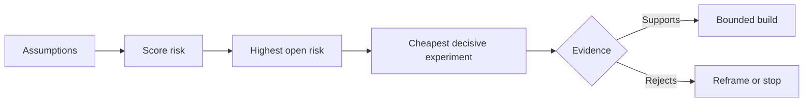

# 绘制假设地图，先解决风险最高的假设

> 路线图把不确定性藏在功能里。假设地图则揭示：在这些功能配得上存在之前，哪些条件必须先成立。

**Type:** Learn + Build
**Languages:** Python (stdlib)
**Prerequisites:** Phase 14 lesson 48
**Time:** ~65 minutes

## 学习目标

- 把拟议的工作转化为明确的假设。
- 分别给影响、不确定性和不可逆性打分。
- 依据风险而非热情来选择下一个实验。
- 用证据和决策取代已经检验过的假设。

## 每次构建都包含赌注

一个事件工具可能依赖以下条件全部成立：

- 告警上下文包含足以识别服务的信息；
- 工程师愿意信任一个并非由自己推导出的建议；
- 期望的响应时间在运营上确实重要；
- 所需数据可以在没有不安全权限的情况下访问；
- 该工作流的出现频率足以证明维护成本是合理的。

这些不是实现任务。它们是构建要有价值、可用、可行且安全的前提条件。

## 假设分类

| 类别 | 问题 |
|---|---|
| 价值 | 结果的重要性足够吗？ |
| 可用性 | 用户能理解并据此行动吗？ |
| 可行性 | 系统能否在可用的数据和约束下产出它？ |
| 可持续性 | 组织能否持续承担成本、归属和运营？ |
| 安全性 | 它失败时会不会带来不可接受的后果？ |

把假设写成可证伪的陈述。「这个功能有用」无法检验。「十位值班工程师中有八位借助只读结果更快地识别出正确的服务」则可以检验。

## 风险不是一个数字

实验室使用三个维度，每个取 1 到 5 分：

- **影响：** 假设为假时造成的损害。
- **不确定性：** 当前证据的薄弱程度。
- **不可逆性：** 在做出承诺之后才学到教训的代价。

示例评分将影响与不确定性相乘，再加上不可逆性。这个公式并非通用。它的目的是迫使团队说明：为什么某个未知项应当先于另一个被解决。



## 设计实验，而不是确认仪式

一个好的测试具备：

- 一个可能为假的断言；
- 一个总体或贴近现实的样本；
- 一个可观察的结果；
- 一个在看到结果之前就定好的阈值；
- 针对通过、失败和模糊证据的下一步决策。

避免那种只能证明团队能把这个想法做出来的测试。

## 可逆性改变顺序

高后果、不可逆的选择需要更早的证据。只读回放可以先于生产集成。临时适配器可以先于数据迁移。经人工批准的建议可以先于自动操作。

构建的形态应当跟随不确定性的形态。

## 构建它

实验室对假设排序，区分已检验与未决的断言，选出风险最高的未决项，并写出 `outputs/assumption-map.json`。

```bash
python3 code/main.py
python3 -m unittest discover code/tests -v
```

改变最高风险假设的证据，观察下一个实验如何随之改变。

## 练习

1. 为一个你想构建的功能写五条假设。
2. 补上一条你的功能清单遗漏的安全假设。
3. 定义一个会让你停止构建的阈值。
4. 用更便宜的决定性测试替换一个大型实验。
5. 比较风险排序与路线图优先级，并解释二者的错位。

## 延伸阅读

- [Barry Boehm, A Spiral Model of Software Development and Enhancement](https://dl.acm.org/doi/10.1145/12944.12948)，介绍一种风险驱动的开发循环：在更深入地承诺之前先解决不确定性。
- [Dardenne, van Lamsweerde, and Fickas, Goal-Directed Requirements Acquisition](https://doi.org/10.1016/0167-6423(93)90021-G)，介绍如何在细化目标的同时暴露障碍和约束。

## 你要保留的内容

保留 `outputs/assumption-map.json`。下一课会用它选出能产生决定性证据的最小切片。
