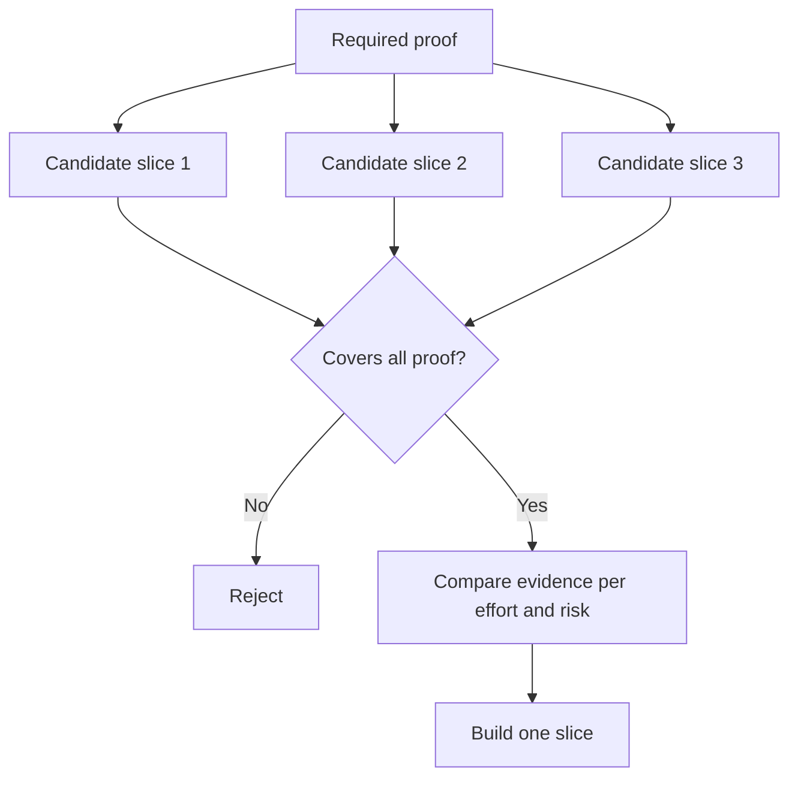

# 选择能改变决策的最小切片

> 小，只有在能证明重要事情时才有用。一个无法改变下一步决策的小构建，仅仅是不完整而已。

**Type:** Learn + Build
**Languages:** Python (stdlib)
**Prerequisites:** Phase 14 lesson 49
**Time:** ~65 minutes

## 学习目标

- 根据切片所证明的假设来定义切片。
- 在结果价值、不确定性削减、投入和后果之间取得平衡。
- 优先选择可逆的证据，而不是过早的生产承诺。
- 拒绝遗漏工作流中高风险部分的切片。

## 纵向意味着端到端的证据

一个有用的切片横跨观察结果所需的最小真实工作流。它可以在用户、数据、时长和能力上收窄。但它不应通过移除你恰恰需要检验的那份不确定性来收窄。

例如：

- 在十起真实事件上做只读回放，检验服务识别与操作员信任。
- 在合成数据上做一个精致的仪表盘，可能检验理解度，但检验不了数据可行性。
- 生产环境的自动修复器会一次性检验所有东西，后果不可接受。

## 先定义所需的证明

取出风险最高的未决假设，把它们转化为一组必需的证明。候选切片只有覆盖这组证明才有资格入选。

然后按以下维度比较合格的切片：

| 维度 | 方向 |
|---|---|
| 结果价值 | 越多越好 |
| 削减的不确定性 | 越多越好 |
| 投入 | 越少越好 |
| 后果 | 越小越好 |
| 可逆性 | 越高越好 |

实验室的评分刻意保持简单。资格门槛比算术更重要。



## 常见的伪最小值

- **只做 UI 的最小值：** 移除了数据和运营层面的不确定性。
- **只做基础设施的最小值：** 证明了技术可行性，却没有用户价值。
- **只走顺利路径的最小值：** 遗漏了制造大部分风险的异常情况。
- **演示版最小值：** 产出一个有说服力的样品，却没有可重复的测量。
- **平台最小值：** 在一个工作流赢得它之前，就构建可复用的机制。

## 加上停止规则

在实现之前，写下切片失败时会发生什么：

- 放弃这个结果；
- 更换目标用户或场景；
- 测试另一种机制；
- 收集更好的证据；
- 进一步收窄权限。

如果任何结果都指向「继续构建」，那这个切片就不是实验。

## 构建它

实验室按必需的证明筛选候选切片，为合格的切片打分，并写出 `outputs/slice-decision.json`。

```bash
python3 code/main.py
python3 -m unittest discover code/tests -v
```

添加一个更便宜的候选切片，它只证明一条必需的假设。即使它的数值评分很高，也应保持不合格。

## 练习

1. 为同一个结果设计三个不同后果层级的切片。
2. 在给它们打分之前先声明所需的证明集。
3. 移除一项能力，同时保留决定性证据。
4. 为一次失败的试点添加停止规则。
5. 找出一个应当等到切片完成之后再做的可复用平台组件。

## 延伸阅读

- [Barry Boehm, A Spiral Model of Software Development and Enhancement](https://dl.acm.org/doi/10.1145/12944.12948)，介绍如何让每个开发循环与它必须解决的风险相匹配。
- [Lenarduzzi and Taibi, MVP Explained: A Systematic Mapping Study on the Definitions of Minimal Viable Product](https://arxiv.org/abs/1609.07592)，介绍软件产品实践中「最小」与「可行」两个词周围的模糊性。

## 你要保留的内容

保留 `outputs/slice-decision.json`。它记录了这个切片为什么是能改变决策的最小切片。
