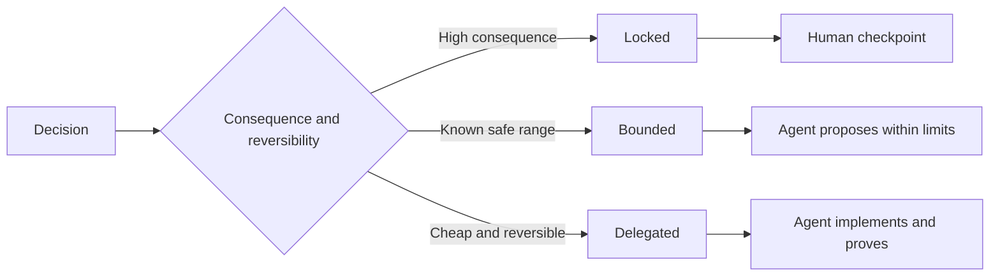

# 编写保留判断力的规格说明

> 有用的规格说明固定不变量和证据，同时让可逆的实现选择保持开放。它是一条决策边界，不是剧本。

**Type:** Learn + Build
**Languages:** Python (stdlib)
**Prerequisites:** Phase 14 lesson 50
**Time:** ~75 minutes

## 学习目标

- 区分结果、不变量、示例、非目标和证明。
- 把决策标记为锁定、有界或委派。
- 在选择代价低且可逆的地方，保留 Agent 的判断力。
- 在后果或公开行为发生变化的地方，要求人工 checkpoint。

## 两个糟糕的极端

规格不足的任务让 Agent 去猜系统。规格过度的任务则让它誊写一份可能已经错误的设计。

有用的中间地带是一份可执行契约：

| 层面 | 目的 |
|---|---|
| 结果 | 可观察的结果 |
| 不变量 | 必须始终成立的条件 |
| 示例 | 揭示意图的具体案例 |
| 非目标 | 有意排除的相邻行为 |
| 决策策略 | 哪些选择是锁定、有界或委派的 |
| 证明 | 完成之前所需的证据 |

## 三种决策模式

- **锁定：** Agent 不得选择。适用于公开兼容性、权限、安全、不可逆成本或产品承诺。
- **有界：** Agent 可以在明确限度内选择。适用于搜索预算、重试次数、允许的依赖或已知的接口族。
- **委派：** Agent 拥有该选择，并且必须解释它。适用于局部结构、命名、可逆重构和实现细节。



## 用示例说明行为

示例比形容词更能压缩意图。「有帮助」「稳健」「生产就绪」都不是可执行的。一组数量不多的正常、边界、失败和禁止示例，能为构建者和验证者提供具体依据。

示例不能替代不变量。一个通过的案例无法证明一条通用的安全规则。

## 证明必须与断言匹配

- 单元测试证明局部的函数契约。
- 线上报文测试证明序列化与传输行为。
- 浏览器走查证明一条界面路径。
- 回放集证明系统在代表性案例上的行为。
- 审计日志证明权限边界得到了遵守。

不要用较低层次的证明来支撑较高层次的断言。

## 有意保留未知项

规格说明可以写「实现可以选择任何在时间预算内返回的只读数据源」。这不是含糊。这是一个有边界、有证明的有意委派决策。

证据变化时，规格说明应当随之演进。保留锁定和有界选择背后的理由，好让后来的团队不必做考古就能修订它们。

## 构建它

实验室验证每一个契约层面，检查决策模式，并写出 `outputs/executable-specification.json`。

```bash
python3 code/main.py
python3 -m unittest discover code/tests -v
```

把生产写入决策从锁定改为委派。解释为什么 schema 接受这个取值，但产品风险不接受。

## 练习

1. 把一张待办工单转化为六个规格层面。
2. 用一条不变量和两个示例替换三条实现指令。
3. 标记每一个决策，并为每个锁定或有界选择给出理由。
4. 为每条不变量添加一份证明凭据。
5. 删除一条没有证据或风险依据的约束。

## 延伸阅读

- [Nuseibeh and Easterbrook, Requirements Engineering: A Roadmap](https://www.cs.toronto.edu/~sme/papers/2000/ICSE2000.pdf)，介绍目标、精确规格、验证、共识与演进之间的关系。
- [Zave and Jackson, Four Dark Corners of Requirements Engineering](https://doi.org/10.1145/237432.237434)，介绍如何区分环境假设、需求和规格说明。
- [Gotel and Finkelstein, An Analysis of the Requirements Traceability Problem](https://doi.org/10.1109/ICRE.1994.292398)，介绍如何保留一条需求为何存在、从何而来。

## 你要保留的内容

保留 `outputs/executable-specification.json`。它将成为编码 Agent 与人工评审者共享的契约。
