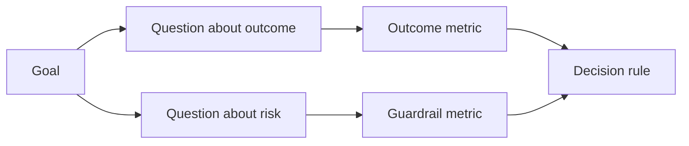

# 在结果出现之前设计成功指标

> 测量应当回答一个决策，而不是装饰仪表盘。从目标出发，推导问题，再选择能回答这些问题的最小指标集。

**Type:** Learn + Build
**Languages:** Python (stdlib)
**Prerequisites:** Phase 14 lessons 47 and 51
**Time:** ~70 minutes

## 学习目标

- 从一个结果目标推导问题和指标。
- 在观察结果之前定义阈值、窗口、来源和方向。
- 将结果指标与防护栏指标和反向指标配对。
- 让评估证据与构建必须支撑的决策相匹配。

## 目标、问题、指标

从一个目标开始：

> 在不增加不安全操作的前提下，缩短识别受影响服务所需的时间。

推导问题：

- 正确的服务被识别得有多快？
- 被识别出的服务多久是正确的？
- 诊断是否保持只读？
- 该工作流是否增加了告警忽略率或操作员负担？

然后选择能把这些问题操作化的指标。



## 指标需要一份契约

每个指标都需要：

| 字段 | 示例 |
|---|---|
| 名称 | `median_identification_seconds` |
| 方向 | 至多 |
| 阈值 | 120 |
| 窗口 | 十次事件回放 |
| 来源 | 回放事件日志 |
| 总体 | 试点中的值班工程师 |
| 类型 | 结果指标或防护栏指标 |

没有来源和窗口，一个数字就无法复现。没有阈值，它就无法推动决策。

## 结果指标、防护栏与反向指标

- **结果指标：** 期望的状态改善了吗？
- **防护栏：** 某个固定约束是否仍然成立？
- **反向指标：** 局部改善是否把成本或危害转移到了别处？

对事件处理工作流而言，速度还不够。正确性、生产写入、操作员负担和漏报告警，用来防止一个快但不安全的结果。

## 离线与线上证据

离线回放有利于可重复性和边界情况覆盖。有界试点有利于观察真实行为、信任和工作流影响。二者不能相互替代。

使用能回答当前决策的最便宜证据。不要仅仅因为实现已经就绪，就把真实用户暴露出来。

## 先决策，再测量

在看到结果之前写下通过、失败和模糊三条路径。否则团队会调整阈值来保护这个构建。

例如：

- 通过：正确服务识别率至少 0.9，且中位时间至多 120 秒；
- 失败：出现任何生产写入，或正确率低于 0.75；
- 模糊：有小幅改善但方差很大，需要更大的回放集。

## 构建它

实验室验证测量计划，按包含边界的阈值进行评估，记录缺失值，并写出 `outputs/measurement-report.json`。

```bash
python3 code/main.py
python3 -m unittest discover code/tests -v
```

移除防护栏指标，观察为什么即使结果指标仍然存在，整个计划也会失效。

## 练习

1. 从一个结果目标推导三个问题。
2. 添加一个反向指标，捕捉转移到其他角色身上的成本。
3. 为每个指标定义来源、总体和窗口。
4. 在生成数值之前写下通过、失败和模糊三种决策。
5. 找出一个容易收集但无法改变决策的指标。删掉它。

## 延伸阅读

- [Basili, Software Modeling and Measurement: The Goal/Question/Metric Paradigm](https://drum.lib.umd.edu/items/8119803a-362b-42ec-b6ce-2311713e7236)，介绍如何从明确的目标推导可操作的测量。
- [Basili, Caldiera, and Rombach, The Goal Question Metric Approach](https://www.cs.toronto.edu/~sme/CSC444F/handouts/GQM-paper.pdf)，介绍如何把该方法用作反馈与改进系统。

## 你要保留的内容

保留 `outputs/measurement-report.json`。它为原型、试点或生产阶段定义了证据门槛。
