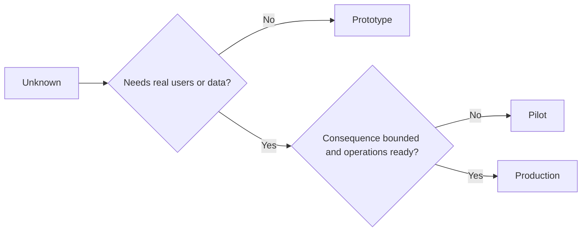

# 有意识地选择原型、试点或生产

> 这些是不同的学习环境，不是打磨程度的不同档位。选择那个能用最少的不必要后果回答当前未知项的阶段。

**Type:** Learn + Build
**Languages:** Python (stdlib)
**Prerequisites:** Phase 14 lessons 50 to 52
**Time:** ~70 minutes

## 学习目标

- 根据未知项、受众、数据、后果和就绪度选择构建阶段。
- 定义各阶段特有的控制措施和退出标准。
- 防止原型悄悄变成生产系统。
- 在证据和运营能力足以支撑之前，推迟真实权限。

## 三个不同的问题

| 阶段 | 首要问题 |
|---|---|
| 原型 | 这个机制究竟能否产出证据？ |
| 试点 | 它能否在有界的真实受众和真实条件下安全运行？ |
| 生产 | 我们能否按承诺的可靠性和风险水平持续地拥有它？ |

原型可以在技术上是完整的，却仍然是一次性的。试点可以使用生产数据，同时在受众和权限上保持受限。当组织接受持续责任时，生产就开始了。

## 原型

当未知项不需要真实用户或真实数据时，使用原型。让它保持：

- 可丢弃；
- 隔离；
- 行为范围窄；
- 明确说明要学习的问题；
- 不带有虚假的运营保证。

在机制赢得下一个阶段之前，不要优化架构。

## 试点

当未知项需要真实行为、贴近现实的数据或真实工作流，但后果或就绪度尚不适合广泛发布时，使用试点。

试点需要：

- 明确的受众；
- 一位人类负责人；
- 有界的时长和权限；
- 审计与回滚；
- 结果指标和防护栏阈值；
- 用于扩大、修订或停止的退出标准。

## 生产

生产需要的不仅仅是部署：

- 服务级别目标；
- 值班与事件归属；
- 安全与隐私审查；
- 成本与容量控制；
- 回滚与恢复；
- 持续监控；
- 退役路径。



## 阶段漂移

当原型代码获得了用户、数据或权限，却没有获得归属时，它就变得危险。要在配置、访问控制、遥测和文档中标记原型与试点的边界。仅仅挂一条警告横幅是不够的。

阶段应当能从系统本身观察出来。

## 构建它

实验室根据决策上下文选择阶段，返回所需的控制措施，并写出 `outputs/stage-decisions.json`。

```bash
python3 code/main.py
python3 -m unittest discover code/tests -v
```

把试点示例改为低后果且运营就绪的情形。解释还需要哪些额外证据，才能证明进入生产是合理的。

## 练习

1. 按学习阶段而非部署状态，对三个当前项目分类。
2. 写出包含停止决策的试点退出标准。
3. 添加一项技术控制，阻止原型接触生产数据。
4. 找出使构建成为生产的第一项运营责任。
5. 为有界试点设计一份回滚凭据。

## 延伸阅读

- [Barry Boehm, A Spiral Model of Software Development and Enhancement](https://dl.acm.org/doi/10.1145/12944.12948)，介绍如何让每一轮迭代的承诺与已解决的风险相匹配。
- [Fagerholm et al., Building Blocks for Continuous Experimentation](https://doi.org/10.1145/2601248.2601276)，介绍持续运行实验所需的组织和技术条件。

## 你要保留的内容

保留 `outputs/stage-decisions.json`。它记录每个阶段为何成立，以及进入下一阶段之前必须存在哪些控制措施。
