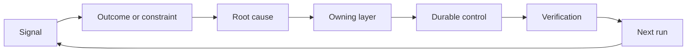

# 构建带归属与退役机制的反馈棘轮

> 交付关闭了一个构建循环，同时打开了学习循环。证据必须改变系统，否则它就会变成无人拥有的遥测数据。

**Type:** Learn + Build
**Languages:** Python (stdlib)
**Prerequisites:** Phase 14 lessons 46 and 53
**Time:** ~75 minutes

## 学习目标

- 将事件、评估、用户行为和纠正转化为有归属的行动。
- 把每一条信号路由到上下文、评估、策略、运行时或待办列表。
- 按严重性和频率对复发进行优先级排序。
- 为每一项控制措施设定退役条件。
- 用证据、权衡和明确的负责人来沟通交付决策。

## 反馈是基础设施

团队可以收集 trace、评估、支持工单和事件日志，却从中什么也学不到。缺失的机制是提升：一条从观察到持久变更的明确路径，并且带有归属人和证明。

循环如下：

1. 观察一个具体信号；
2. 将它连接到某个结果、约束或假设；
3. 找出拥有该原因的最早系统层次；
4. 创建一项有界变更；
5. 验证复发变得更不可能；
6. 复查该控制措施是否应当保留。

## 路由到拥有该原因的层次

| 信号 | 去向 |
|---|---|
| 误报、回归、错误结果 | 评估或测试 |
| 缺失上下文、重复工作、过期事实 | 上下文来源或检索路径 |
| 不安全操作或权限缺口 | 策略或权限边界 |
| 超时、重试风暴、依赖不可用 | 运行时控制 |
| 新的产品需求或未解决的权衡 | 经过塑形的待办项 |

在最早的有效层次修复原因。当一条测试或一项权限就能让失败不可能发生时，不要再加一段 prompt 说明。



## 归属是控制措施的一部分

每一项棘轮行动都需要：

- 一个负责人；
- 基于后果和复发频率的优先级；
- 要改动的工件；
- 证明改动有效的验证；
- 复查或到期窗口；
- 一个退役条件。

没有归属的改进，只是一条排版更好的观察记录。

## 退役过时的控制措施

反馈系统会积累策略。这些策略可能变得相互矛盾且代价高昂。在以下情况复查控制措施：

- 架构或工作流发生变化；
- 更低层的不变量取代了更高层的指令；
- 受保护的失败在选定窗口内没有出现；
- 该控制措施阻碍合法工作的次数超过它防止危害的次数。

退役同样需要证据。不要因为一项控制措施感觉陈旧就删除它。

## 连接构建与编码 Agent 的反馈

同一套棘轮服务两条轨道：

- 产品证据改变结果框架、假设、切片或测量计划。
- 编码 Agent 的纠正改变测试、上下文、范围、自动化或交接。
- 事件可以同时改变产品边界和 Agent 工作台。

这就是为什么构建塑形不是一个在编码前就结束的阶段。它贯穿每一个被接受的变更。

## 构建它

实验室对信号分类，创建有归属的棘轮行动，为它们排定优先级，并写出 `outputs/feedback-backlog.json`。

```bash
python3 code/main.py
python3 -m unittest discover code/tests -v
```

添加一个运行时超时信号，确认它被路由到运行时，而不是通用待办列表。

## 实践练习：在受挫之后对一项决策负责

从你的职业路线的作品集项目中选一个工作流。让它走完一个决策、一个小实验和一次复查。把证据保存在[职业交付模板](https://github.com/rohitg00/ai-engineering-from-scratch/blob/main/phases/14-agent-engineering/54-build-the-feedback-ratchet/outputs/career-delivery-evidence.md)中。

Python 实验室生成示例待办行动。它不观察用户、不测量干预效果，也不证明职业就绪度。完成它的运行只是这个练习的准备。

### 1. 确认发生了什么

记录用户、任务、当前工作流，以及你想改善的结果。链接一条取得同意的观察记录、一份脱敏的支持记录，或一条可复现的任务 trace。把你直接观察到的内容，与别人报告的内容、以及你推断的内容区分开。

找一次受挫：一个失败的假设、一个不可用的结果、一项意外成本，或一次延迟的交接。解释哪些证据改变了你的理解。受挫需要的是回应和决策，而不是围绕它写出来的成功故事。

如果你无法与用户一起工作，就与同伴或按明确设定的场景运行一次清楚标注的模拟。把模拟观察与真实用户证据分开。不要编造访谈、批准、采用情况或业务影响。

### 2. 在权限范围内推进

列出未知项，选择一项能解决最关键未知项的最便宜可逆行动。说明哪些你能决定、哪些受现有协议约束、哪些在执行前需要授权。

例如，你可以在等待客户数据使用许可期间，先准备一份脱敏的离线回放。主动意味着推进已获授权的工作，并把受阻的决策讲清楚。它不会扩大你的访问权限或审批权限。

### 3. 比较选项并向决策负责人汇报

为不需要了解实现细节的人写一份简短的决策简报。包括：

- 用户问题，以及改变计划的证据；
- 至少两个选项，在可信的情况下包括更便宜的手工或无构建选项；
- 质量、交互设计、投入、运营成本和风险方面的权衡；
- 你的建议、剩余不确定性，以及需要做出的决策；
- 决策负责人、受影响的利益相关者，以及需要决策的日期。

请一位同伴代表受影响的利益相关者，并对一项权衡提出质疑。记录这条反对意见，以及它如何改变——或未能改变——你的建议。把角色扮演反馈标注为模拟；它不能替代真实利益相关者的同意。

### 4. 运行有界实验

根据你需要回答的问题，选择原型、试点或生产工作。在收集结果之前，定义受众、数据、权限、时长、回滚，以及继续、变更或停止的条件。

从用户的起点走到任务完成，完整走查这次交互。包含一个错误输出或数据缺失的案例。观察用户能否在你没有暗中帮助的情况下察觉失败、纠正它并恢复。

把人工复查和纠正的时间计入工作流。模型响应更快，仍可能让完整任务变慢或更难信任。

### 5. 比较结果与经济性

使用相同的指标定义、任务总体、收集方法和可比的观察窗口，记录基线与跟进结果。在数字旁边保留样本量、排除项和证据链接。如果这些条件发生变化，解释比较为何受限。

包含一个用户结果、一项质量或安全防护栏，以及总的人工复查投入。即使结果未达目标，也要记录。小样本或模拟样本只支持有界的学习结论，而不是已证实业务影响的结论。

用模型调用、重试、支撑服务和人工复查来估算每个成功完成任务的成本。说明人工费率的假设，并把实测用量与估算分开。把该成本与手工替代方案或项目背后的价值假设相比较。

使用现有的 [LLM 的 FinOps 课程](https://aiengineeringfromscratch.com/lesson?path=phases/17-infrastructure-and-production/27-finops-llms)来深化归因和单位经济性分析。更换模型只是可能的应对之一；收窄工作流或保留一个手工步骤，可能是更好的产品决策。

### 6. 闭环

使用预先声明的标准来建议继续、变更或停止。如果证据无法定论，指出缺失的观察和下一个有界测试。记录承担责任的决策负责人的回应；如果尚未做出决策，就保持待定状态。

选择一项对交付流程本身的改进：更清晰的任务框架、更早的用户走查、更好的复查清单、更小的 Agent 交接，或更严格的评估用例。为它指定负责人和复查日期。

复查时，决定保留、修订还是退役这项改进。记录选择的证据。一份新清单如果只会制造更多工作，却不能防止目标失败，就还没有赢得长期保留的资格。

## 交付工件

把 [career-delivery-evidence.md](https://github.com/rohitg00/ai-engineering-from-scratch/blob/main/phases/14-agent-engineering/54-build-the-feedback-ratchet/outputs/career-delivery-evidence.md) 复制到你自己的项目中，用证据链接把它填完。保持仓库中的模板可复用。把决策简报、交互走查、测量比较和有归属的跟进，一并纳入你的职业作品集工件。

## 验证它

与一位同伴一起使用这份人工验收量规。将每一行标记为**满足**、**需要改进**或**未观察到**，并给出证据链接或具体缺失的观察。字段填满并不证明判断本身是可靠的。

| 检查项 | 满足它的证据 |
|---|---|
| 工作流有据可依 | 一条可追溯的观察支撑该问题；报告的说法、推断和模拟都已标注。 |
| 权限得到遵守 | 可逆的下一步工作清楚，任何受限行动都在等待其真正的决策负责人。 |
| 权衡已沟通 | 记录了可信的替代方案、利益相关者的反对意见、建议和明确的决策请求。 |
| 交互已测试 | 走查覆盖成功、失败、恢复和人工复查投入。 |
| 结果已比较 | 基线与跟进的定义一致；样本、防护栏、成本和比较限制都可见。 |
| 受挫有归属 | 证据改变了继续/变更/停止的决策，并对应一个有归属的下一步行动。 |
| 流程已改进 | 有一项工作流改进具备负责人、复查日期，以及基于证据的保留/修订/退役决策。 |

即使每一步模拟都通过，未观察到的真实用户行为仍然是一处空白。在作品集的陈述中保留这条边界，并指出缩小它的下一步观察。

## 练习

1. 把一起事件和一条用户投诉转化为棘轮行动。
2. 指出能防止每种复发的最早层次。
3. 为实验室输出添加验证命令或观察项。
4. 为一条策略规则定义退役条件。
5. 把一条被接受的纠正回溯到下一个任务框架中。

## 延伸阅读

- [Basili, Caldiera, and Rombach, The Goal Question Metric Approach](https://www.cs.toronto.edu/~sme/CSC444F/handouts/GQM-paper.pdf)，介绍如何通过目标导向的测量实现组织学习。
- [Fagerholm et al., Building Blocks for Continuous Experimentation](https://doi.org/10.1145/2601248.2601276)，介绍把证据与持续产品开发连接起来的技术和组织循环。
- [Nuseibeh and Easterbrook, Requirements Engineering: A Roadmap](https://www.cs.toronto.edu/~sme/papers/2000/ICSE2000.pdf)，介绍如何把需求视为贯穿系统生命周期不断演进的事物。

## 你要保留的内容

保留 `outputs/feedback-backlog.json` 作为路由示例，保留你完成的职业交付证据作为你自己决策的记录。二者共同为「产品判断与交付」路径收尾，并为下一个结果框架提供输入。
