# 通信协议

> 说不上同一种语言的智能体不是团队，而是一群对着虚空喊话的陌生人。

**Type:** Build
**Languages:** TypeScript
**Prerequisites:** Phase 14 (Agent Engineering), Lesson 16.01 (Why Multi-Agent)
**Time:** ~120 minutes

## 学习目标

- 实现 MCP 工具发现与调用，让智能体能够使用外部服务器暴露的工具
- 构建 A2A 的 Agent Card 和任务端点，让一个智能体可以通过 HTTP 把工作委派给另一个智能体
- 对比 MCP（工具访问）、A2A（智能体到智能体）、ACP（企业审计）与 ANP（去中心化信任），并说明每种协议解决什么问题
- 在同一个系统中把多种协议串联起来：智能体通过 MCP 发现工具，通过 A2A 委派任务

## 问题

你把系统拆成了多个智能体：研究员、程序员、审查员。它们各自擅长自己的工作。但现在你需要让它们真正互相沟通。

第一次尝试很明显：传字符串。研究员返回一大段文本，程序员尽其所能地解析。直到程序员误解了一份研究摘要，或者两个智能体互相等待而死锁，或者你需要让不同团队构建的智能体协作，这套做法就崩溃了。突然之间，「传字符串就行」不成立了。

这就是通信协议问题。如果没有一套共享约定来规定智能体如何交换信息，多智能体系统就会脆弱、不可审计，并且无法扩展到你自己写的那几个智能体之外。

AI 生态给出了四个协议，各解决这个问题的一个侧面：

- **MCP** 用于工具访问
- **A2A** 用于智能体之间的协作
- **ACP** 用于企业级可审计性
- **ANP** 用于去中心化身份与信任

这一课讲得很深。你会读到每个规范中真实的线上格式，构建可运行的实现，并把四者连接成一个统一系统。

## 概念

### 协议全景

把这四个协议看作分层结构，每一层回答一个不同的问题：

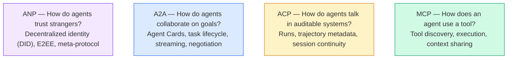

它们不是竞争对手，而是在不同层面解决不同的问题。

### MCP（回顾）

MCP 在 Phase 13 中有深入讲解。这里快速回顾：MCP 标准化了 LLM 如何连接外部工具和数据源。它是一个**客户端-服务器**协议，智能体（客户端）发现并调用服务器暴露的工具。

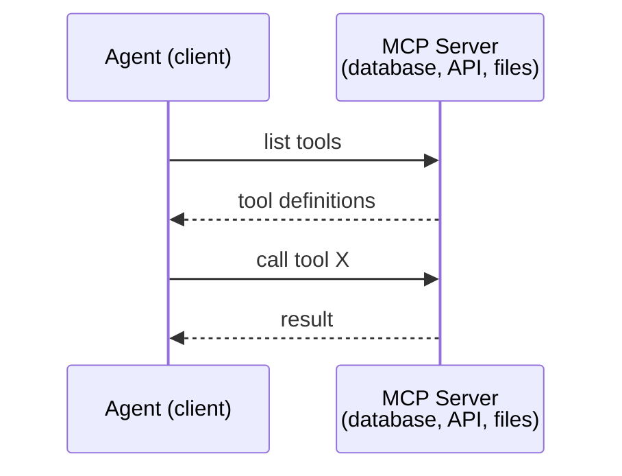

MCP 是**智能体到工具**的通信。它不负责智能体之间的对话。

### A2A（Agent2Agent 协议）

**创建方：** Google（现由 Linux Foundation 托管，标识为 `lf.a2a.v1`）
**规范版本：** 1.0.1
**问题：** 自主智能体之间如何协作、协商，并互相委派任务？

A2A 是**点对点智能体协作**协议。MCP 把智能体连接到工具，A2A 则把智能体连接到其他智能体。每个智能体在众所周知的 URL 上发布一份 **Agent Card**，其他智能体据此发现它、与它协商，并向它委派任务。

#### A2A 如何运作

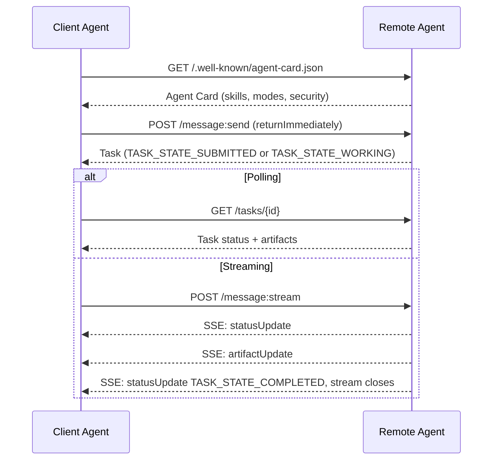

#### 真实的 Agent Card

这是 A2A Agent Card 在真实世界中的样子，由 `GET /.well-known/agent-card.json` 提供：

```json
{
  "name": "Research Agent",
  "description": "Searches documentation and summarizes findings",
  "version": "1.0.0",
  "supportedInterfaces": [
    {
      "url": "https://research-agent.example.com/a2a/v1",
      "protocolBinding": "JSONRPC",
      "protocolVersion": "1.0"
    },
    {
      "url": "https://research-agent.example.com/a2a/rest",
      "protocolBinding": "HTTP+JSON",
      "protocolVersion": "1.0"
    }
  ],
  "provider": {
    "organization": "Your Company",
    "url": "https://example.com"
  },
  "capabilities": {
    "streaming": true,
    "pushNotifications": false
  },
  "defaultInputModes": ["text/plain", "application/json"],
  "defaultOutputModes": ["text/plain", "application/json"],
  "skills": [
    {
      "id": "web-research",
      "name": "Web Research",
      "description": "Searches the web and synthesizes findings",
      "tags": ["research", "search", "summarization"],
      "examples": ["Research the latest changes in React 19"]
    },
    {
      "id": "doc-analysis",
      "name": "Documentation Analysis",
      "description": "Reads and analyzes technical documentation",
      "tags": ["docs", "analysis"],
      "inputModes": ["text/plain", "application/pdf"],
      "outputModes": ["application/json"]
    }
  ],
  "securitySchemes": {
    "bearer": {
      "httpAuthSecurityScheme": {
        "scheme": "Bearer",
        "bearerFormat": "JWT"
      }
    }
  },
  "securityRequirements": [{ "schemes": { "bearer": { "list": [] } } }]
}
```

需要注意的关键点：

- **Skills** 是智能体能做的事情。每个 skill 都有 ID、标签，以及支持的输入/输出 MIME 类型。客户端智能体据此决定这个远程智能体能否处理自己的请求。
- **supportedInterfaces** 列出了多个协议绑定。单个智能体可以同时使用 JSON-RPC、REST 和 gRPC。
- **安全**内建在卡片中：`securitySchemes` 为每种方案命名，`securityRequirements` 说明适用哪些方案。客户端在发出第一个请求之前就知道需要什么认证。

#### 任务生命周期

任务是 A2A 的核心工作单元。它们会在已定义的状态之间流转（图中省略了每个状态在线上格式里都带的 `TASK_STATE_` 前缀）：

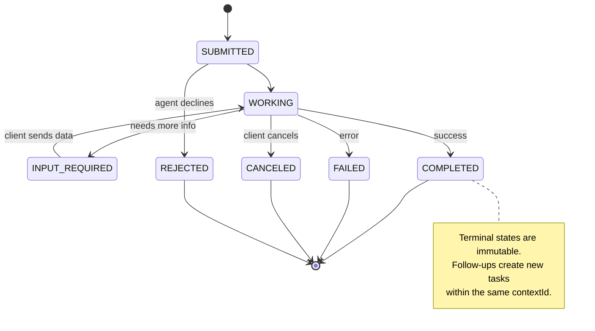

全部 8 个状态（规范还定义了 `UNSPECIFIED` 作为哨兵值，这里省略）：

| 状态 | 终止态？ | 含义 |
|---|---|---|
| `TASK_STATE_SUBMITTED` | 否 | 已确认，尚未处理 |
| `TASK_STATE_WORKING` | 否 | 正在处理 |
| `TASK_STATE_INPUT_REQUIRED` | 否 | 智能体需要客户端提供更多信息 |
| `TASK_STATE_AUTH_REQUIRED` | 否 | 需要认证 |
| `TASK_STATE_COMPLETED` | 是 | 成功完成 |
| `TASK_STATE_FAILED` | 是 | 因错误结束 |
| `TASK_STATE_CANCELED` | 是 | 完成前被取消 |
| `TASK_STATE_REJECTED` | 是 | 智能体拒绝该任务 |

任务一旦进入终止态就不可更改，不会再有更多消息。后续操作会在同一个 `contextId` 下创建新任务。

#### 线上格式

A2A 使用 JSON-RPC 2.0。下面是一次真实的消息交换：

**客户端发送消息：**
```json
{
  "jsonrpc": "2.0",
  "id": 1,
  "method": "SendMessage",
  "params": {
    "message": {
      "messageId": "msg-001",
      "role": "ROLE_USER",
      "parts": [{ "text": "Research React 19 compiler features" }]
    },
    "configuration": {
      "acceptedOutputModes": ["text/plain", "application/json"],
      "historyLength": 10
    }
  }
}
```

**智能体以任务响应：**
```json
{
  "jsonrpc": "2.0",
  "id": 1,
  "result": {
    "task": {
      "id": "task-abc-123",
      "contextId": "ctx-xyz-789",
      "status": {
        "state": "TASK_STATE_COMPLETED",
        "timestamp": "2026-03-27T10:30:00Z"
      },
      "artifacts": [
        {
          "artifactId": "art-001",
          "name": "research-results",
          "parts": [{
            "data": {
              "findings": [
                "React 19 compiler auto-memoizes components",
                "No more manual useMemo/useCallback needed",
                "Compiler runs at build time, not runtime"
              ]
            },
            "mediaType": "application/json"
          }]
        }
      ]
    }
  }
}
```

**通过 SSE 流式传输：**
```text
POST /message:stream HTTP/1.1
Content-Type: application/a2a+json
A2A-Version: 1.0

data: {"task":{"id":"task-123","contextId":"ctx-123","status":{"state":"TASK_STATE_WORKING"}}}

data: {"statusUpdate":{"taskId":"task-123","contextId":"ctx-123","status":{"state":"TASK_STATE_WORKING","message":{"messageId":"msg-002","role":"ROLE_AGENT","parts":[{"text":"Searching documentation..."}]}}}}

data: {"artifactUpdate":{"taskId":"task-123","contextId":"ctx-123","artifact":{"artifactId":"art-1","parts":[{"text":"partial findings..."}]},"append":true,"lastChunk":false}}

data: {"statusUpdate":{"taskId":"task-123","contextId":"ctx-123","status":{"state":"TASK_STATE_COMPLETED"}}}
```

### ACP（Agent Communication Protocol）

**创建方：** IBM / BeeAI
**规范版本：** 0.2.0（OpenAPI 3.1.1）
**状态：** 正在 Linux Foundation 下并入 A2A
**问题：** 智能体如何在进行通信时具备完整的可审计性、会话连续性和轨迹追踪？

ACP 是**企业协议**。与许多摘要文章的说法不同，ACP 并不使用 JSON-LD。它是一个通过 OpenAPI 定义的直白 REST/JSON API。它的特别之处在于 **TrajectoryMetadata**：每条智能体响应都可以携带生成该响应所经历的推理步骤和工具调用的详细日志。

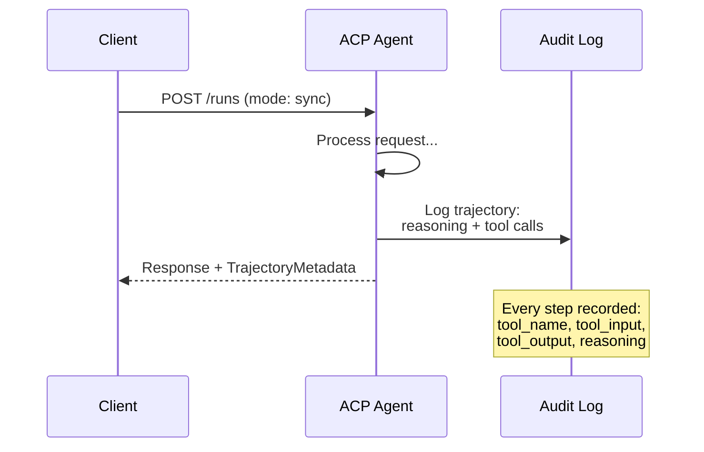

#### ACP 中的智能体发现

ACP 定义了四种发现方式：

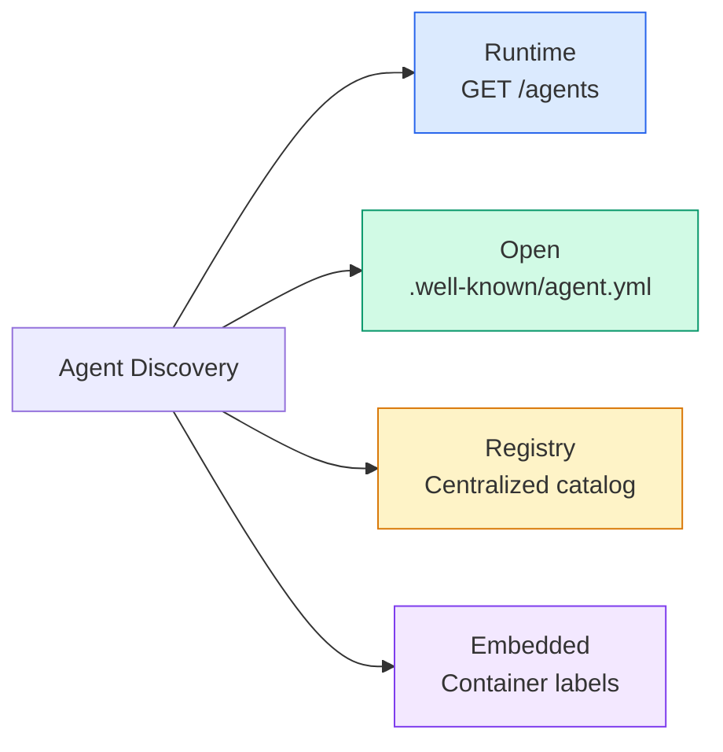

**AgentManifest** 比 A2A 的 Agent Card 更简单：

```json
{
  "name": "summarizer",
  "description": "Summarizes documents with source citations",
  "input_content_types": ["text/plain", "application/pdf"],
  "output_content_types": ["text/plain", "application/json"],
  "metadata": {
    "tags": ["summarization", "RAG"],
    "framework": "BeeAI",
    "capabilities": [
      {
        "name": "Document Summarization",
        "description": "Condenses long documents into key points"
      }
    ],
    "recommended_models": ["llama3.3:70b-instruct-fp16"],
    "license": "Apache-2.0",
    "programming_language": "Python"
  }
}
```

#### Run 生命周期

ACP 使用 "Run" 而不是 "Task"。一次 Run 是一次智能体执行，有三种模式：

| 模式 | 行为 |
|---|---|
| `sync` | 阻塞式。响应包含完整结果。 |
| `async` | 立即返回 202。通过 `GET /runs/{id}` 轮询状态。 |
| `stream` | SSE 流。智能体工作过程中持续推送事件。 |

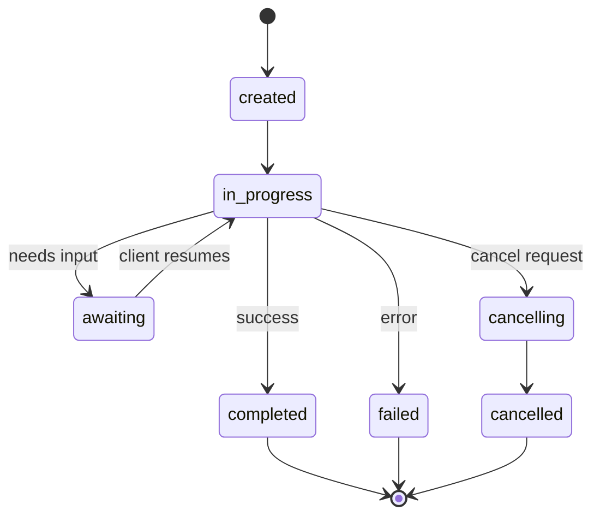

#### TrajectoryMetadata（审计轨迹）

这是 ACP 的关键差异点。消息的每个 part 都可以附带元数据，准确展示智能体做了什么：

```json
{
  "role": "agent/researcher",
  "parts": [
    {
      "content_type": "text/plain",
      "content": "The weather in San Francisco is 72F and sunny.",
      "metadata": {
        "kind": "trajectory",
        "message": "I need to check the weather for this location",
        "tool_name": "weather_api",
        "tool_input": { "location": "San Francisco, CA" },
        "tool_output": { "temperature": 72, "condition": "sunny" }
      }
    }
  ]
}
```

对受监管行业来说，这非常有价值。每个答案都附带一条可证明的推理链：调用了哪些工具、使用了什么输入、收到了什么输出。没有黑箱。

ACP 还支持用于来源署名的 **CitationMetadata**：

```json
{
  "kind": "citation",
  "start_index": 0,
  "end_index": 47,
  "url": "https://weather.gov/sf",
  "title": "NWS San Francisco Forecast"
}
```

### ANP（Agent Network Protocol）

**创建方：** 开源社区（由 GaoWei Chang 发起）
**仓库：** [github.com/agent-network-protocol/AgentNetworkProtocol](https://github.com/agent-network-protocol/AgentNetworkProtocol)
**问题：** 来自不同组织的智能体如何在没有中心权威的情况下互相信任？

ANP 是**去中心化身份协议**。它用 W3C 去中心化标识符（DID）和端到端加密来建立信任。A2A 通过已知端点发现智能体，而 ANP 让智能体能够以密码学方式证明自己的身份。

ANP 有三层：

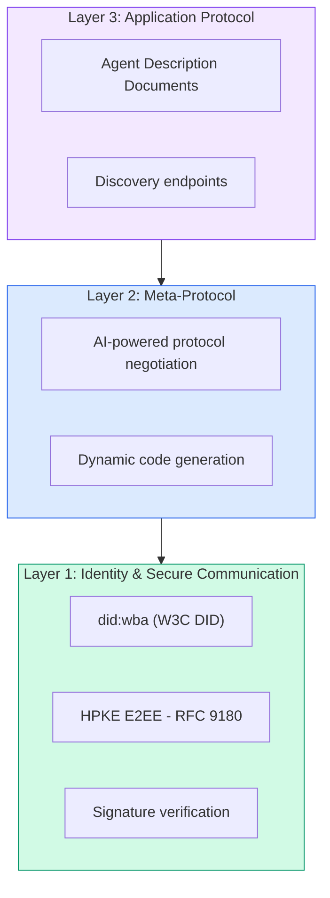

#### DID 文档（真实结构）

ANP 使用一种名为 `did:wba`（Web-Based Agent）的自定义 DID 方法。DID `did:wba:example.com:user:alice` 会解析到 `https://example.com/user/alice/did.json`：

```json
{
  "@context": [
    "https://www.w3.org/ns/did/v1",
    "https://w3id.org/security/suites/jws-2020/v1",
    "https://w3id.org/security/suites/secp256k1-2019/v1"
  ],
  "id": "did:wba:example.com:user:alice",
  "verificationMethod": [
    {
      "id": "did:wba:example.com:user:alice#key-1",
      "type": "EcdsaSecp256k1VerificationKey2019",
      "controller": "did:wba:example.com:user:alice",
      "publicKeyJwk": {
        "crv": "secp256k1",
        "x": "NtngWpJUr-rlNNbs0u-Aa8e16OwSJu6UiFf0Rdo1oJ4",
        "y": "qN1jKupJlFsPFc1UkWinqljv4YE0mq_Ickwnjgasvmo",
        "kty": "EC"
      }
    },
    {
      "id": "did:wba:example.com:user:alice#key-x25519-1",
      "type": "X25519KeyAgreementKey2019",
      "controller": "did:wba:example.com:user:alice",
      "publicKeyMultibase": "z9hFgmPVfmBZwRvFEyniQDBkz9LmV7gDEqytWyGZLmDXE"
    }
  ],
  "authentication": [
    "did:wba:example.com:user:alice#key-1"
  ],
  "keyAgreement": [
    "did:wba:example.com:user:alice#key-x25519-1"
  ],
  "humanAuthorization": [
    "did:wba:example.com:user:alice#key-1"
  ],
  "service": [
    {
      "id": "did:wba:example.com:user:alice#agent-description",
      "type": "AgentDescription",
      "serviceEndpoint": "https://example.com/agents/alice/ad.json"
    }
  ]
}
```

需要注意的关键点：

- **密钥分离**是被强制要求的。签名密钥（secp256k1）与加密密钥（X25519）相互独立。
- **`humanAuthorization`** 是 ANP 独有的。这些密钥在使用前需要显式的人工批准（生物识别、密码、HSM）。资金转账这类高风险操作会走这条路径。
- **`keyAgreement`** 密钥用于 HPKE 端到端加密（RFC 9180）。
- **service** 部分链接到 Agent Description 文档。

#### ANP 中的信任机制

ANP **不**使用信任网络或背书图。信任是双向的，并在每次交互中验证：

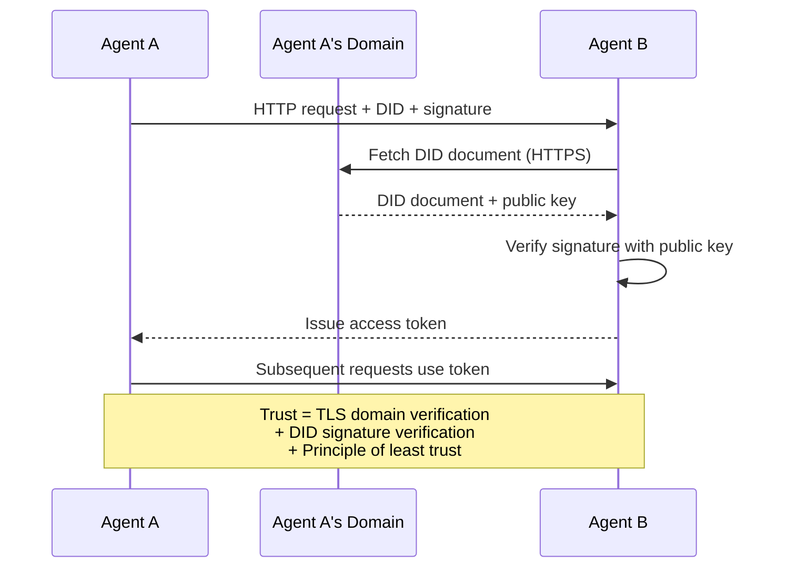

信任来自三个来源：

1. **域名级 TLS** 验证 DID 文档的主机
2. **DID 密码学签名**验证智能体身份
3. **最小信任原则**只授予最低权限

这里没有基于流言的信任传播，也没有 PageRank 打分。你直接通过 DID 验证每一个智能体。

#### 元协议协商

这是 ANP 最新颖的特性。当来自不同生态的两个智能体相遇时，它们不需要预先约定数据格式，而是用自然语言协商：

```json
{
  "action": "protocolNegotiation",
  "sequenceId": 0,
  "candidateProtocols": "I can communicate using:\n1. JSON-RPC with hotel booking schema\n2. REST with OpenAPI 3.1 spec\n3. Natural language over HTTP",
  "modificationSummary": "Initial proposal",
  "status": "negotiating"
}
```

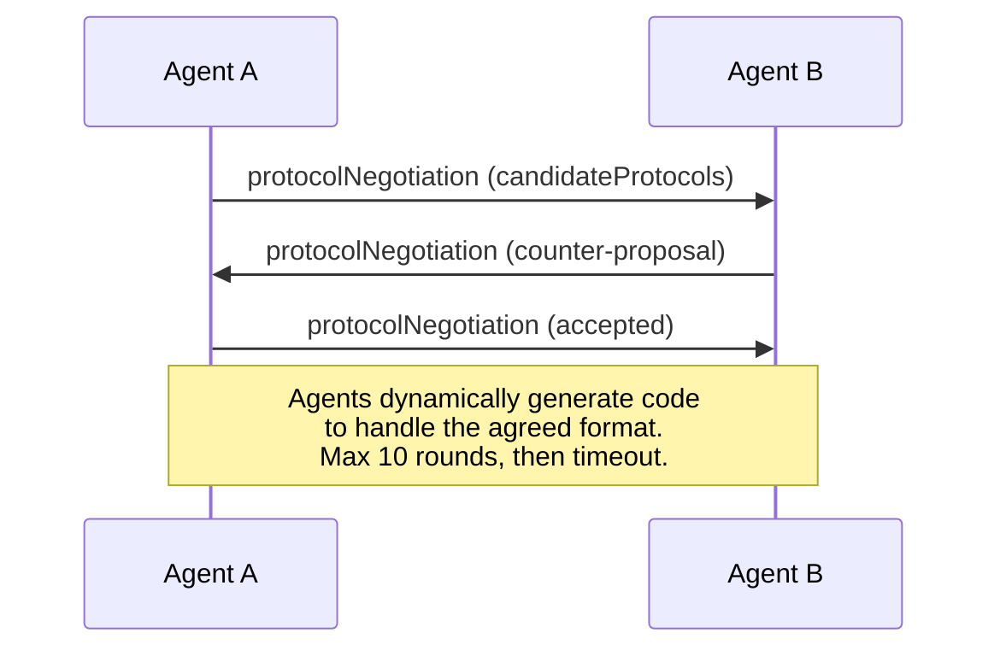

智能体来回协商（最多 10 轮）直到就格式达成一致，然后动态生成代码来处理该格式。状态值包括：`negotiating`、`rejected`、`accepted`、`timeout`。

这意味着两个从未见过彼此的智能体也能找到通信方式，无需任何人预先定义共享 schema。

### 对比（修正版）

| | MCP | A2A | ACP | ANP |
|---|---|---|---|---|
| **创建方** | Anthropic | Google / Linux Foundation | IBM / BeeAI | 社区 |
| **规范格式** | JSON-RPC | JSON-RPC / REST / gRPC | OpenAPI 3.1（REST） | JSON-RPC |
| **主要用途** | 智能体到工具 | 智能体到智能体 | 智能体到智能体 | 智能体到智能体 |
| **发现机制** | 工具列表 | `/.well-known/agent-card.json` | `GET /agents`、`/.well-known/agent.yml` | `/.well-known/agent-descriptions`、DID 服务端点 |
| **身份** | 隐式（本地） | 安全方案（OAuth、mTLS） | 服务端级 | W3C DID（`did:wba`），配合 E2EE |
| **审计轨迹** | 不适用 | 基础（任务历史） | TrajectoryMetadata（工具调用、推理） | 未正式规定 |
| **状态机** | 不适用 | 9 个任务状态 | 7 个 run 状态 | 不适用 |
| **流式** | 不适用 | SSE | SSE | 与传输无关 |
| **独特能力** | 工具 schema | Agent Card + Skills | 轨迹审计 | 元协议协商 |
| **最适合** | 工具与数据 | 动态协作 | 受监管行业 | 跨组织信任 |
| **状态** | 稳定 | 稳定（v1.0） | 正在并入 A2A | 活跃开发中 |

### 它们如何协同工作

这些协议并不互斥。一个真实的企业系统会同时使用多个：

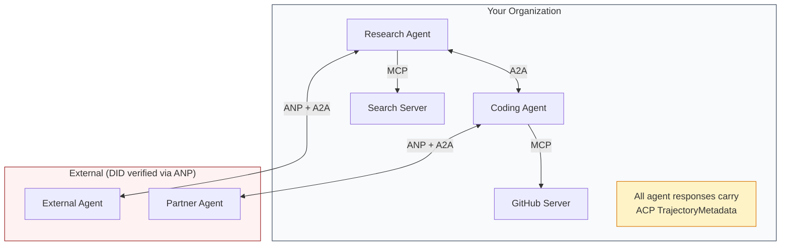

- **MCP** 把每个智能体连接到它的工具
- **A2A** 处理智能体之间的协作（内部与外部）
- **ACP** 用轨迹元数据包装响应，实现可审计性
- **ANP** 为你无法控制的智能体提供身份验证

```figure
swarm-message-bus
```

## 构建它

### 第 1 步：核心消息类型

每个多智能体系统都从消息格式开始。我们定义的类型对应真实协议中使用的内容：

```typescript
import crypto from "node:crypto";

type MessageRole = "ROLE_USER" | "ROLE_AGENT";

type MessagePart =
  | { text: string }
  | { data: unknown; mediaType: string }
  | { url: string; filename: string; mediaType: string };

type TrajectoryEntry = {
  reasoning: string;
  toolName?: string;
  toolInput?: unknown;
  toolOutput?: unknown;
  timestamp: number;
};

type AgentMessage = {
  id: string;
  role: MessageRole;
  parts: MessagePart[];
  trajectory?: TrajectoryEntry[];
  replyTo?: string;
  timestamp: number;
};

function createMessage(
  role: MessageRole,
  parts: MessagePart[],
  replyTo?: string
): AgentMessage {
  return {
    id: crypto.randomUUID(),
    role,
    parts,
    replyTo,
    timestamp: Date.now(),
  };
}

function textMessage(role: MessageRole, text: string): AgentMessage {
  return createMessage(role, [{ text }]);
}
```

注意：`MessagePart` 与真实的 A2A 和 ACP 规范一样是多模态的（文本、结构化数据、文件）。与 A2A 1.0 一致，出现的是哪个字段（`text`、`data` 或 `url`）就说明 part 的类型，没有 `kind` 标签。`TrajectoryEntry` 捕获推理链，对应 ACP 的 TrajectoryMetadata。

### 第 2 步：A2A Agent Card 与注册表

构建符合真实 A2A 规范的智能体发现机制：

```typescript
type Skill = {
  id: string;
  name: string;
  description: string;
  tags: string[];
  inputModes: string[];
  outputModes: string[];
};

type AgentInterface = {
  url: string;
  protocolBinding: string;
  protocolVersion: string;
};

type AgentCard = {
  name: string;
  description: string;
  version: string;
  supportedInterfaces: AgentInterface[];
  capabilities: {
    streaming: boolean;
    pushNotifications: boolean;
  };
  defaultInputModes: string[];
  defaultOutputModes: string[];
  skills: Skill[];
};

class AgentRegistry {
  private cards: Map<string, AgentCard> = new Map();

  register(card: AgentCard) {
    this.cards.set(card.name, card);
  }

  discoverBySkillTag(tag: string): AgentCard[] {
    return [...this.cards.values()].filter((card) =>
      card.skills.some((skill) => skill.tags.includes(tag))
    );
  }

  discoverByInputMode(mimeType: string): AgentCard[] {
    return [...this.cards.values()].filter(
      (card) =>
        card.defaultInputModes.includes(mimeType) ||
        card.skills.some((skill) => skill.inputModes.includes(mimeType))
    );
  }

  resolve(name: string): AgentCard | undefined {
    return this.cards.get(name);
  }

  listAll(): AgentCard[] {
    return [...this.cards.values()];
  }
}
```

这比简单的「名称到能力」映射丰富得多。你可以按 skill 标签、按输入 MIME 类型或按名称发现智能体，与真实的 A2A 规范所支持的能力一致。

### 第 3 步：A2A 任务生命周期

构建完整的任务状态机：

```typescript
type TaskState =
  | "TASK_STATE_SUBMITTED"
  | "TASK_STATE_WORKING"
  | "TASK_STATE_INPUT_REQUIRED"
  | "TASK_STATE_AUTH_REQUIRED"
  | "TASK_STATE_COMPLETED"
  | "TASK_STATE_FAILED"
  | "TASK_STATE_CANCELED"
  | "TASK_STATE_REJECTED";

const TERMINAL_STATES: TaskState[] = [
  "TASK_STATE_COMPLETED",
  "TASK_STATE_FAILED",
  "TASK_STATE_CANCELED",
  "TASK_STATE_REJECTED",
];

type TaskStatus = {
  state: TaskState;
  message?: AgentMessage;
  timestamp: number;
};

type Artifact = {
  id: string;
  name: string;
  parts: MessagePart[];
};

type Task = {
  id: string;
  contextId: string;
  status: TaskStatus;
  artifacts: Artifact[];
  history: AgentMessage[];
};

type TaskEvent =
  | { statusUpdate: { taskId: string; status: TaskStatus } }
  | {
      artifactUpdate: {
        taskId: string;
        artifact: Artifact;
        append: boolean;
        lastChunk: boolean;
      };
    };

type TaskHandler = (
  task: Task,
  message: AgentMessage
) => AsyncGenerator<TaskEvent>;

class TaskManager {
  private tasks: Map<string, Task> = new Map();
  private handlers: Map<string, TaskHandler> = new Map();
  private listeners: Map<string, ((event: TaskEvent) => void)[]> = new Map();

  registerHandler(agentName: string, handler: TaskHandler) {
    this.handlers.set(agentName, handler);
  }

  subscribe(taskId: string, listener: (event: TaskEvent) => void) {
    const existing = this.listeners.get(taskId) ?? [];
    existing.push(listener);
    this.listeners.set(taskId, existing);
  }

  async sendMessage(
    agentName: string,
    message: AgentMessage,
    contextId?: string
  ): Promise<Task> {
    const handler = this.handlers.get(agentName);
    if (!handler) {
      const task = this.createTask(contextId);
      task.status = {
        state: "TASK_STATE_REJECTED",
        timestamp: Date.now(),
        message: textMessage("ROLE_AGENT", `No handler for ${agentName}`),
      };
      return task;
    }

    const task = this.createTask(contextId);
    task.history.push(message);
    task.status = { state: "TASK_STATE_SUBMITTED", timestamp: Date.now() };

    this.processTask(task, handler, message).catch((err) => {
      task.status = {
        state: "TASK_STATE_FAILED",
        timestamp: Date.now(),
        message: textMessage("ROLE_AGENT", String(err)),
      };
    });
    return task;
  }

  getTask(taskId: string): Task | undefined {
    return this.tasks.get(taskId);
  }

  cancelTask(taskId: string): boolean {
    const task = this.tasks.get(taskId);
    if (!task || TERMINAL_STATES.includes(task.status.state)) return false;
    task.status = { state: "TASK_STATE_CANCELED", timestamp: Date.now() };
    this.emit(taskId, {
      statusUpdate: { taskId, status: task.status },
    });
    return true;
  }

  private createTask(contextId?: string): Task {
    const task: Task = {
      id: crypto.randomUUID(),
      contextId: contextId ?? crypto.randomUUID(),
      status: { state: "TASK_STATE_SUBMITTED", timestamp: Date.now() },
      artifacts: [],
      history: [],
    };
    this.tasks.set(task.id, task);
    return task;
  }

  private async processTask(
    task: Task,
    handler: TaskHandler,
    message: AgentMessage
  ) {
    task.status = { state: "TASK_STATE_WORKING", timestamp: Date.now() };
    this.emit(task.id, {
      statusUpdate: { taskId: task.id, status: task.status },
    });

    try {
      for await (const event of handler(task, message)) {
        if (TERMINAL_STATES.includes(task.status.state)) break;

        if ("statusUpdate" in event) {
          task.status = event.statusUpdate.status;
        }
        if ("artifactUpdate" in event) {
          const update = event.artifactUpdate;
          const existing = task.artifacts.find(
            (a) => a.id === update.artifact.id
          );
          if (existing && update.append) {
            existing.parts.push(...update.artifact.parts);
          } else {
            task.artifacts.push(update.artifact);
          }
        }
        this.emit(task.id, event);
      }
    } catch (err) {
      task.status = {
        state: "TASK_STATE_FAILED",
        timestamp: Date.now(),
        message: textMessage("ROLE_AGENT", String(err)),
      };
      this.emit(task.id, {
        statusUpdate: { taskId: task.id, status: task.status },
      });
    }
  }

  private emit(taskId: string, event: TaskEvent) {
    for (const listener of this.listeners.get(taskId) ?? []) {
      listener(event);
    }
  }
}
```

这实现了真实的 A2A 任务生命周期：`TASK_STATE_SUBMITTED`、`TASK_STATE_WORKING`、`TASK_STATE_INPUT_REQUIRED`，然后进入终止态。处理器是异步生成器，会 yield `statusUpdate` 和 `artifactUpdate` 事件，正是 SSE 流所承载的包装形式。

### 第 4 步：ACP 风格的审计轨迹

用轨迹追踪包装通信：

```typescript
type AuditEntry = {
  runId: string;
  agentName: string;
  input: AgentMessage[];
  output: AgentMessage[];
  trajectory: TrajectoryEntry[];
  status: "created" | "in-progress" | "completed" | "failed" | "awaiting";
  startedAt: number;
  completedAt?: number;
  sessionId?: string;
};

class AuditableRunner {
  private log: AuditEntry[] = [];
  private handlers: Map<
    string,
    (input: AgentMessage[]) => Promise<{
      output: AgentMessage[];
      trajectory: TrajectoryEntry[];
    }>
  > = new Map();

  registerAgent(
    name: string,
    handler: (input: AgentMessage[]) => Promise<{
      output: AgentMessage[];
      trajectory: TrajectoryEntry[];
    }>
  ) {
    this.handlers.set(name, handler);
  }

  async run(
    agentName: string,
    input: AgentMessage[],
    sessionId?: string
  ): Promise<AuditEntry> {
    const entry: AuditEntry = {
      runId: crypto.randomUUID(),
      agentName,
      input: structuredClone(input),
      output: [],
      trajectory: [],
      status: "created",
      startedAt: Date.now(),
      sessionId,
    };
    this.log.push(entry);

    const handler = this.handlers.get(agentName);
    if (!handler) {
      entry.status = "failed";
      return entry;
    }

    entry.status = "in-progress";
    try {
      const result = await handler(input);
      entry.output = structuredClone(result.output);
      entry.trajectory = structuredClone(result.trajectory);
      entry.status = "completed";
      entry.completedAt = Date.now();
    } catch (err) {
      entry.status = "failed";
      entry.trajectory.push({
        reasoning: `Error: ${String(err)}`,
        timestamp: Date.now(),
      });
      entry.completedAt = Date.now();
    }
    return entry;
  }

  getFullAuditLog(): AuditEntry[] {
    return structuredClone(this.log);
  }

  getAuditLogForAgent(agentName: string): AuditEntry[] {
    return structuredClone(
      this.log.filter((e) => e.agentName === agentName)
    );
  }

  getAuditLogForSession(sessionId: string): AuditEntry[] {
    return structuredClone(
      this.log.filter((e) => e.sessionId === sessionId)
    );
  }

  getTrajectoryForRun(runId: string): TrajectoryEntry[] {
    const entry = this.log.find((e) => e.runId === runId);
    return entry ? structuredClone(entry.trajectory) : [];
  }
}
```

每次智能体执行都会产生一条完整的审计条目：输入了什么、输出了什么，以及中间工具调用和推理步骤的完整轨迹。你可以按智能体、按会话或按单次 run 查询。

### 第 5 步：ANP 风格的身份验证

构建基于 DID 的身份与验证：

```typescript
type VerificationMethod = {
  id: string;
  type: string;
  controller: string;
  publicKeyDer: string;
};

type DIDDocument = {
  id: string;
  verificationMethod: VerificationMethod[];
  authentication: string[];
  keyAgreement: string[];
  humanAuthorization: string[];
  service: { id: string; type: string; serviceEndpoint: string }[];
};

type AgentIdentity = {
  did: string;
  document: DIDDocument;
  privateKey: crypto.KeyObject;
  publicKey: crypto.KeyObject;
};

class IdentityRegistry {
  private documents: Map<string, DIDDocument> = new Map();

  publish(doc: DIDDocument) {
    this.documents.set(doc.id, doc);
  }

  resolve(did: string): DIDDocument | undefined {
    return this.documents.get(did);
  }

  verify(did: string, signature: string, payload: string): boolean {
    const doc = this.documents.get(did);
    if (!doc) return false;

    const authKeyIds = doc.authentication;
    const authKeys = doc.verificationMethod.filter((vm) =>
      authKeyIds.includes(vm.id)
    );

    for (const key of authKeys) {
      const publicKey = crypto.createPublicKey({
        key: Buffer.from(key.publicKeyDer, "base64"),
        format: "der",
        type: "spki",
      });
      const isValid = crypto.verify(
        null,
        Buffer.from(payload),
        publicKey,
        Buffer.from(signature, "hex")
      );
      if (isValid) return true;
    }
    return false;
  }

  requiresHumanAuth(did: string, operationKeyId: string): boolean {
    const doc = this.documents.get(did);
    if (!doc) return false;
    return doc.humanAuthorization.includes(operationKeyId);
  }
}

function createIdentity(domain: string, agentName: string): AgentIdentity {
  const did = `did:wba:${domain}:agent:${agentName}`;
  const { publicKey, privateKey } = crypto.generateKeyPairSync("ed25519");

  const publicKeyDer = publicKey
    .export({ format: "der", type: "spki" })
    .toString("base64");

  const keyId = `${did}#key-1`;
  const encKeyId = `${did}#key-x25519-1`;

  const document: DIDDocument = {
    id: did,
    verificationMethod: [
      {
        id: keyId,
        type: "Ed25519VerificationKey2020",
        controller: did,
        publicKeyDer,
      },
      {
        id: encKeyId,
        type: "X25519KeyAgreementKey2019",
        controller: did,
        publicKeyDer,
      },
    ],
    authentication: [keyId],
    keyAgreement: [encKeyId],
    humanAuthorization: [],
    service: [
      {
        id: `${did}#agent-description`,
        type: "AgentDescription",
        serviceEndpoint: `https://${domain}/agents/${agentName}/ad.json`,
      },
    ],
  };

  return { did, document, privateKey, publicKey };
}

function signPayload(identity: AgentIdentity, payload: string): string {
  return crypto
    .sign(null, Buffer.from(payload), identity.privateKey)
    .toString("hex");
}
```

这映射了真实的 ANP 身份模型：智能体拥有 DID 文档，其中认证密钥、密钥协商密钥和人工授权密钥相互分离。`IdentityRegistry` 模拟 DID 解析（在生产环境中，这会是对智能体域名的 HTTP 请求）。

### 第 6 步：协议网关

把四种协议连接成一个统一系统：

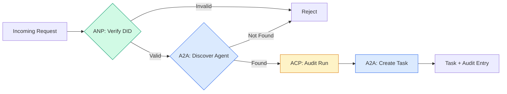

```typescript
class ProtocolGateway {
  private registry: AgentRegistry;
  private taskManager: TaskManager;
  private auditRunner: AuditableRunner;
  private identityRegistry: IdentityRegistry;

  constructor(
    registry: AgentRegistry,
    taskManager: TaskManager,
    auditRunner: AuditableRunner,
    identityRegistry: IdentityRegistry
  ) {
    this.registry = registry;
    this.taskManager = taskManager;
    this.auditRunner = auditRunner;
    this.identityRegistry = identityRegistry;
  }

  async delegateTask(
    fromDid: string,
    signature: string,
    targetAgent: string,
    message: AgentMessage,
    sessionId?: string
  ): Promise<{ task: Task; audit: AuditEntry } | { error: string }> {
    if (!this.identityRegistry.verify(fromDid, signature, message.id)) {
      return { error: "Identity verification failed" };
    }

    const card = this.registry.resolve(targetAgent);
    if (!card) {
      return { error: `Agent ${targetAgent} not found in registry` };
    }

    const audit = await this.auditRunner.run(
      targetAgent,
      [message],
      sessionId
    );
    const task = await this.taskManager.sendMessage(targetAgent, message);

    return { task, audit };
  }

  discoverAndDelegate(
    fromDid: string,
    signature: string,
    skillTag: string,
    message: AgentMessage
  ): Promise<{ task: Task; audit: AuditEntry } | { error: string }> {
    const candidates = this.registry.discoverBySkillTag(skillTag);
    if (candidates.length === 0) {
      return Promise.resolve({
        error: `No agents found with skill tag: ${skillTag}`,
      });
    }
    return this.delegateTask(
      fromDid,
      signature,
      candidates[0].name,
      message
    );
  }
}
```

网关在一次调用中完成四件事：

1. **ANP**：通过 DID 签名验证调用方身份
2. **A2A**：发现目标智能体并检查能力
3. **ACP**：把执行包装进带轨迹的审计记录
4. **A2A**：创建一个带完整生命周期追踪的任务

### 第 7 步：把所有部分串联起来

```typescript
async function protocolDemo() {
  const registry = new AgentRegistry();
  registry.register({
    name: "researcher",
    description: "Searches and summarizes findings",
    version: "1.0.0",
    supportedInterfaces: [
      {
        url: "https://researcher.local/a2a/v1",
        protocolBinding: "JSONRPC",
        protocolVersion: "1.0",
      },
    ],
    capabilities: { streaming: true, pushNotifications: false },
    defaultInputModes: ["text/plain"],
    defaultOutputModes: ["text/plain", "application/json"],
    skills: [
      {
        id: "web-research",
        name: "Web Research",
        description: "Searches the web",
        tags: ["research", "search", "summarization"],
        inputModes: ["text/plain"],
        outputModes: ["application/json"],
      },
    ],
  });
  registry.register({
    name: "coder",
    description: "Writes code from specs",
    version: "1.0.0",
    supportedInterfaces: [
      {
        url: "https://coder.local/a2a/v1",
        protocolBinding: "JSONRPC",
        protocolVersion: "1.0",
      },
    ],
    capabilities: { streaming: false, pushNotifications: false },
    defaultInputModes: ["text/plain", "application/json"],
    defaultOutputModes: ["text/plain"],
    skills: [
      {
        id: "code-gen",
        name: "Code Generation",
        description: "Generates code",
        tags: ["coding", "generation"],
        inputModes: ["text/plain", "application/json"],
        outputModes: ["text/plain"],
      },
    ],
  });

  const taskManager = new TaskManager();
  const auditRunner = new AuditableRunner();

  const researchTrajectory: TrajectoryEntry[] = [];

  taskManager.registerHandler(
    "researcher",
    async function* (task, message) {
      yield {
        statusUpdate: {
          taskId: task.id,
          status: {
            state: "TASK_STATE_WORKING" as const,
            timestamp: Date.now(),
          },
        },
      };

      researchTrajectory.push({
        reasoning: "Searching for React 19 documentation",
        toolName: "web_search",
        toolInput: { query: "React 19 compiler features" },
        toolOutput: {
          results: ["react.dev/blog/react-19", "github.com/react/react"],
        },
        timestamp: Date.now(),
      });

      researchTrajectory.push({
        reasoning: "Extracting key findings from search results",
        toolName: "doc_analysis",
        toolInput: { url: "react.dev/blog/react-19" },
        toolOutput: {
          summary:
            "React 19 compiler auto-memoizes, no manual useMemo needed",
        },
        timestamp: Date.now(),
      });

      yield {
        artifactUpdate: {
          taskId: task.id,
          artifact: {
            id: crypto.randomUUID(),
            name: "research-results",
            parts: [
              {
                data: {
                  findings: [
                    "React 19 compiler auto-memoizes components",
                    "No more manual useMemo/useCallback needed",
                    "Compiler runs at build time, not runtime",
                  ],
                  sources: ["react.dev/blog/react-19"],
                },
                mediaType: "application/json",
              },
            ],
          },
          append: false,
          lastChunk: true,
        },
      };

      yield {
        statusUpdate: {
          taskId: task.id,
          status: {
            state: "TASK_STATE_COMPLETED" as const,
            timestamp: Date.now(),
          },
        },
      };
    }
  );

  auditRunner.registerAgent("researcher", async () => ({
    output: [
      textMessage("ROLE_AGENT", "React 19 compiler auto-memoizes components"),
    ],
    trajectory: researchTrajectory,
  }));

  const identityRegistry = new IdentityRegistry();

  const coderIdentity = createIdentity("coder.local", "coder");
  const researcherIdentity = createIdentity("researcher.local", "researcher");

  identityRegistry.publish(coderIdentity.document);
  identityRegistry.publish(researcherIdentity.document);

  const gateway = new ProtocolGateway(
    registry,
    taskManager,
    auditRunner,
    identityRegistry
  );

  console.log("=== Protocol Demo ===\n");

  console.log("1. Agent Discovery (A2A)");
  const researchAgents = registry.discoverBySkillTag("research");
  console.log(
    `   Found ${researchAgents.length} agent(s):`,
    researchAgents.map((a) => a.name)
  );

  console.log("\n2. Identity Verification (ANP)");
  const message = textMessage("ROLE_USER", "Research React 19 compiler features");
  const signature = signPayload(coderIdentity, message.id);
  const verified = identityRegistry.verify(
    coderIdentity.did,
    signature,
    message.id
  );
  console.log(`   Coder DID: ${coderIdentity.did}`);
  console.log(`   Signature verified: ${verified}`);

  console.log("\n3. Task Delegation (A2A + ACP + ANP)");
  const result = await gateway.delegateTask(
    coderIdentity.did,
    signature,
    "researcher",
    message,
    "session-001"
  );

  if ("error" in result) {
    console.log(`   Error: ${result.error}`);
    return;
  }

  console.log(`   Task ID: ${result.task.id}`);
  console.log(`   Task state: ${result.task.status.state}`);
  console.log(`   Artifacts: ${result.task.artifacts.length}`);

  console.log("\n4. Audit Trail (ACP)");
  console.log(`   Run ID: ${result.audit.runId}`);
  console.log(`   Status: ${result.audit.status}`);
  console.log(`   Trajectory steps: ${result.audit.trajectory.length}`);
  for (const step of result.audit.trajectory) {
    console.log(`     - ${step.reasoning}`);
    if (step.toolName) {
      console.log(`       Tool: ${step.toolName}`);
    }
  }

  console.log("\n5. Full Audit Log");
  const fullLog = auditRunner.getFullAuditLog();
  console.log(`   Total runs: ${fullLog.length}`);
  for (const entry of fullLog) {
    const duration = entry.completedAt
      ? `${entry.completedAt - entry.startedAt}ms`
      : "in-progress";
    console.log(`   ${entry.agentName}: ${entry.status} (${duration})`);
  }
}

protocolDemo().catch((err) => {
  console.error("Protocol demo failed:", err);
  process.exitCode = 1;
});
```

## 常见错误

协议解决的是理想路径。下面是生产环境会出问题的地方：

**Schema 漂移。** 智能体 A 发布的 Agent Card 声称输出 `application/json`，但 JSON schema 在版本之间发生了变化。智能体 B 按旧格式解析，拿到一堆垃圾数据。修复方法：对 skill 和输出 schema 做版本管理。A2A 规范支持在 Agent Card 上标注 `version`，正是为此。

**违反状态机。** 某个智能体处理器 yield 了一个 `TASK_STATE_COMPLETED` 状态更新，随后又试图 yield 更多 artifact。任务此时已不可变。你的代码会静默丢弃这些更新，或者直接抛错。修复方法：在 yield 之前检查终止态。上面的 `TaskManager` 通过在终止态之后执行 `break` 来强制这一点。

**信任解析失败。** 智能体 A 试图验证智能体 B 的 DID，但 B 的域名宕机了，DID 文档拉取不到。你是选择失败开放（接受未验证的智能体），还是失败关闭（拒绝一切）？ANP 建议采用失败关闭，并遵循最小信任原则。

**轨迹膨胀。** ACP 的轨迹日志很强大，但代价高昂。一个复杂的智能体每次 run 发起 200 次工具调用，会产生海量审计条目。修复方法：让轨迹日志的详细程度可配置。为合规记录工具名称和输入输出，对非监管负载跳过推理步骤。

**发现请求惊群。** 50 个智能体在启动时同时查询 `GET /agents`。修复方法：用 TTL 缓存 Agent Card，错开发现间隔，或者改用基于推送的注册而非轮询。

## 使用它

### 真实实现

**A2A** 是最成熟的。Google 的[官方规范](https://github.com/google/A2A)在 Linux Foundation 下开源，提供 Python 和 TypeScript SDK。如果你的智能体需要动态发现和协作，从这里开始。

**ACP** 正在并入 A2A。IBM 的 [BeeAI 项目](https://github.com/i-am-bee/acp)把 ACP 创建为 REST 优先的替代方案，但轨迹元数据这一概念正在被 A2A 生态吸收。即使你用 A2A 作为传输层，也可以沿用 ACP 的模式（轨迹日志、run 生命周期）。

**ANP** 是最实验性的。[社区仓库](https://github.com/agent-network-protocol/AgentNetworkProtocol)提供了 Python SDK（AgentConnect）。元协议协商这一概念确实新颖。跨组织的智能体部署值得关注。

**MCP** 已在 Phase 13 中讲解。如果你想让智能体使用工具，MCP 就是标准。

### 选择合适的协议

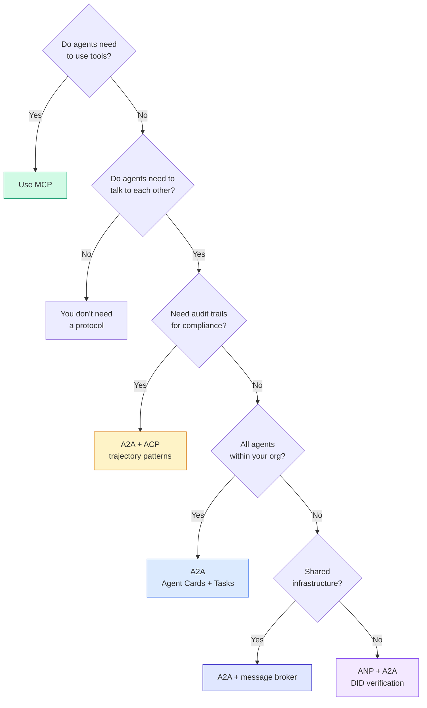

## 交付它

本课产出：

- `code/main.ts` —— 四种协议模式的完整实现
- `outputs/prompt-protocol-selector.md` —— 一个帮助你为系统选择协议的 prompt

## 练习

1. **多跳任务委派。** 扩展 `TaskManager`，让智能体处理器可以把子任务委派给其他智能体。研究员收到一个任务后，把「搜索」和「总结」两个子任务分别委派给两个专家智能体，等待二者完成，再把结果合并进自己的 artifact。

2. **流式审计轨迹。** 修改 `AuditableRunner` 以支持流式模式。不要等待完整结果，而是在轨迹条目加入时实时 yield `AuditEntry` 更新。使用异步生成器产出审计快照。

3. **DID 轮换。** 为 `IdentityRegistry` 添加密钥轮换。智能体应能发布带新密钥的 DID 文档，同时保留 `previousDid` 引用。在宽限期内，验证方应同时接受当前密钥和上一把密钥的签名。

4. **协议协商。** 实现 ANP 的元协议概念。两个智能体交换带候选格式的 `protocolNegotiation` 消息（例如「我会说 JSON-RPC」对「我偏好 REST」）。最多 3 轮后，它们要么就格式达成一致，要么超时。商定的格式决定它们使用哪个 `TaskManager` 或 `AuditableRunner`。

5. **限速发现。** 添加一个 `RateLimitedRegistry` 包装器，用可配置 TTL 缓存 Agent Card 查询，并限制每个智能体每秒的发现查询数。模拟 100 个智能体在启动时互相发现的惊群场景，并测量差异。

## 关键术语

| 术语 | 常见说法 | 实际含义 |
|------|----------------|----------------------|
| MCP | 「AI 工具协议」 | 一种客户端-服务器协议，让智能体发现并使用工具。是智能体到工具，不是智能体到智能体。 |
| A2A | 「Google 的智能体协议」 | Linux Foundation 下用于智能体协作的点对点协议。通过 Agent Card 发现，9 状态任务生命周期，SSE 流式传输。支持 JSON-RPC、REST 和 gRPC 绑定。 |
| ACP | 「企业级智能体消息」 | IBM/BeeAI 的 REST API，用于带 TrajectoryMetadata 的智能体 run：每条响应都携带完整的推理与工具调用链。正在并入 A2A。 |
| ANP | 「去中心化智能体身份」 | 社区协议，使用 `did:wba`（DID）实现密码学身份、HPKE 实现 E2EE，并用 AI 驱动的元协议协商服务于素未谋面的智能体。 |
| Agent Card | 「智能体的名片」 | 位于 `/.well-known/agent-card.json` 的 JSON 文档，描述 skills、支持的 MIME 类型、安全方案和协议绑定。 |
| DID | 「去中心化 ID」 | W3C 标准，用于托管在智能体自己域名上的、可密码学验证的身份。ANP 使用 `did:wba` 方法。 |
| TrajectoryMetadata | 「审计回执」 | ACP 的机制，把推理步骤、工具调用及其输入/输出附加到每条智能体响应上。 |
| Meta-protocol | 「智能体协商如何对话」 | ANP 的方法：智能体用自然语言动态商定数据格式，再生成代码来处理该格式。 |
| Task | 「一个工作单元」 | A2A 中有状态的对象，追踪工作从提交到完成的整个过程。进入终止态后不可变。 |

## 延伸阅读

- [Google A2A specification](https://github.com/google/A2A) —— 官方规范与 SDK（v1.0.1，Linux Foundation）
- [IBM/BeeAI ACP specification](https://github.com/i-am-bee/acp) —— 面向智能体 run 与轨迹元数据的 OpenAPI 3.1 规范
- [Agent Network Protocol](https://github.com/agent-network-protocol/AgentNetworkProtocol) —— 基于 DID 的身份、E2EE、元协议协商
- [Model Context Protocol docs](https://modelcontextprotocol.io/) —— Anthropic 的 MCP 规范（Phase 13 已讲解）
- [W3C Decentralized Identifiers](https://www.w3.org/TR/did-core/) —— 支撑 ANP 的身份标准
- [RFC 9180 (HPKE)](https://www.rfc-editor.org/rfc/rfc9180) —— ANP 用于 E2EE 的加密方案
- [FIPA Agent Communication Language](http://www.fipa.org/specs/fipa00061/SC00061G.html) —— 现代智能体协议的学术前身
