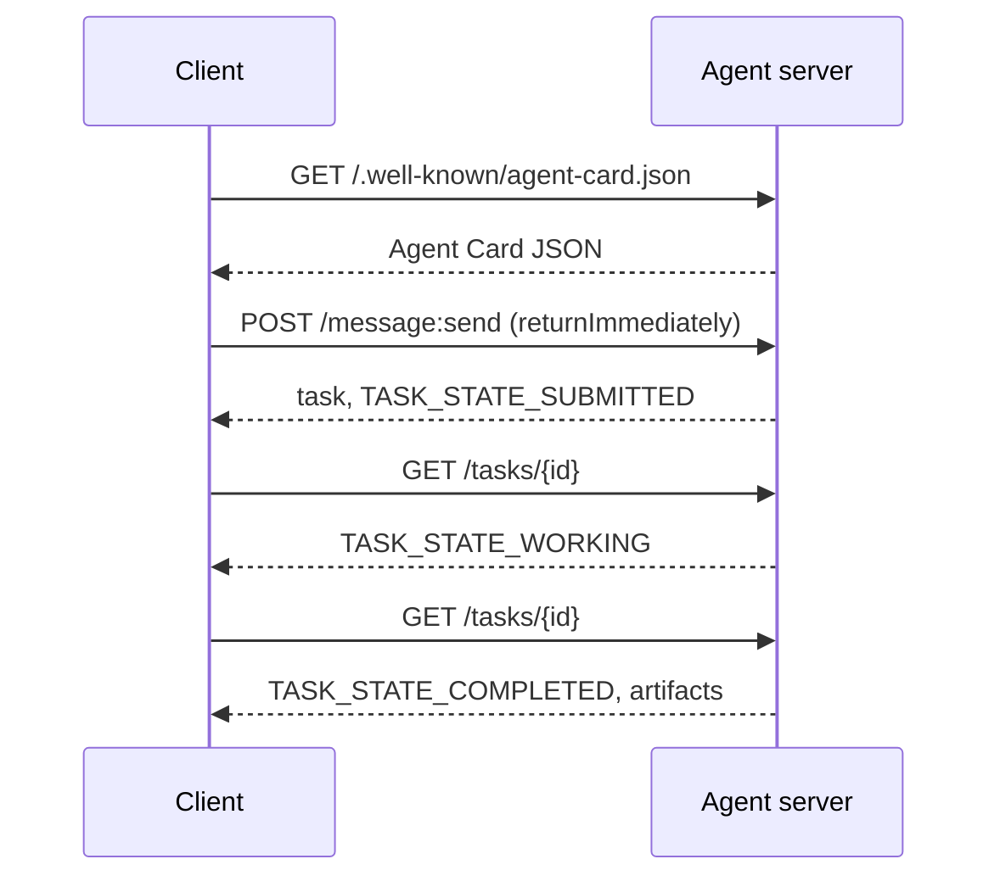

# A2A — Agent 间协议

> Google 于 2025 年 4 月发布 A2A；到 2026 年 4 月，规范已更新至 https://a2a-protocol.org/latest/specification/，并有 150 多家组织支持。A2A 是 MCP（第 13 课）的横向补充：MCP 是纵向的（Agent ↔ 工具），A2A 是点对点的（Agent ↔ Agent）。它定义了 Agent Card（发现）、带 artifact 的任务（文本、结构化数据、视频）、不透明的任务生命周期以及认证。生产系统越来越多地把 MCP 与 A2A 搭配使用。Google Cloud 在 2025-2026 年间把 A2A 支持纳入了 Vertex AI Agent Builder。

**Type:** Learn + Build
**Languages:** Python (stdlib, `http.server`, `json`)
**Prerequisites:** Phase 16 · 04 (Primitive Model)
**Time:** ~75 minutes

## 问题

你的 Agent 需要调用另一个系统上的 Agent。怎么做？你可以暴露一个 HTTP 端点，自定一套 JSON schema，然后指望对方能读懂。这样一来，每一对 Agent 都要做一次定制集成。

A2A 就是这类调用的通用线上协议。标准发现、标准任务模型、标准传输、标准 artifact。像 HTTP+REST 一样，只不过把 Agent 当作一等公民。

## 概念

### 四个要素

**Agent Card（Agent 卡片）。** 位于 `/.well-known/agent-card.json` 的 JSON 文档，描述 Agent：名称、技能、`supportedInterfaces`（端点 URL、协议绑定、协议版本）、默认输入与输出媒体类型，以及认证要求（`securitySchemes` 加 `securityRequirements`）。发现就是读取这张卡片。

```http
GET /.well-known/agent-card.json HTTP/1.1
Host: agent.example.com
```

```json
{
  "name": "code-review-agent",
  "description": "Reviews Python and TypeScript code.",
  "version": "1.0.0",
  "supportedInterfaces": [
    {
      "url": "https://agent.example.com",
      "protocolBinding": "HTTP+JSON",
      "protocolVersion": "1.0"
    }
  ],
  "capabilities": {"streaming": false, "pushNotifications": false},
  "securitySchemes": {
    "bearer": {"httpAuthSecurityScheme": {"scheme": "Bearer"}}
  },
  "securityRequirements": [{"schemes": {"bearer": {"list": []}}}],
  "defaultInputModes": ["text/plain", "application/json"],
  "defaultOutputModes": ["application/json"],
  "skills": [
    {
      "id": "review-python",
      "name": "Review Python",
      "description": "Reviews Python code.",
      "tags": ["code-review", "python"]
    },
    {
      "id": "review-typescript",
      "name": "Review TypeScript",
      "description": "Reviews TypeScript code.",
      "tags": ["code-review", "typescript"]
    }
  ]
}
```

**Task（任务）。** 工作的单位。一个异步、有状态的对象，带有生命周期：`TASK_STATE_SUBMITTED` → `TASK_STATE_WORKING` → `TASK_STATE_COMPLETED` / `TASK_STATE_FAILED` / `TASK_STATE_CANCELED`。客户端发送消息，服务端创建任务，客户端轮询或订阅更新。

**Artifact（产出物）。** 任务产生的结果类型。文本、结构化 JSON、图像、视频、音频。Artifact 是有类型的：每个 part 携带 `text`、`raw`、`url` 或 `data` 之一，并可声明自身的 `mediaType`，因此不同模态都是一等公民。

**不透明的生命周期。** A2A 不规定远端 Agent*如何*解决任务。客户端只看到状态迁移和 artifact；实现方可以自由选用任何框架。

### MCP 与 A2A 的分工

- **MCP**（第 13 课）：Agent ↔ 工具。Agent 通过 JSON-RPC 读写工具服务端。默认无状态。
- **A2A**：Agent ↔ Agent。点对点协议；双方都是具备自身推理能力的 Agent。

生产级多 Agent 系统会同时使用两者。一个 A2A 对端在它那一侧调用 MCP 工具。这样的分工让两类关注点保持清晰。

### 发现流程



这些是 HTTP+JSON 绑定的路由，每个请求都携带 `A2A-Version: 1.0`。默认情况下 `SendMessage` 会阻塞，直到任务进入终态或中断态；因此采用轮询的客户端会设置 `configuration.returnImmediately`，以便立即拿回任务。

也可以使用流式：`POST /message:stream` 返回 Server-Sent Events（先是一个 `task`，然后是 `statusUpdate` 和 `artifactUpdate` 事件），而 `/tasks/{id}:subscribe` 可以重新挂接到正在运行的任务上。任务进入终态时流会关闭，没有 `final` 标志。

### 认证

A2A 支持三种常见模式：

- **Bearer token**：OAuth2 或不透明令牌（`httpAuthSecurityScheme` 或 `oauth2SecurityScheme`）。
- **mTLS**：双向 TLS；组织之间互相证明身份（`mtlsSecurityScheme`）。
- **API key**：放在 header、查询参数或 cookie 中的密钥（`apiKeySecurityScheme`）。

认证在 Agent Card 中声明：`securitySchemes` 列出每个方案，`securityRequirements` 说明客户端必须满足哪些方案。客户端负责发现并遵守。

### 截至 2026 年 4 月的 150 多家组织

企业采用推动了 A2A 的规模化。最值得关注的是：A2A 成为企业 Agent 系统跨越信任边界的方式。Google Cloud 发布了 Vertex AI Agent Builder 的 A2A 支持；Microsoft Agent Framework 也支持它；多数主流框架（LangGraph、CrewAI、AutoGen）都提供了 A2A 适配器。

### A2A 的适用场景

- **跨组织调用。** A 公司的 Agent 调用 B 公司的 Agent。没有 A2A，每一对都要签定制契约。
- **异构框架。** LangGraph Agent 调用 CrewAI Agent，再调用自定义 Python Agent。A2A 负责归一化。
- **带类型的 artifact。** 视频结果、结构化 JSON、音频——全都是一等公民。
- **长时任务。** 不透明生命周期加轮询，让长达数小时的任务变得直截了当。

### A2A 的局限

- **对延迟敏感的微调用。** A2A 的生命周期是异步的。亚毫秒级的 Agent 间调用不适合它，应直接使用 RPC。
- **紧耦合的进程内 Agent。** 如果两个 Agent 运行在同一个 Python 进程里，A2A 的 HTTP 往返纯属浪费。
- **小团队。** 规范带来的开销是实打实的；仅内部使用的 Agent 可能不需要这种形式化的约束。

### A2A 与 ACP、ANP、NLIP 的比较

2024-2026 年间出现了若干相关规范：

- **ACP**（IBM/Linux 基金会）——A2A 的前身，范围更窄。
- **ANP**（Agent Network Protocol）——侧重对等发现，去中心化优先。
- **NLIP**（Ecma 自然语言交互协议，2025 年 12 月标准化）——自然语言内容类型。

截至 2026 年 4 月，A2A 是采用最广的对等协议。对比可参见 arXiv:2505.02279（Liu 等，"A Survey of Agent Interoperability Protocols"）。

```figure
sw-agent-card-discovery
```

## 构建它

`code/main.py` 基于 1.0 HTTP+JSON 绑定，用 `http.server` 和 JSON 实现了一个最小化的 A2A 服务端与客户端。服务端：

- 暴露 `/.well-known/agent-card.json`，
- 接受 `POST /message:send`，
- 管理任务状态，
- 在 `GET /tasks/{id}` 时返回 artifact。

客户端：

- 获取 Agent Card，
- 用 `returnImmediately` 发送消息，
- 轮询直到完成，
- 读取 artifact。

运行：

```
python3 code/main.py
```

脚本在后台线程中启动服务端，然后让客户端对着它运行。你能看到完整流程：发现、提交、轮询、artifact。

## 使用它

`outputs/skill-a2a-integrator.md` 用于设计 A2A 集成：Agent Card 内容、任务 schema、认证选择、流式还是轮询。

## 交付它

检查清单：

- **固定规范版本。** A2A 仍在演进；每个 `supportedInterfaces` 条目都声明 `protocolVersion`，客户端发送 `A2A-Version: 1.0`。
- **幂等的任务创建。** 重复提交（网络重试）应当只产生一个任务。按客户端的 `messageId` 去重。
- **Artifact schema。** 声明 Agent 返回的形状；消费方应当校验。
- **速率限制 + 认证。** A2A 是对外暴露的；要套用标准的 Web 安全实践。
- **失败任务的死信队列。** 长期观察失败类型，找出反复出现的模式。

## 练习

1. 运行 `code/main.py`。确认客户端发现了服务端并收到正确的 artifact。
2. 给服务端添加第二个技能（例如 "summarize"）。更新 Agent Card。写一个按任务类型选择技能的客户端。1.0 的请求没有 skill 字段，因此服务端根据消息 parts 进行路由。
3. 实现 `POST /message:stream`：用 Server-Sent Events 回复（先一个 `task`，然后 `statusUpdate` 事件），并在终态时关闭流。客户端需要做哪些不同的处理？
4. 阅读 A2A 规范（https://a2a-protocol.org/latest/specification/）。找出规范强制要求、而这个演示没有实现的三点。
5. 比较 A2A（Agent Card 发现）与 MCP（通过 `listTools` 在服务端列出能力）。自描述 Agent 与能力探测之间的权衡是什么？

## 关键术语

| 术语 | 人们的说法 | 实际含义 |
|------|----------------|------------------------|
| A2A | "Agent-to-agent" | Agent 跨系统调用其他 Agent 的对等协议。Google 2025 年。 |
| Agent Card | "Agent 的名片" | 位于 `/.well-known/agent-card.json` 的 JSON，描述技能、`supportedInterfaces`、认证。 |
| Task | "工作单位" | 带生命周期的异步有状态对象；完成时产出 artifact。 |
| Artifact | "结果" | 带类型的输出：文本、结构化 JSON、图像、视频、音频。一等媒体。 |
| Opaque lifecycle | "怎么解是 Agent 自己的事" | 客户端只看到状态迁移；服务端可自由选择框架/工具。 |
| Discovery | "找到 Agent" | `GET /.well-known/agent-card.json` 返回卡片。 |
| MCP vs A2A | "工具对同侪" | MCP：纵向的 Agent ↔ 工具。A2A：横向的 Agent ↔ Agent。 |
| ACP / ANP / NLIP | "兄弟协议" | 相邻规范；A2A 是 2026 年采用最广的。 |

## 延伸阅读

- [A2A specification](https://a2a-protocol.org/latest/specification/) —— 权威规范
- [A2A v1.0.1 release](https://github.com/a2aproject/A2A/tree/v1.0.1)：本课遵循的带标签 `docs/specification.md` 与 `specification/a2a.proto`
- [Google Developers Blog — A2A announcement](https://developers.googleblog.com/en/a2a-a-new-era-of-agent-interoperability/) —— 2025 年 4 月发布文章
- [A2A GitHub repo](https://github.com/a2aproject/A2A) —— 参考实现与 SDK
- [Liu et al. — A Survey of Agent Interoperability Protocols](https://arxiv.org/html/2505.02279v1) —— MCP、ACP、A2A、ANP 对比
