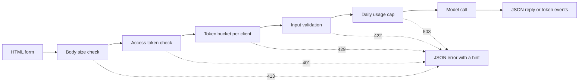

# 模型演示界面 —— 从函数到可分享的应用

> 模型演示只有一份契约：一个输入、一次模型调用、一个输出。分享链接之前，先给每一部分加上限制。

**Type:** Build
**Languages:** Python
**Prerequisites:** Phase 11 · 13 (Building a Production LLM Application), Phase 17 · 08 (Inference Metrics), Phase 17 · 19 (AI Gateways)
**Time:** ~90 minutes

## 学习目标

- 写出演示的输入、模型调用和输出契约，并给每一部分加上限制。
- 用标准库构建一个 HTTP 应用：一个 HTML 页面、一个 JSON 端点和一个 Server-Sent Events 端点。
- 按成本顺序校验输入，并返回能告诉用户下一步该做什么的 JSON 错误。
- 用按客户端的 token bucket、每日用量上限和可选的访问 token 保护公开演示。
- 写请求日志，不保留输入文本，也不保留客户端地址。
- 把标准库版本与两个框架版本作比较，并说出演示必须升级为产品的信号。

## 问题

你的模型在 notebook 里跑通了。现在一位评审想试十条输入，一位客户想在手机上看到一个结果。他们都不会打开你的 notebook。

notebook 单元格没有输入限制，也没有进度显示。它的错误是只有你能看懂的堆栈跟踪。它还使用你的凭据和你的预算运行。如果你不做改动就把这个单元格放到公开 URL 后面，可以预期出现这些故障：

- 用户粘贴了一份 40,000 字符的文档。模型调用跑了一分钟，然后带着堆栈跟踪失败。
- 一个脚本一分钟内发送 500 个请求。每个请求都是一次付费模型调用。
- 页面八秒钟没有任何显示，于是用户又点了四次按钮。
- 服务器日志保留了每一条输入，包括带有客户账号的输入。

一个演示界面只需少量代码就能防止这些故障。本课用 Python 标准库构建一个这样的界面，让你看清每个部分。然后用两个流行框架构建同样的演示，并比较各自的默认行为。

## 概念

### 演示就是一份契约

每个演示都有三个部分。输入是用户能发送的内容。模型调用把输入变成输出。输出是用户看到的内容，其中也包括错误。

在写页面之前，先把契约写下来：

| 部分 | 要回答的问题 | 本课的答案 |
|------|--------------------|-----------------------|
| 输入 | 什么类型、多大、哪些字符？ | 1 到 500 个字符的字符串，不含控制字符 |
| 模型调用 | 一次调用要多久，成本多少？ | 一个玩具关键词模型，耗时不到一毫秒，零成本 |
| 输出 | 成功和失败时用户分别看到什么？ | 一个标签、一个分数和一段回复，或者带提示的 JSON 错误 |

notebook 对这三部分都没有限制。演示给每一部分设定限制，并由服务器把限制施加到每个客户端。



各项检查按成本顺序执行。坏请求会在第一个未通过的检查处停下，因此它几乎不消耗服务器资源。模型调用放在最后，因为它是唯一花钱的步骤。

### 在模型运行前校验

浏览器可以在发送任何内容之前检查输入。文本区域上的 `maxlength` 和 `required` 属性无需网络调用就能给用户反馈。这些检查只对诚实用户有帮助。任何客户端都可以绕过页面直接发请求，所以服务器要重复每一项检查。

把服务器检查按成本排序：

1. 读取 `Content-Length` 头。在读取请求体之前就拒绝超限的请求体。
2. 解析 JSON 请求体。拒绝不是 JSON 对象的请求体。
3. 检查字段。拒绝空文本、超长文本和控制字符。
4. 只对通过所有检查的请求花费一次模型调用。

| 未通过的检查 | HTTP 状态 | 错误码 |
|--------------|-------------|------------|
| 请求体超过 4,096 字节 | 413 Content Too Large | `body_too_large` |
| 请求体在收到 `Content-Length` 字节之前中断 | 408 Request Timeout | `request_timeout` |
| Content type 不是 JSON | 415 Unsupported Media Type | `unsupported_media_type` |
| 请求体不是 JSON 对象 | 400 Bad Request | `bad_json` |
| 文本缺失、为空、过长或含控制字符 | 422 Unprocessable Content | `missing_text`、`empty_text`、`text_too_long`、`control_characters` |

RFC 9110 定义了这些状态码及其名称。

示例是输入设计的一部分。示例向用户展示什么样的输入才算好。它也让评审一键就能测试。为每个输出类别挑一个示例。本演示有一个正面、一个负面和一个中性示例。

### 让用户看到模型在工作

模型调用可能需要好几秒。没有反馈时，用户分不清是模型慢还是页面坏了。看不到变化的用户会再点一次，服务器于是收到第二次付费请求。

本课的页面提供四种反馈：

- 请求运行期间禁用提交按钮。
- 显示已用时间，每 100 毫秒更新一次。
- 收到第一个 token 时显示首 token 时间。
- 请求结束时显示总耗时。

学习[推理指标](../../08-inference-metrics-goodput/)时，首 token 时间（TTFT）是服务器指标。演示页面把同一个数字展示给用户，只是在浏览器里测量。

### 以流式发送输出

语言模型一次产生一个 token 的回复。如果服务器等最后一个 token，用户就要等完整生成结束。如果服务器每准备好一个 token 就发送，用户从第一个 token 之后就能开始阅读。

Server-Sent Events（SSE，服务器发送事件）是这种场景的标准格式。响应的 content type 是 `text/event-stream`。每个事件由若干 `event:` 和 `data:` 行组成，空行表示事件结束。WHATWG HTML 标准定义了该格式。

```text
event: token
data: {"index":0,"text":"Label:"}

event: token
data: {"index":1,"text":" positive."}

event: done
data: {"label":"positive","score":1.0,"tokens":11}
```

浏览器有用于 SSE 的 `EventSource` 接口，但它只发送 GET 请求。GET 请求把输入放进 URL，而 Web 服务器和代理会把 URL 写进访问日志。本演示改为发送带 JSON 请求体的 POST 请求。页面用 `fetch()` 和 `response.body.getReader()` 读取响应，并自己解析事件格式。

流式有一个单次 JSON 响应没有的问题。服务器在第一个 token 之前就发送了状态 200。如果模型在那之后失败，服务器无法修改状态码。因此服务器在流中发送一个 `error` 事件，页面把该事件显示为错误。

构建[生产级 LLM 应用](../../../11-llm-engineering/13-production-app/)时，框架替你通过 SSE 发送 token。本课手写同一套协议，让你看清服务器发送的每一行。

### 写出用户能据此行动的报错

错误消息有两个职责。它告诉用户发生了什么，也告诉用户接下来做什么。对陌生人来说，堆栈跟踪两个职责都没做到。

本演示的每个错误都采用相同的 JSON 形状：

```json
{
  "error": {
    "code": "text_too_long",
    "message": "The text has 812 characters. The limit is 500.",
    "hint": "Shorten the text to 500 characters or fewer.",
    "request_id": "a8f3c2b435e3"
  }
}
```

- `code` 是稳定的名称。客户端代码和测试拿它做比较。
- `message` 陈述事实，并带上用户需要的数字。
- `hint` 给用户一个行动建议。
- `request_id` 把用户报告和一条日志记录关联起来。

RFC 9457 为 HTTP API 定义了一种标准错误格式，称为 problem details。本演示用更小的形状实现相同目的。当其他团队调用你的 API 时，使用 RFC 9457。

### 安全地公开演示

公开链接会改变谁能发请求。为每种风险规划一项控制：

| 风险 | 本演示的控制 | 面向更大受众的控制 |
|------|----------------------|-------------------------------|
| 一个客户端发送过多请求 | 每个客户端一个 token bucket，返回 429 和 `Retry-After` | 登录后的按用户限制 |
| 陌生人发现链接 | `Authorization` 头中的可选访问 token | 通过身份提供商单点登录 |
| 总成本无上限增长 | 每日用量上限，返回 503 和 `Retry-After` | 模型提供商侧的支出限制与告警 |
| 极大或异常输入 | 请求体大小限制、文本长度限制、控制字符检查 | 对输入和输出做内容审核 |
| 日志保留隐私输入 | 记录输入长度和客户端的带密钥哈希 | 日志保留期与访问控制 |

token bucket 使用两个数字。容量是一个客户端能发送的最大突发量。补充速率是长期请求速率。每个请求消耗一个 token，桶会持续补充，直到达到容量：

```text
tokens = min(capacity, tokens + refill_rate * seconds_since_last_request)
accept the request if tokens >= 1, then subtract 1
```

桶空时，服务器返回 `429 Too Many Requests`。RFC 6585 定义了状态码 429，并允许服务器附加 `Retry-After` 头。本演示总是加上该头，值为距离下一个 token 的秒数。页面读取该头，并在这段时间内禁用按钮。

演示用客户端 IP 地址作为桶的键。在反向代理后面，每个请求都来自代理地址，于是所有用户共用一个桶。这种情况下，要从你自己的代理设置的某个头里读取客户端地址。不要信任来自其他来源的这个头，因为客户端可以往里面填任意值。

学习 [AI 网关](../../19-ai-gateways/)时，网关按租户施加速率限制。演示需要同样控制在更小规模上的版本。速率限制控制每个客户端，但不控制总量。一百个客户端各自都不超限，仍然可以花光全部预算。用量上限统计一天内的所有模型调用，在达到固定数量后拒绝调用。

日志需要和输入一样小心。默认的 `http.server` 处理器会把客户端 IP 地址和请求行写到标准错误。如果输入在 URL 里，输入就会进入日志。本演示替换了那行日志。每个请求写一条记录，包含路由、状态、错误码、延迟和输入长度。客户端地址变成一个带密钥的哈希，这样你可以按客户端统计请求，而不必存储地址。

告诉用户你保留了什么。演示页面声明：服务器只保留文本长度，绝不保留文本本身。

### 演示何时变成产品

演示为一个进程内的短期会话服务已知人群。以下信号说明演示已经变成产品：

- 团队之外的人每周都在使用。
- 有人要求正常运行时间目标，或者报告了一次故障。
- 用户要求登录、保存结果或查看历史。
- 每周模型成本成为预算中的一行。
- 输入包含受合同或法律约束的数据。

| 属性 | 演示 | 产品 |
|----------|------|---------|
| 用户 | 已知人群，短期会话 | 未知人群，日常使用 |
| 状态 | 无 | 账户、历史、保存的结果 |
| 可用性 | 尽力而为，单进程 | 书面目标、副本、值班负责人 |
| 成本控制 | 一个每日用量上限 | 按用户配额与计费 |
| 可观测性 | 每请求一条日志记录 | Trace、指标和告警 |

看到这些信号时，把演示迁移到生产 LLM 应用课中的生产栈上。那套栈提供真正的认证、回退模型、追踪和按用户的成本跟踪。

```figure
demo-token-bucket
```

## 构建它

代码是一个文件 `code/main.py`，除标准库外没有依赖。先运行自测：

```bash
python3 code/main.py
```

自测会检查校验器、token bucket、流格式和一次真实的 HTTP 往返。它在空闲端口启动服务器，发送三个请求，停止服务器并退出。只有需要浏览器时才启动服务器：

```bash
python3 code/main.py --serve
```

在浏览器中打开 `http://127.0.0.1:8000`。按 Ctrl+C 停止服务器。

### 第 1 步：模型调用

模型是一个玩具关键词计数器。它把文本标记为正面、负面或中性。它还一次一个 token 地产生简短回复。

```python
def classify(text):
    words = WORD_RE.findall(text.lower())
    positive = sum(1 for word in words if word in POSITIVE)
    negative = sum(1 for word in words if word in NEGATIVE)
    score = (positive - negative) / max(1, positive + negative)
    if score > 0:
        label = "positive"
    elif score < 0:
        label = "negative"
    else:
        label = "neutral"
    return {"label": label, "score": round(score, 3), "positive_cues": positive,
            "negative_cues": negative, "words": len(words)}


def generate(text):
    result = classify(text)
    reply = (
        f"Label: {result['label']}. Positive cues: {result['positive_cues']}. "
        f"Negative cues: {result['negative_cues']}. Words read: {result['words']}."
    )
    parts = reply.split(" ")
    yield parts[0]
    for part in parts[1:]:
        yield " " + part
```

真实模型只需替换 `generate`，别的都不用动。把 API 调用或本地模型放进去。保持签名不变：字符串进，token 出。校验器、限制和页面都保持不变。

### 第 2 步：校验与错误响应

一个异常类承载所有错误。它保存 HTTP 状态、稳定错误码、消息、提示和可选的响应头。

```python
class DemoError(Exception):
    def __init__(self, status, code, message, hint, headers=None):
        super().__init__(message)
        self.status = status
        self.code = code
        self.message = message
        self.hint = hint
        self.headers = dict(headers or {})


def validate_text(payload, max_chars=MAX_CHARS):
    if "text" not in payload:
        raise DemoError(422, "missing_text", 'The field "text" is missing.', 'Add a "text" field with your input.')
    text = payload["text"]
    if not isinstance(text, str):
        raise DemoError(422, "text_not_string", 'The field "text" is not a string.', "Send the input as a string.")
    text = text.strip()
    if not text:
        raise DemoError(422, "empty_text", "The text is empty.", "Type a sentence or pick an example.")
    if len(text) > max_chars:
        raise DemoError(422, "text_too_long", f"The text has {len(text)} characters. The limit is {max_chars}.",
                        f"Shorten the text to {max_chars} characters or fewer.")
    if CONTROL_RE.search(text):
        raise DemoError(422, "control_characters", "The text contains control characters.",
                        "Remove the hidden characters, then send the text again.")
    return text
```

校验器先去掉首尾空白。全是空格的文本随后会以空文本失败，提示告诉用户该输入什么。`check_body_size` 和 `parse_json_body` 对 411、413、415 和 400 情况使用相同的模式。`error_body` 把任何 `DemoError` 转换成概念部分介绍的 JSON 形状。

### 第 3 步：token bucket

```python
class TokenBucket:
    def __init__(self, capacity, refill_per_second, now):
        if capacity < 1:
            raise ValueError("capacity must be at least 1")
        if refill_per_second <= 0:
            raise ValueError("refill_per_second must be positive")
        self.capacity = float(capacity)
        self.refill_per_second = float(refill_per_second)
        self.tokens = float(capacity)
        self.updated = now

    def take(self, now, cost=1.0):
        elapsed = max(0.0, now - self.updated)
        self.tokens = min(self.capacity, self.tokens + elapsed * self.refill_per_second)
        self.updated = now
        if self.tokens >= cost:
            self.tokens -= cost
            return 0.0
        return (cost - self.tokens) / self.refill_per_second
```

`take` 在接受请求时返回 0.0。否则它返回桶攒够 token 所需的秒数。服务器把这个值向上取整，放进 `Retry-After` 发送。

`RateLimiter` 在 `OrderedDict` 中为每个客户端保留一个桶。锁保护这个字典，因为 `ThreadingHTTPServer` 在自己的线程里处理每个请求。当字典条目超过 `max_clients` 时，限流器移除最近一次请求最旧的客户端。被移除的客户端下次请求时会得到一个满桶。把 `max_clients` 设得高于你预期的活跃客户端数。

限流器接受一个 `clock` 参数。测试传入 `FakeClock`，因此测试可以无需等待地把时间前进十秒。`UsageCap` 对每日总量使用同样的时钟模式。它按 86,400 秒的固定窗口统计调用，计数满时返回到下一个窗口的秒数。

### 第 4 步：流

```python
def sse_event(event, data):
    payload = json.dumps(data, separators=(",", ":"), ensure_ascii=False)
    return f"event: {event}\ndata: {payload}\n\n".encode("utf-8")


def stream_events(text, generate_fn=generate, delay=0.0, sleep=time.sleep):
    count = 0
    try:
        for token in generate_fn(text):
            yield sse_event("token", {"index": count, "text": token})
            count += 1
            if delay:
                sleep(delay)
    except Exception:
        yield sse_event("error", MODEL_ERROR)
        return
    result = classify(text)
    yield sse_event("done", {"label": result["label"], "score": result["score"], "tokens": count})
```

`json.dumps` 会把字符串里的换行写成两个字符 `\n`。因此每个事件只有一条 data 行，其中没有原始换行。data 中的原始换行会破坏事件格式。

生成器捕获模型失败并发送 `error` 事件，因为服务器已经发送了状态行。`delay` 和 `sleep` 参数用于在浏览器中放慢流，同时保持测试快速。

### 第 5 步：请求处理器

`DemoHandler` 继承 `BaseHTTPRequestHandler`。POST 处理器按概念部分的顺序运行检查：

```python
def do_POST(self):
    app = self.server.app
    request_id = uuid.uuid4().hex[:12]
    client_id = self.client_address[0]
    started = time.perf_counter()
    route = self.path if self.path in self.routes else "other"
    status, code, chars = 200, None, 0
    try:
        declared = self.headers.get("Content-Length")
        try:
            if route == "other":
                raise DemoError(404, "not_found", "This endpoint does not exist.",
                                "Send requests to /api/predict or /api/stream.")
            size = check_body_size(declared, app.config.max_body_bytes)
        except DemoError:
            self.drain(int(declared) if declared and declared.isdigit() else 0)
            raise
        try:
            body = self.rfile.read(size)
        except TimeoutError:
            self.close_connection = True
            raise DemoError(408, "request_timeout", "The request body did not arrive in time.",
                            "Send the request again with the full body.") from None
        app.admit(client_id, self.headers.get("Authorization"))
        text = app.read_text(self.headers.get("Content-Type"), body)
        chars = len(text)
        app.charge()
        if route == "/api/predict":
            self.send_json(200, predict(text), request_id)
        else:
            code = self.send_stream(text, request_id)
    except DemoError as err:
        status, code = err.status, err.code
        self.send_error_json(err, request_id)
    except TimeoutError:
        status, code = 408, "request_timeout"
        self.close_connection = True
    except Exception:
        status, code = 500, "internal_error"
        self.send_error_json(DemoError(500, "internal_error", "The server failed on this request.",
                                       "Try again. Quote the request id if you report the problem."), request_id)
    finally:
        latency_ms = (time.perf_counter() - started) * 1000
        app.log.record(request_id, route, client_id, status, chars, latency_ms, code)
```

`admit` 检查访问 token 和 token bucket。`charge` 检查每日上限。它最后运行，因此只有有效请求才计入上限。每个请求都在 `finally` 块中写一条日志记录，被拒绝的请求也包括在内。记录保存 `route`，绝不保存原始路径，因为路径可能携带含用户文本的查询字符串。

有四个细节能防止容易忽略的故障：

- 处理器类上的 `timeout = 10` 会在客户端停止发送时关闭连接。没有它，一个声明发送 100 字节却只发 10 字节的客户端会永久占住一个服务器线程。处理器会发送带请求 id 的 408 JSON 错误并关闭连接。流开始之后的超时只会关闭连接，因为状态行已经发送。
- `log_message` 直接返回，不输出内容。这去掉了带客户端地址和请求行的默认日志。
- `drain` 读取并丢弃被拒绝请求体中最多 64 KiB 的内容。RFC 1122 指出，当主机在还有未读数据时关闭连接，TCP 会发送 reset。客户端可能因此收不到 413 回复。
- `send_stream` 捕获 `BrokenPipeError` 并关闭生成器。用户关闭标签页时模型停止，请求不再产生任何开销。

`BaseHTTPRequestHandler` 默认使用 HTTP/1.0。此时流式请求体的结束就是服务器关闭连接的时刻。使用 HTTP/1.1 的服务器出于同样目的会用 chunked transfer coding 发送请求体。

### 第 6 步：页面

`render_page` 返回一个 HTML 文档，内含内联样式和内联脚本。页面不加载任何外部脚本、字体或图片。脚本这样读取流：

```javascript
const reader = response.body.getReader();
const decoder = new TextDecoder();
let buffer = "";
while (true) {
  const chunk = await reader.read();
  if (chunk.done) { break; }
  buffer += decoder.decode(chunk.value, { stream: true });
  let cut = buffer.indexOf("\n\n");
  while (cut >= 0) {
    const frame = parseFrame(buffer.slice(0, cut));
    buffer = buffer.slice(cut + 2);
    cut = buffer.indexOf("\n\n");
    if (frame.event === "token") { output.textContent += frame.data.text; }
  }
}
```

一个网络数据块可能在一个事件中间结束。读取器把不完整的部分留在 `buffer` 里，直到空行到达。

页面用 `textContent` 写入模型输出，绝不用 `innerHTML`。模型输出是不可信文本。假设页面把回复当作 HTML 插入，而回复里有一个带 `onerror` 属性的元素。该属性就能在用户浏览器里执行代码。

服务器还发送 `Content-Security-Policy` 头，值为 `default-src 'none'`。该策略允许一个内联脚本和一个内联样式，通过它们的 SHA-256 哈希识别。浏览器拒绝其他所有脚本，包括攻击者注入页面的脚本。

```python
def csp_hash(source):
    digest = hashlib.sha256(source.encode("utf-8")).digest()
    return "'sha256-" + base64.b64encode(digest).decode("ascii") + "'"
```

### 第 7 步：运行它并试着攻破它

启动服务器，然后在第二个终端使用 `curl`。对一个新启动的服务器连续发送七个请求。桶里初始有五个 token，每两秒补充一个：

```bash
for i in 1 2 3 4 5 6 7; do
  curl -s -o /dev/null -w '%{http_code} ' -X POST http://127.0.0.1:8000/api/predict \
    -H 'Content-Type: application/json' -d '{"text": "ok"}'
done
```

```text
200 200 200 200 200 429 429
```

等十秒，然后发送空文本：

```bash
curl -s -X POST http://127.0.0.1:8000/api/predict \
  -H 'Content-Type: application/json' -d '{"text": ""}'
```

```json
{"error": {"code": "empty_text", "message": "The text is empty.", "hint": "Type a sentence or pick an example.", "request_id": "e3e3599feaea"}}
```

用 `curl -N` 观察事件流，它会关闭输出缓冲：

```bash
curl -N -X POST http://127.0.0.1:8000/api/stream \
  -H 'Content-Type: application/json' -d '{"text": "The screen is bright."}'
```

要强制要求访问 token，请在启动服务器前设置 `DEMO_ACCESS_TOKEN`。页面随后会显示一个 token 输入框。

```bash
export DEMO_ACCESS_TOKEN="$(python3 -c 'import secrets; print(secrets.token_urlsafe(24))')"
echo "$DEMO_ACCESS_TOKEN"
python3 code/main.py --serve
```

运行测试：

```bash
python3 -m unittest discover -s code/tests -v
```

HTTP 测试在端口 0 上启动服务器，由操作系统挑选空闲端口。`tearDown` 停止服务器并检查它的线程已经结束。

## 使用它

两个 Python 框架用更少的代码构建同类演示：Gradio 和 Streamlit。下面两个示例都从 `main.py` 导入契约，因此校验器和模型保持不变。运行 `main.py` 或测试都不需要这两个框架。

### 围绕一个函数的组件

Gradio 围绕一个 Python 函数包装 Web 界面。输入和输出组件描述契约，生成器函数发送部分输出。

```python
import os

import gradio as gr

from main import EXAMPLES, MAX_CHARS, DemoError, classify, generate, validate_text


def label_text(text):
    try:
        clean = validate_text({"text": text})
    except DemoError as err:
        raise gr.Error(f"{err.message} {err.hint}")
    label = classify(clean)["label"]
    reply = ""
    for token in generate(clean):
        reply += token
        yield reply, label


demo = gr.Interface(
    fn=label_text,
    inputs=gr.Textbox(label="Text to label", lines=5, max_length=MAX_CHARS),
    outputs=[gr.Textbox(label="Reply"), gr.Textbox(label="Label")],
    examples=list(EXAMPLES),
    flagging_mode="never",
)

if __name__ == "__main__":
    demo.queue(max_size=20).launch(auth=("demo", os.environ["DEMO_PASSWORD"]))
```

每次 `yield` 都会替换整个输出值。因此函数在每一步都给出截至当前的完整回复。

分享链接之前要刻意设置 `flagging_mode`。默认模式会显示一个标记按钮。用户按下它时，Gradio 会把输入和输出写入服务器上的 CSV 文件。值 `"never"` 会移除该按钮。

`queue(max_size=20)` 限制等待中的请求数量。默认并发限制是每个事件一次运行中的调用。慢模型因此一次只服务一个用户，直到你调高限制。Gradio 在应用启动时还会创建 API 端点，脚本可以绕过页面直接调用演示。你的速率限制也必须作用于这些端点。

### 每次输入都会重跑的脚本

每次用户改变控件时，Streamlit 都会从上到下重新运行整个脚本。表单收集其控件值，并在用户按下提交按钮时一次性发送。

```python
import streamlit as st

from main import EXAMPLES, MAX_CHARS, DemoError, classify, generate, validate_text

st.title("Toy sentiment demo")
st.caption("Do not paste private data.")

example = st.selectbox("Start from an example", ["", *EXAMPLES])
with st.form("demo"):
    text = st.text_area("Text to label", value=example, max_chars=MAX_CHARS)
    submitted = st.form_submit_button("Run model")

if submitted:
    try:
        clean = validate_text({"text": text})
    except DemoError as err:
        st.error(f"{err.message} {err.hint}")
    else:
        st.write_stream(generate(clean))
        st.write(f"Label: {classify(clean)['label']}")
```

`st.write_stream` 直接接收生成器，并在每个块到达时写出。用 `@st.cache_resource` 加载真实模型，因为每次提交脚本都会重新运行。该装饰器让所有会话共用一份模型副本。

### 每个选项的默认行为

| 需求 | 标准库（本课） | Gradio | Streamlit |
|------|--------------------------------|--------|-----------|
| 表单、示例、结果区 | 你自己写 HTML | `Interface` 根据组件和 `examples` 构建 | 诸如 `st.text_area` 和 `st.selectbox` 的控件 |
| 输入长度限制 | 页面上的 `maxlength` 加服务器检查 | `Textbox` 上的 `max_length` | `st.text_area` 上的 `max_chars` |
| 部分输出 | 你自己写 SSE 和流读取器 | 生成器函数，每次 `yield` 替换输出 | `st.write_stream` 配合 chunk 生成器 |
| 进度显示 | 你自己写计时器 | 输出区上的进度显示，由 `show_progress` 设置 | `st.write_stream` 在每个 chunk 到达时显示 |
| 给用户的错误 | 带 `code`、`message`、`hint`、`request_id` 的 JSON | `raise gr.Error(...)` 显示消息 | `st.error(...)` 显示消息 |
| 并发 | 每请求一线程，无限制 | 队列，默认每个事件一次运行中的调用 | 每次交互都会为该会话重新运行脚本 |
| 公开链接 | 你自己运行服务器和域名 | `launch(share=True)` 给出一个一周后过期的链接 | 你把应用部署到服务器 |
| 登录 | Bearer token 检查 | `launch(auth=...)`，使用用户名和密码 | `st.login()` 配合 OpenID Connect 提供商 |
| 速率限制与成本上限 | token bucket 加每日上限 | 你的代码，客户端地址从请求中取 | 你的代码 |
| 工具写入磁盘的输入 | 只记录输入长度，写入日志 | 标记的样本写入 CSV 文件，除非 `flagging_mode="never"` | 由你的代码决定 |

框架省下的工作主要在页面：表单、示例、进度显示和部分输出。对公开链接的风险，它们省下的工作较少。三个版本中，速率限制、成本上限和日志隐私都是你的职责。标准库版本展示了每一个部分，因此你知道在框架中该检查什么。

## 交付它

本课产出 `outputs/skill-demo-interface-checklist.md`。给它一段模型演示的描述或代码，它返回对契约、反馈、错误和公开链接控制的通过/失败评审。每个失败项附带一个修复建议。

## 练习

1. 把 `BUCKET_CAPACITY` 设为 2，`REFILL_PER_SECOND` 设为 1。预测七请求循环的输出。然后运行并比较。
2. 给请求体添加 `language` 字段。只接受 `"en"`。对其他值返回带提示的 422 错误，并添加两个测试。
3. 找一句玩具模型标错的句子，例如 "The screen is not good."。把它添加为第四个示例，并在页面上加一条说明解释该限制。
4. 把演示放到你机器上的反向代理后面。添加 `trust_proxy` 选项，只从代理地址读取 `X-Forwarded-For`。写一个测试，证明客户端无法选择自己的桶键。
5. 把 `generate` 替换为调用流式返回 token 的模型 API。保持校验器、限制和事件格式不变。把页面上的首 token 时间与服务器日志中的延迟作比较。

## 关键术语

| 术语 | 人们怎么说 | 实际含义 |
|------|-----------------|------------------------|
| Demo contract | 「UI」 | 输入限制、模型调用和输出形状，包括错误 |
| Token bucket | 「限流器」 | 按客户端的计数器，以固定速率补充到容量上限。每个请求消耗一个 token |
| Retry-After | 「稍后再试」 | 响应头，给出客户端可以重试的秒数或日期 |
| Server-Sent Events | 「流式传输」 | `text/event-stream` 响应，由 `event:` 和 `data:` 行组成，每个事件后跟空行 |
| Time to first token | 「延迟」 | 从请求发出到第一个 token 出现在用户屏幕上的时间 |
| Usage cap | 「预算」 | 一个时间窗口内所有客户端合计的模型调用总数上限 |
| Keyed hash | 「匿名 ID」 | 用秘密盐对客户端地址做 HMAC。它是一种假名：持有盐的人可以测试已知地址 |
| Content Security Policy | 「CSP」 | 响应头，告诉浏览器页面可以使用哪些脚本、样式和连接 |

## 延伸阅读

- [Python `http.server` documentation](https://docs.python.org/3/library/http.server.html)：服务器类、HTTP/1.0 默认值、默认日志行，以及该模块不适合生产环境的警告。
- [WHATWG HTML Standard, server-sent events](https://html.spec.whatwg.org/multipage/server-sent-events.html)：事件流格式和 `EventSource` 接口。
- [MDN, Using server-sent events](https://developer.mozilla.org/en-US/docs/Web/API/Server-sent_events/Using_server-sent_events)：事件格式和浏览器 API 的示例。
- [MDN, Using readable streams](https://developer.mozilla.org/en-US/docs/Web/API/Streams_API/Using_readable_streams)：如何逐块读取 `fetch()` 响应体。
- [MDN, Using the Fetch API](https://developer.mozilla.org/en-US/docs/Web/API/Fetch_API/Using_Fetch)：带 JSON 请求体的请求与响应处理。
- [MDN, 429 Too Many Requests](https://developer.mozilla.org/en-US/docs/Web/HTTP/Reference/Status/429) 和 [MDN, Retry-After](https://developer.mozilla.org/en-US/docs/Web/HTTP/Reference/Headers/Retry-After)：速率限制状态码及其响应头。
- [MDN, Content Security Policy](https://developer.mozilla.org/en-US/docs/Web/HTTP/Guides/CSP)：内联脚本的哈希与 `default-src` 指令。
- [RFC 6585](https://www.rfc-editor.org/rfc/rfc6585.html)：附加 HTTP 状态码，包括 429。
- [RFC 9110](https://www.rfc-editor.org/rfc/rfc9110.html)：HTTP 语义，包括 413、415 和 422。
- [RFC 9457](https://www.rfc-editor.org/rfc/rfc9457.html)：problem details，HTTP API 的标准 JSON 错误格式。
- [RFC 1122](https://www.rfc-editor.org/rfc/rfc1122.html)：主机要求，包括关闭时还有未读数据则发送 TCP reset（第 4.2.2.13 节）。
- [Gradio, Sharing your app](https://gradio.app/guides/sharing-your-app)：分享链接、认证、API 页面和速率限制。
- [Gradio, Streaming outputs](https://gradio.app/guides/streaming-outputs)：用生成器函数产生部分输出。
- [Gradio, Interface](https://gradio.app/docs/gradio/interface)：`examples`、`flagging_mode` 和 `concurrency_limit`。
- [Gradio, Using flagging](https://gradio.app/guides/using-flagging)：标记样本写入磁盘的位置。
- [Streamlit, Basic concepts](https://docs.streamlit.io/get-started/fundamentals/main-concepts)：rerun 数据流。
- [Streamlit, st.write_stream](https://docs.streamlit.io/develop/api-reference/write-magic/st.write_stream) 和 [Streamlit, Caching](https://docs.streamlit.io/develop/concepts/architecture/caching)：部分输出与只加载一次的模型。
- [Streamlit, st.login](https://docs.streamlit.io/develop/api-reference/user/st.login)：通过 OpenID Connect 提供商登录。
