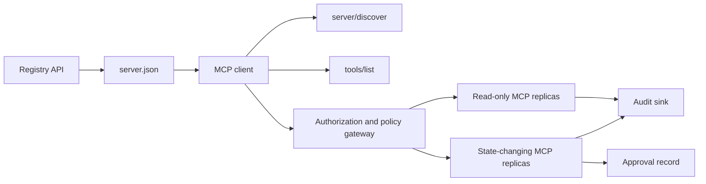

# 项目 13：带注册表与治理的无状态 MCP 服务器

> 生产级 MCP 并不是单个服务器进程，而是一串契约：可发布的元数据、实时发现、无状态请求信封、授权、策略、审计，以及部署证据。

**Type:** Capstone
**Languages:** Python and TypeScript reference models; any production language
**Prerequisites:** Phase 11, Phase 13, Phase 14, Phase 17, and Phase 18
**Required MCP deep dives:** [Lesson 28: Tool Contracts](../../../13-tools-and-protocols/28-mcp-tool-contracts-and-content/docs/en.md), [Lesson 29: Reliability](../../../13-tools-and-protocols/29-mcp-reliability-cancellation-and-flow-control/docs/en.md), [Lesson 30: Registry Supply Chain](../../../13-tools-and-protocols/30-mcp-registry-supply-chain-and-drift/docs/en.md), and [Lesson 31: Conformance Operations](../../../13-tools-and-protocols/31-mcp-conformance-versioning-and-operations/docs/en.md)
**Protocol target:** MCP `2026-07-28`
**Time:** ~25 hours

## 学习目标

- 实现无状态的 MCP 请求与结果信封。
- 将 Registry 元数据与实时协议发现分开维护。
- 构建确定性的、可感知缓存的工具发现。
- 对每次工具调用强制执行签发者、受众、作用域与审批策略。
- 以无会话亲和性的方式部署 Streamable HTTP。
- 在传输、授权、策略、注册表与审计各边界上证明行为正确。

## 必需的 MCP 前置学习路径

在把本项目视为可上生产之前，请按顺序完成四个已关联的第 13 阶段课程：

1. [第 28 课](../../../13-tools-and-protocols/28-mcp-tool-contracts-and-content/docs/en.md)定义了本服务器必须暴露的工具、schema、内容、分页、补全、路由以及错误契约。
2. [第 29 课](../../../13-tools-and-protocols/29-mcp-reliability-cancellation-and-flow-control/docs/en.md)定义了取消竞态、截止时间、幂等性、背压、重试以及重连行为。
3. [第 30 课](../../../13-tools-and-protocols/30-mcp-registry-supply-chain-and-drift/docs/en.md)定义了命名空间、来源（provenance）、准入固定（admission pin）、Registry 状态、漂移、账本以及回滚证据。
4. [第 31 课](../../../13-tools-and-protocols/31-mcp-conformance-versioning-and-operations/docs/en.md)定义了黄金与负向记录、严格版本纪元、SDK 差分检查、代理证明、脱敏、健康检查以及发布门禁。

本项目会整合上述产物，而不是用一个只走顺利路径的 SDK 测试取而代之。

## 问题

内部平台需要只读数据工具，以及一小组会改变状态的工具。开发者必须能够发现服务器、理解如何连接、检查其在线能力，并且只能调用自己有权使用的操作。

难点不在于注册一个函数，而在于让六种不同的「真相」保持一致：

1. `server.json` 说明服务器可以在哪里安装或访问。
2. `server/discover` 说明当前运行中的进程支持什么。
3. 每个请求说明它使用哪个协议修订版本以及哪些客户端能力。
4. 授权把调用者绑定到正确的签发者、资源与作用域。
5. 策略决定这个具体操作是否可以执行。
6. 审计证据记录跨越边界的内容，同时不泄露密钥或敏感载荷。

只要其中任何一项发生漂移，平台就可能列出一个无法访问的服务器、把不兼容的客户端路由过去、接受为其他资源签发的 token，或者在缺少预期审查的情况下暴露破坏性操作。

## 两层发现机制

Registry 与实时 MCP 服务器回答的是不同的问题。

| 层 | 契约 | 它回答的问题 |
|---|---|---|
| 发布 | `server.json` 与 Registry API | 这个服务器是什么、其包或远程端点在哪里、如何配置？ |
| 运行时 | `server/discover` | 这个进程支持哪些协议版本、能力、扩展，以及服务器身份是什么？ |

官方 Registry 使用带版本的 `server.json` schema。远程条目可以指定一个 Streamable HTTP URL：

```json
{
  "$schema": "https://static.modelcontextprotocol.io/schemas/2025-12-11/server.schema.json",
  "name": "com.example/internal-readonly",
  "title": "Internal Read-Only Tools",
  "description": "Read-only incident and data lookup tools.",
  "version": "1.0.0",
  "remotes": [
    {
      "type": "streamable-http",
      "url": "https://mcp.internal.example.com/readonly"
    }
  ]
}
```

Registry schema 的版本与 MCP 协议的修订版本相互独立。不要把其中一个日期改写成与另一个一致。每个文档都要按照它自己的契约来校验。

schema 合法并不能证明命名空间归属。通过 `example.com` 验证的发布者使用反向 DNS 命名空间 `com.example/*` 或其某个子命名空间。Registry 的认证流程证明这种归属关系。若按域名的常规顺序保留标签，指向的就是另一个命名空间。

stdlib 模型中的 `validate_registry_document` 函数有意只做部分远程配置校验。它会检查官方要求的 `name`、`description` 与 `version` 字段，可选的 `title`，已发布的名称与长度约束，具体版本号的形态，以及每个 `streamable-http` 或 `sse` 远程端点的 HTTP(S) URL 形态。它还要求 `remotes` 列表非空，因为本项目始终会对远程端点做实时探测。`validate_publisher_namespace` 单独把名称与已验证的发布者域名进行比对，而 `validate_runtime_alignment` 把发布信息中的名称与版本和运行时的 `serverInfo` 进行比较。官方 schema 还支持仅包含包的记录以及更多远程字段。发布之前，请用固定版本的官方 JSON Schema 或 `mcp-publisher` 校验整个文档；不要把这个零依赖子集当作完整的 schema 校验。

服务器必须实现 `server/discover`；客户端可以在调用其他方法之前先调用它。本项目的客户端会在解析端点之后执行该调用，并收到当前协议修订版本与实时能力：

```json
{
  "resultType": "complete",
  "supportedVersions": ["2026-07-28"],
  "capabilities": {
    "tools": {
      "listChanged": false
    }
  },
  "_meta": {
    "io.modelcontextprotocol/serverInfo": {
      "name": "com.example/internal-readonly",
      "version": "1.0.0"
    }
  },
  "ttlMs": 3600000,
  "cacheScope": "public"
}
```

私有目录可以额外索引归属、评审或生命周期数据，但不能把这些数据生造成 MCP 传输字段或 `server.json` 的根字段。组织策略应存放在已发布记录之外。确实需要公开自定义元数据时，使用 Registry 的 `_meta.io.modelcontextprotocol.registry/publisher-provided` 扩展，并遵守其 4 KB 上限。

## 无状态 MCP 核心

MCP 修订版本 `2026-07-28` 移除了协议会话以及 `initialize` / `notifications/initialized` 握手，也移除了 `Mcp-Session-Id`。

每个请求都在 `params._meta` 中携带协议上下文：

```json
{
  "io.modelcontextprotocol/protocolVersion": "2026-07-28",
  "io.modelcontextprotocol/clientCapabilities": {},
  "io.modelcontextprotocol/clientInfo": {
    "name": "internal-platform-client",
    "version": "1.0.0"
  }
}
```

版本与能力是请求本身的事实，而不是连接的事实。负载均衡器可以把连续请求发往不同的健康副本，因为任一副本都能仅凭消息本身校验该请求。

普通结果包含 `resultType: "complete"`。服务器应在每个结果的 `_meta.io.modelcontextprotocol/serverInfo` 中放入自身身份。协议版本缺失或不是字符串，属于参数无效 `-32602`。错误 `-32022` 仅用于请求提供了字符串但版本不受支持的情况，其 data 必须恰好为 `{"supported": ["2026-07-28"], "requested": "..."}`。

### 可缓存的发现

`tools/list` 对同一有效工具集合必须保持确定性。结果包含：

- `ttlMs`，给客户端的新鲜度提示；
- `cacheScope`，取值为 `public` 或 `private`；
- 稳定的工具顺序，使相同的列表可以复用 prompt 缓存；
- `resultType: "complete"` 与服务器身份元数据。

按用户授权的场景通常应产生 `cacheScope: "private"`。不要把按用户区分的工具可见性放在共享的公共缓存之后。

## Streamable HTTP

网络服务器暴露一个接受 POST 的 MCP 端点。每个 JSON-RPC 请求或通知都单独使用一次 POST。

对于请求，服务器返回单个 JSON 对象，或返回限定到该请求的 SSE 流。长生命周期的 `subscriptions/listen` 请求承载客户端主动订阅的变更通知。当前传输层没有独立的 GET 流、会话 DELETE、会话头，也没有 `Last-Event-ID` 重放。

每个请求包含：

- `MCP-Protocol-Version`，与请求体中的元数据一致；
- `Mcp-Method`，与 JSON-RPC 方法一致；
- `Mcp-Name`，用于 `tools/call`、`resources/read` 与 `prompts/get`；
- `Accept: application/json, text/event-stream`。

镜像头不一致时，用规定的 `-32020` 错误拒绝。校验 `Origin`，把本地开发服务器绑定到回环地址，对远程客户端做认证，并把关闭的请求级 SSE 响应视为取消。



```figure
cf-mcp-gate
```

## 授权与策略

传输层元数据不等于授权。每次调用都要校验授权。

对于远程服务器：

1. 发现受保护资源的元数据。
2. 为该资源选择授权服务器。
3. 优先使用 Client ID Metadata Documents 进行客户端注册。把 Dynamic Client Registration 当作兼容性支持。
4. 在授权过程中发送 resource indicator（资源指示符）。
5. 用本次流程所记录的授权服务器校验返回的 `iss` 值。
6. 按签发者区分客户端凭据。绝不在不同签发者之间复用注册数据。
7. 在 MCP 服务器上校验 token 的签发者、受众或资源、过期时间与作用域。
8. 针对具体工具与参数再执行一次策略决策。

诸如 `readOnlyHint` 与 `destructiveHint` 的工具注解有助于客户端呈现风险，但它们不是可信的授权控制手段。

### 审批是记录，不是魔法作用域

改变状态的调用需要一条审批记录，绑定操作者、工具、规范化参数或摘要、目标环境、过期时间，以及一次性或可重复使用的策略。仅凭一条聊天消息不能作为审批证明。

Python 模型对键排序后的规范 JSON 求哈希，再把该摘要与 token 主体、工具名、服务器 URL 和过期时间绑定。哪怕只改动一个参数再重放该记录，也会在处理器运行之前失败。审批是独立证据，而不是加到访问 token 上的作用域。

当把高风险工具放在可单独评审的界面上能显著缩小影响范围时，就应这样做。但只有在凭据、策略、部署身份与审计控制也彼此分离时，这种分离才有意义。

## 构建它

### 1. 建模发布元数据

创建 `server.json` 并做 schema 校验。包含一个位于发布者已认证命名空间内的稳定名称，以及版本、描述、适用时的官方 `repository` 或 `packages` 元数据，还有 remote 或 stdio 传输。密钥应作为声明的环境变量输入，绝不要写成字面值。

### 2. 实现实时发现

在任何功能 RPC 之前实现 `server/discover`。公布支持的协议版本、能力、扩展与服务器身份。增加一个使用 `-32022` 的版本拒绝用例。

### 3. 实现无状态信封

要求每个请求都携带协议版本与客户端能力。每个结果都返回 `resultType` 与服务器身份。移除初始化状态、连接级能力缓存与会话标识符。

### 4. 构建工具面

从两个只读工具和一个改变状态的工具开始。为每个工具提供有边界的 JSON Schema、精确的描述、确定性的结果形态以及诚实的注解。当客户端依赖结构化结果时，增加输出 schema。

### 5. 添加缓存感知的列表

以稳定顺序返回工具，并带上 `ttlMs` 与 `cacheScope`。分别演练缓存过期与列表变更通知的行为。

### 6. 添加授权与策略

校验签发者、受众、过期时间与作用域。每次工具调用都执行策略决策。把审批绑定到确切的高风险操作。在执行处理器之前拒绝缺失或过期的审批。

### 7. 分离注册表校验与运行时校验

先校验静态的 `server.json` 记录，再用 `server/discover` 探测远程端点。当已发布的远程端点、身份、版本或必需能力与运行中的进程不一致时，报告漂移。

### 8. 添加审计证据

记录操作者、签发者、资源、工具、策略决策、请求标识符、追踪上下文、延迟与结果。持久化之前，对敏感参数与结果做脱敏或摘要处理。审计汇点应位于模型可见上下文之外。

### 9. 演练水平扩展

把两个无状态副本放在负载均衡器后面。发送至少 100 个并发请求。证明正确性不依赖亲和性。如果某个工具需要跨调用状态，签发一个显式的不透明句柄，并把它存放在共享的持久系统中。

### 10. 跨越真实传输层

针对真实的服务器二进制运行一致性检查。捕获请求头与 JSON 请求体，而不只是 SDK 对象。演练版本错误、请求头不匹配、缺少作用域、受众错误、参数格式错误、处理器失败、取消以及缓存过期。

## 必需的证据包

提交内容只要缺少五类证据中的任何一类，就视为不完整：

| 证据 | 最低证明 | 来源课程 |
|---|---|---|
| 传输 | 黄金用例与负向用例的脱敏原始请求头和 JSON-RPC 请求体，包括元数据类型失败、请求头不匹配、不支持的版本、缺失或未知的 `resultType`、通知不应答，以及响应 ID 匹配 | [第 31 课](../../../13-tools-and-protocols/31-mcp-conformance-versioning-and-operations/docs/en.md) |
| 代理 | 同一稳定用例分别直连和经过已部署中间件运行，给出入口、源站与出口的状态码和响应体摘要；证明协议错误没有被折叠成通用 500 响应，流式响应没有被缓冲 | [第 29 课](../../../13-tools-and-protocols/29-mcp-reliability-cancellation-and-flow-control/docs/en.md) 与 [第 31 课](../../../13-tools-and-protocols/31-mcp-conformance-versioning-and-operations/docs/en.md) |
| 准入 | 已验证的发布者命名空间、不可变的 Registry 记录摘要、产物或远程来源、实时 `server/discover` 身份与能力观测、描述符固定值（descriptor pin）、当前 Registry 状态，以及准入账本事件 | [第 30 课](../../../13-tools-and-protocols/30-mcp-registry-supply-chain-and-drift/docs/en.md) |
| 重试 | 取消与完成之间的竞态、显式超时、安全的读重试、变更幂等键、重连后重新拉取，以及证明请求取消不会悄悄变成持久任务取消 | [第 29 课](../../../13-tools-and-protocols/29-mcp-reliability-cancellation-and-flow-control/docs/en.md) |
| 回滚 | 确切的上一个版本、准入与产物摘要、描述符固定值、当前 Registry 状态、当前健康窗口、路由恢复结果，以及脱敏的决策证据 | [第 30 课](../../../13-tools-and-protocols/30-mcp-registry-supply-chain-and-drift/docs/en.md) 与 [第 31 课](../../../13-tools-and-protocols/31-mcp-conformance-versioning-and-operations/docs/en.md) |

将脱敏证据包的摘要随发布一起保存。缺少任何一类就暂缓发布。不要从进程内分发器推断代理行为，不要从 Registry 中的存在推断准入，不要从新的 JSON-RPC id 推断重试安全性，也不要从「上一次部署」推断已具备回滚能力。

## 本地参考模型

Python 模型展示了注册表元数据、反向 DNS 发布者命名空间校验、发布到运行时的身份检查、实时发现、确定性工具列表、逐请求元数据、受信签发者、受众、过期时间与作用域检查、与操作绑定的审批、有文档说明的部分 Registry 校验器、策略与审计，且不打开网络套接字：

```bash
cd phases/19-capstone-projects/13-mcp-server-with-registry
python3 code/main.py
python3 -m unittest discover -s code/tests -v
```

TypeScript 项目在不使用 MCP SDK 的情况下，通过 stdio 暴露无状态 JSON-RPC 形态。它的 `tools/call` 路径强制执行与 `tools/list` 公布内容相同的带边界输入 schema；对已知工具传入无效参数时，会返回一个带 `isError: true` 的完整结果，而不调用执行器：

```bash
cd phases/19-capstone-projects/13-mcp-server-with-registry/code/ts
npm install
npm run typecheck
npm test
npm run demo
```

这些模型证明的是本地契约逻辑。它们不能证明 HTTP 请求头、OAuth 交换、Registry 发布、OPA 集成、负载均衡或采集器接收。

## 传输示例

```http
POST /mcp HTTP/1.1
Host: mcp.internal.example.com
Content-Type: application/json
Accept: application/json, text/event-stream
MCP-Protocol-Version: 2026-07-28
Mcp-Method: tools/call
Mcp-Name: postgres.readonly
Authorization: Bearer REDACTED

{
  "jsonrpc": "2.0",
  "id": 42,
  "method": "tools/call",
  "params": {
    "name": "postgres.readonly",
    "arguments": {"sql": "SELECT 1"},
    "_meta": {
      "io.modelcontextprotocol/protocolVersion": "2026-07-28",
      "io.modelcontextprotocol/clientCapabilities": {},
      "io.modelcontextprotocol/clientInfo": {
        "name": "internal-platform-client",
        "version": "1.0.0"
      }
    }
  }
}
```

## 交付它

交付一个包含以下内容的仓库：

- 通过 schema 校验的 `server.json`；
- 只读与改变状态的服务器界面；
- `server/discover`、确定性的 `tools/list`，以及受策略门控的 `tools/call`；
- 带两个可互换副本的 Streamable HTTP 部署；
- 授权与审批集成；
- Registry 发布器或私有 Registry API 适配器；
- 策略定义与绑定到操作的审批记录；
- 脱敏的审计输出与追踪传播；
- 传输与代理失败证据；
- 准入、重试、健康与回滚证据，以及脱敏证据包的摘要。

| 权重 | 标准 | 证据 |
|---:|---|---|
| 25 | 协议正确性 | 无状态请求元数据、发现、结果、请求头与负向用例 |
| 20 | 授权 | 签发者、受众、过期时间、作用域与操作绑定审批用例 |
| 15 | 注册表完整性 | 合法的 `server.json`、发布记录、实时发现探测与漂移报告 |
| 15 | 策略与安全 | 允许、拒绝、格式错误、过期审批与敏感数据用例 |
| 15 | 规模与可靠性 | 两个副本、不依赖亲和性、取消、超时与恢复 |
| 10 | 可审计性 | 脱敏的接收端审计与追踪证据 |

## 练习

1. 修改已发布的远程 URL，但保持实时服务器不变。让注册表校验报告确切的漂移。
2. 用相同输入发送两次 `tools/list`，证明工具顺序逐字节稳定。然后让 `ttlMs` 过期并刷新。
3. 发送合法请求体，但使用不同的 `MCP-Protocol-Version` 头。返回 `-32020`，且不调用策略或工具。
4. 为只读服务器签发 token，并把它出示给改变状态的服务器。证明受众校验在处理器运行之前就失败。
5. 把审批绑定到某个规范化参数摘要。改动一个字段，证明该审批无法重放。
6. 把连续调用轮流路由到两个副本。凡工作流需要持久化的地方，用显式的共享句柄替代隐藏的进程内存。
7. 断开请求级 SSE 连接，并用新的 JSON-RPC 请求 ID 重试。验证没有使用 `Last-Event-ID` 恢复路径。

## 关键术语

| 术语 | 人们常说的 | 实际含义 |
|---|---|---|
| 无状态 MCP | 「哪里都不存状态」 | 没有协议会话；跨调用状态是显式的，由服务器管理 |
| `server.json` | 「工具清单」 | 用于命名、打包、配置与传输的 Registry 元数据 |
| `server/discover` | 「握手」 | 一个普通的强制 RPC，用于获取实时版本与能力，而不是会话初始化器 |
| 缓存作用域 | 「我能缓存它吗？」 | 可缓存结果对共享复用还是私有复用是安全的 |
| 策略决策 | 「token 允许了它」 | 针对操作者、工具、目标、参数与上下文的独立决策 |
| 审批记录 | 「有人点了同意」 | 在过期策略下绑定到某个操作者与重大操作的证据 |
| 显式句柄 | 「会话 ID」 | 用于命名服务器管理状态的普通应用数据，而不是协议连接状态 |

## 延伸阅读

- [MCP 2026-07-28 关键变更](https://modelcontextprotocol.io/specification/2026-07-28/changelog)
- [Streamable HTTP](https://modelcontextprotocol.io/specification/2026-07-28/basic/transports/streamable-http)
- [服务器发现](https://modelcontextprotocol.io/specification/2026-07-28/server/discover)
- [MCP 授权](https://modelcontextprotocol.io/specification/2026-07-28/basic/authorization)
- [官方 Registry 的 server.json 要求](https://github.com/modelcontextprotocol/registry/blob/main/docs/reference/server-json/official-registry-requirements.md)
- [官方 Registry 的 OpenAPI 契约](https://registry.modelcontextprotocol.io/openapi.yaml)
