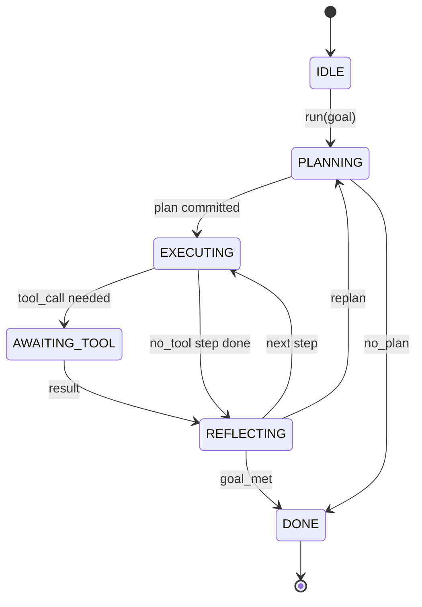

# 智能体 Harness 循环契约

> Harness 才是智能体，模型只是协处理器。本课冻结一套循环契约，你可以把任何模型接入其中。

**Type:** Build
**Languages:** Python
**Prerequisites:** Phase 13 lessons 01-07, Phase 14 lesson 01
**Time:** ~90 minutes

## 学习目标
- 把智能体 Harness 循环定义为一个带显式状态转移的确定性状态机。
- 实现十个生命周期 Hook 主题，供运维人员接入策略、遥测与防护栏。
- 定义两个拉取点（pull point），循环在此把控制权交还调用方，并在新的输入到来时恢复。
- 实施按会话的预算（轮次、工具调用、墙钟时间），超限时不泄露部分状态。
- 发出包含十一种事件类型的强类型流，使下游 UI 与追踪器无需直接检查循环即可订阅。

```figure
cf-loop-contract
```

## 框架

一个无人值守运行四十轮的编码智能体，不是聊天循环。它是一个状态机：其节点可被运维人员拦截，其边可被审计。一旦把契约写下来，更换模型、工具或策略就不再是一次重构，而变成一次注册调用。

本课构建这套契约。我们定义了六个状态、十个 Hook 主题、两个拉取点、十一种事件类型，以及一个预算信封。Harness 中的其他一切（工具注册表、JSON-RPC 传输、分发器、规划器）都插入这个形状。

## 状态

循环有六个状态。其中五个是活动状态，一个是终止状态。



`IDLE` 是唯一合法的入口点，`DONE` 是唯一合法的出口。`AWAITING_TOOL` 是唯一会交出拉取点的状态。其余状态转移都是内部的。

状态机是确定性的。给定相同的事件日志，Harness 会重新进入相同的状态。正是这一性质让你能够在不重新调用模型的情况下重放会话以进行调试。

## Hook 主题

Hook 是运维人员切入循环的缝口。Harness 会触发十个主题。每个主题可接受任意数量的订阅者。订阅者按注册顺序触发。订阅者可以修改载荷、抛出异常以中止本轮，或返回一个哨兵值以跳过下一步。

```text
before_plan         after_plan
before_tool_call    after_tool_call
before_step         after_step
on_error
on_pause
on_budget_exceeded
on_complete
```

这个形状与 Claude Code、Cursor、OpenCode 在 2025 年中期共同收敛到的形态一致。这些名字是功能性的，不是品牌化的。拦截 `rm -rf` 的 Hook 放在 `before_tool_call`。发送 OpenTelemetry span 的 Hook 放在 `after_step`。在暂停会话上恢复的 Hook 放在 `on_pause`。

## 拉取点

循环交出控制权两次。第一次在 `AWAITING_TOOL`，此时没有工具结果就无法继续推进。第二次在 `on_pause`，此时预算耗尽或有 Hook 明确请求人工评审。

拉取点不是异常，而是一次返回。调用方检查 Harness 状态，取回 Harness 所需的内容，然后调用 `resume(payload)`。Harness 从停止处继续。这与 Python 生成器的形状相同。跨越拉取点的传输方式由你选择。在 TUI 中是按键。经 MCP 时是 `tools/call`。经队列时是任务轮询。

## 事件流

循环在契约中的特定位置把事件追加到强类型流。该流只可追加，订阅者可以从任意偏移重放。已实现的十一种事件类型是：

- `session.start` — 在调用 `run(goal)` 时发出一次
- `plan.draft` — 在规划器返回草稿计划时发出
- `plan.commit` — 在草稿被提交为当前计划后发出
- `step.start` — 在每个执行步骤开始时发出
- `step.end` — 在每个执行步骤结束时发出
- `tool.call` — 在需要工具的步骤把控制权交给调用方时发出
- `tool.result` — 在带着工具结果恢复时发出
- `tool.error` — 在带错误恢复时发出，或在 Hook 中止调用时发出
- `budget.warn` — 在达到某个预算限制时发出
- `session.pause` — 在循环因暂停（预算或 Hook）而让出时发出
- `session.complete` — 在循环到达 `DONE` 时发出一次

事件不重复 Hook 的载荷。Hook 是命令式的（修改、中止），事件是观测式的（记录、发送）。二者应视为正交。

## 预算信封

一个会话携带三种限制：轮次数、工具调用数、墙钟秒数。每进行一轮，轮次计数加一。每次工具调用，工具调用计数加一。每次状态转移都会检查墙钟时间。任一限制达到时，循环触发 `on_budget_exceeded`，发出 `budget.warn`，然后在下一个拉取点以预算超限为原因转移到 `IDLE`。

预算不是急停开关，而是一次让出。调用方决定是延长预算并恢复，还是关闭会话。

## 本课不做什么

本课不调用模型，不注册真实工具，也不实现传输。这些是接下来四课的内容。本课把契约钉死，好让接下来四课能够直接插入而无需重写。

`main.py` 中的确定性规划器只是一个替身。它返回一个硬编码的三步计划，其中两步需要工具结果。重点在循环，而不在计划。

## 如何阅读代码

`HarnessLoop` 是主类。它保存状态、触发 Hook、发出事件。`Budget` 跟踪限制。`Event` 是流上的强类型信封。`HookRegistry` 是分发表。`_transition` 是唯一改变状态的函数，因此状态机的不变量集中在一处。

从开头到结尾通读 `main.py`，然后读 `code/tests/test_loop.py`。测试固定了每次状态转移与每个 Hook 的触发顺序。

## 更进一步

在生产中构建 Harness，最难的部分不是状态机，而是让契约真正可执行。契约必须能经受规划器的热重载，经受返回畸形 JSON 的工具，经受在四十轮会话进行到三分之二时于 `before_tool_call` 中抛异常的 Hook。本课的测试演练了这些失败模式。运行它们，破坏它们，再补充用例。

下一课加入工具注册表，之后是 JSON-RPC 传输，再之后是分发器。到第二十四课时，本文件中的循环将针对真实工具运行真实计划，并强制执行真实预算。
