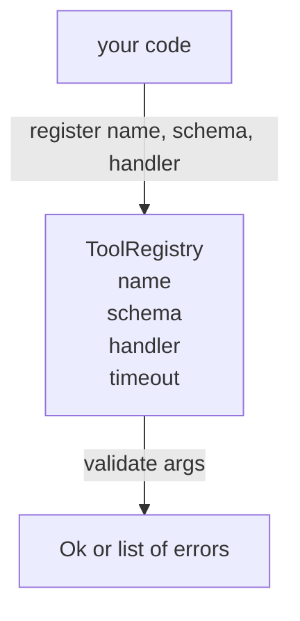

# 工具注册表与 Schema 验证

> Agent 验证不了的工具，就是它调用不了的工具。先构建注册表和 schema 检查器，再构建工具。

**Type:** Build
**Languages:** Python
**Prerequisites:** Phase 13 lessons 01-07, Phase 14 lesson 01
**Time:** ~90 minutes

## 学习目标
- 维护一张「工具名 → schema → 处理函数」的类型化注册表，让调度器问一次就能一直信任。
- 实现 JSON Schema 2020-12 的一个子集，覆盖 tool call 实际会用到的九成关键字。
- 返回精确的、JSON Pointer 形式的错误路径，让模型一次往返就能自我纠正。
- 默认拒绝重复注册，除非显式覆盖——生产环境的工具目录就是这样悄悄漂移的。
- 保持验证器纯净（无 I/O、无时间、无全局状态），这样它可以在重放日志上重复运行。

```figure
cf-registry-validate
```

## 为什么注册表先于工具

2026 年的编码 Agent 注册的工具数量，早已超过模型单个上下文窗口的容量。一个像样的 harness 会注册两百个工具，并在任意一轮里露出十到四十个。注册表是「有哪些工具」「参数长什么样」「该调用哪个处理函数」的唯一事实来源。这三个问题一旦钉死，harness 的其余部分就不用再猜了。

我们要避免的错误是：只发布处理函数却没有 schema，或者只发布 schema 却不做验证。两种都很常见。两种都会把下一层（第二十三课的调度器）变成猜谜游戏，唯一的失败模式就是处理函数抛出的堆栈跟踪。

## 工具记录的样子

```text
ToolRecord
  name        : str          (unique, lowercase alphanumeric and underscore segments separated by dots, e.g., snake_case.segment.case)
  description : str          (one line, shown to the model)
  schema      : dict         (JSON Schema 2020-12 subset)
  handler     : Callable     (async or sync, returns Any)
  idempotent  : bool         (dispatcher uses this for retry decisions)
  timeout_ms  : int          (override per-tool dispatcher default)
```

schema 是验证器唯一会碰的字段。处理函数对它是不透明的。我们有意把两者分开：schema 是数据，处理函数是代码。混在一起，你就会忍不住把验证逻辑塞进处理函数——这正是我们要阻止的 bug。

## JSON Schema 2020-12 子集

完整的 2020-12 规范是一篇论文。我们只需要八个关键字。

```text
type           string / number / integer / boolean / object / array / null
properties     map of property name -> schema
required       list of property names
enum           list of allowed primitive values
minLength      integer, applies to strings
maxLength      integer, applies to strings
pattern        ECMA-262-compatible regex, applies to strings
items          schema applied to every array element
```

这足以覆盖工具 API 的实际需求。我们没有加入的关键字（oneOf、anyOf、allOf、$ref、条件分支）在生产 schema 里是合法的，但会让验证器变成带环的树遍历器。我们要构建的是注册表，不是 JSON Schema 引擎。

## JSON Pointer 错误路径

验证失败时，验证器返回一组错误。每条错误都带一个指向输入内部的 JSON Pointer 路径。指针是以斜杠开头的属性名与数组下标序列。

```text
{"a": {"b": [1, 2, "x"]}}
                    ^
                    /a/b/2
```

模型读错误路径比读句子强。如果 schema 要求 `args.user.email`，而模型传了一个整数，错误应该是 `/user/email`，并带上 `expected_type: string`。模型下一次调用就能改对，不需要再来一轮自然语言解释。

## 注册与覆盖

`register(name, schema, handler, **opts)` 默认拒绝重复注册。调用方必须传 `override=True` 才能替换。这是运维卫生。代码库里两个地方悄悄注册同一个工具名，是那种在生产环境要花一周才能找到的 bug。

注册表暴露三个读取方法。`get(name)` 返回记录或抛异常。`validate(name, args)` 返回 `Ok` 或一组错误。`names()` 按注册顺序返回工具名。

## 验证器是什么，不是什么

它是对 schema 树的一次递归单遍遍历。它是纯函数。它不调用处理函数。它不做类型强制转换（字符串 `"42"` 过不了 number schema）。它不会悄悄截断。

它不是安全边界。验证通过之后，恶意的处理函数依然可能乱来。第二十三课的调度器会加上超时和沙箱层。注册表负责的是形状。

## 结构



## 如何阅读代码

`code/main.py` 定义了 `ToolRegistry`、`ToolRecord`、`ValidationError` 以及八个验证函数。验证器根据 `schema["type"]` 分派（带 `enum` 的 schema 按无类型枚举检查处理）。每个类型验证函数返回空列表或 `ValidationError` 列表。顶层遍历器负责拼接错误，并在下探时前置路径段。

`code/tests/test_registry.py` 覆盖注册、覆盖、验证成功、带路径的验证失败，以及子集中的每个关键字。

## 走得更远

这节课落地后，你会想要两个扩展：针对本地 definitions 块的 `$ref` 解析，以及用于严格形状的 `additionalProperties: false`。两者都很小，也都是工具目录超过五十个之后常见的加项。这节课没有放进，是为了让文件保持一次读完的长度。

下一课（第二十二课）构建 JSON-RPC stdio 传输层，把这个注册表暴露给模型客户端。再下一课（第二十三课）把两者一起包进带超时和重试的调度器。
