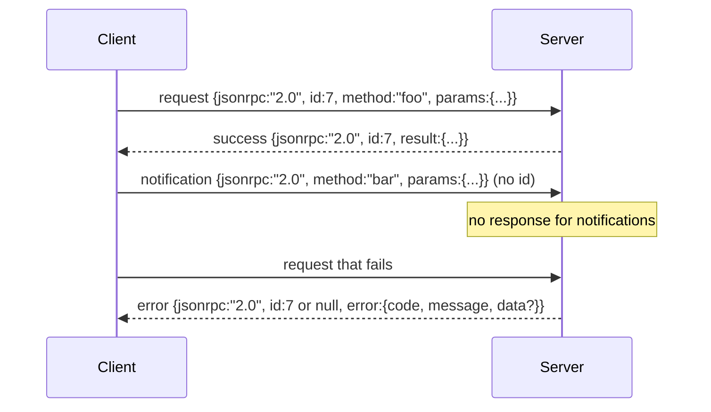

# 基于换行分隔 stdio 的 JSON-RPC 2.0

> 模型客户端与工具服务器之间的传输层，就是跑在 stdio 上的 JSON-RPC。亲手实现一次，你才会明白每一层分帧究竟在为什么付出代价。

**Type:** Build
**Languages:** Python
**Prerequisites:** Phase 13 lessons 01-07, Phase 14 lesson 01
**Time:** ~90 minutes

## 学习目标
- 在 stdin 和 stdout 上说以换行分隔 JSON 分帧的 JSON-RPC 2.0。
- 掌握五个标准错误码（-32700、-32600、-32601、-32602、-32603），并以正确的语义呈现它们。
- 区分请求、响应、通知和批处理，不发明新的信封字段。
- 每行出现一个解析错误时单独处理，不污染流的其余部分。
- 用 io.BytesIO 构建一个自终止的演示，让课程无需创建子进程即可运行。

```figure
cf-jsonrpc-frames
```

## 为什么 JSON-RPC 仍是通用语

2026 年的编码 Agent，在一次会话里大概要和十二个工具服务器对话。每个服务器都是一个独立进程或远程端点。线上格式从 2013 年起就没变过。JSON-RPC 2.0 的规范只有两页。它能活下来，是因为替代方案（gRPC、每次调用一个 HTTP 请求、自定义二进制）都强加了 JSON-RPC 没有的取舍：它们要么绑定流式，要么绑定批处理，要么绑定传输层。JSON-RPC 在 stdio、socket、WebSocket 和 HTTP 上保持对称；只要双方都遵守规范，客户端就能驱动一个它从未见过的服务器。

本课构建的是 stdio 变体：换行分隔 JSON。每个请求一行，每个响应一行。传输边界就是 `\n`。

## 报文格式

信封一共四种形状。两种由客户端发出，两种由服务器发出。



通知没有 `id`。服务器不得对它作出响应。如果服务器给通知回了响应，客户端无法把它挂回任何调用点。就这一条规则，让分帧的算术保持简单。

批处理是一个 JSON 数组，元素是请求或通知。服务器用一个响应数组回复，顺序任意，每个非通知条目对应一个响应。如果批处理里全是通知，服务器什么也不回。

## 五个错误码

```text
-32700  Parse error      JSON could not be parsed
-32600  Invalid Request  Envelope shape is wrong
-32601  Method not found
-32602  Invalid params
-32603  Internal error
```

-32000 到 -32099 之间的错误码保留给服务器自定义错误。其余都是应用自定义。本课只使用这五个。如果处理函数抛异常，传输层会把它包装成 -32603，并把异常类名放进 `data.exception`。

解析错误有一条特殊规则：响应里的 `id` 是 `null`，因为请求根本没解析到能提取 id 的程度。

## 换行分帧与 BytesIO 演示

传输层一次读一行。所谓一行，是直到并包括 `\n` 的字节。如果某一行解析失败，传输层写出一个 `id: null` 的 -32700 响应，然后继续。流不会被污染，下一行照常解析。

本课把一对 `io.BytesIO` 包装成 stdin 和 stdout。服务器读取请求直到 EOF，为每个请求写出响应，然后返回。客户端把响应读回来。不创建进程，没有超时。传输行为和真实的子进程管道完全一致，因为 Python 的 `io` 接口提供了相同的 `.readline()` 和 `.write()` 契约。

## 方法分派

传输层不知道存在哪些方法。它把请求交给 harness 提供的可调用对象 `handler(method, params)`。处理函数返回结果或抛异常。三类异常对应特定的错误码。

```text
MethodNotFound -> -32601
InvalidParams  -> -32602
Anything else  -> -32603 with exception name in data
```

传输层永远看不到工具注册表。注册表位于处理函数之后。这正是我们想要的分层：传输层说 JSON-RPC，注册表说工具形状，调度器（第二十三课）把两者缝合起来。

## 出错时的流行为

```text
client writes              server reads             server writes
---------------            -----------              -------------
{...valid request...}      parses ok                {...response, id matches...}
{...broken json...         parse fails              {id:null, error: -32700}
{...valid request...}      parses ok                {...response, id matches...}
{...missing method...}     invalid envelope         {id:X, error: -32600}
```

一行坏 JSON 不会让循环停下。缺少 `method` 字段不会让循环停下。处理函数抛异常也不会让循环停下。传输层会一直读到 EOF。

## 通知与不对称流程

通知是「发出即忘」。harness 用通知处理进度事件、取消信号和日志行。长跑工具正是靠通知持续推送状态更新，而不必为每一次更新做一次往返。

本课实现了一个出站通知辅助函数 `write_notification`。服务器用它在一个请求进行中发出进度。演示展示了这个模式：请求进来，处理函数发出两条进度通知，然后写出最终响应。

## 如何阅读代码

`code/main.py` 定义了 `StdioTransport`、解析辅助函数 `parse_request`、三个写出辅助函数（`write_response`、`write_error`、`write_notification`），以及分派循环 `serve`。错误码常量定义在模块作用域。

`code/tests/test_transport.py` 覆盖五个错误码、通知（不写响应）、批处理（数组进、数组出、跳过通知）、坏 JSON（先解析错误再继续），以及处理函数在调用中途写通知的不对称流程。

## 走得更远

这个传输层足够支撑后续课程。生产级传输层还要加三样东西。第一，能穿透转发的关联 id 字段（你的 `id` 已经是这个，但在 mesh 里还需要一个外层 trace id）。第二，取消通道（一条类似 `$/cancelRequest` 的通知，携带进行中调用的 id）。第三，内容类型协商握手，让同一个 socket 既能说 JSON-RPC 也能说 Streamable HTTP。这些都不改变线上格式，只是增加元数据。
