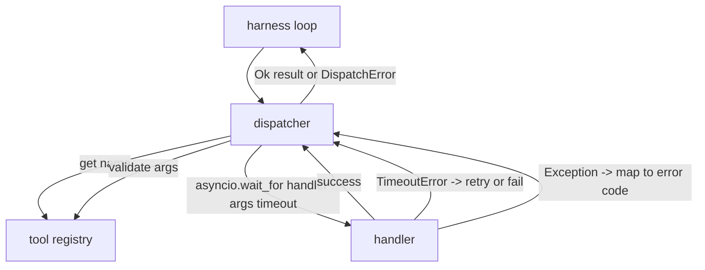
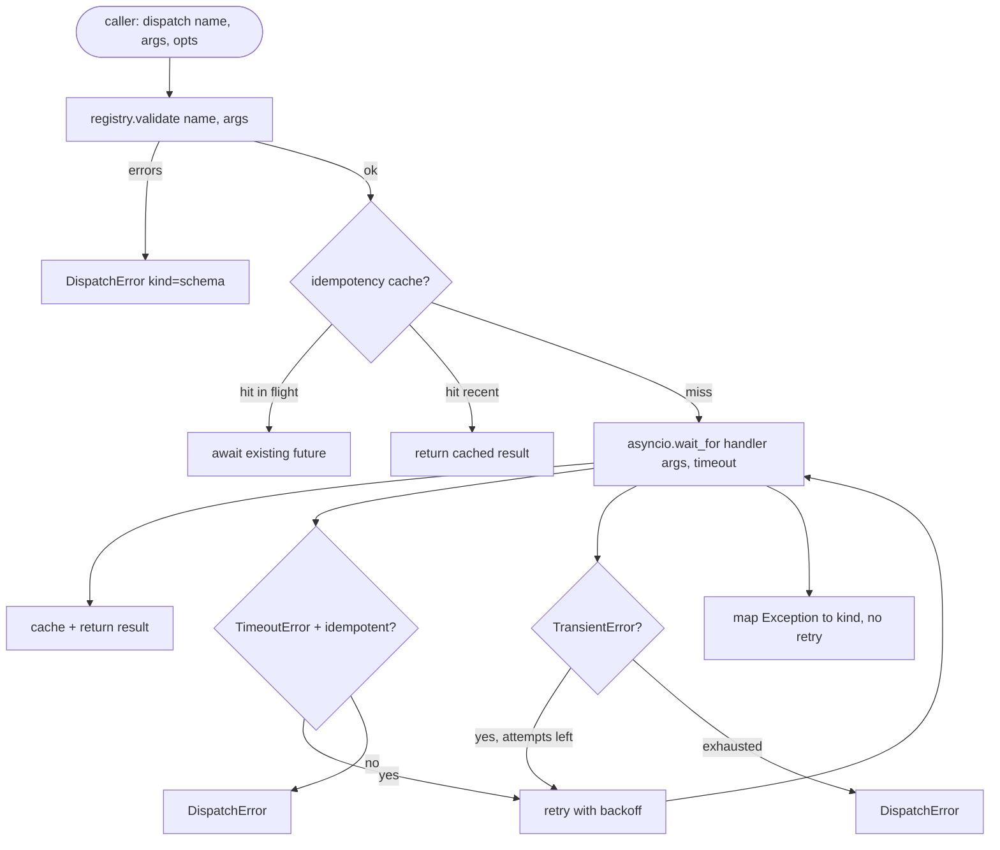

# Function call 调度器

> 调度器是 harness 兑现 schema 每一项承诺的地方。超时、重试、去重、错误映射，全都在这一条接缝上完成。

**Type:** Build
**Languages:** Python
**Prerequisites:** Phase 13 lessons 01-07, Phase 14 lesson 01
**Time:** ~90 minutes

## 学习目标
- 用按次超时包裹工具处理函数，超时时返回类型化错误，而不是让循环挂死。
- 应用带抖动的指数退避重试，并设置最大尝试次数。
- 基于幂等键去重重试，使与慢速原始调用竞争的重试不会执行两次。
- 把处理函数异常和传输层故障映射到 harness 循环已经理解的统一错误信封。
- 为并行分派设置并发上限，使四十个 tool call 的扇出不会耗尽事件循环。

```figure
cf-dispatch-retry
```

## 调度器的位置

它位于 harness 循环（第二十课）和工具注册表（第二十一课）之间。传输层（第二十二课）给循环提供输入。循环把 tool call 交给调度器。调度器查询注册表、运行处理函数，然后返回结果或 JSON-RPC 形状的错误信封。



调度器是唯一知道定时器、重试和幂等性的层。循环不知道。注册表不知道。处理函数不知道。这种隔离正是重点。

## 超时

每个工具都有默认超时。注册表记录里带着 `timeout_ms`。当 harness 传入按次覆盖时，调度器用它覆盖默认值。我们使用 `asyncio.wait_for`。超时发生时，处理函数任务被取消，调度器返回 `DispatchError(kind="timeout")`。

默认情况下，超时对非幂等工具来说不是可重试错误。一个超时的 `db.write` 可能已经提交，也可能没有。重试会重复写入。调度器尊重注册表记录里的 `idempotent` 标志：幂等工具重试，非幂等工具不重试。

## 指数退避重试

重试策略是最多三次尝试。退避是指数式加抖动的。

```text
attempt 1  -> delay 0
attempt 2  -> delay 0.1s * (1 + random[0..0.5])
attempt 3  -> delay 0.4s * (1 + random[0..0.5])
```

只有 `timeout` 和 `transient` 错误会重试。`schema` 错误、`not_found` 或 `internal` 错误不重试。schema 错误是确定性的，重试不会改变结果，只会烧掉预算。

重试循环遵守 harness 给出的预算。如果调用方的预算里剩余 tool call 为零，调度器会在第一次尝试时就快速失败，返回 `kind="budget_exceeded"`。

## 幂等键去重

重试在原始调用仍在进行时触发，是真实的生产 bug。第一次调用卡在 4.9 秒（刚好在超时之下）。重试在 5 秒时触发。现在两个请求在同一个后端上竞争。如果工具是 `payments.charge`，你就扣了两次款。

调度器接受可选的 `idempotency_key`。如果调用到达时同一个键正在执行中，调度器会等待那个进行中的 future 并返回它的结果。缓存会在完成后继续保留键六十秒，以吸收迟到的重试。

键由调用方负责。harness 从 planner 派生它：`f"{step_id}:{tool_name}:{hash(args)}"`。调度器不自己发明键，因为仅从参数派生键，会让两个语义不同的调用看起来一模一样。

## 错误信封

失败的分派返回统一的形状。

```text
DispatchError
  kind        : "timeout" | "transient" | "schema" | "not_found" | "internal" | "budget_exceeded"
  message     : str
  attempts    : int
  jsonrpc_code: int   (one of -32601, -32602, -32603)
```

harness 循环把 `kind` 映射到下一个状态。`schema` 和 `not_found` 进入 `on_error` 并触发重新规划。`timeout` 和 `transient` 进入 `on_error`，是否重新规划取决于尝试次数。`budget_exceeded` 触发 `on_budget_exceeded`。

## 扇出时的并发限制

`gather(*calls)` 会同时运行所有协程。四十个 tool call，就是四十个打开的 socket 或四十个子进程管道。大多数后端都不喜欢来自单个客户端的四十条并行连接。

调度器用信号量包装 `gather`。默认并发上限是八。每个调用在分派前获取信号量，完成时释放。调用方看到的是 `gather` 形状的输出，但实际调度是有上限的。

## 单次调用的流程



## 如何阅读代码

`code/main.py` 定义了 `Dispatcher`、`DispatchError` 和 `TransientError`。调度器在构造时接收一个注册表。异步方法 `dispatch(name, args, ...)` 是唯一的入口点。每次尝试的超时在 `_run_with_retries` 内部用 `asyncio.wait_for` 就地施加。`gather_bounded(calls)` 在并发上限内运行多个分派。

`code/tests/test_dispatcher.py` 覆盖超时触发、瞬时错误重试、schema 错误不重试、幂等去重（两个同键的并发调用合并为一次处理函数调用），以及并发限制（信号量实际生效）。

测试使用 `asyncio.sleep(0)` 和基于 `Counter` 的确定性处理函数，因此能在毫秒内完成，不依赖墙上时钟计时。

## 走得更远

生产级调度器通常会加两个扩展。第一，在每个状态迁移处做结构化日志（循环的事件流已经给了你一部分，但调度器还应发出 `dispatch.attempt` 和 `dispatch.retry` 事件）。第二，熔断器：在一个时间窗口内失败 N 次后，该工具进入冷却期，分派立即返回 `kind="circuit_open"`，不再尝试调用处理函数。两者都能叠加在这个调度器之上，而不改变契约。

第二十四课把调度器粘到计划-执行 Agent 上，让你看到四块部件一起运转。
