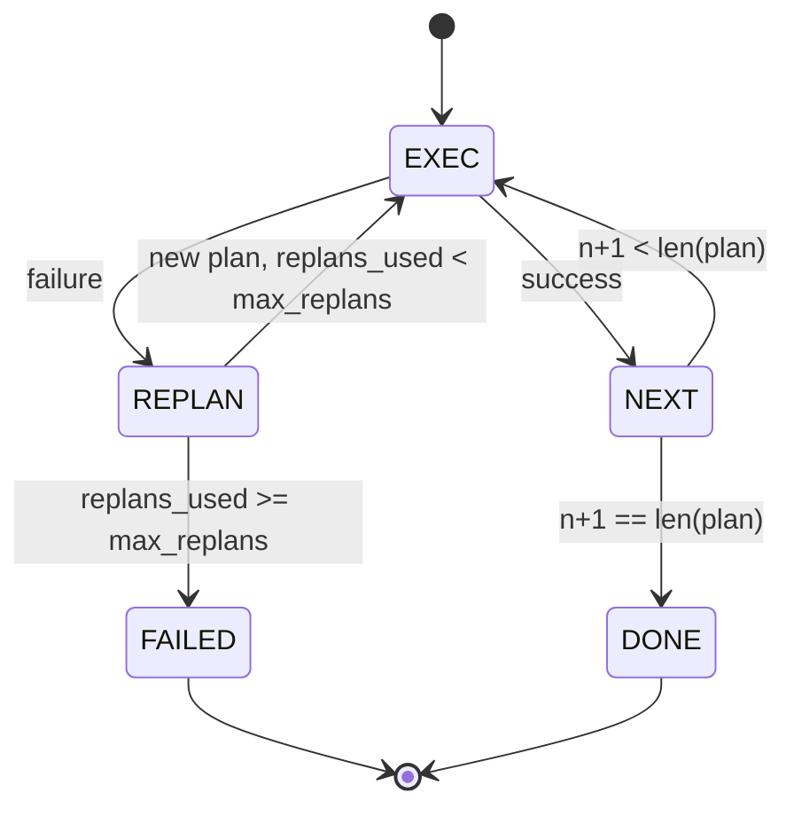

# 计划-执行控制流

> 挺不过一次失败的计划只是脚本。能重新规划的脚本才是智能体。先构建重新规划器。

**Type:** Build
**Languages:** Python
**Prerequisites:** Phase 13 lessons 01-07, Phase 14 lesson 01
**Time:** ~90 minutes

## 学习目标
- 把计划表示成有序的类型化步骤列表，让执行器能推断进度和结果。
- 按顺序执行步骤，并把失败可控地交回给 planner。
- 从当前游标处重新规划，并在上下文中带上先前的错误，让下一次计划有据可依。
- 每次修订时发出计划 diff，让下游追踪器或 UI 能展示计划为何改变。
- 强制执行两个预算：硬性的步骤上限和硬性的重新规划上限。

```figure
cg-plan-replan
```

## 计划与执行，而非思维链

思维链智能体不断吐 token，让循环去猜工具调用在哪里结束。计划-执行智能体先产出结构化计划，再确定性地执行每个步骤。计划是 harness 可以内省的数据。执行则是 harness 让这份数据流经调度器的过程。

两个部件：planner 产出计划，executor 运行计划。真正有意思的是执行器撞上失败时会发生什么。有三种选择：

```text
1. Abort         (return failed, surface the error)
2. Skip          (mark step failed, continue with the rest)
3. Replan        (hand the error to the planner, get a new plan from the cursor)
```

重新规划，是让脚本变成智能体的那一种。

## Step 的形状

```text
Step
  id              : int           (monotonic within a plan revision)
  tool_name       : str
  args            : dict
  expected_outcome: str           (planner's stated success condition)
  result          : Any | None
  error           : str | None
```

`expected_outcome` 是 planner 随步骤一起发出的简短句子。执行器不会强制执行它。它有两个用途：重新规划器在修订计划时读取它；事件流把它发出去，让追踪器能显示「这一步本来应该完成 X」。

## planner 的形状

```python
def planner(goal: str, history: list[Step], last_error: str | None) -> list[Step]:
    ...
```

一个纯函数。`goal` 是用户目标。`history` 是已经执行过的步骤（填好了结果和错误）。`last_error` 在第一次调用时为 None，之后每次都是最近一次失败的消息。planner 返回从游标处开始的下一份计划。

planner 不知道执行器，不知道重试，不知道超时。它只产出计划，仅此而已。

## 执行器

执行器是一个小状态机。每个步骤都经由调度器运行。结果只有三种：成功、可重新规划的失败、致命失败。可重新规划的失败会交回 planner。致命失败（预算超限、重新规划次数触顶）返回 `FAILED` 的会话结果。



## 修订时的计划 diff

当 planner 在失败后返回新计划时，执行器发出一个 `plan.diff` 事件，包含三个字段。

```text
removed: list of step ids that were in the old plan and are not in the new
added  : list of step ids in the new plan that were not in the old
revised: list of step ids whose tool_name or args changed
```

追踪器或 UI 可以把它渲染成：被移除的步骤加删除线，新增的步骤高亮。重点不是 diff 格式，而是修订本身是一个可见事件，不是一次悄无声息的重写。

## 两个硬预算

`max_steps` 限制整个会话内的总步骤执行次数，包括重新规划后的执行。默认是十二。一份线性的五步计划如果重新规划两次、每次多出三步，就会执行十六次，超出预算。执行器会拒绝这次重新规划并返回 FAILED。

`max_replans` 限制首份计划之后 planner 被调用的次数。默认是五。这是更重要的限制。否则，一个连续五次返回同一份坏计划的 planner 会一直循环，直到步骤预算把它拦下。限制重新规划次数能让失败来得更快，原因也更清楚。

## 本课的确定性 planner

本课不调用模型。课程附带一个确定性 planner，根据 `last_error` 选择计划。

```text
last_error is None    -> emit a four-step plan
last_error matches X  -> emit a three-step plan that routes around X
last_error matches Y  -> emit a two-step plan that gives up gracefully
otherwise             -> return [] (signals nothing to replan)
```

这足以测试执行器在每条迁移路径上的行为：成功、重新规划一次、重新规划两次、重新规划耗尽，以及步骤预算耗尽。

## 结果形状

```text
SessionResult
  status      : "completed" | "failed"
  reason      : str     ("goal_met" | "step_budget" | "replan_budget" | "no_plan")
  history     : list[Step]
  revisions   : list[PlanDiff]
  events      : list[Event]
```

第二十课的 harness 循环可以直接读取它。第二十三课的调度器负责执行每个步骤。第二十一课的注册表验证每个步骤的 args。第二十二课的传输层则会把整条流程经由 JSON-RPC 呈现给模型客户端。

## 如何阅读代码

`code/main.py` 定义了 `PlanExecuteAgent`、`Step`、`PlanDiff`、`SessionResult` 以及确定性 planner。执行器是一个 `run(goal)` 方法，返回 `SessionResult`。计划 diff 通过比较步骤 id 和 `(tool_name, args)` 元组计算。

`code/tests/test_agent.py` 覆盖线性成功、计划中途失败后重新规划一次、重新规划耗尽返回 `failed:replan_budget`、步骤预算耗尽，以及 plan-diff 事件格式。

## 走得更远

把本课接到真实模型之后，你会想要两个扩展。第一，部分计划缓存：当六步计划的前三步成功、随后失败时，你不想重跑前三步。执行器已经保留了 history，planner 只需要读取它。第二，并行分支：当前执行器严格串行。一个能发出独立分支的 planner（用 `gather_step` 代替 `next_step`）可以通过调度器并发运行两个工具调用。

两者都会增加真实复杂度，也都更容易在线性执行器钉牢之后再加入。这正是本课完成的事。
