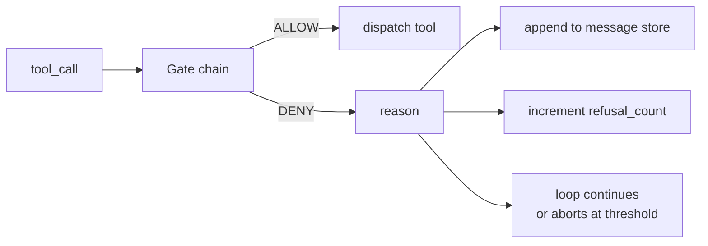
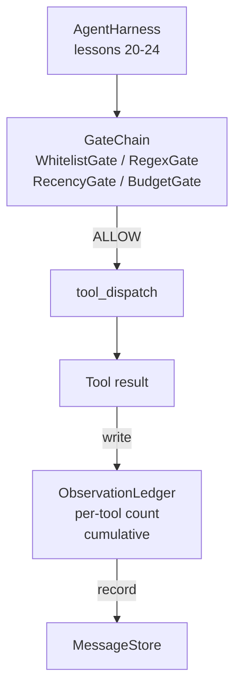

# 项目第 25 课：验证门与观察预算

> 没有验证层的智能体 harness，只是一个穿着风衣的愿望。本课构建确定性的门链，由它决定一次工具调用是否允许触发、智能体允许看到多少输出，以及智能体读得太多时循环必须在什么时候停下。门链由若干小而具名的门，加上一本记录模型已经看过的每一个 token 的观察账本组成。

**Type:** Build
**Languages:** Python (stdlib)
**Prerequisites:** Phase 19 · 20-24 (Track A1: agent loop, tool registry, message store, prompt builder, model router), Phase 14 · 33 (instructions as constraints), Phase 14 · 36 (scope contracts), Phase 14 · 38 (verification gates)
**Time:** ~90 minutes

## 学习目标

- 构建带确定性 `evaluate(call)` 方法的 `VerificationGate` 协议。
- 把预算门、时效门、白名单门和正则门组合成带短路语义的门链。
- 通过 `ObservationLedger` 以工具和轮次为键记录每一次观察。
- 当累计观察预算将被超出时，拒绝该工具调用。
- 输出结构化的 `GateDecision` 记录，供下游可观测性系统摄取。

## 问题

当智能体 harness 让模型自由调用工具时，真实使用不到一小时就会出现三类 bug。

第一类是无界观察。对 20 万行仓库跑一次 grep，会把五十万个 token 的输出倒进下一轮。模型每千字节只看到一个匹配，其余上下文全部浪费。token 账单很大，而智能体在任务上的表现变得更差，而不是更好。

第二类是时效失效。长跑任务累积了五十次工具调用。模型把第三轮里第一次 read_file 的结果当成当前状态重新阅读。第四十七轮做出的编辑从未出现，因为 prompt 构建器把最早的观察排在了最前面。

第三类是权限蔓延。一个研究任务从调用 `web_search` 开始，最后却跑起了 `shell`，因为模型编造了一个工具名，而 harness 默认放行。等到有人去看 trace 时，/tmp 里已经躺着一个垃圾文件，一个 curl 已经打到了私有 API 上。

验证门就是 harness 里负责说「不」的组件。它不是模型，不是裁判。它是一个确定性函数，输入 `(call, history, ledger)`，返回 ALLOW 或 DENY 并附带理由。理由会被记录，也会告知模型，然后循环继续或中止。

## 概念



只要一个对象带有 `evaluate(call, ctx) -> GateDecision` 方法，它就是一个门。门链是一个有序列表。评估在第一次拒绝时短路。顺序很重要：廉价的结构门排在昂贵的 token 计数门之前。

本课提供四个门：

- `WhitelistGate`。允许的工具名是一个显式集合，集合之外一律拒绝。这是最廉价的门，排在最前。
- `RegexGate`。工具参数与正则匹配。适合拒绝带 `rm -rf` 的 shell 调用，或发往内部 IP 的 HTTP 调用。它只对调用载荷做纯函数判断。
- `RecencyGate`。模型只能看到最近 N 轮的观察，更早的观察会被遮蔽。如果某次工具调用的结果会延长一个已经过期的观察窗口，门就拒绝这次调用。
- `BudgetGate`。模型在整个会话中累计读取的 token 有一个上限。当账本显示已达上限，之后每一次工具调用都被拒绝。

观察账本是记账工具。每次成功的工具调用写下一行：工具名、轮次、发出的 token 数、累计值。账本回答两个问题：模型总共看了多少，以及它看了工具 X 多少。预算门读第一个。按工具划分的预算门——留作练习让你实现——读第二个。

```figure
cg-gate-chain
```

## 架构



harness 向门链提问。门链要么点头，要么拒绝。点头时，工具运行，账本记一笔，结果追加到消息存储。拒绝时，拒绝理由以系统消息的形式交给模型，由循环决定重试还是中止。

## 你将构建什么

实现是一个 `main.py` 加测试。

1. `Observation` 和 `ToolCall` 数据类定义传输形状。
2. `ObservationLedger` 记录 `(turn, tool, tokens)` 行，并提供 `cumulative()` 和 `per_tool(name)`。
3. `GateDecision` 携带 `(allow, reason, gate_name)`。
4. `VerificationGate` 是协议，每个门实现 `evaluate(call, ctx)`。
5. `GateChain` 包装一个有序列表。它依次调用每个门，返回第一个拒绝；如果所有门都通过，则返回允许。
6. 演示运行一个微型合成智能体循环。共三轮。第三轮触发预算门，循环报告一次干净的拒绝，拒绝计数非零。

token 计数器故意使用笨拙的 `len(text) // 4` 启发式。本课的重点是门的管道，不是 tokenizer。生产环境请换成真正的 tokenizer。

## 为什么门链顺序很重要

拒绝比允许更廉价。`WhitelistGate` 是 $O(1)$ 的哈希查找。`RegexGate` 的开销是 $O(\text{pattern} \cdot \text{argv})$。`RecencyGate` 读取消息存储的一小段。`BudgetGate` 要读整本账本。你按成本升序排列，让被拒绝的调用在做昂贵工作之前就短路。

你还要按影响范围排序。白名单是最强的主张：这个工具不在契约里。正则门其次：这个参数不在契约里。时效门排在其后：harness 仍然关心，但这次调用在结构上是合法的。预算门最后，因为从定义上说，它只在其他门都通过时才会触发。

## 如何与 Track A 的其余部分组合

前面的课程给了你循环、工具注册表、消息存储、prompt 构建器和模型路由。本课添加的是模型与工具之间的那一层。第 26 课提供沙箱，门链说 ALLOW 之后，调度器把工具调用交给它。第 27 课提供评估 harness，把拒绝计数记录为质量信号。第 28 课把门的决策接入 OpenTelemetry span。第 29 课把所有部分缝合成一个能工作的编码智能体。

## 运行它

```bash
cd phases/19-capstone-projects/25-verification-gates-observation-budget
python3 code/main.py
python3 -m pytest code/tests/ -v
```

演示会打印逐轮 trace，包含每一次门的决策，并以零退出。测试覆盖账本、每个门的隔离行为、门链短路，以及合成循环的端到端流程。
