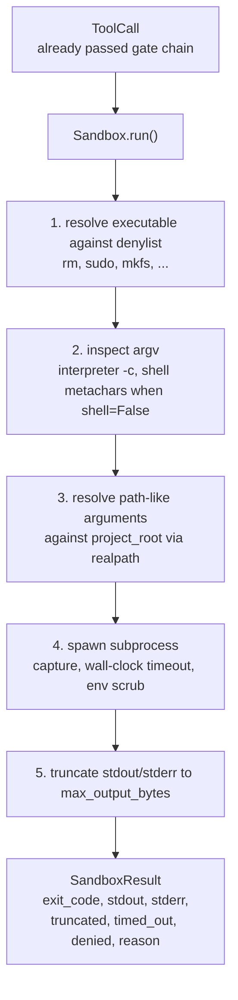
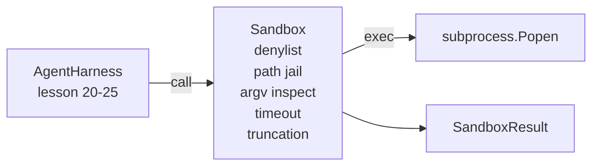

# 项目第 26 课：带拒绝名单与路径牢笼的沙箱运行器

> 验证门决定一次 tool call 该不该运行。沙箱决定它运行之后会发生什么。本课提供一个子进程运行器：拒绝危险的可执行文件，拒绝危险的 argv 形状，把每个文件路径关进项目根目录的牢笼，截断超大输出，并在墙上时钟超时后杀掉失控进程。它是模型与操作系统之间两层防护中的第二层。

**Type:** Build
**Languages:** Python (stdlib)
**Prerequisites:** Phase 19 · 25 (verification gates and observation budget), Phase 14 · 33 (instructions as constraints), Phase 14 · 38 (verification gates)
**Time:** ~90 minutes

## 学习目标

- 构建一个 `Sandbox` 类，包装 `subprocess.run`，支持超时、捕获和截断。
- 按名称对照拒绝名单拒绝命令，并按结构交给 argv 检查器拒绝。
- 拒绝任何解析后落在声明的项目根目录之外的路径参数。
- 关闭 shell 模式时，拒绝 shell 元字符。
- 返回结构化的 `SandboxResult`，供下游可观测性系统和评估 harness 摄取。

## 问题

一个能起 shell 的编码 Agent，可以在同一轮里安装后门、窃取密钥、把开发者的笔记本搞成砖，并刷出一大笔云账单。代价最低的防御，是干脆不给它 shell。代价第二低的，是一个对精确模式清单说「不」的沙箱。

Agent trace 里反复出现三类失败。

第一类是危险的可执行文件。模型在修路径问题修到焦头烂额时，会尝试 `sudo`、`chmod -R 777`、`rm -rf`、`mkfs`、`dd`。这些都不该出现在一次 Agent 运行里。拒绝名单按名称和别名把它们拦下。

第二类是 argv 花招。被明确告知不能使用 shell 的模型，会借解释器把攻击塞进去：`python3 -c "import os; os.system('rm -rf /')"`、`bash -c '...'`、`node -e '...'`、`perl -e '...'`。沙箱必须知道，任何带 `-c` 类标志运行的解释器，都只是多绕了几步的 shell 调用。

第三类是路径逃逸。模型被告知读取 `./src/main.py`，实际读的却是 `../../etc/passwd`。沙箱把每个路径参数都用 `os.path.realpath` 解析，再断言前缀，从而关进牢笼。

这里的沙箱不是操作系统意义上的安全边界。一个已经拿到代码执行能力的坚定攻击者依然能逃出去。它是开发期的防护栏：让常见的失败模式大声暴露，并阻止 Agent 因为纯粹的笨拙造成破坏。

## 概念



沙箱有四个拒绝维度：名称、argv、路径、结构。每个维度都是调用的纯函数，此时还没有子进程。只有所有维度都通过，才会创建子进程。

`SandboxResult` 的退出码沿用惯例：0 表示成功，非零表示失败，另外有三个哨兵码分别表示被拒绝（-100）、超时（-101）和截断（退出码保留真实值，同时设置标志位）。下游课程读取这个结构化结果，而不是解析 stderr。

```figure
cg-path-jail
```

## 架构



拒绝名单是一个可执行文件基名的 frozenset。别名（`/bin/rm`、`/usr/bin/rm`）都会解析到同一个基名。argv 检查器认识解释器的形状：任何 argv[0] 是解释器、且后续某个参数以 `-c` 或 `-e` 开头的调用，一律拒绝。当调用没有明确请求 shell 时，shell 元字符（`;`、`|`、`&`、`>`、`<`、反引号、`$()`）会触发拒绝。

路径牢笼是最微妙的部分。沙箱在构造时接收 `project_root`。任何看起来像路径的参数（包含 `/`，或匹配已有文件）都会经 `os.path.realpath` 归一化，再与项目根目录的 realpath 比对。如果解析结果不在根目录之下，拒绝。符号链接逃逸（项目根里的链接指向外部）通过检查 realpath 而非字面路径来阻断。

## 你将构建什么

实现是 `main.py` 加一个测试目录。

1. `SandboxResult` 数据类：exit_code、stdout、stderr、truncated、timed_out、denied、reason、duration_ms。
2. `SandboxConfig` 数据类：project_root、max_output_bytes、timeout_seconds、denylist、interpreter_block。
3. `Sandbox` 类：`run(argv, *, shell=False, cwd=None)` 返回 `SandboxResult`。
4. 内部拒绝辅助函数：`_check_executable_denylist`、`_check_argv_interpreter`、`_check_shell_metachars`、`_check_path_jail`。
5. 输出截断，带清晰的 `truncated` 标志和写入捕获流中的标记行。
6. 文件底部的演示：一串合法调用与对抗性调用，逐个展示结果。

沙箱默认以 `shell=False` 和 `capture_output=True` 调用 `subprocess.run`。墙上时钟超时使用 `timeout` 参数；遇到 `TimeoutExpired` 时，沙箱杀掉进程组并合成一个 SandboxResult。

## 为什么这不是真正的沙箱

本课沙箱不使用 namespace、cgroup、seccomp、gVisor、Firecracker，也不使用任何内核级隔离。子进程能做的事，沙箱都能做。保护是结构性的：Agent 最常见的危险调用被拒绝，而且拒绝会大声进入可观测性系统，而不是悄悄执行。

生产级 Agent 要在此之上叠加：在非特权 Docker 容器里运行，在 microVM 里运行，丢弃 capabilities，把项目根挂成只读、另挂一个可写的暂存目录，对内存和 CPU 设置 ulimit，把环境变量清理到已知安全的允许清单。第 29 课会做其中一部分。操作系统级隔离超出本课范围。

## 运行它

```bash
cd phases/19-capstone-projects/26-sandbox-runner-denylist
python3 code/main.py
python3 -m pytest code/tests/ -v
```

演示创建一个临时目录，放入一个干净文件，然后跑一组调用。合法调用成功。被拒绝的调用返回 `denied=True` 并附带理由的 SandboxResult。超时返回 `timed_out=True`。截断设置 `truncated=True`。演示打印一张 JSON 结果表并以零退出。

## 如何与 Track A 的其余部分组合

第 25 课产出了门链。第 26 课是门返回 ALLOW 之后运行的工具执行器。第 27 课的评估 harness 把沙箱结果与每个任务的预期退出码做比较。第 28 课在每次 `Sandbox.run` 调用周围发出 `gen_ai.tool.execution` span。第 29 课的端到端演示，则让一个真正的编码 Agent 穿过这两层。
