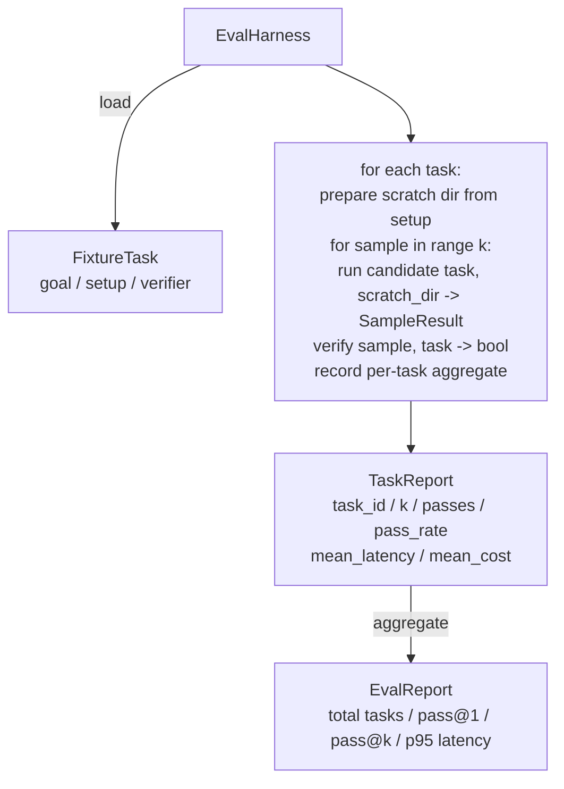

# 项目第 27 课：带夹具任务的评估 harness

> 编码智能体好不好，取决于你用来衡量它的那套任务。本课构建一个评估 harness：它接收一个装满夹具任务的文件夹，让每个任务经过候选智能体运行，用确定性验证器判定通过或失败，再把结果汇总成 pass@1、pass@k、平均延迟和平均成本。harness 是事实来源，有了它，你才能分辨一次改动是回归还是重构。

**Type:** Build
**Languages:** Python (stdlib)
**Prerequisites:** Phase 19 · 25 (verification gates), Phase 19 · 26 (sandbox runner), Phase 14 · 30 (eval-driven agent development), Phase 14 · 19 (SWE-bench and GAIA benchmarks)
**Time:** ~90 minutes

## 学习目标

- 把夹具任务定义为目标、环境准备和验证器的三元组。
- 对每个任务采样多次运行，计算 pass@1 与 pass@k。
- 把延迟和成本汇总为平均值和第 95 百分位指标。
- 把确定性验证器（文件 diff、退出码、正则匹配）接入可复用函数。
- 输出结构化 JSON 报告，供回归跟踪脚本摄取。

## 问题

没有评估 harness 的智能体基准，会被三类失败模式反复折磨。

第一类是没有验证的通过。智能体说它修好了 bug，人扫一眼 diff，测试套件标绿，三周后回归测试又把同一个 bug 揪出来。智能体推理得头头是道，实际上什么都没修。

第二类是没有被发现的回归。提示模板改了一处，智能体在显眼的那个任务上好 4%，在安静的那个任务上差 14%。没有黄金集和逐任务得分，这次回归就跟着进了主干，直到客户投诉才浮出水面。

第三类是逐任务漂移。周一的评估跑了 100 个任务，周五只跑了 95 个，因为有人重命名了五个夹具。通过率看起来提升了 5%。其实并没有。

harness 就是把这类失败变成事实的程序。它每次都按可复现的顺序跑完每个夹具，交给一个在确定性检查上返回真或假的验证器。

## 概念

```mermaid
flowchart LR
  F1[fixtures/task_001/<br/>task.json + expected/] --> Harness
  F2[fixtures/task_002/<br/>...] --> Harness
  Harness[Harness<br/>for each task:<br/>setup / run agent k samples /<br/>verify each sample /<br/>record latency, cost]
  Harness --> Report[EvalReport<br/>pass@1 / pass@k<br/>mean ms / p95 ms<br/>mean cost]
```

`FixtureTask` 是一个小 JSON 文件，外加可选的 `expected/` 目录。JSON 声明 `id`、`goal`（喂给智能体的 prompt）、`setup` 块（要放进临时目录的文件）和 `verifier` 块。verifier 块指定 harness 验证器注册表中的一个函数，并提供它的参数。

三种验证器形态覆盖了大多数有用的任务。

第一种是 `file_equals`。智能体跑完后，把指定文件与期望内容比较。它捕捉「按这个确切方式修好这个 bug」这类任务。

第二种是 `regex_match`。用正则匹配指定文件的内容。它捕捉「函数必须存在并返回 X」这类有多种可接受解的任务。

第三种是 `shell_exit_zero`。harness 运行一条 shell 命令（通过第 26 课的沙箱），只有命令以零退出时才判定任务通过。它捕捉「测试必须通过」这类任务。

harness 把每个任务跑 `k` 次。pass@k 为 `1 - (1 - p)^k`，其中 p 是经验通过率；harness 同时报告原始计数，方便你发现方差。延迟是每个样本的墙上时钟时间。成本取智能体自报的值（token 数、美元，或两者兼有）；harness 跨样本求和，给出逐任务与汇总数字。

```figure
pass-at-k
```

## 架构



候选（candidate）是一个可调用对象：`Callable[[FixtureTask, str], SampleResult]`。harness 通过 `tempfile.mkdtemp()` 创建临时目录，并把路径作为普通字符串传入。harness 不关心 candidate 如何工作。candidate 可以是确定性的补丁应用器（用于 harness 自检）、真实的 LLM 智能体，或模糊测试器。契约就是 SampleResult。

## 你将构建什么

`main.py` 提供：

1. `FixtureTask` dataclass。
2. `SampleResult` dataclass：success_self_reported、latency_ms、cost_units、edits。
3. `TaskReport`、`EvalReport` dataclass，带 `to_dict()`。
4. `VerifierRegistry`，把验证器名称映射到函数。内置验证器：file_equals、regex_match、shell_exit_zero。
5. `EvalHarness` 类。对一个 candidate 运行一个目录下的任务，返回 EvalReport。
6. `tasks/` 里捆绑的五个夹具任务：
   - `fizzbuzz` 的差一错误
   - `factorial` 缺少 return
   - 错误信息里的拼写错误
   - 空函数体
   - 链表遍历的差一错误
7. 一个确定性参考 candidate（`apply_known_fixes`），harness 用它演示 pass@1 干净地达到 1.0。
8. 演示程序打印 EvalReport JSON 并以零退出。

夹具任务以 JSON 文件的形式捆绑在 `tasks/`，并在 `tasks/<id>/buggy/` 与 `tasks/<id>/expected/` 里配有成对的源文件。harness 把 buggy 复制进临时目录，交给 candidate，再对照 expected 验证。

## 为什么用 pass@k 而不只是 pass@1

真实 LLM 智能体是随机的。pass@1 为 0.6 看起来像失败。pass@5 为 0.95 则说明智能体大多数时候能给出正确答案，只是在前几次采样中选错了。解决办法是采样加排序，而不是一味增加训练。pass@k 让这一点变得可见。

pass@k 与 pass@1 并排报告，因为 pass@k 会掩盖一种真实失败：如果一个模型二十次里只对一次，你手上并没有可用的智能体。harness 两者都展示。

## 本课如何与 Track A 的其余部分组合

第 25 课产出了门链（gate chain）。第 26 课产出了沙箱。harness 对任何 `shell_exit_zero` 验证器都使用沙箱。第 28 课把每次 harness 运行包进一条 OTel trace。第 29 课针对某个捆绑夹具运行端到端演示，并断言参考 candidate 的 pass@1 = 1.0。

## 运行方式

```bash
cd phases/19-capstone-projects/27-eval-harness-fixture-tasks
python3 code/main.py
python3 -m pytest code/tests/ -v
```

演示程序以 JSON 打印 EvalReport，包括 pass@1、pass@5、平均延迟和逐任务明细。退出码为零。测试覆盖验证器函数、pass@k 数学、夹具加载，以及 harness 针对捆绑参考 candidate 的端到端运行。
