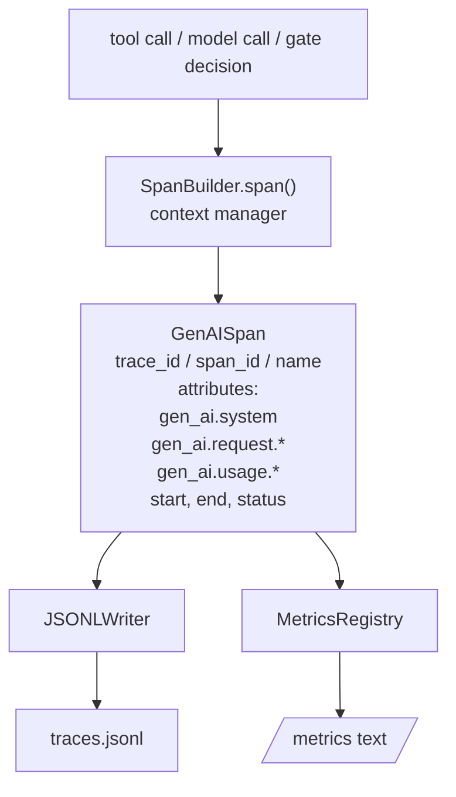
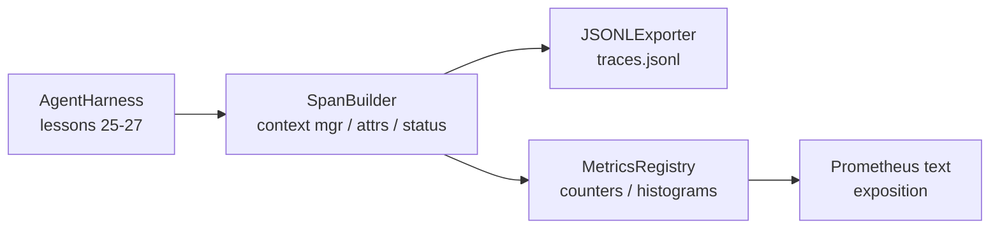

# 项目第 28 课：用 OTel GenAI span 与 Prometheus 指标做可观测性

> 没有可观测性的智能体 harness，是一个只会烧钱的黑盒。本课手写一个 span 构建器，输出符合 OpenTelemetry GenAI 语义约定的记录，按每行一条 span 写入 JSON-Lines 文件，并以 Prometheus 文本格式暴露计数器和直方图。全部用 Python 标准库实现，可离线运行。

**Type:** Build
**Languages:** Python (stdlib)
**Prerequisites:** Phase 19 · 25 (verification gates), Phase 19 · 26 (sandbox), Phase 19 · 27 (eval harness), Phase 13 · 20 (OpenTelemetry GenAI), Phase 14 · 23 (OTel GenAI conventions)
**Time:** ~90 minutes

## 学习目标

- 构建一个按 OpenTelemetry GenAI 语义约定塑形的 span 数据类。
- 实现 JSONL 导出器，每行写一条自包含的 span。
- 构建带标签的计数器和直方图，并以 Prometheus 文本格式暴露。
- 用 span 上下文管理器包装任意可调用对象，记录时长、状态和异常。
- 验证发出的 span 能通过 `json.loads` 往返，并符合规范形状。

## 问题

生产环境中的编码智能体，每一轮都会产生三类产物：一次模型调用、一次工具执行、一次验证门决策。没有结构化遥测，这些都没有用。

第一类失败模式是缺失的 trace。周二出了点问题，唯一记录是一份 500 行的聊天日志。哪个工具跑过、跑了多久、prompt 里塞了多少 token、门是否拒绝过什么，全都没有记录。智能体的作者只能猜。

第二类失败模式是无法解析的 trace。harness 写了 span，但用的是自己临时定的字段名。Grafana、Honeycomb、Jaeger 或本地 CLI 都读不了。团队技术栈里有什么工具都白搭，因为 span 不合规范。

第三类失败模式是没有聚合的指标。你能在 trace 里看见一次慢工具调用，却回答不了「过去一小时 read_file 调用的 p95 延迟是多少？」，因为没有指标，只有 trace。

OpenTelemetry GenAI 语义约定正是为此存在。它定义了一小组标准属性，让各 LLM 框架的 span 发射器共享同一套词汇。只要你的 harness 写入这些属性，任何兼容 OTel 的后端都能读取。

## 概念



harness 中的每个操作都产生一个 span。span 有 trace id（整个智能体调用）、span id（这一个操作）、名称（例如 `gen_ai.chat`、`gen_ai.tool.execution`）、遵循 GenAI 约定的属性、起止时间，以及状态。

GenAI 约定标准化了这些属性键：`gen_ai.system`（哪个提供商，例如 `anthropic`、`openai`）、`gen_ai.request.model`（模型 id）、`gen_ai.request.max_tokens`、`gen_ai.usage.input_tokens`、`gen_ai.usage.output_tokens`、`gen_ai.response.model`、`gen_ai.response.id`、`gen_ai.operation.name`，以及工具专用键 `gen_ai.tool.name` 和 `gen_ai.tool.call.id`。

导出器写 JSONL。一行一个 JSON 对象。这是下游工具能流式读取、grep 和导入的最简单格式。真实的 OTel 导出器会说 OTLP gRPC；本课的 JSONL 导出器是离线等价物，在每台工作站上都能零退出。

指标与 trace 并排存在。每次工具调用递增一个计数器：`tools_called_total{tool="read_file"}`。直方图记录观测到的延迟：`tool_latency_ms{tool="read_file"}`。两者都序列化为 Prometheus 文本暴露格式——拉取式指标的事实标准。

```figure
trace-spans
```

## 架构



span 构建器是一个小类，`span(name, attrs)` 方法返回上下文管理器。上下文管理器在进入时记录开始时间，退出时记录结束时间，若抛出异常则挂上异常，并把最终 span 推给导出器。

指标注册表是两个 dict。计数器是 `{(name, frozen_labels): int}`。直方图把原始样本保存在列表里，在暴露时序列化为 Prometheus 直方图桶。

## 你将构建什么

`main.py` 提供：

1. `GenAISpan` dataclass：trace_id、span_id、parent_span_id、name、attributes、start_unix_nano、end_unix_nano、status、status_message、events。
2. `SpanBuilder` 类，带 `span(name, attrs, parent=None)` 上下文管理器。
3. `JSONLExporter` 类，`export(span)` 追加一行。
4. `Counter` 与 `Histogram` 类，以及 `MetricsRegistry`。
5. `prometheus_exposition(registry)`，生成文本格式输出。
6. `wrap_tool_call(name)` 装饰器，发出 span 并更新指标。
7. 演示：合成一次完整的智能体调用（工具 span 外层包 gen_ai.chat span），写入 traces.jsonl，打印 Prometheus 暴露文本，零退出。

span id 与 trace id 是由 `os.urandom` 生成的 16 字节十六进制字符串。这与 OTel 的 W3C trace context 一致。导出器永不抛异常；IO 错误会暴露出来，但 harness 继续运行。

直方图有固定桶集合（OTel 对毫秒延迟的默认值：5、10、25、50、100、250、500、1000、2500、5000、10000、+Inf）。样本存为列表；暴露时按需计算每桶计数。

## 为什么手写而不用 opentelemetry-sdk

OTel Python SDK 是一个真实依赖。它也是数千行代码、OTLP 导出器的多个进程，以及会吃掉整个课程预算的运行时开销。手写版本教的是线上格式（wire format）。生产中，你把同样的属性接进真实 SDK，免费获得 OTLP 导出器、批处理和资源检测。

这些约定是稳定的。本课发出的线上格式到 2030 年仍能解析，因为 OTel 从不破坏 GenAI 属性名；它们只新增。

## 本课如何与 Track A 的其余部分组合

第 25 课产出了门链。第 26 课产出了沙箱。第 27 课产出了评估 harness。第 28 课让这三者都可观测。第 29 课把端到端演示的每一步包进 span，并在最后打印 Prometheus 文本。

## 运行方式

```bash
cd phases/19-capstone-projects/28-observability-otel-traces
python3 code/main.py
python3 -m pytest code/tests/ -v
```

演示会在本课工作目录里生成一个 `traces.jsonl`（结束时清理），然后打印三条 span 样本，再打印计数器和直方图的 Prometheus 暴露文本。测试验证 span 能往返序列化、规范 GenAI 属性存在、计数器正确递增，以及直方图暴露文本包含预期的桶计数。
