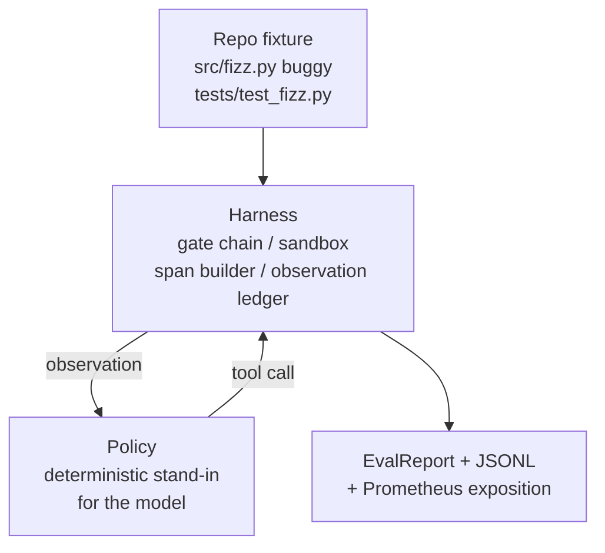
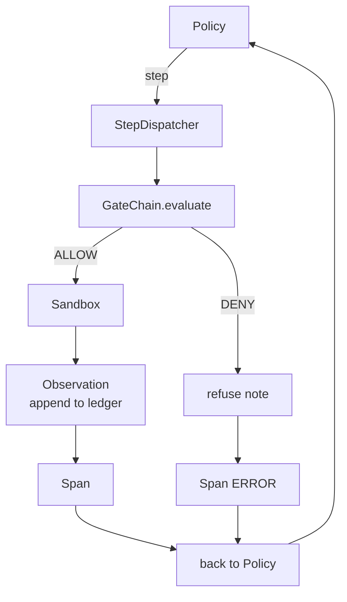

# 项目第 29 课：harness 上的端到端编码 Agent

> Track A 的收获时刻。本课把门链、沙箱、评估 harness 和 OTel span 缝合进一个可工作的编码 Agent，让它在一个多文件 Python 项目里修一个真实（规模很小、夹具级）的 bug。这个 Agent 是确定性策略，而不是 LLM；这一替换让课程可复现，也说明真正有意思的部分始终是 harness。契约完全相同：真实模型插在策略接缝处即可。

**Type:** Build
**Languages:** Python (stdlib)
**Prerequisites:** Phase 19 · 25 (verification gates), Phase 19 · 26 (sandbox), Phase 19 · 27 (eval harness), Phase 19 · 28 (observability), Phase 14 · 38 (verification gates), Phase 14 · 41 (workbench for real repos), Phase 14 · 42 (agent workbench capstone)
**Time:** ~90 minutes

## 学习目标

- 把门链、沙箱、评估 harness 和 span 构建器组合成一个 Agent 循环。
- 实现一个确定性策略，用 read_file、run_tests 和 write_file 修好夹具 bug。
- 在一次端到端运行中同时执行全局步数预算和观测 token 预算。
- 为整次运行发出完整的 OTel GenAI trace 和 Prometheus 指标。
- 验证 Agent 在少于 12 步内解决夹具，且合法工具上零次触发门。

## 问题

大多数 Agent 演示都是孤立工作的：单独一个沙箱，单独一个评估 harness，单独一个 span 发射器。它们看起来都没问题。一旦组合起来，接缝就露出来了。

门链说 ALLOW，沙箱却以门链没预料到的理由拒绝。评估 harness 记录了一次通过，OTel span 却说门拒绝了 Agent 声称用过的工具。Prometheus 计数器该加一次却加了两次。观测预算已经超了，Agent 却继续运行，因为预算只在门链里跟踪，沙箱毫不知情。

本课是整条 Track 的集成测试。Agent 必须按顺序做四件事：读项目、跑测试、从测试失败信息中定位 bug、写修复、重跑测试、停下。每个操作都经过门链。每次工具执行都经过沙箱。每一步都包在 span 里。评估 harness 最后给整次运行打分。

## 概念



Agent 的策略是一个状态机。五个状态。

`SURVEY`：Agent 读取项目清单。下一状态是 RUN_TESTS。

`RUN_TESTS`：Agent 运行测试命令。若测试通过，状态机以成功停机。否则下一状态是 INSPECT。

`INSPECT`：Agent 读取失败的源文件。下一状态是 FIX。

`FIX`：Agent 写入修正后的文件。下一状态是 VERIFY。

`VERIFY`：Agent 再次运行测试命令。若通过，以成功停机。否则以失败停机。

每个状态对应一次 tool call。每次 tool call 都经过门链。如果 tool call 被拒绝，Agent 在 trace 中报告这次拒绝并停机。

夹具 bug 是 `fizz.py` 里的一个差一错误。确定性策略通过正则从测试失败信息中识别 bug，并写出修正后的文件。把策略换成 LLM 不会改变 harness 契约。

```figure
cg-harness-weave
```

## 架构



本课是自包含的。每个先前课程的原语都在 `main.py` 里以最小规模重新实现（门、沙箱、台账、span），因此本课无需导入同级模块即可运行。名称与第 25–28 课完全一致，概念映射没有歧义。

## 你将构建什么

`main.py` 提供：

1. 最小 harness 原语，与第 25–28 课同名复制：`GateChain`、`Sandbox`、`ObservationLedger`、`SpanBuilder`、`MetricsRegistry`。
2. `CodingAgentPolicy` 类：五状态状态机。
3. `Repo` 辅助类：准备一个装有捆绑 buggy 夹具的临时目录。
4. `AgentRun` 类：驱动策略，经 harness 分发，返回 `AgentRunReport`。
5. 一个捆绑夹具（`fixture_repo/`），包含 src/fizz.py、tests/test_fizz.py，以及供评估 harness 使用的 expected/ 目录树。
6. 演示：端到端运行策略，打印逐步 trace，断言通过，打印指标。

捆绑夹具的形状与第 27 课的任务结构相同：一个 buggy 文件和一个测试文件。测试失败信息含有足够信息，让确定性策略识别出修复方式。真实 LLM 会做同样的工作，只是更慢、召回更广，但它不会改变 harness 的期望。

## 为什么策略不是 LLM

真实 LLM 需要 API key、网络调用和无法验证的随机性。harness 才是本课关心的部分。换成确定性策略，课程就能在任何开发者的笔记本上零外部依赖运行，测试套件也能断言精确的步数。

本课的策略是 LLM Agent 所做事情的一个严格子集。策略读取仓库，看到失败的测试，定位到行，写出修复。LLM 走同样的循环、遵守同样的 harness 契约；记账方式一模一样。

## 演示断言了什么

端到端演示在退出时断言五件事，测试套件会以程序方式再次断言它们。

策略在少于 12 步内解决了夹具。

观测预算从未超限。

合法工具上零次门拒绝。（Agent 从未编造被拒绝的工具名。）

每一步在 traces.jsonl 中都有对应的 span。

Prometheus 暴露文本包含 `tools_called_total{tool="read_file"}` 条目和 `tool_latency_ms` 直方图。

## 本课如何与 Track A 的其余部分组合

本课是集成。第 25 课写了门链。第 26 课写了沙箱。第 27 课写了评估 harness。第 28 课写了可观测性。第 29 课证明它们能作为一个系统工作。真实的 Agent harness 从这里继续扩展：把确定性策略换成模型，把捆绑夹具换成真实仓库任务，把 JSONL 导出器换成 OTLP。

## 运行方式

```bash
cd phases/19-capstone-projects/29-end-to-end-coding-task-demo
python3 code/main.py
python3 -m pytest code/tests/ -v
```

演示会打印逐步 trace、最终评估报告和 Prometheus 暴露文本。退出码为零。测试覆盖策略状态转移、对合成 tool call 的门拒绝、捆绑夹具上的端到端运行，以及步数预算不变量。
