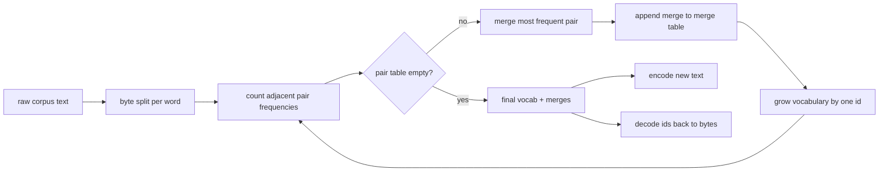
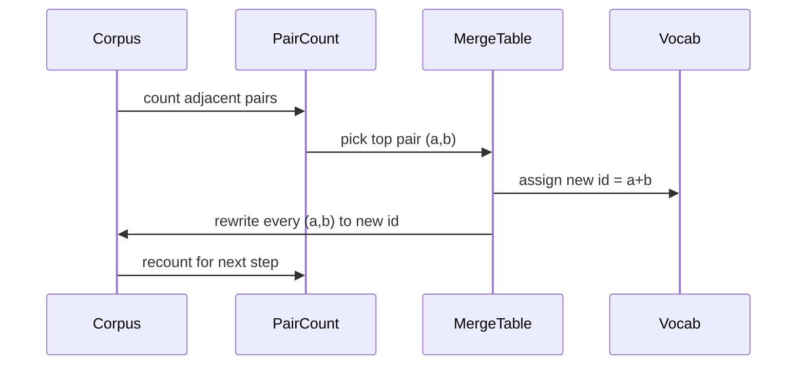

# 从零构建 BPE Tokenizer

> 字节进，id 出，id 再还原成同样的字节。构建现代文本模型至今仍要用的那个 tokenizer。

**Type:** Build
**Languages:** Python
**Prerequisites:** Phase 04 lessons, Phase 07 transformer lessons
**Time:** ~90 minutes

## 学习目标
- 从原始文本语料训练一个字节对编码（Byte-Pair Encoding，BPE）词表：反复合并出现最频繁的相邻符号对。
- 实现确定性的合并表，并把它应用到新文本上，产出一串子词 id。
- 对任意 UTF-8 输入做 id 往返，不丢失任何信息。
- 预留并保护特殊 token（`<|endoftext|>`、`<|pad|>`），让它们在训练和解码之后依然可用。
- 论证为什么字节级字母表是通用 tokenizer 的合适下限。

```figure
cap-bpe-merge
```

## 框架

语言模型从不直接看到文本。它看到的是整数。从字符串到整数列表、再还原回来的映射，就是 tokenizer。这一层出问题，训练中每一条损失曲线测的都是错的东西。

通用文本模型的主力子词 tokenizer 家族是字节对编码。思路很简单。从一个已知字母表开始。找出训练语料中出现最频繁的相邻符号对。把它合并成一个新符号。重复，直到词表达到目标大小。编码新文本时，按同样的顺序复用同一张合并表。

我们要构建的是字节级变体。字母表是 256 个原始字节，而不是 Unicode 码点。正因如此，这个 tokenizer 才能处理任意 UTF-8 输入，而不必回退到未知 token。

## Pipeline



训练侧与推理侧共享合并表。这种共享就是契约。如果你在推理时改变合并顺序，解码出来的就是另一串 id。

## 字节字母表

前 256 个 id 保留给原始字节 0x00 到 0xFF。这保证任何输入字符串在任何合并发生之前，都能用词表表达出来。字节块之后，我们为特殊 token 预留了一小段范围。训练循环永远不会把这些 id 当作合并目标，因为我们把它们完全排除在预分词后的流之外。

预分词器（pretokenizer）在训练看到语料之前，先按空白和标点边界切分。没有这一步，BPE 合并会毫不犹豫地学出跨越词边界的合并，词表里塞满整个常见短语。有了切分，合并只发生在词内，结果才能泛化。

## 训练循环

每个训练步骤做三件事。它遍历语料中的每个词，统计当前符号的每个相邻对出现多少次，并按词本身的出现频率加权。它挑出计数最高的对。它把该对的每次出现改写成一个新符号，id 取词表里下一个空位。然后记录这次合并。



每一步的代价与语料规模（表示成符号序列列表后）成线性关系。对于一个百万词的语料和目标词表一万个 id，循环几秒内就能跑完，因为随着合并落地，符号序列会不断缩短。

## 编码新文本

推理时不调用合并计数器。它按学习时的同样顺序应用合并表。对于一个新词，编码器从字节切分开始。它扫描当前序列，寻找排名最低（也就是最早学到、最先适用）的合并。执行这次合并。再扫描一次。当表中没有任何合并能作用于当前序列时，循环结束。

按排名排序，正是编码确定、且与训练时对同一输入的行为一致的原因。先学到的合并排在表的最前面，也最先被应用。如果两个合并在同一位置都能适用，排名更低（更早）的那个胜出。

## 特殊 token

特殊 token 是字节流永远无法产生的 id。我们手工预留它们。本课两个就够了。

- `<|endoftext|>` 在预训练时分隔文档。它告诉模型「新文档从这里开始，不要让前一个文档的上下文渗进来」。
- `<|pad|>` 用来填充短序列，让一个 batch 能成为矩形张量。损失掩码会在训练时把它遮住。

编码器接受一个标志，允许输入中出现特殊 token。标志关闭时，字符串 `<|endoftext|>` 和 `<|pad|>` 会被当作拼出它们的普通字节来分词。标志开启时，这些字面字符串直接映射到预留 id，不参与任何合并。

## 往返保证

先编码再解码，必须精确还原输入字节。解码器按顺序拼接每个 id 的字节展开。由于每个 id 要么是原始字节，要么是两个已知 id 的拼接，递归展开一定终止于原始字节。解码随后返回这些字节拼出的 UTF-8 字符串。

本课的测试套件会在一个没见过的句子上、一个含 Unicode emoji 的句子上，以及一个包含字面 `<|endoftext|>` token 的句子上检查这一性质。

## 本课不做什么

它不构建大型生产 tokenizer 那种由正则驱动的预分词器。这里的预分词器只做简单的空白和标点切分。对于小型训练语料，这足以产生合理的合并，与后续课程链的契约也保持不变。下一课把 tokenizer 当作黑盒，在它之上构建滑动窗口数据集。

它不对配对计数器做并行化。在 Python 里遍历几千词的语料，远不到一秒就结束。语料更大时，显而易见的做法是并行统计每个词的对，再做归约。

## 如何阅读代码

`main.py` 定义了四个对象。`BPETokenizer` 保存词表、合并表和特殊 token 表。`train` 是训练循环。`encode` 是推理路径。`decode` 做字节拼接。底部的演示在一个内置语料上训练一个小 tokenizer，编码一个留出句子，再把 id 解码回来，并打印两者。`code/tests/test_bpe.py` 里的测试锁住往返性质、特殊 token 预留和合并顺序。

运行演示。然后把这个演示的目标词表大小从 300 改成 600，观察留出句子的编码长度如何下降。那条曲线就是 BPE 的压缩曲线。
