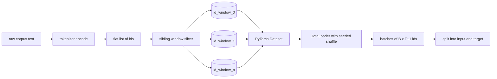
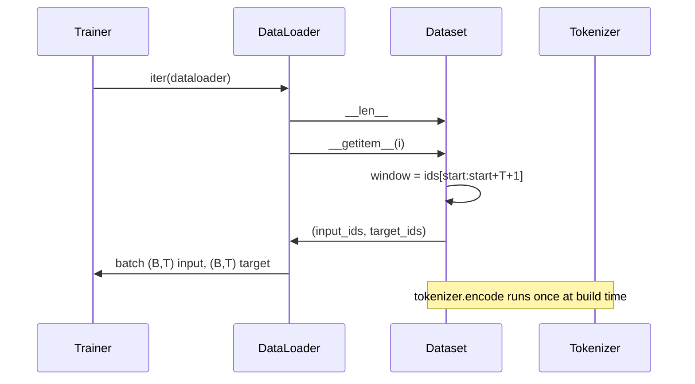

# 带滑动窗口的 Token 数据集

> 预训练运行是一个从 token id 到梯度的函数。本课构建把 id 喂进去的传送带。

**Type:** Build
**Languages:** Python
**Prerequisites:** Phase 04 lessons, Phase 07 transformer lessons, Lesson 30 of this phase
**Time:** ~90 minutes

## 学习目标
- 调用一次 tokenizer，把原始语料转换成 token id 流。
- 用可配置的重叠步长（stride）把 id 流切成定长窗口。
- 构建一个 PyTorch Dataset，为下一 token 预测返回输入张量和目标张量。
- 用一个按 epoch 播种的确定性 shuffle 把数据集包进 DataLoader。
- 论证步长、冗余与有效数据集大小之间的权衡。

```figure
cap-sliding-window
```

## 框架

预训练一次读一个 batch 的 token id，然后更新模型。每个 batch 的形状由训练契约固定。对因果语言模型来说，batch 持有 `(B, T)` 的输入 id 和 `(B, T)` 的目标 id，目标是输入左移一位。数据管线的任务，就是从一个可能有数 GB 原始文本的语料中，按需、确定、可复现地给出这个契约。

本课构建这条管线。上一课的 tokenizer 把文本变成一长串扁平 id。滑动窗口把这串 id 切成训练样本。自定义 Dataset 把样本以张量形式暴露出来。DataLoader 把它们组成 batch，并用已知种子打乱。

## 形状契约

因果 LM 消费形状为 `(B, T)` 的 id，其中 `B` 是 batch 大小，`T` 是上下文长度。位置 `t` 的目标是位置 `t+1` 的输入。这意味着每个训练样本要覆盖 `T+1` 个原始 id。窗口步长决定相邻样本之间有多少重叠。



切片器不会越过语料边界。如果最后一个窗口没有足够 id 填满 `T+1` 个位置，切片器就丢弃它。用 `<|pad|>` 填充尾部也是可行选择，但会让损失掩码变复杂。本课选择丢弃。

## 为什么要滑动窗口

预训练语料是一条很长的 id 流。如果模型只看不重叠的窗口，每个训练样本都会教它同样的 `T` 个边界。调整步长能移动这些边界，让模型看到更多样的预测下一 token 的任务。

步长为 `T` 时窗口不重叠。步长为 `T // 2` 时重叠百分之五十，有效数据集翻倍。步长为 `1` 时重叠最大，数据集扩大为原来的 `T` 倍。代价是每个 epoch 更多计算。收益是更多的边界多样性。大多数预训练运行使用等于上下文长度的步长，因为语料本来就比模型一个 epoch 能跑完的大得多，边界多样性的论点因此变弱。

## Dataset 类

PyTorch Dataset 有两个必需方法。`__len__` 返回样本数。`__getitem__` 返回一个样本，形式是一对张量。我们的 Dataset 保存编码后的 id 流和步长。索引时动态计算窗口起点，因此无论步长产生多少样本，内存里都只有一份 id 流。



左移一位发生在 `__getitem__` 内部。Dataset 返回 `(input, target)`，其中 `input = window[:-1]`、`target = window[1:]`。两者都是 PyTorch long 张量。训练循环把它们当作 ground truth。

## 确定性打乱

`shuffle=True` 的 DataLoader 从 PyTorch 随机生成器读取随机数。传入一个按 epoch 显式播种的 `torch.Generator`，每次重启运行都会得到同样的打乱结果。当你想比较两次只有单个超参数不同的运行时，这一性质很重要。没有种子，两次运行看到的数据顺序不同，损失曲线会因为与改动无关的原因分叉。

本课的种子契约很简单。`epoch_seed = base_seed + epoch_index`。base seed 在构造时传入。epoch index 由训练器在每个 epoch 开头递增。用同一个 base seed 重跑，每个 epoch 看到的顺序都相同。

## Batch 采样器

PyTorch 的默认 sampler 均匀随机选取索引，且不放回。这正是预训练想要的。在小数据集上微调时契约也一样。DataLoader 通过调用 `B` 次 `__getitem__` 并把结果堆叠来组装一个 batch。由于构造上每个样本长度相同，不需要任何 padding 逻辑。

本课为了简单保持 `num_workers=0`。生产运行时，worker 会并行执行 `__getitem__` 调用。在我们的管线里这基本没有收益，因为工作只是切一段内存中的张量，但同样的 Dataset API 能干净地支持 worker。

## 统计样本数

对于长度为 `N` 的 id 流、上下文长度 `T` 和步长 `S`，样本数为 `max(0, 1 + (N - (T + 1)) // S)`。本课把这个计算暴露为 Dataset 上的静态方法，训练器不必迭代就能算出每个 epoch 的总步数。

## 本课不做什么

它不从磁盘流式读取。语料完全编码在内存中，保存为单个张量。对于几百万 id 的语料，这远不到一百 MB，也正是本课合适的形态。磁盘流式是另一个问题，替换存储即可接入，Dataset 契约不变。

它不处理多文档。语料被当作一条连续的 id 流。当语料由多个文档构建时，通过插入 `<|endoftext|>` id 来编码下一文档边界。模型会学着在边界周围做预测。

## 如何阅读代码

`main.py` 定义两个类和一个辅助函数。`SlidingWindowDataset` 是 PyTorch Dataset。`make_dataloader` 返回一个带种子生成器的配置好的 DataLoader。`_encode_corpus_to_ids` 是那次一次性 tokenizer 调用。底部的演示在进程内构建一个小 tokenizer，编码内置语料，构造数据集和 dataloader，打印一个 batch，并断言形状契约。`code/tests/test_dataset.py` 里的测试锁住窗口数公式、左移一位性质、确定性 shuffle 和步长权衡。

运行演示。然后把上下文长度从 16 改成 32，观察每个 epoch 的样本数如何下降。这个数字就是你的每 epoch 步数预算。
