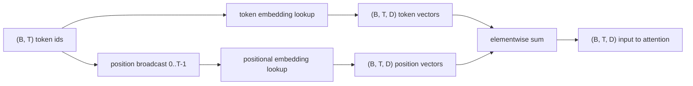
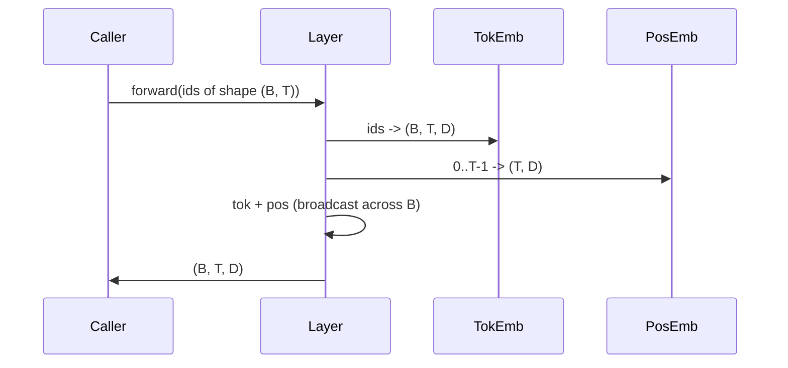

# Token 嵌入与位置嵌入

> id 是整数。模型要的是向量。两者之间隔着两张查找表，而位置表的选择会塑造模型能学到什么。

**Type:** Build
**Languages:** Python
**Prerequisites:** Phase 04 lessons, Phase 07 transformer lessons, Lessons 30 and 31 of this phase
**Time:** ~90 minutes

## 学习目标
- 构建一张 token 嵌入查找表，把词表 id 映射为稠密向量。
- 构建一张按位置索引的可学习位置嵌入查找表。
- 构建一张按位置索引、无参数的固定正弦位置嵌入表。
- 把 token 嵌入与位置嵌入组合成 transformer 块的单一输入。
- 对比可学习嵌入与正弦嵌入在长度泛化和参数量上的差异。

```figure
cc-embedding-lookup
```

## 框架

模型第一次接触 token id，是在 token 嵌入矩阵里做一次行查找。矩阵每行对应一个词表 id，每列对应一个模型维度。查找返回一个向量，模型其余部分把它当作该 id 的含义。反向传播更新前向传播中用到的行。训练过程中，这些行的几何结构学会用方向编码相似性。

光有 token id 没有顺序。模型需要第二个信号，告诉它位置 1 与位置 17 不同。这个信号的两大选择是：可学习位置嵌入（第二张查找表，每个位置一行）和固定正弦位置嵌入（一个无参数的数学公式）。这个选择有后果。可学习表是一个参数，受模型训练时的最大上下文长度限制。正弦表理论上无参数，公式可延伸到任意位置，但本课的 `SinusoidalPositionalEmbedding` 在 `max_context_length` 处预计算固定表，`forward` 超过该界限会抛错；因此两个模块在这里都强制了最大上下文长度。即使表大到足以索引，模型在超过训练长度后仍可能表现不佳。

本课把两者都构建出来，并与 token 嵌入组合成下一课注意力块的单一输入。

## 形状契约

嵌入阶段的输入是形状 `(B, T)` 的 token id batch。输出是形状 `(B, T, D)` 的张量，其中 `D` 是模型维度。每个 batch 元素有相同的上下文长度 `T`。每个位置有相同的向量维度 `D`。



组合方式是相加，不是拼接。相加让 `D` 在网络中保持不变，并让模型逐特征决定每一层里 token 含义和位置谁占主导。

## Token 嵌入矩阵

token 嵌入是形状 `(V, D)` 的参数张量，`V` 是词表大小。PyTorch 用 `nn.Embedding(V, D)` 暴露它。初始化时，元素取自一个小高斯分布；在 transformer 规模模型里，传统上均值 0、标准差约 `0.02`。精确的初始化方式不如「跨运行保持一致」重要。

前向传播就是一次索引操作。PyTorch 通过 gather 行，把 `(B, T)` 的 int64 id 映射为 `(B, T, D)` 的浮点数。反向传播只把梯度累加到前向传播中碰过的行。一个 batch 里从未出现的两行，在这一步收到零梯度。

一个细微之处。token 嵌入与模型末尾的输出投影常常共享权重（weight tying）。发生这种情况时，每次反向传播都会通过输出侧碰到嵌入的每一行。本课把两者作为独立模块暴露，但在完整模型里同一矩阵可以扮演两个角色。

## 可学习位置嵌入

可学习位置嵌入是第二个 `nn.Embedding`，形状 `(max_context_length, D)`。查找以位置 id `0, 1, 2, ..., T-1` 为键。前向传播把这个位置向量沿 batch 维广播。

可学习表的缺点在于：如果模型只训练到位置 `T-1`，它就无法在位置 `T` 查询，因为那一行不存在。采用这种方案的生产级 decoder-only 模型，把最大上下文长度写死进架构，并拒绝处理更长的输入。

## 正弦位置嵌入

正弦位置嵌入是一个从位置到向量的函数。位置 `p` 和特征 `i` 产生

```python
angle = p / (10000 ** (2 * (i // 2) / D))
emb[p, 2k]     = sin(angle)
emb[p, 2k + 1] = cos(angle)
```

这个函数没有参数。每个位置都有唯一向量。波长在特征维度上按几何级数变化，低维编码粗粒度位置，高维编码细粒度位置。

同时使用 `sin` 和 `cos` 带来一个性质：位置 `p + k` 的向量是位置 `p` 向量的线性函数。这给注意力层一条学习相对位置偏移的便捷路径。模型不需要单独的参数来表达「往回看五个 token」。

本课在构造时一次性计算完整的正弦表，前向时直接索引。

## 组合

输入管线按顺序做三件事。读取 token id。查找 token 向量。加上位置向量。返回和。



相加步骤中的广播，把 `(T, D)` 的位置张量沿 batch 维复制。unsqueeze 之后位置张量形状为 `(1, T, D)`，PyTorch 会自动处理。

## 对比分析

本课在同一组输入上运行两个变体，并打印两项诊断。

第一项是参数量。可学习变体在 token 嵌入之外增加 `max_context_length * D` 个参数。正弦变体增加零个。

第二项是相邻位置嵌入之间的余弦相似度。正弦变体呈现平滑且可预测的衰减，因为函数是连续的。可学习变体在初始化时相似度接近随机，因为各行独立抽取。训练之后，可学习变体通常会发展出类似的平滑结构，但它必须从数据里发现这种结构。

## 本课不做什么

它不构建旋转位置编码（RoPE）或 AliBi。那些是现代生产级 transformer 的选择。它们都遵循与本课嵌入相同的形状契约（对形状 `(B, T, D)` 的向量施加依赖位置的变换），但作用在注意力投影步骤，而不是输入端。下一课构建注意力块，其中一个可选扩展就是在那里的 query-key 投影中折入旋转。

它不训练嵌入。训练需要损失，损失需要模型输出，模型输出需要注意力和 LM head。那是下一课再下一课的事。

## 如何阅读代码

`main.py` 定义三个模块。`TokenEmbedding` 包装 `nn.Embedding(V, D)`。`LearnedPositionalEmbedding` 包装 `nn.Embedding(L, D)`。`SinusoidalPositionalEmbedding` 预计算表并以 buffer 暴露。`EmbeddingComposer` 把一个 token 嵌入和一个位置嵌入绑在一起。底部的演示打印形状、参数量和相邻位置相似度诊断。`code/tests/test_embeddings.py` 里的测试锁住形状、广播行为、参数量和正弦公式。

运行演示。然后把模型维度 `D` 从 64 改成 32，观察正弦波长带如何变化。
