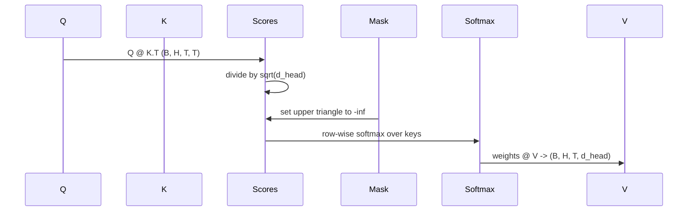

# 多头自注意力

> 一次线性投影，三个视图，H 个并行的注意力头，一个掩码。这就是模型实际使用的注意力块。

**Type:** Build
**Languages:** Python
**Prerequisites:** Phase 04 lessons, Phase 07 transformer lessons, Lessons 30 through 32 of this phase
**Time:** ~90 minutes

## 学习目标
- 把批量的 Query/Key/Value 投影实现为单个线性层，并切分成 H 个头。
- 用正确的归一化和 dtype 处理计算缩放点积注意力。
- 应用因果掩码，阻止某个位置关注未来的位置。
- 针对固定输入检查每个头的注意力权重，并推敲每个头在关注什么。
- 在玩具任务上训练一个小注意力块，观察损失随着各头开始专门化而下降。

```figure
cap-multihead-attention
```

## 整体框架

注意力是这样一种函数：它让某个 token 的表示从同一序列的其他 token 处拉取信息。自注意力意味着 query、key、value 都来自同一个输入。多头意味着把投影切分成 H 个并行的注意力问题，它们的输出被拼接后再投影回来。

高效的实现方式是使用一个线性层，把 `D` 投影到 `3 * D`，再切成三个视图，然后重塑为 H 个大小为 `D // H` 的头。矩阵乘法、softmax 和加权求和都以批量张量运算的形式完成，因此各头可以在加速器上并行执行。

本节课构建这个块。它还会加入因果掩码，使同一份代码能作为仅解码器语言模型中的注意力层使用。下一节把这个块堆叠成完整的 Transformer，再下一节训练它。

## 形状约定

输入是 `(B, T, D)`，输出是 `(B, T, D)`。掩码是 `(T, T)`，或者可以广播到该形状。块内部的中间张量形状为 `(B, H, T, d_head)`，其中 `d_head = D // H`。约束条件是 `D % H == 0`。

```mermaid
flowchart LR
    A["(B, T, D) input"] --> B[Linear D -> 3D]
    B --> C["split into Q, K, V"]
    C --> D["reshape to (B, H, T, d_head)"]
    D --> E["scores = Q @ K.T / sqrt(d_head)"]
    E --> F[apply causal mask]
    F --> G[softmax over keys]
    G --> H["context = weights @ V"]
    H --> I["reshape to (B, T, D)"]
    I --> J[output Linear D -> D]
    J --> K["(B, T, D) output"]
```



块中仅有的参数是两个线性层（QKV 投影和输出投影）。掩码、softmax、矩阵乘法和重塑全都没有参数。

## QKV 拆分

朴素实现使用三个独立的线性层，分别对应 Q、K、V。高效实现只有一个层，输出 `3 * D` 个特征，再拆分结果。两者在数学上等价：用三个 `(D, D)` 权重分别做三次矩阵乘法，与把它们堆叠成一个 `(3D, D)` 权重做一次矩阵乘法，结果完全相同。

高效版本更快，因为加速器只启动一次矩阵乘法而不是三次。它也更容易初始化，因为三个子矩阵位于同一个参数张量中，可以一起初始化。

## 头维度重塑

拆分之后，Q、K、V 各自都是 `(B, T, D)`。为了把它变成 H 个并行的注意力问题，我们重塑为 `(B, T, H, d_head)`，再转置为 `(B, H, T, d_head)`。此时头维度紧挨着批维度，PyTorch 会把逐头注意力当作在 `B * H` 个独立实例上的批量运算。

d_head 维度保持在最后，以便打分矩阵乘法 `Q @ K.transpose(-2, -1)` 在它上面做收缩。结果是 `(B, H, T, T)` 的逐头注意力打分。

## 缩放

softmax 之前，打分要除以 `sqrt(d_head)`。没有这个缩放，点积会随 `d_head` 增大而增大，把 softmax 推到一个极端：某一项占据了几乎全部权重，其余的则小到可以忽略。在这种状态下梯度极小，学习会停滞。除以 `sqrt(d_head)` 可以让打分的方差在不同头大小下大致保持恒定。

## 因果掩码

仅解码器语言模型在预测下一个 token 时只能以过去为条件。掩码负责强制执行这一点。具体来说，在 softmax 之前，`(T, T)` 打分矩阵中对角线上方的每一项都被替换为负无穷。经过 softmax 后，这些位置的权重为零。



构造时把掩码注册为 buffer，这样它与模型位于同一设备上，也不属于计算图。掩码覆盖该块可能见到的最大上下文长度。前向时我们截取左上角的 `(T, T)` 区域。

## 输出投影

得到逐头上下文向量 `(B, H, T, d_head)` 之后，我们转置回 `(B, T, H, d_head)`，重塑为 `(B, T, D)`，再做一次 `(D, D)` 的线性投影。输出投影让模型可以混合各个头。没有它，H 个头只能通过后续层重新组合，这个块就会受到人为限制。

## 检查注意力权重

本节课在前向传播中提供 `return_weights=True` 标志。设置后，块会在返回输出的同时返回形状为 `(B, H, T, T)` 的逐头注意力权重。演示程序会在短输入上打印某个头的权重热力图，让你看到因果三角形的结构以及每个位置的关注重点。

在训练好的模型中，不同的头会学到不同的模式。有些头关注紧邻的前一个 token，有些头关注序列的开头，有些头把注意力几乎均匀地铺开。这个检查钩子就是这类可解释性工作的入口。

## 训练演示

`main.py` 底部的演示把注意力块接到一个很小的 LM 头上，并在重复任务上训练整个模型。输入的每一行是一个随机 id，在整个上下文里重复。目标是输入右移一位，因此模型必须学会下一个 token 与上一个 token 相同。损失函数是交叉熵。在 H=4、D=32、T=12、词表大小为 64 的设置下，在 CPU 上训练三个 epoch，损失会从随机水平（约 `log(64) ~ 4.16`）降到远低于 `1.0`。

这个演示的目的不是训练出有用的模型。它的目的是确认梯度能流经块的每一部分，并且各头能在一个答案显而易见的问题上学到东西。

## 本节课不做什么

它不添加前馈块。真实模型中的 Transformer 层是注意力之后接一个两层 MLP，并各自配有残差连接和 layer norm。下一节会补上这些。

它不实现旋转位置编码或 AliBi 位置编码。两者都在同一个块的 QKV 投影步骤中生效，但它们是独立的教学单元。这里构建的块与两者兼容——只需在矩阵乘法之前变换 Q 和 K。

它不实现用于推理的 KV cache。跨前向传播缓存 key 和 value 是让自回归解码变快的优化手段。它改变了 K 和 V 张量的形状约定，但不改变 Q。这属于推理那一课的内容。

## 如何阅读代码

`main.py` 定义了 `MultiHeadSelfAttention`。这个类包含两个线性层和一个注册的掩码 buffer。前向传播依次做：投影、重塑、打分、加掩码、softmax、加权、重塑、再投影。底部的演示构建一个小模型，用 token 嵌入、位置嵌入和 LM 头把注意力包起来，在复制任务上训练三个 epoch，并打印损失曲线和逐头注意力热力图。`code/tests/test_attention.py` 中的测试固定了形状约定、因果性、softmax 性质、头拆分性质和梯度流动。

运行演示。然后把 `n_heads` 从 4 增加到 8（保持 `d_model=32`，此时 `d_head=4`），观察热力图的变化。
