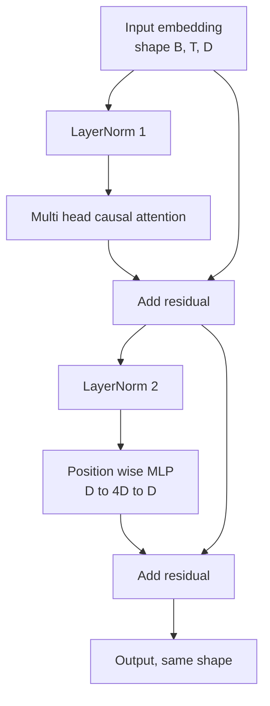
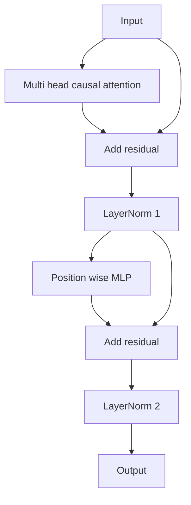

# 从零实现 Transformer 块

> 一个块就是所有现代解码器 LLM 的基本单元。layer norm、多头注意力、残差、MLP、残差。pre-LN 变体无需 warmup 即可稳定训练，post-LN 变体则是原始论文发布时的做法。本节课并排实现两者，并展示在常见学习率下哪一个能撑过 12 层堆叠。

**Type:** Build
**Languages:** Python
**Prerequisites:** Phase 19 lessons 30 to 33 (tokenizer, embeddings, attention math, batched data loader)
**Time:** ~90 minutes

## 学习目标

- 用四个组成部分在 PyTorch 中构建 Transformer 块：LayerNorm、多头因果注意力、残差连接、逐位置 MLP。
- 以两种配置（pre-LN 和 post-LN）放置 LayerNorm，并解释为什么其中一种无需 warmup 即可稳定训练。
- 在多头注意力内部实现因果掩码，使 token `i` 看不到 `j > i` 的 token。
- 在 12 层堆叠上追踪两种变体的梯度流动，并给出有依据的解读。
- 下一节课组装 1.24 亿参数的 GPT 时，把这个块当作即插即用的单元复用。

## 问题

Transformer 就是同一个块反复堆叠。块错一次，重复十二次，你交付的模型就会在第一个 epoch 发散，或者此后一路都需要 warmup 之类的补丁。本节课要看的两种失败模式并不罕见，初学者第一次天真地堆叠块时就会撞上。一种是注意力层偷看未来，另一种是 LayerNorm 被放在了深处无法驯服残差信号的位置。

一旦看清，修复是机械性的。这个块恰好有两条残差路径、恰好两个归一化位置。位置选对了，剩下的堆叠工作只是记账。

## 概念

每个仅解码器的 Transformer 块都是一个函数：接收形状为 `(batch, sequence, embedding)` 的张量，返回相同形状的张量。内部由两个子层完成工作。



这是 pre-LN 变体。LayerNorm 位于残差分支内、子层之前，残差连接把未归一化的信号向前传递。

post-LN 变体则把 LayerNorm 移到残差相加之后。



形状完全相同，训练行为却不同。在 post-LN 中，沿残差路径回传的梯度必须经过 LayerNorm。在十二层深度、学习率 `3e-4` 的情况下，这个梯度衰减得足够快，需要 warmup 调度才能正常训练。pre-LN 让残差路径保持未归一化，因此梯度可以干净地传回嵌入层。正因如此，GPT-2 及之后的模型都采用 pre-LN。

### 因果多头注意力

注意力子层把输入以三种方式投影成 query、key、value 张量。每个张量都从 `(B, T, D)` 重塑为 `(B, H, T, D/H)`，其中 `H` 是头数。缩放点积注意力在每个头上计算 `softmax(Q K^T / sqrt(d_k))`，把上三角置为负无穷，通过 softmax 施加掩码，再乘以 `V`。各头被拼接回单个 `(B, T, D)` 张量，再做一次投影。掩码是让模型具备因果性的唯一部件。忘了掩码，你训练的模型就是在作弊。

### MLP

逐位置 MLP 对每个 token 独立地应用同一个两层网络。隐藏宽度是嵌入宽度的四倍，激活函数是 GELU，第二个线性层之后接 dropout。MLP 内部 token 之间互不交流，所有 token 混合都发生在注意力中。

### 残差连接做两件事

它们让梯度路径在深度方向上可加，从而在十二层之间保持梯度范数量级稳定。它们还让每个块学习对当前表示的加性更新，而不是整体替换。这两个效果正是这个块能够扩展的原因。

```figure
cc-transformer-block
```

## 构建它

`code/main.py` 实现了：

- `class LayerNorm`：带可学习的 scale 和 shift，带偏置的 eps，按 token 向量逐个应用。
- `class MultiHeadAttention`：包含 `num_heads`、`head_dim = d_model // num_heads`、融合的 QKV 投影、注册的因果掩码、注意力 dropout 和残差 dropout。
- `class FeedForward`：两个线性层、GELU 激活、dropout。
- `class TransformerBlock`：带一个 `pre_ln` 标志，在两种变体之间切换。
- 一个演示：构建 6 层 pre-LN 堆叠和 6 层 post-LN 堆叠，输入相同，打印 (a) 输出形状，(b) 一次反向传播后嵌入处的梯度范数。

运行方式：

```bash
python3 code/main.py
```

输出为两个堆叠的形状检查，以及并排的梯度范数。在相同学习率下，pre-LN 堆叠的嵌入梯度比 post-LN 堆叠大一个数量级，这就是 pre-LN 无需 warmup 即可训练的经验信号。

## 技术栈

- 用 `torch` 做张量运算、自动微分和 `nn.Module` 的接线。
- 不依赖 `transformers`，不加载预训练权重。这个块完全由基础原语实现。

## 生产环境中的做法

有三种做法能把这个教科书式的块变成可以交付的东西。

**融合 QKV 投影。** 三个独立的线性层意味着三次 kernel 启动和三次矩阵乘法。一个宽度为 `3 * d_model` 的线性层在一次启动中完成同样的工作，然后沿最后一维拆分输出。融合路径在每种加速器上都更快，也与 GPT-2、LLaMA、Mistral 参考实现的做法一致。

**注册因果掩码 buffer。** 掩码只依赖最大上下文长度。构造时用 `register_buffer` 分配一次，每次前向截取当前窗口，跳过逐次调用的分配。忘了这一点，长上下文下掩码就会成为分配器热点。

**dropout 只放两处，不是三处。** dropout 应放在注意力 softmax 之后（注意力 dropout）和 MLP 第二个线性层之后（残差 dropout）。在残差本身加 dropout 会破坏让梯度在深处流动的加性恒等式。早期一些实现搞错了这一点，并为此付出了训练不稳定的代价。

## 使用它

- 本节课的块可以直接接入第 35 课的 GPT 组装，无需改动。
- pre-LN 变体是每个现代开放权重 LLM 所采用的。post-LN 变体是 2017 年那篇注意力论文所用的。两者都懂，就足以读懂任何你会遇到的解码器架构。
- 把 GELU 换成 SiLU，就得到 LLaMA 系列的激活函数；把 LayerNorm 换成 RMSNorm，就得到 LLaMA 系列的归一化。骨架相同。

## 练习

1. 给块里每个线性层加上 `bias=False` 标志。现代开放权重 LLM 的线性层都不带偏置。测量在一个 12 层、768 维的模型中能省下多少参数。
2. 用自己手写的 RMSNorm 替换 `nn.LayerNorm`，验证输出形状不变。
3. 加一个标志，把第一个头的注意力权重以 `(B, T, T)` 张量返回。画出上三角，确认 softmax 后它为零。
4. 写一个健全性检查：把一个 `(2, 16, 384)` 的张量以 `H=6` 送入两种变体，在权重初始化相同且 dropout 设为零时，断言前向输出不同（例如 `not torch.allclose`）。

## 关键术语

| 术语 | 人们的说法 | 实际含义 |
|------|-----------------|------------------------|
| Pre-LN | 「前归一化」 | LayerNorm 位于残差分支内、每个子层之前；残差携带未归一化的信号 |
| Post-LN | 「后归一化」 | LayerNorm 位于残差相加之后；2017 年论文的做法，需要 warmup |
| 因果掩码 | 「三角掩码」 | 把注意力 logit 的上三角置为负无穷，使 token i 在 j 大于 i 时无法读取 token j |
| 融合 QKV | 「合并投影」 | 用一个宽度为 3D 的线性层代替三个宽度为 D 的线性层；一个 kernel、一次矩阵乘法 |
| 残差流 | 「跳跃连接」 | 自上而下流经每个块的未归一化张量；每个块向它叠加东西 |

## 延伸阅读

- 第 7 阶段第 02 课（从零实现自注意力），了解这个块底层的注意力数学。
- 第 7 阶段第 05 课（完整 Transformer），了解同一骨架的编码器-解码器版本。
- 第 10 阶段第 04 课（预训练 mini GPT），了解这个块所接入的训练流程。
- 第 19 阶段第 35 课（本方向），把十二个这样的块堆叠成 GPT 模型。
