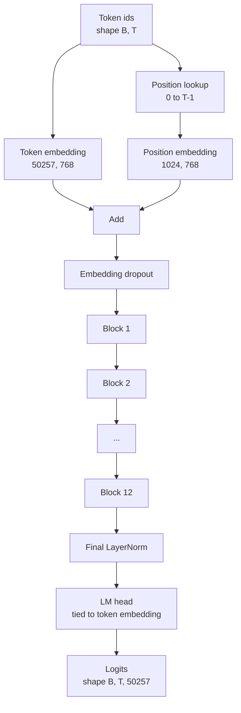
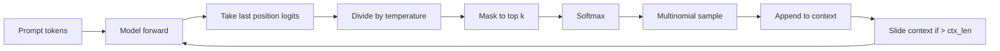

# GPT 模型组装

> 十二个块堆叠起来，加上 token 嵌入、可学习的位置嵌入、最后的 LayerNorm，以及一个权重绑定的语言模型头。这就是完整的 1.24 亿参数 GPT 模型。本节课把这些部件组装成一个可工作的类，统计参数确认模型与参考的 124M 形状一致，并用多项式采样、温度和 top-k 生成文本。

**Type:** Build
**Languages:** Python
**Prerequisites:** Phase 19 lessons 30 to 34
**Time:** ~90 minutes

## 学习目标

- 把第 34 课的 Transformer 块组装成完整的 GPT 模型：token 嵌入、位置嵌入、N 个块、最终 LayerNorm、语言模型头。
- 复现 1.24 亿参数的配置：词表 50257、上下文 1024、嵌入维度 768、十二个头、十二层。
- 把语言模型头的权重与 token 嵌入绑定，并解释为什么在这个规模下能省下约 3800 万参数。
- 用多项式采样、温度缩放和 top-k 截断从 prompt 生成文本，并用滑动窗口维持上下文长度。
- 对照 124M 目标测量参数数量和一次前向传播的开销。

## 问题

Transformer 块本身什么也做不了。你需要把 token id 变成向量，混入位置信息，让它们穿过堆叠，再投影回词表 logit。这四步中漏掉任何一步，模型要么无法前向，要么位置信息漂移，要么开不了口。

模型的形状同样重要。参考的 GPT-2 small 在上述配置下恰好是 1.24 亿参数。这些数字不是魔法。词表 50257 乘以嵌入维度 768 是 token 表。位置 1024 乘以 768 是位置表。十二个块每个约 700 万参数，合计 8400 万。最后的头通过权重绑定复用 token 表。把各部分加起来就是 1.24 亿。如果构造出的模型参数量与参考不符，说明某处接线错了。

## 概念



token id 变成 token 向量，位置 id 变成位置向量。两者相加后送入堆叠。最终的 LayerNorm 是块之外唯一在所有现代变体中保留下来的部件。LM 头复用 token 嵌入矩阵，这就是权重绑定的含义。

### 权重绑定

token 嵌入的形状是 `(vocab, d_model)`。语言模型头需要从 `d_model` 投影回 `vocab`。两者互为转置。绑定意味着字面上同一个参数张量被使用两次。在词表 50257、d_model 768 时，这个矩阵有 3800 万参数。不绑定时你要为它付两次代价；绑定后只付一次，而且因为嵌入和头会一起更新，梯度信号还会稍微干净一些。

### 位置嵌入是可学习的，不是正弦的

GPT-2 使用可学习的位置嵌入。位置表是一个形状为 `(1024, 768)` 的参数张量。每次前向时模型查找位置 0 到 T-1，并把查到的向量加到 token 嵌入上。这是位置方案中最简单的一种（替代方案有 RoPE、ALiBi、T5 相对偏置），也是 124M 参考模型所采用的。

### 生成：温度、top-k、多项式采样

生成是自回归的。每一步，模型都在所有位置上返回覆盖整个词表的 logit。你只取最后一个位置，除以温度，可选地把前 k 以外的 logit 全部掩为负无穷，softmax 得到概率，再从所得分布中采样一个 token。



三个旋钮，三种行为。温度接近零时会退化为贪心。温度为一匹配模型的自然分布。top-k 为一就是贪心。top-k 四十则过滤长尾。各种组合都很重要；下一节训练课会把生成当作定性的评估信号。

```figure
cc-gpt-assembly
```

## 构建它

`code/main.py` 实现了：

- `class GPTConfig` dataclass，带 124M 默认值：`vocab_size=50257`、`context_length=1024`、`d_model=768`、`num_heads=12`、`num_layers=12`、`mlp_expansion=4`、`dropout=0.1`、`use_bias=True`、`weight_tying=True`。
- `class GPTModel`：包含 token 嵌入、位置嵌入、嵌入 dropout、十二个 `TransformerBlock`、最终 LayerNorm，以及一个在标志开启时与 token 嵌入绑定的 `lm_head`。
- `count_parameters` 辅助函数，返回去重后的参数数量（因此权重绑定在计数时被正确对待）。
- `generate` 函数，完成温度、top-k、多项式采样和滑动窗口上下文。
- 一个演示：构建模型，打印参数数量并与参考 124M 对照，从固定 prompt 生成一段短序列，展示整条流水线端到端可用。

运行方式：

```bash
python3 code/main.py
```

输出：参数数量与 124M 参考并排，从随机 prompt 生成的 token id，以及绑定开启时 LM 头与 token 嵌入共享存储的确认。

为了让演示保持快速，脚本还会把一个小配置（`d_model=64`、`num_layers=2`）完整跑一遍，并内联打印生成的 token 序列。124M 配置会被构建，但只检验参数数量和一次前向传播。

## 技术栈

- 用 `torch` 做张量运算、自动微分和模块接线。
- `code/main.py` 在本地重新实现了第 34 课的同一套块模式。

## 生产环境中的做法

有三种做法决定了模型是仅仅能跑还是能交付。

**把残差投影初始化得小一些。** 注意力的输出投影和 MLP 的第二个线性层都直接汇入残差相加。用与其他线性层相同的标准差初始化它们，会让残差流随深度增长，并把最终 LayerNorm 推入过热区间。把这两个投影的标准差按 `1 / sqrt(2 * num_layers)` 缩放，残差流就能在十二层内保持在合理范围。

**缓存位置 id 张量，不要重算。** `torch.arange(T)` 在每次前向时都会分配新内存。在 `__init__` 中按最大上下文分配一次，每次调用截取前 T 项，避免与分配器的往返。

**在参数层面绑定权重，而不是复制。** 设置 `lm_head.weight = token_embedding.weight` 共享张量；复制则不会。优化器需要更新一个参数，自动微分图需要一次累加。如果复制，头会与嵌入渐行渐远，权重绑定就白做了。

## 使用它

- 本节课的模型类与下一节要训练的模型形状相同。
- 把可学习位置嵌入换成 RoPE，就得到 LLaMA 系列，无需改动块或头。
- 把 GELU 换成 SiLU、LayerNorm 换成 RMSNorm，就完成了 LLaMA 系列的其余改动。
- 生成函数适用于任何 logit 来源，不限于这个模型。你可以从第 37 课的预训练 GPT-2 文件中取 logit，复用同一个生成循环。

## 练习

1. 解除 LM 头与 token 嵌入的绑定，重新统计参数。验证差值是 50257 乘以 768 = 3800 万。
2. 把可学习位置嵌入换成构造时计算的正弦表。确认模型仍能前向，且参数量减少 786,432。
3. 给生成加一个 `greedy=True` 标志，跳过采样直接取 argmax。确认序列在多次运行间是确定的。
4. 加一个 `repetition_penalty` 旋钮：在 softmax 之前，把 prompt 或生成历史中任何 token 的 logit 除以一个常数。在固定 prompt 上展示大于 1 的取值能减少输出中的重复次数。
5. 在 `top_k` 旁边加上 `top_p`（核）采样。用两行代码检查：保留 token 的概率之和超过 `top_p`。

## 关键术语

| 术语 | 人们的说法 | 实际含义 |
|------|-----------------|------------------------|
| 权重绑定 | 「绑定嵌入」 | LM 头和 token 嵌入共享同一个参数张量；省下 vocab 乘以 d_model 个参数，且与 GPT-2 参考一致 |
| 位置嵌入 | 「可学习位置」 | 一张形状为（上下文长度, d_model）的独立表，加到 token 向量上；端到端学习 |
| 滑动窗口上下文 | 「上下文上限」 | 当 prompt 加已生成 token 超过上下文长度时，丢弃最旧的 token，使活动窗口放得下 |
| top-k 采样 | 「K 截断」 | 保留取值最高的 K 个 logit，其余掩为负无穷，在剩下部分做 softmax |
| 温度 | 「采样温度」 | softmax 之前把 logit 除以 T；T 小于 1 更尖锐，T 等于 1 保持自然分布，T 大于 1 更平坦 |

## 延伸阅读

- 第 19 阶段第 34 课，了解这个模型所堆叠的块。
- 第 19 阶段第 36 课，了解用交叉熵损失驱动这个模型的训练循环。
- 第 19 阶段第 37 课，了解把预训练 GPT-2 权重加载进这个架构。
- 第 7 阶段第 07 课（GPT 因果语言建模），了解下一 token 预测的数学。
- 第 10 阶段第 04 课（预训练 mini GPT），了解同一架构上的原始训练流程。
