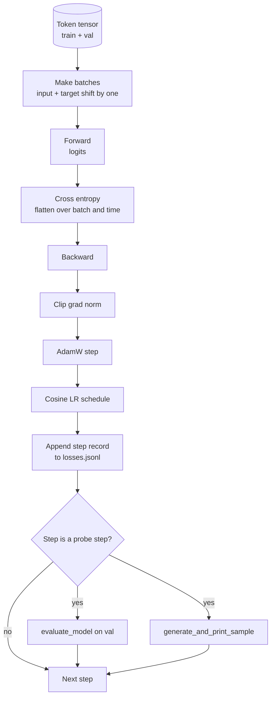

# 训练循环与评估

> 不做度量的循环，就是一个会撒谎的循环。本节课构建驱动 GPT 模型的训练循环：带权重衰减分组的 AdamW、warmup 加余弦的学习率调度、`calc_loss_batch` 辅助函数、在留出数据上的 `evaluate_model`、每 K 步一次的 `generate_and_print_sample` 定性探针，以及一份事后可以绘图的 JSONL 损失日志。这个骨架能训练你未来搭建的每一个解码器 LLM。

**Type:** Build
**Languages:** Python
**Prerequisites:** Phase 19 lessons 30 to 35
**Time:** ~90 minutes

## 学习目标

- 构建训练循环，为下一 token 预测正确对齐输入与目标并计算交叉熵损失。
- 配置 AdamW，把权重衰减应用到权重张量上，而不作用于 LayerNorm 或偏置张量。
- 实现线性 warmup 加余弦衰减的学习率调度，并读懂学习率随时间的变化。
- 用 `evaluate_model` 在留出划分上评估，使评估损失在不同运行之间可比。
- 每 K 步用 `generate_and_print_sample` 生成一个定性样本，在损失曲线报警之前发现发散。
- 把每步损失持久化到 JSONL，事后可以重新加载、绘图，并把训练日志作为交付物交出去。

## 问题

一个只打印损失、别的什么都不做的训练脚本会在三处失败。它无法告诉你损失下降是否因为正确的原因（模型可能过拟合训练集而什么也没学到）。它无法告诉你发散是否正在开始（损失可能跳一步就恢复，也可能跳一步就崩掉）。它无法告诉你模型学到了什么（损失是个标量，而生成的样本是一段话）。这三种失败只要循环不做度量，就都会藏起来。

本节课的循环从三个方面度量。每一步记录训练批次上的损失。每 K 步记录留出批次上的损失。每 K 步从固定 prompt 生成一段续写。训练日志落到 JSONL，这份产物就是循环的证词。

## 概念



两个不那么直观的部分是损失对齐和 AdamW 的衰减分组。

### 损失对齐

模型在每个位置预测下一个 token。如果输入批次是 token `[t0, t1, t2, t3]`，目标批次必须是 `[t1, t2, t3, t4]`。交叉熵在展平的形状 `(batch * seq, vocab)` 上计算，对照展平的目标 `(batch * seq,)`。忘了错位，你就会训练模型预测它自己，损失收敛到零，却什么有用的东西都没学到。

### AdamW 的衰减分组

权重衰减用来正则化权重张量，而非归一化的 scale 或偏置。对 LayerNorm 的 scale 施加衰减会慢慢把它压向零，破坏归一化。对偏置施加衰减在数学上无害，但白白浪费算力。标准的划分是：矩阵形状的张量（线性权重、嵌入表）接受衰减，一切形似 scale 或 shift 的张量则不受衰减。

### warmup 加余弦调度

warmup 在几百步内把学习率从零拉到目标值，让优化器状态有时间填充。余弦衰减在剩余步数里把学习率降回接近零，让最后阶段以小步长对权重做微调。这一组合是开放权重 LLM 训练中最常见的调度，因为它消除了最初一千步和最后一千步中的大部分脆弱时刻。

### 留出评估

`evaluate_model` 从验证划分中运行固定数量的批次，累加损失，除以批次数后返回。不计算梯度，不启用 dropout。只要种子相同、划分相同，这个数字在多次运行间可复现。把留出损失与训练损失并排报告，才能发现过拟合。

### 用定性采样作为早期信号

训练损失漂亮下降、但生成样本全是同一个 token 的模型是坏的。损失曲线看起来平坦、但生成样本逐渐收敛成连贯词语的模型正在学习。定性探针比读懂整条曲线更快，还能捕捉标量漏掉的模式。

```figure
cap-training-loop
```

## 构建它

`code/main.py` 实现了：

- `make_batches(token_ids, batch_size, context_length)`：把长 token 张量切成输入与目标对。
- `calc_loss_batch(model, inputs, targets)`：前向、展平，返回标量交叉熵。
- `evaluate_model(model, val_loader, max_batches)`：以 no_grad 迭代固定数量的验证批次，返回平均损失。
- `generate_and_print_sample(model, prompt, max_new_tokens)`：在固定 prompt 上运行第 35 课的生成函数并打印结果。
- `build_param_groups(model, weight_decay)`：产出一分为二的 AdamW 参数列表。
- `cosine_with_warmup(step, warmup_steps, total_steps, max_lr, min_lr)`：返回给定步的学习率。
- `train(...)`：运行循环，持久化 `outputs/losses.jsonl`，每 `eval_every` 步打印评估损失和一个样本。
- 一个演示：在合成数据上训练小模型若干步，写出 JSONL 日志，并在探针点打印评估损失和样本。演示在 CPU 上远不到一分钟即可跑完。

运行方式：

```bash
python3 code/main.py
```

输出：逐步骤的损失行、每个探针步的评估损失、每个探针步的一个生成样本，以及最终的 `outputs/losses.jsonl`，可以逐行用 `json.loads` 加载。

## 技术栈

- 用 `torch` 做自动微分、优化器和模块。
- `main.py` 在本地重新实现了第 35 课的 `GPTModel` 及其支撑模块。

## 生产环境中的做法

有三种做法能把这个教科书式的循环变成可以整夜挂着跑的东西。

**梯度范数裁剪不可妥协。** 一个坏批次（异常数据、学习率尖峰、数值边界情况）会产生巨大的梯度，抹掉数小时的训练。在 `backward` 之后、`step` 之前调用 `torch.nn.utils.clip_grad_norm_(params, max_norm=1.0)`，可以把优化器限制在安全范围内。裁剪值是自由参数，1.0 是能在多数配置下存活的默认值。

**可续写的 JSONL 日志，而不是 pickle 状态。** 每步损失以 `{"step": int, "train_loss": float, "lr": float}` 的 JSONL 行记录，具有持久性：任何崩溃都留下可读的产物，可以 grep，可以用三十行 Python 画图，也可以读取最后一步来续训。pickle 状态则把你绑死在产生文件时的模块布局上，一重构就碎。

**评估批次取自固定切片。** 验证 token 在脚本启动时就切成批次，而不是临时切。可复现性依赖评估批次在多次运行间完全相同；否则两次运行之间比较评估损失，测到的有一半是批次打乱。

## 使用它

- 本节课的循环与在真实数据上训练 124M 模型的是同一个骨架。把合成 token 张量换成 `datasets` 风格的加载器，循环无需改动即可运行。
- JSONL 日志是那份把一次训练变成证据的交付物。下一节会用它来比较新训练的 checkpoint 与预训练的 checkpoint。
- 定性样本探针是标量损失无法替代的兜底检查。

## 练习

1. 为 `weight_decay_groups()` 添加单元测试，确认 scale 和偏置参数进入不衰减组，线性权重和嵌入权重进入衰减组。
2. 把合成随机 token 换成小文本文件中的字节，让演示在可读的内容上训练。验证生成的样本使用了文件中出现的字符。
3. 给余弦调度加上 `max_lr` 百分之十的 `min_lr` 下限，重新绘图。
4. 除 JSONL 日志外，每 `eval_every` 步保存一个 checkpoint。加一个 `resume_from` 标志，重新加载模型状态和优化器状态。
5. 在损失旁边记录每步吞吐量（每秒 token 数），确认它保持在稳定区间。

## 关键术语

| 术语 | 人们的说法 | 实际含义 |
|------|-----------------|------------------------|
| 损失对齐 | 「错一位」 | 输入 token 位于位置 0..T-1，目标 token 位于位置 1..T；交叉熵在展平形状上计算 |
| 衰减分组 | 「两组」 | AdamW 对矩阵形状张量施加权重衰减，对 scale 或偏置张量不施加 |
| warmup | 「爬坡」 | 学习率在固定步数内从零升到目标值，让优化器状态得以填充 |
| 评估批次 | 「留出批次」 | 验证 token 张量的一块固定切片，脚本启动时切一次，每个探针点都用同一块 |
| 定性探针 | 「打印样本」 | 每 K 步从固定 prompt 生成一小段，捕捉仅靠损失看不到的失败模式 |

## 延伸阅读

- 第 19 阶段第 35 课，了解这个循环所驱动的模型。
- 第 19 阶段第 37 课，了解把预训练权重加载进同一个模型。
- 第 10 阶段第 04 课（预训练 mini GPT），了解真实数据上的训练过程。
- 第 10 阶段第 10 课（评估），了解交叉熵损失之外的更广评估面。
