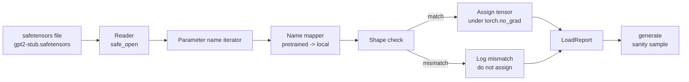

# 加载预训练权重

> 从零训练一个 1.24 亿参数的模型是预算决策；加载一个已发布的 checkpoint 只是寻常一天的事。本节课把预训练的 GPT-2 风格权重从 safetensors 文件加载进第 35 课的确切架构，逐项走通参数名映射，并做一次健全性生成来证明加载成功。不用网络，不用第三方加载器，没有不透明的魔法。

**Type:** Build
**Languages:** Python
**Prerequisites:** Phase 19 lessons 30 to 36
**Time:** ~90 minutes

## 学习目标

- 用 `safetensors` Python 库读取 safetensors 文件，检查张量名称与形状。
- 把每个预训练参数名映射到第 35 课 GPT 模型内部的一个参数。
- 处理已发布 GPT-2 权重与本方向模型之间的两套命名约定：`wte/wpe/h.N.attn.c_attn/c_proj` 和 `mlp.c_fc/c_proj`，对应本地命名的 `tok_embed/pos_embed/blocks.N.attn.qkv/out_proj` 和 `mlp.fc1/fc2`。
- 在任何权重赋值发生之前，检测形状不匹配并以清晰的错误拒绝加载。
- 用加载后的权重生成一段短续写，确认 token 来自加载的分布，而不是随机初始化的分布。

## 问题

已发布的权重并不是为你的架构打包的。它们带着原始实现使用的名称。预训练文件里有形状为 `(2304, 768)` 的 `transformer.h.0.attn.c_attn.weight`；而你的模型期望的是形状为 `(2304, 768)` 的 `blocks.0.attn.qkv.weight`（同一个矩阵，但排布约定不同），或者你的模型用 `nn.Linear`，它以转置方式存储矩阵。同一个参数以三种微妙不同的身份出现（名称、形状、字节布局），加载器必须把三者调和一致。

盲目复制的加载器会把正确的张量放到错误的位置，你得到的模型会生成胡言乱语。形状不同就拒绝复制却什么也不记录的加载器，则让你去猜哪个张量没落位。本节课的加载器是显式的：每次赋值都记日志，每个形状都检查，`LoadReport` 汇总命中、缺失和形状不匹配，让你能读出发生了什么。

## 概念



名称映射器只是一个字符串到字符串的函数。形状检查是一个 if。赋值发生在 `torch.no_grad()` 内部，所以自动微分不会追踪这次加载。报告保存每个名称的处理结果。

### GPT-2 的命名约定

已发布的 GPT-2 权重使用类似这样的名称：

| 预训练名称 | 形状 | 含义 |
|-----------------|-------|---------|
| `wte.weight` | (50257, 768) | Token 嵌入 |
| `wpe.weight` | (1024, 768) | 位置嵌入 |
| `h.N.ln_1.weight` | (768,) | 第 N 块的 LayerNorm 1 scale |
| `h.N.ln_1.bias` | (768,) | 第 N 块的 LayerNorm 1 shift |
| `h.N.attn.c_attn.weight` | (768, 2304) | 融合 QKV 线性权重 |
| `h.N.attn.c_attn.bias` | (2304,) | 融合 QKV 线性偏置 |
| `h.N.attn.c_proj.weight` | (768, 768) | 注意力输出投影 |
| `h.N.attn.c_proj.bias` | (768,) | 注意力输出投影偏置 |
| `h.N.ln_2.weight` | (768,) | LayerNorm 2 scale |
| `h.N.ln_2.bias` | (768,) | LayerNorm 2 shift |
| `h.N.mlp.c_fc.weight` | (768, 3072) | MLP fc1 权重 |
| `h.N.mlp.c_fc.bias` | (3072,) | MLP fc1 偏置 |
| `h.N.mlp.c_proj.weight` | (3072, 768) | MLP fc2 权重 |
| `h.N.mlp.c_proj.bias` | (768,) | MLP fc2 偏置 |
| `ln_f.weight` | (768,) | 最终 LayerNorm scale |
| `ln_f.bias` | (768,) | 最终 LayerNorm shift |

有两处意外需要提前考虑。`c_attn`、`c_proj`、`c_fc` 这些线性层的存储矩阵相对于 `nn.Linear.weight` 的期望是转置的，加载器在赋值时做转置。LM 头根本不在文件里；模型依靠与 `wte` 的权重绑定，因此 `wte` 落位后，头通过别名设置。

### 本地命名约定

本方向的模型使用描述性名称：

| 本地名称 | 含义 |
|------------|---------|
| `tok_embed.weight` | Token 嵌入 |
| `pos_embed.weight` | 位置嵌入 |
| `blocks.N.ln1.scale` | 第 N 块的 LayerNorm 1 scale |
| `blocks.N.ln1.shift` | LayerNorm 1 shift |
| `blocks.N.attn.qkv.weight` | 融合 QKV |
| `blocks.N.attn.qkv.bias` | 融合 QKV 偏置 |
| `blocks.N.attn.out_proj.weight` | 注意力输出投影 |
| `blocks.N.attn.out_proj.bias` | 输出投影偏置 |
| `blocks.N.ln2.scale` | LayerNorm 2 scale |
| `blocks.N.ln2.shift` | LayerNorm 2 shift |
| `blocks.N.mlp.fc1.weight` | MLP fc1 |
| `blocks.N.mlp.fc1.bias` | MLP fc1 偏置 |
| `blocks.N.mlp.fc2.weight` | MLP fc2 |
| `blocks.N.mlp.fc2.bias` | MLP fc2 偏置 |
| `final_ln.scale` | 最终 LayerNorm scale |
| `final_ln.shift` | 最终 LayerNorm shift |

映射是一个固定函数。本节课将其作为字典提供，由加载器遍历。

### stub 测试文件

真实的 GPT-2 权重有 0.5 GB。演示不会下载它们；它在首次运行时生成一个小型 safetensors 测试文件，使用确切的 GPT-2 命名约定与合适的形状，对应一个 12 块、d_model 为 192 而非 768 的模型。这个测试文件结构正确，能走通加载器中的每条代码路径。把测试文件换成真实文件，加载器无需改动即可工作。

```figure
cc-weight-remap
```

## 构建它

`code/main.py` 实现了：

- 第 35 课 `GPTModel` 的一个小型复刻，使本节课自包含。
- `make_pretrained_to_local(num_layers)`：展开逐层条目。
- `load_safetensors(model, path)`：遍历名称、映射、检查形状、转置 conv1d 风格的权重，并在 `torch.no_grad()` 下赋值。返回 `LoadReport`。
- `make_stub_safetensors(path, cfg)`：生成一个使用确切预训练命名约定的测试文件。
- 一个演示：首次运行时创建 `outputs/gpt2-stub.safetensors`，构建全新模型，从随机初始化捕获一段续写，加载 stub，再捕获一段续写，打印两者，并验证它们不同（加载确实改变了模型）。

运行方式：

```bash
python3 code/main.py
```

输出：测试文件路径、逐名称的加载日志、`LoadReport` 摘要、加载前的续写、加载后的续写，以及往测试文件里注入的一个故意错误张量所触发的形状不匹配，以走通失败路径。

## 技术栈

- 用 `safetensors` 负责磁盘格式和流式读取器。
- 用 `torch` 负责模型和赋值数学。
- 不依赖 `transformers`，不依赖 `huggingface_hub`，不发网络请求。

## 生产环境中的做法

有三种做法能让加载器在面对非你所创建的权重时存活下来。

**任何赋值之前都先校验文件。** 打开文件，列出每个张量的名称、dtype 和形状，用形状检查跑完整个映射，只有全部成功才开始赋值。半加载的模型是沉默的失败机器。

**每次赋值都记录源名称与目标名称。** 出问题时，日志会告诉你哪个张量落到了哪里；否则你就只能去读十六进制转储。本节课的 `LoadReport` dataclass 跟踪 `loaded`、`missing`、`unexpected` 和 `shape_mismatch` 列表，并在最后打印摘要。

**LM 头是权重绑定的别名，不是单独的副本。** 加载 `tok_embed` 之后设置 `model.lm_head.weight = model.tok_embed.weight` 是规范做法。把嵌入矩阵复制进一个新的 `lm_head.weight` 参数会破坏绑定，并悄悄让你的参数数量翻倍。

## 使用它

- 这个加载器适用于任何使用预训练命名约定的 safetensors 文件。真实的 GPT-2 文件（small / medium / large / xl）无需改动代码即可工作，只有模型配置不同。
- 更新名称映射后，同样的模式可扩展到 LLaMA、Mistral、Qwen 的权重。形状检查和报告保持不变。
- 加载后的健全性生成是一道快速关卡：如果加载后的样本看起来和加载前一样，说明加载没有改变模型，也就意味着映射悄悄错过了每一个张量。

## 练习

1. 给加载器加一个 `dtype` 参数，在赋值时把每个张量转换成目标 dtype（`bfloat16`、`float16`、`float32`）。确认 `float32` 模型可以降为 `bfloat16` 并仍能生成。
2. 加一个 `expected_layers` 参数，拒绝加载 `h.N` 索引与模型 `num_layers` 不匹配的 checkpoint。
3. 把加载器接入第 35 课的生成函数，产出并排的两个样本：一个来自随机初始化，一个来自加载的测试文件。
4. 加一条导出路径：按预训练命名约定把当前模型状态写到新的 safetensors 文件。让加载器往返一次，确认报告中的形状不匹配为零。
5. 扩展 `NAME_MAP` 以处理 LLaMA 命名约定（无偏置、RMSNorm、融合 qkv 布局），并在你生成的 stub LLaMA 测试文件上重跑加载器。

## 关键术语

| 术语 | 人们的说法 | 实际含义 |
|------|-----------------|------------------------|
| 名称映射 | 「键重映射」 | 从预训练张量名到本地参数名的函数；通常是一个字面字典，逐层条目在循环中展开 |
| 形状不匹配 | 「形状不对」 | 映射后的名称存在对应预训练张量，但维度与本地参数不符；加载器拒绝赋值并记录该对名称 |
| 加载时转置 | 「Conv1d 布局」 | 已发布的 GPT-2 以 nn.Linear 期望的转置形式存储注意力与 MLP 投影；加载器在赋值时转置 |
| 权重绑定别名 | 「共享 LM 头」 | 设置 model.lm_head.weight = model.tok_embed.weight，使头与嵌入共享存储；正因如此头不在文件中 |
| 加载报告 | 「覆盖率摘要」 | 一个跟踪 loaded、missing、unexpected 和 shape_mismatch 列表的小 dataclass；打印它就是判断加载是否成功的方式 |

## 延伸阅读

- 第 19 阶段第 35 课，了解接收这些权重的架构。
- 第 19 阶段第 36 课，了解产生同形状 checkpoint 的训练循环。
- 第 10 阶段第 11 课（量化），了解内存紧张时如何处理加载后的权重。
- 第 10 阶段第 13 课（构建完整的 LLM pipeline），了解加载与推理周遭的完整生命周期。
