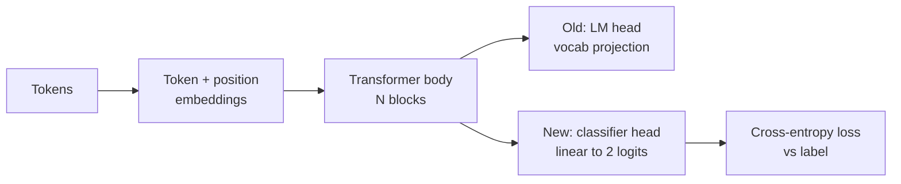
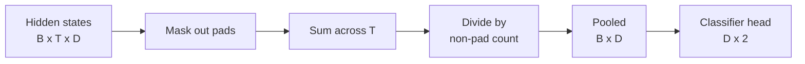
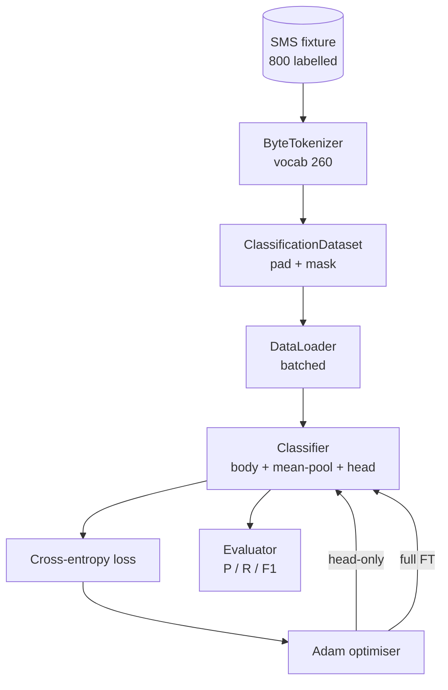

# 项目第 38 课：通过替换头进行分类器微调

> Track B 的第一个项目。预训练语言模型是一摞自注意力块，末端接一个 token 预测头。当你要做垃圾邮件与正常邮件的区分时，这个头是错的，但主体大体是对的。本节课把原来的头拆掉，在池化表示上粘一个两类线性层，并用两种方式训练分类器：只训最后一层，以及全量微调。评估指标是留出划分上的精确率、召回率和 F1。你会弄清每种策略带来什么，又付出什么代价。

**Type:** Build
**Languages:** Python (torch, numpy)
**Prerequisites:** Phase 19 lessons 30-37 (NLP LLM track: tokenizer, embedding table, attention block, transformer body, pre-training loop, checkpointing, generation, perplexity)
**Time:** ~90 minutes

## 学习目标

- 在不重新初始化主体的情况下，把语言模型头替换为分类头。
- 实现两种训练方案：冻结主体（只训头）与全量微调，共用同一个训练循环。
- 构建感知 tokenizer 的数据 pipeline，完成填充、填充掩码和注意力输出池化。
- 从原始 logit 计算精确率、召回率、F1 和混淆矩阵。
- 权衡参数量、训练时间与提升空间。

## 问题

你在通用语料上预训练了一个小型 Transformer。输出头把最后的隐状态投影到 1000 词表。现在你手上有 800 条标注为垃圾邮件或正常邮件的短信，想做一个二分类器。有三种选择。

错误的选择是在 800 个样本上从零训练一个新分类器。预训练模型的主体已经编码了有用的结构：词的身份、位置、简单的共现关系。把它丢掉，就浪费了构建它的算力。

两个正确的选择是冻结主体的换头，以及主体可训练的换头。只训头很快，几乎不占额外内存，在这么少的数据上也很少过拟合。全量微调更慢，在小数据上可能过拟合，但当下游领域与预训练语料产生偏移时能达到更高准确率。

本节课把两者都实现出来，方便你在同一份测试数据上比较。

## 概念



模型是一个函数 `f_theta(tokens) -> hidden_states`。头是一个函数 `g_phi(hidden) -> logits`。换头意味着保留 `theta`、替换 `g_phi`。主体的参数才是昂贵的部分，头只是一个线性层。

两组可训练参数值得关注：

- `theta`（主体）：每个注意力块数万个权重。
- `phi`（头）：`hidden_dim * num_classes` 个权重加一个偏置。

只训头时，你对 `phi` 计算梯度，对 `theta` 的梯度置零。PyTorch 中通过给主体参数设置 `requires_grad=False` 实现。优化器于是只看得到头，主体保持冻结。

全量微调时，你让梯度回传穿过整个堆叠。主体的权重会漂移以拟合分类目标。风险是小数据上的灾难性遗忘：主体的预训练成果被过拟合噪声冲掉。

## 池化问题

分类器需要每条序列一个向量，而不是每个 token 一个向量。三种常见选择：

- **平均池化**：按注意力掩码加权，对序列上的隐状态取平均。
- **CLS 池化**：在最前面加一个特殊 token，只使用它的输出。BERT 就是这么做的。
- **末 token 池化**：使用最后一个非填充 token。GPT 类分类器采用这种方式。

本节课使用带显式注意力掩码加权的平均池化。它最简单，能在不同序列长度间给出稳定信号，也不需要预训练一个 CLS token。



## 数据

800 条短信，垃圾邮件和正常邮件各 400 条，在 `code/main.py` 中确定性地生成。生成器使用固定种子，挑选模板并替换槽位填充词，输出长度在 5 到 25 个 token 之间的消息。真实数据集有这份测试数据所没有的噪声。这份测试数据的意义在于可复现。

数据按 80/20 划分：640 条训练，160 条测试。划分是分层的，因此测试集保持 50/50 的平衡。平衡已知的留出集让精确率和召回率可以被读作诚实的数字。

## 指标

二分类，类别 1 为正类（垃圾邮件）。计数如下：

- `TP`：预测为垃圾邮件，实际是垃圾邮件。
- `FP`：预测为垃圾邮件，实际是正常邮件。
- `FN`：预测为正常邮件，实际是垃圾邮件。
- `TN`：预测为正常邮件，实际是正常邮件。

三个主要指标：

- `precision = TP / (TP + FP)`。在被标为垃圾邮件的消息中，实际有多少是？
- `recall = TP / (TP + FN)`。在实际的垃圾邮件中，模型标出了多少？
- `F1 = 2 * P * R / (P + R)`。两者的调和平均。

混淆矩阵以 2x2 网格打印这四个计数。演示会为两种训练方案都写入标准输出。

```figure
cap-classifier-head-swap
```

## 架构



主体是一个刻意做得很小的 Transformer：词表 260、隐藏维度 64、4 个头、2 个块、最大序列长度 32。小到能在 CPU 上九十秒内把两种方案都训练到收敛。它在本课中不做预训练；取而代之，`pretrain_quick` 辅助函数在同一份测试数据的文本上做五个 epoch 的语言模型训练，给主体一个非平凡的起点。这让本节课保持自包含。

## 你将构建什么

实现是一个 `main.py` 加一个测试模块（`code/tests/test_main.py`）。

1. `ByteTokenizer`：把字节映射为 id，保留一个 pad id。
2. `Block`：带多头注意力和前馈层的 Transformer 块。pre-norm。
3. `LMBody`：token 嵌入加位置嵌入，再加一摞块。返回隐状态。
4. `MeanPool`：在序列轴上做掩码加权平均。
5. `Classifier`：主体、池化、线性头。两种方案共享同一个主体实例。
6. `freeze_body` 和 `unfreeze_body`：切换主体参数的 `requires_grad`。
7. `train_classifier`：一个共享的循环。接收模型和针对当前可训练参数组配置好的优化器。
8. `evaluate`：跑测试集，返回 `Metrics(precision, recall, f1, confusion)`。
9. `run_demo`：先短暂预训练主体，再训练并评估只训头方案，然后全量微调，打印两份报告，退出码为零。

## 为什么这个比较重要

只训头方案通常训练更快，欠拟合得更温和。在这份测试数据上，只训头训练二十个 epoch 后，你通常会看到精确率接近 0.9、召回率接近 0.85。全量微调耗时约为三倍，根据随机种子的不同，最终指标会在几个百分点内浮动，可能高也可能低。

本节课不评选冠军，而是教你读懂数字与代价。在 800 个样本、小主体的场景下，只训头是正确选择。在 80000 个样本、更大主体的场景下，全量微调开始划算。你从本节课带走的契约是 API：同一个 `train_classifier` 函数处理两者，切换只需一次调用。

## 进阶目标

- 加第三种方案，只解冻最后一个块。这有时称为部分微调。它比全量微调便宜，又比只训头学到更多。
- 加学习率调度器。头部用余弦调度、主体用较小的恒定学习率，是常见的生产配置。
- 把平均池化换成可学习的注意力池化：一个带单个可学习 query 的小注意力层。在较长序列上，这通常优于平均池化。

实现给了你挂钩，测试固定了契约，数字留给你去推高。
