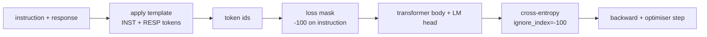
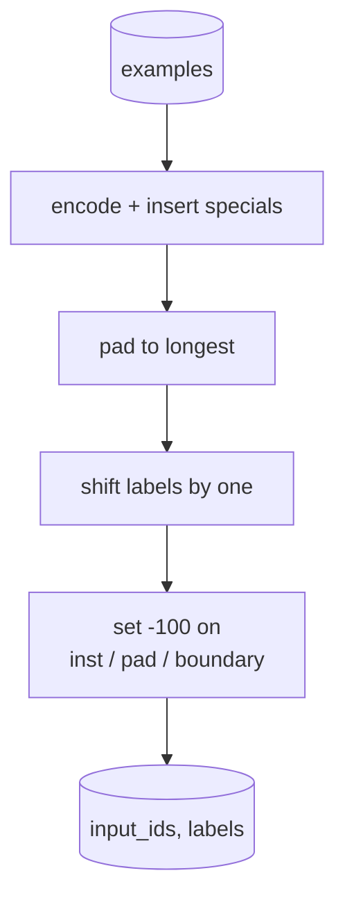
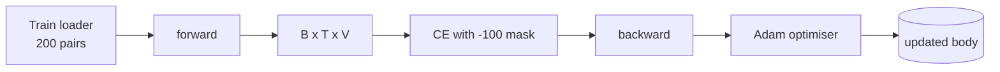

# 项目第 39 课：通过监督微调实现指令微调

> 预训练的基础模型能够续写一个序列，却无法遵循指令。监督微调（SFT）是修复这一问题的最小改动：给模型成对的「指令 + 期望回复」示例，训练模型主体去预测回复 token。窍门在于，你只希望损失统计回复部分，而不是指令部分。本课构建一个 Alpaca 风格的 SFT 训练循环，用自定义 collate 函数通过 `ignore_index=-100` 屏蔽指令 token，在 200 组指令-回复对上训练，并用精确匹配（exact-match）在留出集上评估。

**Type:** Build
**Languages:** Python (torch, numpy)
**Prerequisites:** Phase 19 lessons 30-37 (NLP LLM track: tokenizer, embedding table, attention block, transformer body, pre-training loop, checkpointing, generation, perplexity)
**Time:** ~90 minutes

## 学习目标

- 把成对的指令-回复数据格式化为一条带有显式边界 token 的因果序列。
- 构建 collate 函数来屏蔽指令 token，使交叉熵只统计回复 token。
- 在 SFT 目标下训练一个小型 Transformer 主体，并观察评估指标的变化。
- 实现贪心生成与温度采样生成，二者都尊重回复起始边界。
- 在生成的回复上计算留出集的精确匹配。

## 问题

一个只按下一 token 预测训练出来的基础模型，根本不知道指令是什么。把字符串 `"What is the capital of France?"` 喂给它，它会继续追问，或者凭空编出一句话。模型掌握了语言，却没有掌握格式约定。

SFT 的约定是一个字符串模板。每个训练示例都变成一条包含三个区域的单一序列：

```text
<INST> What is the capital of France? <RESP> The capital of France is Paris.
```

边界 token 是在训练时保留的特殊 token。模型会学到 `<RESP>` 之后的一切都是回复，而回复才是被评分的内容。基础模型的下一 token 目标仍然适用，只是训练语料里的每个示例都长这个样子。

但有个陷阱。如果把整条序列直接喂给普通的交叉熵损失，你等于在训练模型连指令 token 也一起预测。指令是给定的。你希望这些位置上的梯度为零。解决办法就是掩码。

## 概念



`ignore_index` 是 `torch.nn.functional.cross_entropy` 的一个特性。任何等于 `ignore_index` 的目标位置都贡献零损失、零梯度。PyTorch 的惯例是 `-100`。collate 函数为每个示例构建两个张量：`input_ids`（完整序列）和 `labels`（`input_ids` 的副本，其中指令位置被覆写为 `-100`）。

前向传播时模型看到的是整条序列，注意力可以关注到指令。损失只统计回复 token。这正是你想要的：以指令为条件，预测回复。

## 数据

`main.py` 以确定性方式生成 200 组指令-回复对，覆盖六种任务类型：

- 事实型单轮问答（X 的首都）
- 算术
- 列表抽取
- 一句话摘要
- 代码（打印、排序）
- 定义

每种任务都有一个模板化指令和确定性回复。这是刻意保持简单的做法。精确匹配很脆弱，所以本课使用的 fixture 中正确答案就是一个特定字符串。真实的 SFT 数据集需要模糊指标；但原理完全相同。

划分是 160 条训练、40 条测试。测试集覆盖全部六种任务类型，因此可以按类别报告精确匹配。

## 分词与填充

分词器是字节级的，保留三个特殊 token：

- `INST_ID = 256`：标记指令区域的开始。
- `RESP_ID = 257`：标记指令与回复的边界。
- `PAD_ID = 258`：用于变长 batch 的填充。

序列形式为 `[INST] inst_bytes [RESP] resp_bytes [PAD]*`。collate 函数会：

1. 对每个示例进行分词。
2. 把 batch 中每个示例填充到该 batch 内最长序列的长度。
3. 构建 `labels` = 右移一位的 `input_ids`（因果 LM 的目标），并做如下处理：
   - 指令区域替换为 `-100`。
   - 填充区域替换为 `-100`。
   - `RESP_ID` 边界位置本身替换为 `-100`（你不训练模型预测边界 token，它预测的是边界之后的内容）。



这种移位是标准的因果技巧：`input_ids` 的位置 `i` 预测位置 `i+1`，所以 `labels[i] = input_ids[i+1]`（输入丢掉最后一个位置，目标丢掉第一个位置）。掩码在移位之后应用，以便落在正确的位置上。

## 训练



这个循环就是标准的 PyTorch SFT 循环。使用 Adam，学习率约 3e-4 到 1e-3，在这个 fixture 上训练十到二十个 epoch，不使用调度器。模型足够小（hidden 96、2 个 block、最大长度 64），在 CPU 上两分钟内就能训练到收敛。

每五个 epoch，循环会在留出集上跑一次小型评估并打印精确匹配。看着精确匹配从第一个 epoch 的 0.0 升到第十五个 epoch 的 0.85 左右，正是本课的回报：你能同时看到模型学会格式和答案。

## 生成

评估时，模型拿到指令前缀 `[INST] inst_bytes [RESP]`，并生成 token，直到满足以下任一条件：

- 序列达到 `max_len`，或
- 模型触发特殊的停止启发式：连续出现两个句子结束字节（`.`、`!`、`?`）。

本课提供贪心解码，以及可选的温度采样器。精确匹配使用贪心，因为温度会让指标带随机性。真实系统常常先采样再做模糊评判；那条 pipeline 是第 41 课的内容。

## 精确匹配评估

精确匹配是最严格的文本指标。预测的回复字符串会被规范化（转小写、去掉首尾空白、合并连续空格），再与同样规范化后的参考回复比较。每个示例的指标为 1 或 0，汇总值为平均值。

真实的 SFT pipeline 会用 token 级 F1（第 41 课）和评判模型来补充精确匹配。精确匹配依然有用，因为它没有歧义；如果它报告 0.7，就说明恰好 70% 的测试指令逐字符生成了黄金回复。

```figure
cc-sft-loss-mask
```

## 你将构建什么

实现部分是一个 `main.py` 加上测试。

1. `InstructionTokenizer`：带保留特殊 token 的字节级编码器。既可以编码指令前缀，也可以编码完整的指令-回复对。
2. `make_dataset`：用固定随机种子生成覆盖六种任务类型的 200 组数据对。
3. `SFTDataset`：每个示例返回 `(input_ids, labels)`，掩码已处理完毕。
4. `sft_collate`：动态填充，构建 batch 张量，在指令和填充位置设置 `-100`。
5. `TinyGPT`：Transformer 主体加上绑定或非绑定的 LM 头。
6. `train_sft`：SFT 训练循环，带每个 epoch 的评估钩子。
7. `generate`：从给定前缀做因果解码，支持贪心或采样，并带停止启发式。
8. `exact_match`：规范化字符串比较，返回 `[0, 1]` 内的浮点数。
9. `run_demo`：构建数据，训练二十个 epoch，执行评估，打印按类别的细分结果，成功时以退出码 0 结束。

## 为什么掩码很重要

没有掩码时，损失会把指令 token 当作目标，模型于是学会预测指令。这是一个不同的目标，并从两方面产生更差的模型。第一，模型容量被浪费在重建用户总会提供的输入上。第二，在梯度总和中，回复部分的损失占比更小，因为在多数 batch 中指令 token 的数量超过回复 token；优化器在你真正关心的部分上的有效学习率会低于你的预期。掩码不是锦上添花，它就是目标本身。

## 延伸目标

- 加入学习率预热（warmup）再接余弦衰减。SFT 对学习率（LR）比预训练更敏感。
- 加入逐 token 的损失日志，并绘制训练过程中的损失曲线。你会注意到，早期 epoch 的损失主要由模板 token（`<RESP>`、常见前缀）主导，后期 epoch 则由真正的答案 token 主导。
- 把评估扩展到 BLEU-1 或 chrF。精确匹配会低估那些用不同措辞给出同一答案的模型。
- 加入多轮格式的聊天模板，并在包含追问的 fixture 上训练。

实现部分给了你格式约定、掩码和训练循环。从基础模型到指令遵循模型的全部目标变化，就落在一个 collate 函数上。
