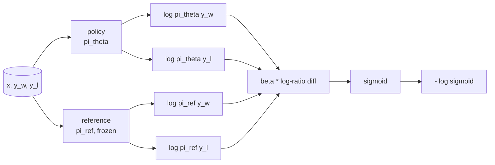
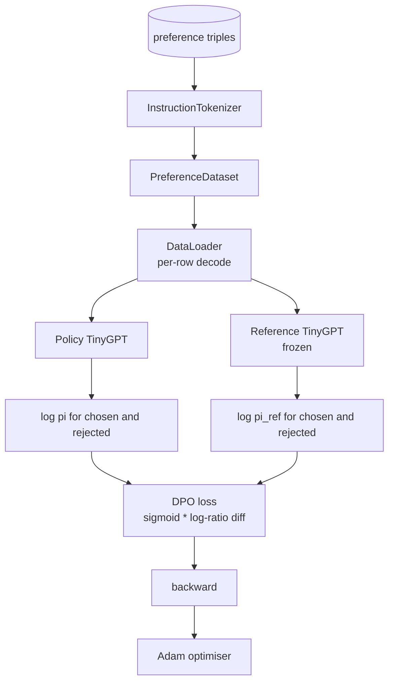

# 项目第 40 课：从零实现直接偏好优化（DPO）

> 奖励模型加 PPO 是经典的 RLHF 技术栈。DPO 把这一整套压缩成一个监督损失，直接让策略拟合偏好对。本课从奖励差恒等式推导 DPO 损失，提供可运行的参考模型与策略模型，计算逐 token 对数概率，并在由「被选中」和「被拒绝」回复构成的偏好 fixture 上训练一个小型 Transformer。测试固定住损失数学和梯度方向，让你确认实现与论文一致。

**Type:** Build
**Languages:** Python (torch, numpy)
**Prerequisites:** Phase 19 lessons 30-37 (NLP LLM track: tokenizer, embedding table, attention block, transformer body, pre-training loop, checkpointing, generation, perplexity)
**Time:** ~90 minutes

## 学习目标

- 把 DPO 损失推导为对一个缩放后的对数比差值取 sigmoid，并把它与隐式奖励联系起来。
- 构建参考模型与策略模型这一对：参考模型冻结，策略模型可训练。
- 在两个模型下计算序列级对数概率，并屏蔽 prompt token。
- 在 `(prompt, chosen, rejected)` 三元组上训练策略，观察被选中回复的对数概率相对被拒绝回复上升。
- 用测试固定损失数学、梯度符号和参考模型不变性这三项行为。

## 问题

你有一个 SFT 模型。它能遵循指令，但输出参差不齐：有些回复清晰，有些啰嗦甚至错误。你还有一个小型偏好对数据集：对同一个 prompt，人类把其中一个回复标记为被选中（chosen），另一个标记为被拒绝（rejected）。

经典 RLHF 的答案是两阶段 pipeline。先在偏好数据上训练奖励模型，再用 PPO 针对奖励优化策略。这可行，但代价高昂：PPO 期间内存里要放两个模型，需要 KL 控制让策略靠近参考模型，而且奖励模型脆弱时会出现奖励黑客（reward hacking）。

DPO 用一个监督损失取代这两个阶段。奖励模型从不显式存在。策略直接在偏好对上训练，并带有显式的 KL 惩罚，使其靠近 SFT 参考模型。在 Bradley-Terry 偏好模型下，二者最优解相同，代码却少得多。

## 概念

从 Bradley-Terry 模型出发。给定 prompt `x` 和两个回复 `y_w`（被选中）与 `y_l`（被拒绝），人类偏好 `y_w` 的概率为

```math
P(y_w > y_l \mid x) = \sigma\big( r(x, y_w) - r(x, y_l) \big)
```

其中 `r` 是某个潜在奖励函数。RLHF 先从偏好数据拟合 `r`，再训练策略 `pi`，在 KL 锚点约束下最大化 `r`：

```math
\max_{\pi} \; \mathbb{E}_{x, y \sim \pi} \big[ r(x, y) \big] - \beta \, \mathrm{KL}(\pi \,\|\, \pi_{\text{ref}})
```

DPO 的推导注意到，该目标下的最优策略 `pi*` 可以用 `r` 写成闭式解：

```math
\pi^*(y \mid x) = \frac{1}{Z(x)} \, \pi_{\text{ref}}(y \mid x) \exp\!\left( \frac{r(x, y)}{\beta} \right)
```

反解出 `r`：

```math
r(x, y) = \beta \big( \log \pi^*(y \mid x) - \log \pi_{\text{ref}}(y \mid x) \big) + \beta \log Z(x)
```

`log Z(x)` 这一项对 `y_w` 和 `y_l` 是相同的（它只依赖 `x`，不依赖 `y`），所以在计算偏好差时会消掉：

```math
\begin{aligned}
r(x, y_w) - r(x, y_l) = \beta \big( &\log \pi_\theta(y_w \mid x) - \log \pi_{\text{ref}}(y_w \mid x) \\
&- \log \pi_\theta(y_l \mid x) + \log \pi_{\text{ref}}(y_l \mid x) \big)
\end{aligned}
```

代入 Bradley-Terry 的 sigmoid，并对偏好对取负对数似然：

```math
\begin{aligned}
L_{\text{DPO}}(\theta) = -\mathbb{E}_{(x, y_w, y_l)} \Big[
  \log \sigma\big( \beta \big( &\log \pi_\theta(y_w \mid x) - \log \pi_{\text{ref}}(y_w \mid x) \\
  &- \log \pi_\theta(y_l \mid x) + \log \pi_{\text{ref}}(y_l \mid x) \big) \big)
\Big]
\end{aligned}
```

这就是 DPO 损失。它对每个示例的单个标量取 sigmoid，而该标量由四个对数概率计算得出。不需要独立的奖励模型，不需要 PPO，损失里也没有 KL 项；KL 约束已经内嵌进闭式推导中。



## 梯度的符号

在任何训练开始之前，有一个有用的合理性检查：对 `log pi_theta(y_w | x)` 求梯度：

```math
\frac{\partial L_{\text{DPO}}}{\partial \log \pi_\theta(y_w \mid x)} = -\beta \big(1 - \sigma(z)\big)
```

其中 `z` 是 sigmoid 的输入。该梯度对所有 `z` 都为负，这意味着：提高策略对被选中回复的对数概率会降低损失。对称地，对 `log pi_theta(y_l | x)` 的梯度为正：提高被拒绝回复的对数概率会增加损失。因此训练会把被选中回复推高、把被拒绝回复压低。参考模型是冻结的，不会移动。

## 数据

本课附带 12 组偏好三元组，每组为 `(prompt, chosen, rejected)`。被选中的回复简短而准确，被拒绝的回复则啰嗦、跑题或错误。这些偏好对覆盖与第 39 课相同的任务族（首都、算术、列表），因此从 SFT 基座出发的策略有一个合理的起点。

这个 fixture 是刻意做小的。生产中 DPO 要处理数万组偏好对；这里的重点是在极小数据集上把损失数学和训练循环端到端跑通，并让被选中与被拒绝之间的对数概率差距肉眼可见地扩大。

## 参考模型的不变性

DPO 实现必须小心处理参考模型。参考模型就是原地冻结的 SFT 模型。必须满足三个性质：

- 参考模型的参数永远不接收梯度。
- 参考模型的对数概率在不同 epoch 之间从不改变。
- 策略从与参考模型相同的权重开始。（最优的 `theta` 是参考模型加上一个学习到的更新；把策略初始化为参考模型的副本，就是定义明确的起点。）

实现通过以下方式保证这三点：

- 在前向传播期间用 `torch.no_grad()` 包裹参考模型。
- 把参考模型的每个参数设为 `requires_grad=False`。
- 在参考模型构建完成后，通过 `policy.load_state_dict(reference.state_dict())` 构造策略。

```figure
cap-dpo-preference
```

## 架构



模型与第 39 课使用的 TinyGPT 相同（仅解码器、因果、字节分词器）。参考模型和策略共享同一架构；训练中策略的权重会逐渐偏离参考模型，而参考模型保持固定。

## 你将构建什么

实现部分是一个 `main.py` 加上测试。

1. `InstructionTokenizer`：带 `INST` 和 `RESP` 特殊 token 的字节分词器。形态与第 39 课相同。
2. `TinyGPT`：仅解码器 Transformer。形态与第 39 课相同，因此即使你跳过了第 39 课，本课也自成一体。
3. `make_preferences`：返回 12 组 `(prompt, chosen, rejected)` 三元组。
4. `sequence_log_prob`：给定模型、prompt 前缀和回复，返回回复部分下一 token 对数概率之和（不计入 prompt 位置的贡献）。
5. `dpo_loss`：接收四个对数概率和 `beta`，返回逐示例损失张量，以及用于日志记录的隐式奖励差值。
6. `train_dpo`：按 epoch 的循环，在策略和参考模型下计算被选中与被拒绝回复的对数概率，应用损失，并推进 Adam。
7. `evaluate_margins`：返回任意时刻策略下「被选中减被拒绝」对数概率边距的均值。
8. `run_demo`：先用一个小型预热预训练构建参考模型和策略模型，复制权重，训练三十步，打印每步的损失和边距，成功时以退出码 0 结束。

## DPO 为什么有效

在 Bradley-Terry 偏好模型下，DPO 与 RLHF 在数学上等价，差别只在于奖励的参数化方式。隐式奖励 `r(x, y) = beta * (log pi(y|x) - log pi_ref(y|x))` 可以从偏好数据中识别出来，识别结果只差一个关于 `x` 的函数，而这个函数在求差时会消掉。闭式策略让你可以跳过显式的奖励模型。KL 约束以结构化的方式生效：`pi` 一旦偏离 `pi_ref`，对数比就会变大，sigmoid 随之饱和，从而在策略走得太远时抑制梯度。参考模型就是你的安全网。

## 延伸目标

- 给对数概率之和加入长度归一化：除以回复长度。长度偏差是 DPO 已知的失效模式，模型会偏好选择更短的回复，因为其对数概率的绝对值更大。
- 加入 IPO 变体损失：把 sigmoid + log 换成 `(z - 1)^2`。在 fixture 上比较收敛情况。
- 加入标签平滑参数，在被选中-被拒绝的硬标签与均匀的 0.5 之间插值。
- 用更小、更便宜的模型替换参考模型（知识蒸馏风格）。

实现部分给了你损失、参考模型不变性和训练循环。数学才是本课的核心，代码让数学变得具体。
