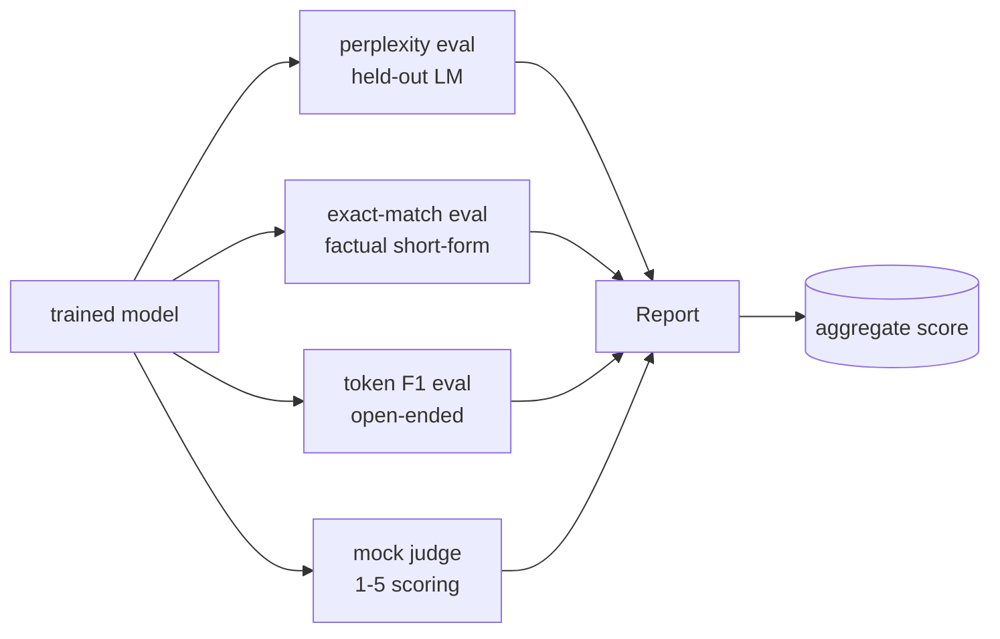
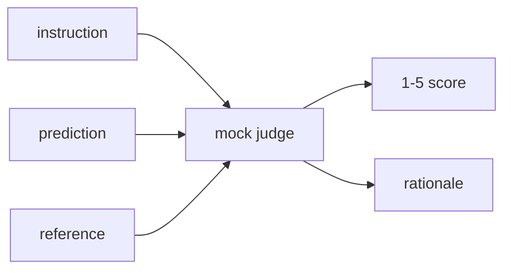
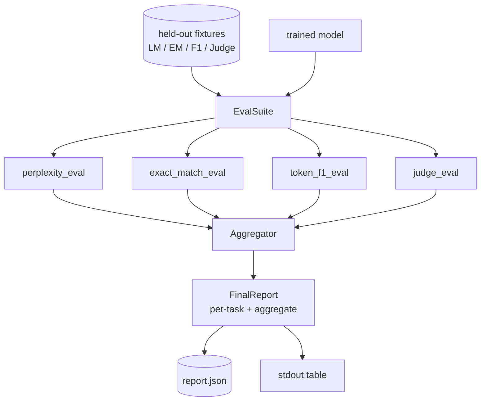

# 项目第 41 课：完整评估 pipeline

> 训练是可以用损失曲线监控的部分，评估则是必须自己设计的部分。本课构建一条统一的 eval pipeline：接收任意已训练的语言模型，对它运行四种异构评估，把结果汇总成按任务的报告，并附带一个本地 mock LLM-as-judge，使整个循环无需联网即可运行。这四种评估覆盖每个上线模型都需要的维度：语言建模（困惑度）、短答案正确性（精确匹配）、开放式相似度（token F1）和定性评分（judge）。

**Type:** Build
**Languages:** Python (torch, numpy)
**Prerequisites:** Phase 19 lessons 30-37 (NLP LLM track: tokenizer, embedding table, attention block, transformer body, pre-training loop, checkpointing, generation, perplexity)
**Time:** ~90 minutes

## 学习目标

- 在小型 Transformer 上计算留出集的困惑度，并正确核算被掩码的 token。
- 在短事实型 prompt 上运行精确匹配评估。
- 在规范化后计算预测字符串与参考字符串之间的 token 级 F1。
- 构建一个本地 mock LLM-as-judge，按 1-5 分给模型输出打分。
- 把四种评估聚合成一份带按任务细分的加权报告。

## 问题

单一指标永远无法描述一个语言模型。困惑度说明模型对语言分布的拟合程度，却完全不管它能否回答问题。精确匹配说明模型是否生成了黄金字符串，但会惩罚正确的改写。Token F1 容忍改写，却会被与错误内容重叠的词汇骗过。LLM-as-judge 能捕捉定性维度，但昂贵且带随机性。

你真正想要的 pipeline 同时包含这四种。每种评估都覆盖其他评估看不到的维度，每种都在为它量身定制的留出数据子集上运行。最终报告并排展示各任务的数值与一个汇总值，让评审者一眼看出模型在做哪些权衡。

本课在一个文件里端到端构建这条 pipeline。

## 概念



每种评估都是一个从 `(model, dataset) -> EvalResult` 的函数。结果携带指标值、可供检查的逐示例细节，以及用于聚合的名称。pipeline 通过配置把它们组合起来，配置说明要运行哪些评估、各自如何加权。

## 正确计算的困惑度

困惑度是 `exp(每个 token 的平均负对数似然)`。实现时有两个陷阱：

- 平均值必须基于真实 token 位置，而不是 batch * sequence。填充 token 必须从分母中排除，否则困惑度会显得比实际更好。
- 模型预测的是下一个 token，所以位置 `i` 的 logit 预测位置 `i+1` 的 token。这里的差一错误是无声的：损失照样能训练，但指标会变得毫无意义。

评估时先在每个 batch 内对非填充位置累加 `-log p(token)`，并统计该 batch 的 token 数，最后再相除。这比对各 batch 的困惑度取平均（会低估短序列的权重）在数值上更安全，也与教科书的定义一致。

## 带规范化的精确匹配

测试框架在比较前会同时规范化预测与参考：

- 转小写。
- 去掉首尾空白。
- 把内部连续空白合并为一个空格。
- 如果两侧仅因标点不同而不同，则去掉末尾的句子结束标点（`.`、`!`、`?`）。

规范化让精确匹配在实践中变得可用。输出 `"Paris"` 的模型算对，输出 `"Paris."` 的也算对，输出 `"  paris  "` 的同样算对。该指标仍然要求规范化之后答案字符串完全相同。

## 正确的 Token F1 做法

Token F1 是在 token 词袋上计算的精确率与召回率的调和平均。步骤如下：

1. 规范化预测和参考（规则与精确匹配相同）。
2. 各自切分成 token 列表（按空白分词）。
3. 统计多重集交集。
4. 精确率 = `intersection_count / len(pred_tokens)`。召回率 = `intersection_count / len(ref_tokens)`。F1 = 二者的调和平均。

如果预测和参考都为空，F1 为 1（空匹配）。如果只有一方为空，F1 为 0。这一模式与 SQuAD 的评估参考实现一致，并能在不同改写之间给出稳定的数值。

## 本地 Mock LLM-as-Judge

真正的 judge 是 API 背后的前沿模型。本课的 judge 必须离线运行。mock judge 是一个确定性打分器：输入指令、模型预测和参考，返回 `{1, 2, 3, 4, 5}` 中的一个分数，外加一行评分理由。评分规则是明确的：

- 如果规范化后的预测等于规范化后的参考，得 5 分。
- 如果预测与参考的 token F1 至少为 0.8，得 4 分。
- 如果 token F1 落在 `[0.5, 0.8)`，得 3 分。
- 如果 token F1 落在 `[0.2, 0.5)`，得 2 分。
- 其余情况得 1 分。

这不是真正的 judge，但接口是对的。以后只需替换一个函数就能换成真实模型，pipeline 并不关心具体实现。



## 聚合

汇总值是各评估归一化分数的加权平均。每种评估都报告自己 `[0, 1]` 内的数值：

- 困惑度：按 `1 / (1 + log(perplexity))` 归一化。困惑度为 1 映射到 1，无穷大映射到 0。
- 精确匹配：本身就在 `[0, 1]` 内。
- Token F1：本身就在 `[0, 1]` 内。
- Judge：除以 5。

权重可配置。默认配比是困惑度 0.2、精确匹配 0.3、token F1 0.3、judge 0.2。权重的选择是产品决策；本课把这个旋钮暴露出来，方便你实验。

```figure
cg-eval-quadrant
```

## 架构



`EvalSuite` 是一个轻量编排器。每种单独的评估都是自由函数，接收 `(model, tokenizer, dataset, config)` 并返回 `EvalResult`。`Aggregator` 收集结果并生成最终报告。demo 会打印表格，并写出一份供下游 CI 读取的 JSON 副本。

## 你将构建什么

实现部分是一个 `main.py` 加上测试。

1. `TinyGPT`：与第 38-40 课相同的仅解码器架构，内置在本课中以便独立运行。
2. `InstructionTokenizer`：带 INST / RESP / PAD 特殊 token 的字节分词器。
3. 四个 fixture：一个 LM 语料、一个 EM 集合、一个 F1 集合和一个 judge 集合，各含 20 个确定性示例。
4. `perplexity_eval`：返回带困惑度值和逐 token 损失直方图的 `EvalResult`。
5. `exact_match_eval`：返回平均 EM 和逐示例记录。
6. `token_f1_eval`：返回平均 token F1 和逐示例记录。
7. `mock_judge` 和 `judge_eval`：逐示例的分数与理由，以及整个集合的平均分。
8. `Aggregator.normalise`：每种评估的归一化规则。
9. `Aggregator.aggregate`：加权平均与组装好的报告。
10. `run_demo`：短暂训练一个小模型，运行全部四种评估，打印报告表并写出 JSON，成功时以退出码 0 结束。

## 阅读报告

报告分三层。最上层是汇总分数，其下是四种评估各自的数值，再往下是用于诊断的逐示例细分。失败的 CI 运行通常只关心汇总值，但追查回归的评审者需要逐示例细分，来判断模型在哪些输入上出错。

JSON 输出使用稳定的键名，便于 CI 仪表盘跨版本绘制趋势线。格式化表格则是给训练结束后盯着终端的人看的。

## 延伸目标

- 加入校准评估：模型的 softmax 概率与它的准确率是否匹配？按置信度对预测分桶，报告每个桶的经验准确率。
- 加入鲁棒性评估：给每个示例标注一种扰动（拼写错误、改写、干扰项），报告每种扰动下的指标下降。
- 把 mock judge 换成 HTTP 调用背后的真实模型，函数签名不变。
- 加入按任务的权重学习：不再使用固定权重，而是让权重拟合模型之间的目标偏好顺序。

实现部分给了你四种评估、聚合器和报告。真实的评估 pipeline 会在其上叠加更多维度；模式始终不变：每种评估一个函数、一个聚合器、一份报告。
