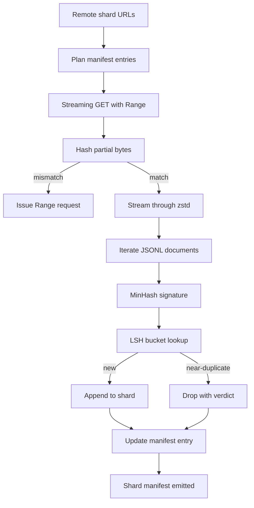

# 大规模语料下载器

> 训练语言模型的工作早在第一次前向传播之前就开始了。语料必须落到磁盘上：解压完成、去重完毕、可寻址，而且在网络于 4% 处断开之前，续传方案就已经想好。本课构建一个流式下载器：拉取压缩分片，用 Zstandard 即时解压，通过 MinHash 加局部敏感哈希（LSH）为近重复文档生成指纹，并写出分片清单，供 pipeline 其余部分信任。

**Type:** Build
**Languages:** Python
**Prerequisites:** Phase 19 lessons 30-37
**Time:** ~90 minutes

## 学习目标

- 用 `urllib` 流式读取远端分片，并用 `zstandard` 解压，无需把整个文件缓冲在内存中。
- 基于经过校验的字节偏移发出 HTTP `Range` 请求，续传未完成的下载。
- 为每篇文档构建 MinHash 签名，并用 LSH 分桶，使近重复文档碰撞到同一个桶。
- 输出分片清单，包含内容哈希、字节大小、文档数和去重判定。

## 问题

第一次在 200 GB 语料上训练，网络在 41% 处断开，脚本抛出 `urllib` 异常退出。第二次在 78% 处断开。到 99% 时，你已经把循环重写了三遍。从第一分钟起就必须考虑的两类失败是：部分下载的续传，以及重复文档的删除。两者都有成熟的解决方案，却经常被跳过，因为 pipeline 最初只是一行 `requests.get` 调用，后来才长出牙齿。

续传是一个 HTTP 问题。服务器必须支持 `Range`，客户端必须依据磁盘上的记录跟踪已验证偏移，而且这个已验证偏移必须在进程死亡后仍然有效。如果偏移与文件哪怕差一个字节，续传就会写入垃圾数据，语料随之损坏，而这种损坏往往只在分词阶段才暴露。

去重是一个签名问题。精确哈希去重会漏掉近重复：同一篇 Wikipedia 文章带着三种不同的样板页脚出现，同一份代码文件换了许可证头，同一篇博客文章的每个链接都多了跟踪参数。MinHash 加 LSH 能以亚线性代价捕捉这些情况。代价是每篇文档一个签名，每个签名一次分桶查找。

## 概念



### 用 `urllib` 流式读取

标准库的 `urllib.request.urlopen` 返回一个类文件对象。把它包进 `zstandard.ZstdDecompressor().stream_reader`，字节就从网络流经解压器进入文档迭代器，压缩分片和解压后的分片全程都不会在内存中实体化。唯一的内存开销是行缓冲、当前文档的 MinHash 签名和 LSH 索引。

### 用 `Range` 续传

下载器为每个分片写两个文件：分片本身和一个 `.partial.json` checkpoint。checkpoint 记录 `verified_bytes`、`expected_size`、`sha256_prefix`（对前 `verified_bytes` 个字节计算）以及源 URL。启动时，下载器读取 checkpoint，对磁盘上的字节重新计算 `sha256_prefix`，只有重新计算的哈希匹配时才续传。如果哈希不对，就丢弃这个未完成文件，从头开始下载。由于已验证的字节是被检查过的而不是假定的，静默损坏不可能发生。

### MinHash 加 LSH

MinHash 在固定空间内估计两个集合的 Jaccard 相似度。对一篇文档来说，集合是它文本的 shingle（相互重叠的 n-gram）。签名是 `k` 个最小哈希值，每个独立哈希函数对应一个。Jaccard 相似度为 `s` 的两篇文档，在签名的任意单个分量上一致的概率也是 `s`。

LSH 随后把这 `k` 个分量分成 `b` 个 band，每个 band 含 `r` 行，满足 `k = b * r`。两篇文档至少在一个 band 上碰撞的概率为 `1 - (1 - s^r)^b`，在你通过调整 `(b, r)` 所设定的 `s` 值附近形成陡峭的阈值。典型语料去重的阈值是 `s = 0.8`，LSH 研究文献用 `k = 128`、`b = 32`、`r = 4` 达到该阈值。

### 分片清单即契约

下载器唯一持久化的输出就是清单。清单按分片记录 URL、解压后的字节数、文档数、去重后的唯一文档数，以及最终分片文件的 sha256。下游分词读取的是清单，而不是目录列表。如果某个分片缺失或其 sha256 不对，清单会告诉下一阶段拒绝启动。清单是「数据已下载」与「数据已下载且可验证」之间的决定性边界。

```figure
cap-corpus-downloader
```

## 构建它

`code/main.py` 实现了：

- `ShardPlanner` - 读取分片 URL 列表，生成计划中的清单条目。
- `StreamingDownloader` - 打开带可选 `Range` 的 `urllib` 流，写入临时文件，每个 chunk 都更新 `.partial.json` checkpoint，并在续传时校验 sha256 前缀。
- `ZstdDocIterator` - 把类文件流包进 `zstandard.ZstdDecompressor`，每行产出一篇文档。
- `MinHasher` - 使用固定的一组哈希种子，为字符串生成 `k` 分量的签名。
- `LSHIndex` - 按 band 对签名分桶并报告碰撞。
- `Dedup` - 组合哈希器与索引，为每篇文档标注 `keep` 或 `near_duplicate`，并附上匹配到的分片 id。
- `ManifestWriter` - 收集每个分片的统计信息并写出 `manifest.json`。

文件底部的 demo 会在磁盘上构建一个小型合成语料，用 `zstandard` 压缩，通过 `file://` URL 下载，执行去重，并打印清单。

运行：

```bash
python3 code/main.py
```

脚本以退出码 0 结束并打印清单摘要。

## 生产模式

以下四种模式能把本课扩展到真实语料。

**先写 checkpoint，再写数据。** 在把字节追加到分片之前，必须先对 `.partial.json` 执行 `fsync`。否则一旦断电，顺序就反了：分片字节已在磁盘上，checkpoint 却没记录它们，下次续传会以为自己已验证的字节比实际少，重复的后缀字节会破坏文件。先写 checkpoint，再写数据。这与预写日志（write-ahead log）是同一套纪律。

**分片的 LSH 索引。** 在 200 GB 规模下，覆盖整个语料的单一 LSH 索引放不进 RAM。按第一个 band 的哈希对 LSH 索引分区，把分区存到磁盘上，查询时只访问新签名会落入的那个分区。代价是每篇文档多一次磁盘读取；好处是 LSH 索引不再是一个硬性的内存上限。

**打墓碑标记，而不是删除。** 被丢弃的重复文档会以 `near_duplicate` 判定记录在清单中，并附上与之碰撞的文档所在分片 id。直接删除会丢失重复项与保留项之间的联系。打墓碑标记能保留审计轨迹，也让下游流程以后可以改变对阈值的决定。

**清单中记录每个分片的 sha256，再给清单本身加一个 sha256。** 清单本身也要有内容哈希。下游阶段先校验清单哈希，再信任其中的分片条目。没有这一步，清单就是无声的攻击面：能编辑单个文件的攻击者就能破坏整条 pipeline。

## 使用它

生产模式：

- **每次 CI 运行都续传。** CI runner 是临时的。下载器必须假设每次运行都是全新磁盘，并从缓存或远端恢复。`--cache-dir` 是一等公民参数。
- **先去重，再分词。** 分词很昂贵。对同一篇文档跑两遍，成本翻倍而损失曲线不变。去重位于分词的上游，而不是下游。
- **把清单当作合并门禁。** 训练运行从固定的 commit 读取清单 sha256。新的数据集版本需要新的清单 commit。代码与数据之间的关联靠 git，而不是口口相传。

## 交付它

在真实项目中，`outputs/skill-corpus-downloader.md` 会描述哪些 URL 为下载器提供输入、checkpoint 目录如何布局、去重使用多大的 shingle 宽度和哪组 `(k, b, r)` 三元组，以及清单在版本控制中的位置。本课交付的是引擎。

## 练习

1. 加入 `--shingle-width` 参数，测量宽度为 3、5、9 时去重判定的变化，并为你选择的默认值给出理由。
2. 通过嗅探魔数，在 zstd 之外加入 gzip 支持。下载器不应要求调用方指定编解码器。
3. 加入 `--resume-only` 模式：找不到 checkpoint 时拒绝开始全新下载。这在 CI 中很有用，可以防止某次运行意外重新拉取 200 GB 数据。
4. 把 LSH 索引迁移到 shelf 或 sqlite 文件，并比较其与内存版本的吞吐量。
5. 在启动时加入清单 sha256 校验。如果磁盘上的清单与 `manifest.lock` 中的清单哈希不一致，下载器应失败关闭（fail closed）。

## 关键术语

| 术语 | 人们怎么说 | 实际含义 |
|------|-----------------|------------------------|
| 分片（Shard） | 「一个文件」 | 语料中自带 sha256 的自包含切片，是续传和去重的单位 |
| MinHash 签名 | 「指纹」 | 集合的 `k` 分量概要，每个分量是对集合做某个独立哈希得到的最小值 |
| LSH band | 「桶」 | 一组 `r` 个签名分量，作为一个桶键用于碰撞检测 |
| 已验证字节 | 「续传偏移」 | 磁盘上其 sha256 前缀与 checkpoint 匹配的字节；唯一可以安全续传的偏移 |
| 清单（Manifest） | 「索引」 | 下载器产出的唯一持久记录，包含内容哈希 |

## 延伸阅读

- [RFC 7233](https://datatracker.ietf.org/doc/html/rfc7233) - HTTP Range 请求，续传协议
- [Zstandard 格式规范](https://datatracker.ietf.org/doc/html/rfc8478) - 使流式解压安全的帧格式
- [MinHash](https://en.wikipedia.org/wiki/MinHash) - 本课使用的签名族
- [局部敏感哈希](https://en.wikipedia.org/wiki/Locality-sensitive_hashing) - 去重阈值背后的分 band 方案
- 第 19 阶段 · 43 - 下载器为其提供数据的 HDF5 分词语料
- 第 19 阶段 · 44 - 在该语料上训练的余弦调度
- 第 19 阶段 · 45 - 使用该调度的 AMP 训练循环
