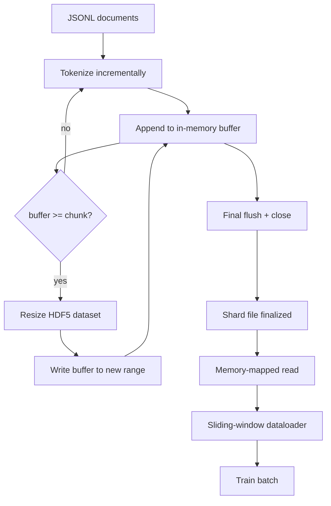

# HDF5 分词语料

> 下载好的语料必须以训练器能够以线速流式读取的布局落地。磁盘上的 JSONL 撑不住 16 个 dataloader worker。可调整大小、分块存储的整数型 HDF5 数据集则可以。本课实现把分词流式写入可调整大小的 HDF5 数据集，跨多个文件分片写入，训练时内存映射读取，以及一个按正确打包规则产出定长序列的滑动窗口 dataloader。

**Type:** Build
**Languages:** Python
**Prerequisites:** Phase 19 lessons 30-37
**Time:** ~90 minutes

## 学习目标

- 以确定性的分块方式，把文档流式写入可调整大小的 HDF5 整数数据集。
- 把写入分片到多个 HDF5 文件，使故障影响有界，并支持并行。
- 通过 HDF5 由页缓存支撑的分块布局读回 token，使 dataloader 只在组 batch 时才复制到 batch 缓冲区。
- 实现一个滑动窗口 dataloader，按明确的打包规则产出定长训练序列。

## 问题

现代语言模型训练要在数十个 worker 上以每秒数十万个样本的速度读取 token。磁盘上的 JSONL 在第一次冷缓存缺页时就会崩溃：JSON 解析器慢，文档边界不可寻址，定位到「第 4,217,884 个样本」需要扫描整个文件。即便是压缩效果很好的 Parquet 也不合适，因为训练器不需要列式结构；它需要的是支持 $O(1)$ 随机访问的扁平 token 流。

HDF5 合适，因为它提供分块、可调整大小、纯整数的数据集，其分块在读取时对页缓存友好。训练器请求 `tokens[3,200,000 : 3,200,8192]` 的一个切片，HDF5 就把请求的超切片从页缓存复制到一个新分配的 NumPy 数组中。开销只是每个 worker 一个打开的文件句柄和一份 chunk 大小的页缓存占用，相比解码 JSONL 的代价可以忽略不计。

构建时的难题是让写入端保持诚实。可调整大小的数据集很容易被误用：一次只写一篇文档，HDF5 文件会碎片化到无法使用；一次 resize 写入全部文档，进程一死就丢掉整个分片。正确的纪律是「先缓冲，再扩展」：缓冲区大小与 chunk 大小匹配，并把工作负载分片到多个文件，使崩溃最多只损失一个分片。

## 概念



### 正确使用可调整大小的 HDF5

token 数据集以 `maxshape=(None,)` 和固定的 `chunks=(chunk_size,)` 创建。写入时，先把 token 缓冲到一个长度为 `chunk_size` 的 NumPy 数组中。缓冲区满时，数据集恰好扩展 `chunk_size`，再把缓冲区写入新的范围。分片结束时，残余缓冲区写入最后一个不完整的范围。除最后一次写入外，每次写入都是连续且按 chunk 对齐的；读取端会依据分片 HDF5 属性中记录的 `token_count` 对最后一次写入进行截断。

### 分片写入

单个 HDF5 文件就是单点故障。pipeline 并行写入分片：第 19 阶段第 42 课的每个输入分片产出一个 HDF5 输出分片。`shards.json` 索引按分片记录文件路径、token 数、文档数，以及针对 token 计算的 sha256。训练器读取 `shards.json` 来计算全局偏移并校验语料。

### 内存映射读取

训练时，每个 worker 以 `swmr=True` 模式打开自己负责的那部分 HDF5 文件，并请求 `tokens[start:stop]`。chunk 变热之后，HDF5 的分块布局使这次读取由页缓存支撑。worker 从不把整个文件实体化：切片先复制到 dataloader 的 batch 缓冲区，组 batch 时 dataloader 再把它复制到固定内存（pinned memory）的训练张量中。热路径上每跨一次 chunk 只有一次系统调用，其余都是 RAM 访问。

### 滑动窗口 dataloader

dataloader 是唯一知道训练序列长度的阶段。它在全局 token 流中随机选一个起始索引，读取 `window_size + 1` 个 token，返回 `(input, target) = (tokens[:-1], tokens[1:])`。不会强制对齐文档边界：一个窗口可以横跨两篇文档，中间放一个显式的 `boundary_token_id`，让模型学会使用分隔符。这是标准的打包规则；也正是初学者容易忘记的规则，结果语料里 8% 是训练用的边界 token，只有 92% 是自然文本。

```figure
cc-hdf5-corpus
```

## 构建它

`code/main.py` 实现了：

- `Tokenizer` - 一个字节级确定性分词器，对 demo 来说够用。接口是 `encode(text) -> list[int]` 和 `vocab_size`。
- `HDF5ShardWriter` - 打开可调整大小的整数数据集，把 token 缓冲到 chunk 大小，按固定步长扩展并写入，关闭时把 `token_count` 和 `sha256` 记录为 HDF5 属性。
- `ShardedTokenizationPipeline` - 遍历输入文档，把它们路由到写入器，并输出 `shards.json` 索引。
- `MmapTokenStore` - 打开分片文件进行内存映射读取，计算全局偏移，暴露单一的 `get_slice(start, stop)` API。
- `SlidingWindowDataloader` - 从全局流中挑选随机窗口，产出 `(input_ids, target_ids)` NumPy 数组。

文件底部的 demo 构建一个微小的内存语料，分词成两个分片，通过内存映射打开它们，运行 dataloader 10 个 batch，并打印每个 batch 的形状和校验和。

运行：

```bash
python3 code/main.py
```

脚本以退出码 0 结束并打印各 batch 的校验和。

## 生产模式

以下四种模式能把本课扩展到真实训练运行。

**chunk 大小等于典型读取量。** 训练器每个样本读取 `window_size + 1` 个 token。把 HDF5 chunk 设为 `window_size` 的整数倍，读取就能页缓存对齐。chunk 不匹配会使吞吐量减半，因为每个样本都会触及两个 chunk。

**把 token 数放在属性里，而不是放在数据集里。** 由于 chunk 大小不能整除文档边界，数据集的最后一小段可能只填了一部分。把真实的 `token_count` 存为数据集上的 HDF5 属性，让读取端在该值处截断。否则读取端会越界读到补零的 token，模型也就学会预测零。

**分片 sha256 与并行校验。** 每个分片都有自己的 token 字节 sha256。训练开始前，训练器可以并行校验所有分片。sha256 不对会在运行早期失败，而不是十六个小时后的第三个 epoch 才失败。

**两端都使用 `swmr=True`，写入端使用 `libver="latest"`。** 单写多读（Single-Writer-Multiple-Reader）模式要求写入端以 `libver="latest"` 打开文件，预先创建所有数据集，然后设置 `file.swmr_mode = True`。之后写入端每次 resize 后都必须调用 `dataset.flush()`，这样以 `swmr=True` 打开的读取 worker 才能看到一致的数据。跳过 `libver="latest"` 或在结构性变更之后才启用 SWMR，是「文件被锁定」故障的常见来源。

## 使用它

生产模式：

- **每个源分片对应一个 HDF5。** 下载器（第 42 课）为每个 URL 产出一个分片；分词（本课）为每个源分片产出一个 HDF5。1:1 映射让续传和部分失败恢复变得非常简单。
- **边界 token id。** 边界 token 属于分词器词表，也是 dataloader 唯一注入的 token。如果希望模型忽略该边界 token，训练损失会把它掩码；否则模型会学会把它当作序列分隔符。
- **以 `shards.json` 为唯一事实来源。** 新增分片意味着写出 HDF5、计算其 sha256，并追加一条记录。训练器在启动时读取一次该文件，之后从不碰目录列表。

## 交付它

在真实项目中，`outputs/skill-hdf5-tokenized-corpus.md` 会描述哪个分词器为 pipeline 提供输入、哪种 chunk 大小与训练器的窗口匹配、`shards.json` 在版本控制中的位置，以及 dataloader worker 如何跨文件分片。本课交付的是引擎。

## 练习

1. 给 HDF5 写入器加入 `--compression gzip` 参数，并在 demo 语料上测量吞吐量代价。为你选择的默认值给出理由。
2. 给滑动窗口 dataloader 加入确定性随机种子，并验证相同种子的两次运行产生完全相同的 batch。
3. 加入 `--validate` 模式：读取每个分片，重新计算其 token 的 sha256，并与 `shards.json` 比对。CI 应在训练开始前运行它。
4. 比较 chunk 大小等于、一半于和两倍于窗口大小时 dataloader 的吞吐量，并报告页缓存效应。
5. 加入 `--max-document-tokens` 参数，在写入时截断超长文档。就这一做法与在读取时决定之间的权衡给出理由。

## 关键术语

| 术语 | 人们怎么说 | 实际含义 |
|------|-----------------|------------------------|
| 可调整大小的数据集 | 「只追加」 | 使用 `maxshape=(None,)` 的 HDF5 数据集，通过按 chunk 大小步长调用 `resize` 来增长 |
| 分块布局 | 「HDF5 的存储方式」 | 固定大小的磁盘页，内核可以内存映射，dataloader 可以连续读取 |
| `swmr` 模式 | 「边写边读」 | 单写多读模式，让 dataloader worker 安全地共享文件 |
| 分片索引 | 「shards.json」 | 所有 token 分片的持久索引，包含偏移和内容哈希 |
| 滑动窗口 | 「训练样本」 | 全局 token 流中的定长切片，训练器将其与右移一位的目标配对 |

## 延伸阅读

- [HDF5 分块文档](https://support.hdfgroup.org/documentation/hdf5/latest/hdf5_chunking.html) - 本课使用的分块、可调整大小数据集布局
- [h5py 用户指南](https://docs.h5py.org/en/stable/) - HDF5 的 Python 绑定
- [NumPy 内存映射](https://numpy.org/doc/stable/reference/generated/numpy.memmap.html) - HDF5 通过 h5py 暴露的读取端原语
- 第 19 阶段 · 42 - 本课对其输出进行分词的下载器
- 第 19 阶段 · 44 - 使用该 dataloader 的余弦调度
- 第 19 阶段 · 45 - 包裹训练步骤的 AMP 循环
