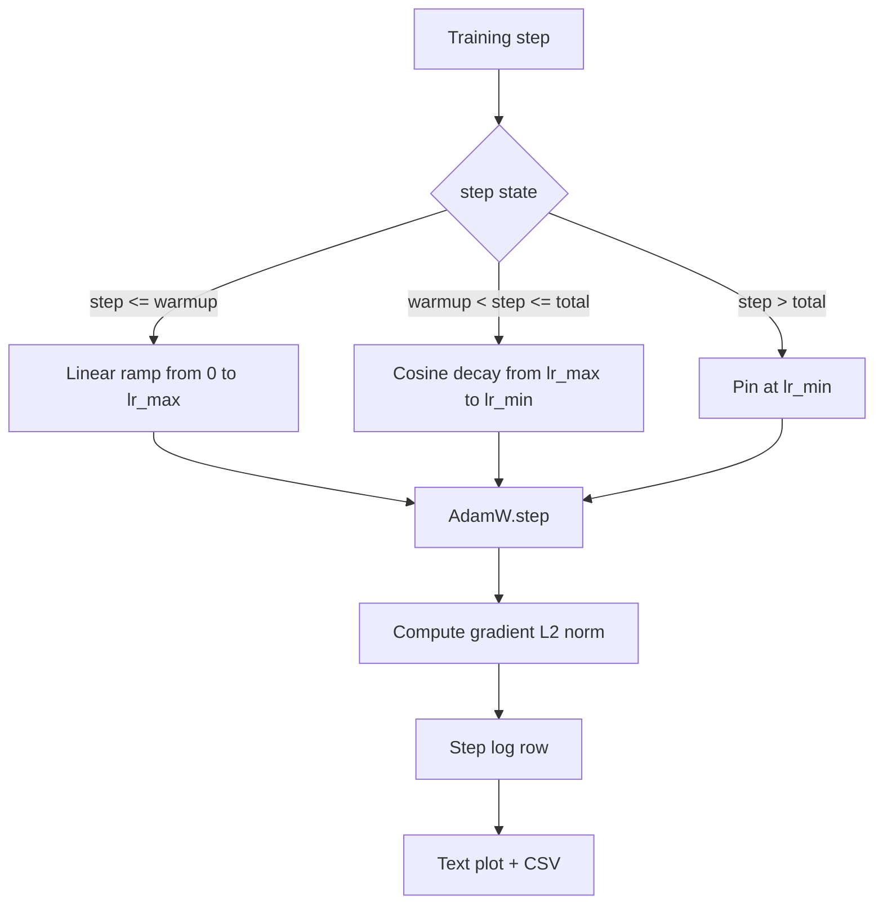

# 带线性预热的余弦学习率调度

> 学习率调度是仅次于损失函数的第二重要决策。带余弦衰减和线性预热的 AdamW 是现代语言模型训练的默认选择：它让模型在脆弱的前一千次更新中看到较小的有效步长，再爬升到配置的峰值，最后平滑衰减回接近零。本课实现该调度，绘制训练步数上的曲线，把梯度范数与调度并排记录，并证明调度严格遵守预热、峰值和衰减的边界。

**Type:** Build
**Languages:** Python
**Prerequisites:** Phase 19 lessons 30-37
**Time:** ~90 minutes

## 学习目标

- 实现接入线性预热加余弦学习率调度的 AdamW 优化器。
- 在任意 step 计算调度的精确值，且跨运行不发生浮点漂移。
- 把梯度 L2 范数与学习率并排记录，使训练健康状况可观测。
- 把调度渲染成人眼可读的文本图，以及任何工具都能消费的 CSV。

## 问题

最初一千次训练更新最为喧嚣。模型权重仍接近初始化值，优化器的二阶矩滑动估计尚未稳定，梯度范数又大又噪。如果学习率在这些更新期间就处于峰值，模型要么直接发散，要么落入再也逃不出的损失平台。两个众所周知的修复方法是梯度裁剪（第 19 阶段第 45 课的主题），以及从小到大爬升的学习率调度。

带预热的余弦调度有三个区间。从 step 0 到 step `warmup_steps`，学习率从零线性爬升到配置的峰值 `lr_max`。从 step `warmup_steps` 到 step `total_steps`，学习率沿余弦曲线的上半段从 `lr_max` 衰减到 `lr_min`。超过 `total_steps` 后，学习率固定在 `lr_min`，这样即便训练器配置有误、跑过了头，也不会悄无声息地脱离调度。

构建时的难题在于，调度很容易犯差一错误。这种差一错误会在训练运行六小时后显现：模型刚开始过拟合的那一刻，学习率偏高了或偏低了 1%。除非对调度在边界处做穷举测试，否则这种问题完全不可见。

## 概念



### 预热公式

当 `warmup_steps > 0` 时，对 `[0, warmup_steps]` 内的 `step`，学习率为 `lr_max * step / warmup_steps`。退化的 `warmup_steps = 0` 情况按「无预热」处理：调度在 step 零直接从 `lr_max` 开始，并立即进入余弦衰减。有些测试框架会传入 `warmup_steps = 0`，以检查调度仍能产出可用的曲线。

### 余弦公式

对 `(warmup_steps, total_steps]` 内的 `step`，学习率为 `lr_min + 0.5 * (lr_max - lr_min) * (1 + cos(pi * progress))`，其中 `progress = (step - warmup_steps) / max(1, total_steps - warmup_steps)`。在 `step = warmup_steps` 处，余弦值为 `cos(0) = 1`，得到 `lr_max`，恰好与预热的终点吻合。在 `step = total_steps` 处，余弦值为 `cos(pi) = -1`，得到 `lr_min`，恰好与衰减的终点吻合。

两个端点处的连续性并非巧合。这正是调度被实现为关于 `step` 的单一函数、而不是三个拼接函数的原因。拼接式调度在第一次修改 `lr_max` 时就会丢失一个边界。

### 超过总步数后的下限

当 `step > total_steps` 时，学习率保持在 `lr_min`。契约是明确的：调度不报错，也不外推；它固定在下限，让训练器记录一条警告。需要延长训练的训练器应修改调度的 `total_steps`，而不是修改循环。

### 与学习率并排记录梯度范数

调度是训练健康状况的一半，梯度范数是另一半。训练循环每步记录二者。发散的训练运行中，梯度范数会先于损失出现尖峰；调得好的预热会让范数随学习率线性上升；过于激进的峰值则表现为预热结束后范数仍居高不下。磁盘上的数据是 `step, lr, grad_l2_norm, loss`。CSV 是唯一的持久记录。

```figure
cap-cosine-warmup
```

## 构建它

`code/main.py` 实现了：

- `CosineWithWarmup` - 针对配置好的调度，提供无状态函数 `lr(step) -> float`。
- `TrainState` - 把模型、`AdamW` 优化器和调度封装成单一的 step 函数。
- `TrainState.step` - 执行一次前向、一次反向，记录梯度 L2 范数，并把 `lr(step)` 应用到优化器。
- `plot_schedule_ascii` - 把调度渲染成人眼可读的文本图。
- `write_schedule_csv` - 每个 step 输出一行，包含学习率。

文件底部的 demo 构建一个微小的 `nn.Linear` 模型，在固定输入 batch 上训练 20 步，并打印每步的学习率、梯度范数和损失。调度还会渲染为文本图，用于目视检查。

运行：

```bash
python3 code/main.py
```

脚本以退出码 0 结束，打印逐步训练日志和调度图。

## 生产模式

以下四种模式能把该调度提升为生产级产物。

**调度住在配置里，而不是代码里。** 训练器从提交进 git 的 YAML 或 JSON 配置中读取 `warmup_steps`、`total_steps`、`lr_max`、`lr_min`。配置是内容寻址的，所以调度可复现；配置是 PR diff 的一部分，所以调度可审计。

**step 计数器单调递增，并与 epoch 解耦。** 当数据集分片或 dataloader 重启时，一些框架会把 step 和 epoch 搞混。调度从训练器的 checkpoint 读取 `global_step`，而不是从本地计数器读取。续跑的训练因为 step 计数器是持久轴，能接着落在正确的调度位置。

**把调度图写进运行目录。** 每次训练运行都会把 `outputs/lr_schedule.png`（本课中则是文本图）写入运行目录。浏览目录的评审者无需重跑任何东西就能检查调度是否正常。这能在 PR 阶段抓住配置错误的调度这一类 bug。

**日志行 schema 固定不变。** 顺序为 `step, lr, grad_l2_norm, loss`。下游 notebook 或仪表盘按此 schema 读取；不升版本就重命名列，会让所有现有仪表盘失效。

## 使用它

生产模式：

- **先扫峰值，再扫其他。** `lr_max` 是最敏感的旋钮。先在小模型上扫它；最优 `lr_max` 随模型规模只呈弱相关，因此小模型上的扫描结果是很有力的先验。
- **预热是总步数的一个比例，而不是绝对步数。** 2 亿步的运行配 2,000 步预热，几乎立刻到达峰值；2 万步的运行用同样的数字则预热了 10%。把预热配置为比例（典型为 1-3%），调度才能随训练时长伸缩。
- **`lr_min` 故意不为零。** 取 `lr_max` 的 10% 作为下限，能让优化器在长尾阶段继续学习。`lr_min = 0` 的调度会给出在图上很漂亮、实际却没训练完的模型。

## 交付它

在真实项目中，`outputs/skill-cosine-warmup.md` 会描述哪个配置承载调度、全局计数器从训练器的哪一步读取，以及哪次 `lr_max` 扫描产出了部署值。本课交付的是引擎。

## 练习

1. 加入逆平方根（inverse-square-root）调度变体，并在 200 步的玩具训练运行上比较。哪条曲线的最终损失更低？
2. 加入 `--restart` 参数，在 `total_steps / 2` 处再加入一次预热。就热重启在玩具运行上是改善还是损害给出理由。
3. 加入一个单元测试来验证调度连续性：对 `[0, total_steps]` 中的每个 step，差值 `|lr(step+1) - lr(step)|` 都不超过 `lr_max / warmup_steps`。
4. 把调度接入 `torch.optim.lr_scheduler.LambdaLR`，以便与框架代码组合。本课使用普通 step 函数；这层包装改变了什么？
5. 加入 `--plot-png` 参数，通过 `matplotlib` 写出真正的图表。就本课的文本图与 PNG 哪个更适合作为 CI 运行的默认值给出理由。

## 关键术语

| 术语 | 人们怎么说 | 实际含义 |
|------|-----------------|------------------------|
| 预热（Warmup） | 「慢启动」 | 在前 `warmup_steps` 次更新中从零线性爬升到 `lr_max` |
| 余弦衰减 | 「平滑下降」 | 在剩余步数中从 `lr_max` 到 `lr_min` 的余弦曲线上半段 |
| 下限 | 「训练之后」 | 超过 `total_steps` 后调度固定住的 `lr_min` 值 |
| 梯度范数 | 「梯度的 L2」 | 拼接后梯度向量的欧几里得范数，每步记录 |
| 全局 step | 「调度的横轴」 | 能在重启后存活的单调 step 计数器，驱动整个调度 |

## 延伸阅读

- [Loshchilov 与 Hutter，SGDR: Stochastic Gradient Descent with Warm Restarts（arXiv 1608.03983）](https://arxiv.org/abs/1608.03983) - 余弦调度的参考论文
- [Loshchilov 与 Hutter，Decoupled Weight Decay Regularization（arXiv 1711.05101）](https://arxiv.org/abs/1711.05101) - AdamW 的参考论文
- [PyTorch torch.optim.lr_scheduler](https://docs.pytorch.org/docs/stable/optim.html#how-to-adjust-learning-rate) - step 函数如何与框架调度器组合
- 第 19 阶段 · 42 - 该调度消费其语料的下载器
- 第 19 阶段 · 43 - 与该调度协同演进的 dataloader
- 第 19 阶段 · 45 - 梯度裁剪与 AMP，循环中的下一层
