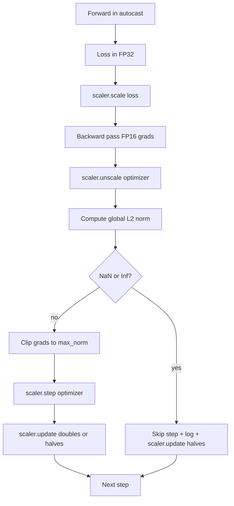

# 梯度裁剪与混合精度

> 上一课的优化器与调度器假设梯度是正常的。它们通常并非如此。单个坏 batch 就能让梯度范数暴涨三个数量级。混合精度训练会放大这个问题：它在损失一侧引入 FP16 溢出。本课构建生产训练不可或缺的两条安全带：按配置的全局 L2 范数进行梯度裁剪，以及一个带 autocast 和 GradScaler 的混合精度循环——它能检测 NaN 与 Inf、干净地跳过该步，并记录缩放因子以备事后分析。

**Type:** Build
**Languages:** Python
**Prerequisites:** Phase 19 lessons 30-37
**Time:** ~90 minutes

## 学习目标

- 计算所有参数梯度的全局 L2 范数，并在超过配置阈值时原地裁剪。
- 用 autocast 加 GradScaler 包装训练步，使 FP16 的前向与反向传播在溢出下仍能存活。
- 检测损失或梯度中的 NaN 与 Inf，跳过优化器步，并记录这次跳过。
- 每一步都报告 GradScaler 的缩放因子，让连续的跳过立刻可见。

## 问题

昨天还跑得很干净的一次训练，损失曲线在第 8,217 步突然竖直起飞。罪魁祸首是单个 batch，它的梯度范数是 4,200，是此前峰值的二十倍。不做裁剪，优化器会走一步，把模型在过去一小时里学到的东西全部重置。若把全局 L2 裁剪设在范数 1.0，同一个 batch 只贡献一个单位范数的更新；损失保持在趋势线上；训练得以存活。

混合精度训练把前向传播和大部分反向传播放在 FP16 里计算，将吞吐量提升 2 到 3 倍。代价是 FP16 的指数范围很窄。一个在 FP16 中溢出的典型梯度会算成 Inf，随后作为 NaN 向后传播，并在下一次优化器步把每个权重都置为 NaN。PyTorch 的 GradScaler 通过以下方式解决：在反向传播前把损失乘以一个较大的缩放因子，在优化器步之前再把梯度除以同一因子。如果在反缩放时任一梯度是 Inf 或 NaN，scaler 就跳过该步并把缩放因子减半；如果之前 N 步都是干净的，scaler 就把因子加倍。在整个训练过程中，因子会找到 FP16 范围允许的最大值。

构建的难点在于把两者正确接线。在反缩放之前裁剪，阈值作用在缩放后的梯度上；在反缩放之后裁剪，则 GradScaler 的操作顺序至关重要。正确的顺序是：`scaler.scale(loss).backward()`，然后 `scaler.unscale_(optimizer)`，然后 `clip_grad_norm_`，然后 `scaler.step(optimizer)`，然后 `scaler.update()`。任何其他顺序都会产生一个静默损坏的循环。

## 概念



### 全局 L2 范数

全局 L2 范数是拼接后梯度向量的欧几里得范数，而不是逐参数的范数。PyTorch 以 `torch.nn.utils.clip_grad_norm_(parameters, max_norm)` 实现。该函数返回裁剪前的范数，本课因此能同时记录自然值与裁剪后的值，这对「每一步都在裁剪」这一诊断是必要的。

### autocast 与 GradScaler

`torch.amp.autocast(device_type)` 是上下文管理器，选择性地把符合条件的运算（大多数矩阵乘法类运算）放到 FP16 中执行。`torch.amp.GradScaler(device_type)` 是辅助器，在反向传播前缩放损失，在优化器步前对梯度做反缩放。两者配套设计；只用其一而不用另一个是配置错误，测试应当捕获它。

本课使用 CPU autocast，因为 CI 里跑的就是它；把 `device_type="cpu"` 改成 `device_type="cuda"`，同一模式可以原样迁移到 CUDA。CPU 上的 GradScaler 是个桩（CPU autocast 默认已在 BF16 下运行，不需要损失缩放），但本课保留了调用点，使接线与 GPU 循环完全一致。

### NaN 与 Inf 检测

检测发生在两处。第一，反向传播前用 `torch.isfinite` 检查损失本身；Inf 或 NaN 损失不会产生有用的梯度，直接跳过而不进入优化器。第二，在 `scaler.unscale_(optimizer)` 之后，本课用 `has_non_finite_grad(...)` 扫描反缩放后的梯度，任何 Inf 或 NaN 都视为跳过。两项检查合起来覆盖了前向传播与反向传播两种失败模式。

### 缩放因子诊断

缩放因子是 GradScaler 的内部状态。每一步本课都读取 `scaler.get_scale()`，并把它与学习率和梯度范数记录在一起。健康的训练中，缩放因子以 2 的幂爬升，直到在 `2^17` 或 `2^18` 附近饱和。行为异常的运行中，因子在高值与低值之间振荡，这是模型梯度时而在范围内、时而不在的信号。不记录日志，这个诊断就不可见。

```figure
grad-clip-monitor
```

## 构建它

`code/main.py` 实现了：

- `clip_global_l2_norm` —— 对 `torch.nn.utils.clip_grad_norm_` 的包装，同时返回裁剪前与裁剪后的范数。
- `has_non_finite_grad` —— 扫描梯度中 NaN 与 Inf 的辅助函数。
- `AmpTrainState` —— 封装模型、`AdamW` 优化器、GradScaler 和 autocast 设备。暴露 `step(inputs, targets)`，运行完整的裁剪、缩放与 NaN 跳过 pipeline。
- `StepLog` 与 `SkipLog` —— 结构化的逐步记录。
- 一个演示：训练一个小型 `nn.Linear` 模型 20 步，在第 5 步向梯度注入 Inf 以走通跳过路径，并打印结果日志。

运行它：

```bash
python3 code/main.py
```

脚本以零码退出，打印逐步日志，每行标记为 `STEP` 或 `SKIP`；至少有一行是 `SKIP`。

## 生产模式

四种模式能把该循环提升为生产级训练步。

**跳过计数器是告警，不是日志行。** 每次训练跳过少数几步是健康的。每个 epoch 数百次跳过则是硬告警：模型处在了 FP16 撑不住的区间，循环正在静默失败。本课跟踪 1,000 步的滚动跳过率，在生产中，超过 5% 的比率应触发告警。

**裁剪阈值放在配置里。** `max_norm = 1.0` 是语言模型训练的现代默认值。先在小模型上扫描它；较大的阈值让模型能从真正困难的 batch 中恢复；较小的阈值限制最坏情况，代价是损失曲线更嘈杂。该阈值应当与第 44 课的调度一起放在同一份 YAML 或 JSON 配置中。

**范数日志与调度一起写入 CSV。** CSV 的列是 `step, lr, grad_l2_pre_clip, grad_l2_post_clip, loss, skipped, skip_reason, scaler_scale`。打开文件的审阅者能在同一行看到调度、梯度情况、缩放因子和跳过结果（含原因）。把列拆分到不同文件是让分析对不齐的根源。

**每一步都运行 `scaler.update()`，跳过时也一样。** 在干净的步上，scaler 读取其 no-inf 计数器、递增，并可能把因子加倍。在跳过的步上，scaler 把因子减半并重置计数器。在跳过路径上忘记 `update()`，正是产生「缩放因子从未变化」的 bug。

## 使用它

生产模式：

- **autocast 设备与优化器设备匹配。** GPU 训练用 `torch.amp.autocast(device_type="cuda")`；CPU 用 `torch.amp.autocast(device_type="cpu")`。混用设备会产生静默的类型错误，表现为损失曲线看起来正常，但模型没有在学习。
- **反向传播前检查损失。** `torch.isfinite(loss).all()` 只是一次张量归约；开销可忽略，而遇到 NaN 损失时节省的是一整个训练步。始终执行它。
- **在 `zero_grad` 中使用 `set_to_none=True`。** 把梯度设为 `None` 而不是零，让优化器对未受影响的参数组跳过计算。这个设置是免费的吞吐量提升，也略微减少了 bug 面。

## 交付它

在真实项目中，`outputs/skill-clip-amp.md` 会说明训练步使用哪个裁剪阈值和 autocast 设备、逐步 CSV 在版本控制中的位置，以及生产跳过率告警阈值是多少。本课交付的是引擎。

## 练习

1. 把合成 Inf 注入换成真实的损失尖峰（把某个 batch 的目标乘以 1e8），验证跳过路径被触发。
2. 添加 `--bf16` 模式，把 autocast 从 FP16 切换为 BF16。BF16 的指数范围比 FP16 宽，几乎不需要损失缩放；在同一个演示上验证跳过率降为零。
3. 添加单元测试，验证在未发生裁剪时，梯度裁剪包装正确返回裁剪前与裁剪后的范数。
4. 添加滚动窗口跳过率计算，以及一个 CLI 标志：若跳过率连续 100 步超过配置阈值，则让本次运行失败。
5. 把循环接到规范 CSV (`step, lr, grad_l2_pre_clip, grad_l2_post_clip, loss, skipped, skip_reason, scaler_scale`) 的写出上，并确认每写一行就 flush，使文件在 Ctrl-C 后依然完整。

## 关键术语

| 术语 | 常见说法 | 实际含义 |
|------|-----------------|------------------------|
| 全局 L2 范数 | 「裁剪目标」 | 所有可训练参数拼接后梯度向量的欧几里得范数 |
| autocast | 「混合精度」 | 在 `with` 块内选择性地以 FP16（或 BF16）执行符合条件的运算 |
| GradScaler | 「损失缩放器」 | 在反向传播前乘以损失、在优化器步前反缩放梯度的辅助器 |
| 跳过（skip） | 「坏步」 | 因梯度或损失非有限而拒绝执行的优化器步；scaler 会把因子减半 |
| 缩放因子 | 「Scaler 状态」 | GradScaler 当前的乘数；在干净的连续步之后加倍，每次跳过时减半 |

## 延伸阅读

- [Micikevicius 等，Mixed Precision Training（arXiv 1710.03740）](https://arxiv.org/abs/1710.03740) —— 最初的损失缩放提案
- [Pascanu, Mikolov, Bengio，On the difficulty of training recurrent neural networks（arXiv 1211.5063）](https://arxiv.org/abs/1211.5063) —— 梯度裁剪的参考论文
- [PyTorch torch.amp.GradScaler](https://docs.pytorch.org/docs/stable/amp.html) —— 本课封装的 scaler API
- [PyTorch torch.nn.utils.clip_grad_norm_](https://docs.pytorch.org/docs/stable/generated/torch.nn.utils.clip_grad_norm_.html) —— 本课使用的裁剪原语
- 第 19 阶段 · 42 —— 为循环提供语料的下载器
- 第 19 阶段 · 43 —— 循环消费的 dataloader
- 第 19 阶段 · 44 —— 与本循环组合的调度
