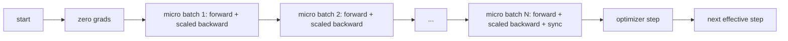
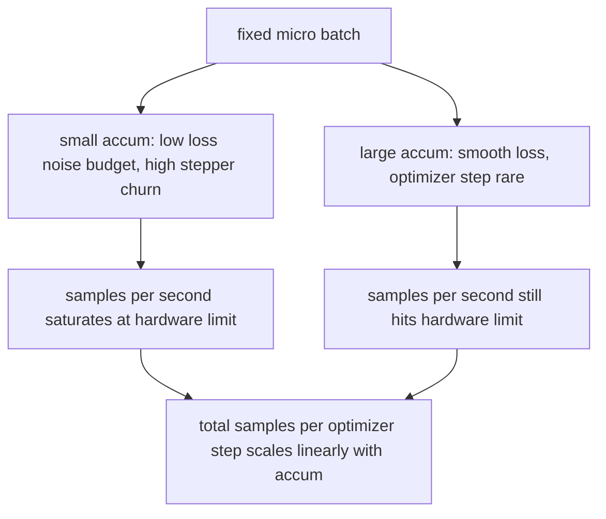

# 梯度累积

> 用你负担不起的有效 batch 训练，一次一个 micro-batch。缩放损失、按住优化器步，让梯度堆积起来。

**Type:** Build
**Languages:** Python
**Prerequisites:** Phase 19 lessons 42 to 45
**Time:** ~90 minutes

## 学习目标

- 推导有效 batch 恒等式：`effective_batch = micro_batch * accum_steps`。
- 实现逐 micro-batch 的损失缩放，使累积梯度与单次全 batch 反向传播一致。
- 推迟到最后一个 micro-batch 才做优化器同步（sync-on-last-step）。
- 读懂吞吐量对有效 batch 的曲线，并解释其中的收益递减。

## 问题

你想以 512 的有效 batch 训练，因为损失曲线更平滑，优化器步在那个尺度上也更合理。桌上的加速器在显存耗尽前只能容纳 32 个样本。把 batch 翻倍不是选项。把模型减半也不是选项。这个领域在 2017 年拿出的、此后从未停用的技巧是：跑 16 次反向传播，让梯度在参数缓冲区里累积，只在计数达到目标时才走一次优化器步。

风险在于损失不再是大 batch 时的那个数值。16 个 mini-batch 的交叉熵朴素相加，是单个全 batch 损失的 16 倍。不做缩放，梯度方向正确但幅度错误，优化器步会大 16 倍。修复只需一次除法。这个修复也很容易忘。

## 概念



约定很短：

- 每个 micro-batch 的损失在 `backward()` 之前除以 `accum_steps`。PyTorch 默认把梯度累加进 `param.grad`；这次除法把运行中的和拉回正确的尺度。
- 优化器步每个有效 batch 触发一次，在最后一个 micro-batch 的反向传播之后。在累积中途步进会扭曲后续整个运行所依赖的每一个参数。
- 优化器状态（动量缓冲区、Adam 矩）每个有效步推进一次，而不是每个 micro-batch 一次。否则指数移动平均会看到错误的频率，把调度提前烧完。
- 在单设备上这只是记账。在多 rank 集群上，同一模式把非最后的 micro-batch 包进 `no_sync` 上下文，跳过梯度 all-reduce；最后一个 micro-batch 一次归约全部累积梯度，而不是支付 N 次网络代价。

### 代码中的等价性证明

```python
loss = criterion(model(x_full), y_full)
loss.backward()
opt.step()
```

等价于

```python
for x, y in chunks(x_full, y_full, n):
    scaled = criterion(model(x), y) / n
    scaled.backward()
opt.step()
```

差异仅在浮点求和顺序。循环结束时累积的梯度缓冲区，与单次全 batch 反向传播产生的张量相同。本课代码在 `equivalence_check` 中以最大绝对差小于 1e-4 断言这一点。

### 代价去了哪里

每个 micro-batch 花费一次前向和一次反向。借助累积，你用内存换时间。`outputs/accum-curve.json` 中的吞吐量曲线展示了固定 micro-batch、有效 batch 增长时会发生什么：



没有免费的午餐。把 `accum_steps` 翻倍，每个优化器步的实际耗时也翻倍。变化的是梯度估计的方差：在同样的实际时间预算下，你做的优化器步更少，但每一步都是在更多样本上平均出来的。文献把大 batch 与小 batch 当作不同的优化问题；本课的教训是机械性的，而非统计性的。

```figure
cc-grad-accumulation
```

## 构建它

`code/main.py` 是可运行的交付物。它做三件事。

### 第一步：等价性检查

`equivalence_check()` 用相同种子构建同一网络的两份副本。一份在一次前向传播中看到 16 个样本的 batch。另一份看到四个 4 样本的 chunk，损失除以四。函数比较优化器步之前的梯度缓冲区，以及之后的参数。断言是 `max_abs_diff < 1e-4`。

### 第二步：sync-on-last-step 模式

`train_one_optimizer_step` 遍历 micro-batch。对除最后一个之外的每个 micro-batch，它进入 `no_sync_context(model)`。在单进程里该上下文是空操作；在 DDP 上，这里正是跳过梯度 all-reduce 的地方。无论哪种情况，记账方式都一样。`sync_counter` 记录我们离开 no_sync 作用域的次数；对于 N 个 micro-batch，每个有效步的计数是一，而不是 N。

### 第三步：吞吐量曲线

`sweep_effective_batches` 用固定 micro-batch 和一组累积步数运行同一模型。对每种设置记录：

- `samples_per_sec`：看到的总样本数除以实际耗时
- `median_step_ms`：每个有效步的 50 分位数
- `sync_calls`：实际执行的集合通信点数量
- `avg_loss`：本次扫描各优化器步的平均值

输出写入 `outputs/accum-curve.json`，可在 notebook 中复用。

运行它：

```bash
python3 code/main.py
```

脚本先打印等价性差值，再打印扫描表，最后打印 JSON 路径。退出码为零。

## 使用它

在生产训练中，梯度累积藏在一个旋钮后面。PyTorch 的写法是 `accumulation_steps = effective_batch // (micro_batch * world_size)`。这里不允许你使用的框架包装的也是同一个循环，步骤相同：缩放损失、在非最后的 micro 上跳过同步、累积、步进一次。

实战中的三种模式：

- micro-batch 大小选在刚好吃满设备内存。更小会浪费加速器周期。更大则会崩溃。
- 有效 batch 根据学习率调度来选择。大的有效 batch 需要按比例放大的学习率和 warmup；这就是自 2017 年以来常谈的线性缩放规则。
- 累积次数是两者之间的桥梁，也是运行时唯一可以自由调节、无需重写 dataloader 的旋钮。

## 交付它

`outputs/skill-gradient-accumulation.md` 记录了这一配方，同事可以直接放进新仓库：用 `accum_steps` 缩放损失，在非最后的 micro 上跳过优化器同步，每个有效 batch 步进一次优化器，把吞吐量对有效 batch 的关系以 JSON 记录，让权衡可见。

## 练习

1. 用 `--num-steps 100` 重跑扫描，画出每秒样本数对有效 batch 的图。曲线在哪里变平？
2. 添加一个错误的缩放变体（不做除法），展示第 1 步时参数相对参考的差异。
3. 把 SGD 换成 AdamW，确认优化器状态每个有效步推进一次，而不是每个 micro-batch 一次。
4. 引入真实的 `DistributedDataParallel` 包装，把 `no_sync_context` 接到它的方法上。确认每个有效 batch 的 sync_calls 减少 N-1。
5. 修改等价性检查，比较两种不同的 micro 切分（2 乘 8 与 4 乘 4），并解释你需要放宽哪些容差。

## 关键术语

| 术语 | 常见说法 | 实际含义 |
|------|-----------------|------------------------|
| micro-batch | 「你前向的那个 batch」 | 单次前向传播中能放进内存的那一片 |
| 累积步数 | 「每步的反向次数」 | 在一次优化器步之前求和的 backward 次数 |
| 有效 batch | 「那个 batch」 | micro-batch 乘以累积步数，再乘以数据并行的 world size |
| 损失缩放 | 「除以 N」 | 逐 micro-batch 的除法，使求和后的梯度与全 batch 一致 |
| 末步同步 | 「跳过其余」 | 只在窗口内最后一次反向传播时执行梯度集合通信 |

## 延伸阅读

- 关于 sync-on-last-step 技巧的生产版本，见 PyTorch 的 `DistributedDataParallel.no_sync` 文档。
- Goyal 等，2017，关于大 batch 训练的线性缩放，这是关心有效 batch 的经典理由。
- PyTorch issue tracker 上关于梯度累积与混合精度反缩放交互的讨论。
- 第 19 阶段第 42 到 45 课覆盖了本课假设的模型、数据加载器、优化器和训练器脚手架。
- 第 19 阶段第 47 课覆盖 checkpoint 与恢复，让长时间的累积训练能挺过实际时间上限。
