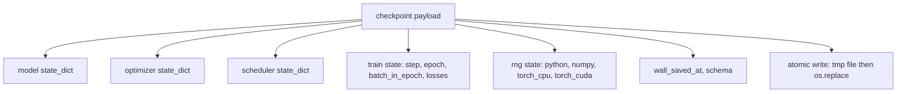
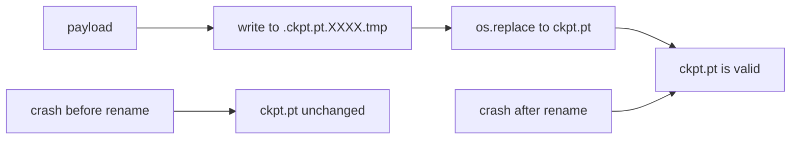
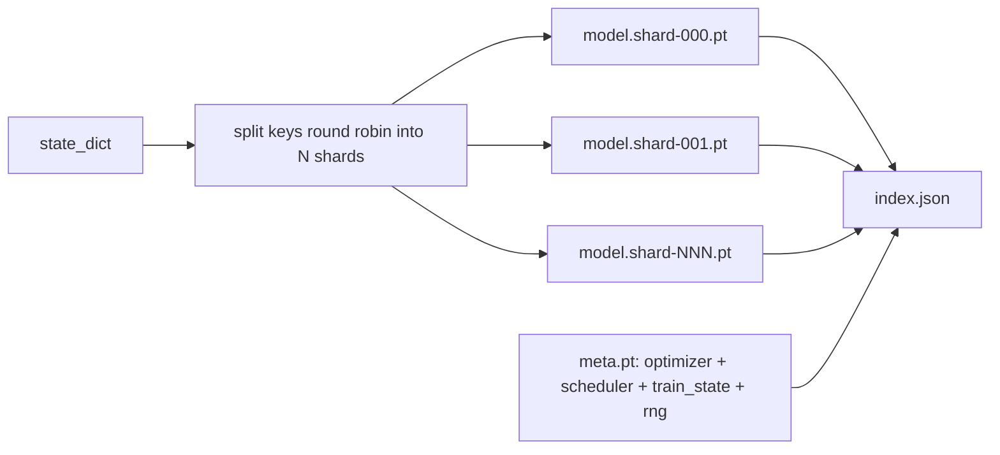

# checkpoint 的保存与恢复

> 训练中断会杀死运行；checkpoint 让它得以继续。把模型、优化器、调度器、损失历史、步计数器和 RNG 状态原子地保存下来，这样无论何时被杀，磁盘上都留有一个有效文件。

**Type:** Build
**Languages:** Python
**Prerequisites:** Phase 19 lessons 42 to 45
**Time:** ~90 minutes

## 学习目标

- 把完整训练状态捕获进单个 payload，可加载进全新进程。
- 实现原子保存：先写临时文件再重命名，使崩溃永远不会留下写了一半的文件。
- 恢复 Python、NumPy 和 PyTorch 的 RNG 状态，使恢复后的损失与不中断的基线一致。
- 为不再能装进单个文件的模型构建分片 checkpoint 布局，带哈希校验的分片和 JSON 索引。

## 问题

你把训练任务定为 18 小时。实际时间上限是 4 小时。集群在第 11 小时重启，因为某个比你级别高的人批准了内核升级。没有 checkpoint，你只能从头再来。没有恢复，你还会丢掉前 11 小时才学到的优化器状态；所以即使模型权重幸存，AdamW 的矩也没了，下一步会朝训练轨迹早已越过的方向猛冲。

正确的交付物是一个文件，装下继续训练所需的一切：模型参数、优化器状态、调度器状态、用于绘图的损失历史、当前 step、epoch 和 batch-in-epoch 计数器，以及每一个随机源的 RNG 状态。没有 RNG 状态，恢复后的损失曲线就是另一条曲线。同样的模型、同样的数据，不同的打乱、不同的 dropout 掩码、仪表盘上不同的数字。

原子保存是约定的另一半。直接写最终文件名，写入中途崩溃就会留下损坏的文件；恢复时读到垃圾。先写同目录下的临时文件再重命名，写入中途崩溃时上一个好文件原封不动。在 POSIX 文件系统上，重命名是原子的。

## 概念



### 五个状态桶

| 桶 | 为什么重要 |
|--------|----------------|
| 模型 | 权重与缓冲区；模型之所以为模型。 |
| 优化器 | 动量与自适应矩；没有它们，下一步就是另一个优化问题。 |
| 调度器 | 学习率在其曲线上的位置；余弦调度尤其在意。 |
| 训练计数器 | step、epoch、batch-in-epoch，以及绘制仪表盘用的损失历史。 |
| RNG 状态 | dropout、数据打乱以及模型内部任何采样的确定性。 |

### 原子保存



两条规则。第一，临时文件与目标在同一目录，使重命名留在同一文件系统内；跨设备重命名不是原子的。第二，临时名每次尝试都唯一，避免两个写入者互相踩踏。

### 分片 checkpoint

模型变大后，单文件 payload 会大到无法快速加载、无法检查，而且网络共享在读取中途卡顿时非常痛苦。修复办法是把参数状态拆成分片，再写一个把它们串起来的小索引。



索引记录分片数量、每个分片的 sha256，以及 meta 文件的 sha256。任何哈希不匹配，加载器都会大声失败。分片可以落在不同的物理磁盘上；meta 很小，最先读取。

### 恢复从中途 epoch 继续

恢复时跳到下一个 epoch 开头，会浪费从几分钟到一天不等。修复是 `(epoch, batch_in_epoch)` 加上 RNG 状态。加载后，训练循环把随机数生成器快进过当前 epoch 已消费的 batch，然后从 `batch_in_epoch` 继续。本课代码正是这样做的；断言是恢复后的损失轨迹与不中断基线在 1e-4 内一致。

```figure
cc-atomic-checkpoint
```

## 构建它

`code/main.py` 提供四个原语和一个演示驱动程序。

### 第一步：捕获并恢复 RNG 状态

`capture_rng_state` 返回一个 dict，包含 Python 的 `random.getstate`、NumPy 的 `np.random.get_state`，以及 PyTorch CPU 与 CUDA 的 RNG 字节。每一部分都存成普通的 Python 数字、元组和列表（NumPy 的 key 数组经过 `tolist()`），这样第三步的加载器无需反序列化任意对象就能读回。`restore_rng_state` 做反向操作。CPU 张量是一个 uint8 字节缓冲区，PyTorch 的 RNG 知道如何消费它。

### 第二步：原子保存

`atomic_save` 把 payload 写入目标目录里的临时文件，然后用 `os.replace` 换到最终名字。`atomic_write_json` 对分片索引做同样的事。

### 第三步：完整 checkpoint 往返

`save_checkpoint` 把模型、优化器、调度器、训练状态和 RNG 打包进一个 dict。`load_checkpoint` 反向还原并返回 `TrainState`。schema 字段是升级钩子：未来的格式变化提升版本字符串，加载器据此分派。

`load_checkpoint` 调用 `torch.load(..., weights_only=True)`。`.pt` 文件是 pickle，用 `weights_only=False` 反序列化不可信文件会执行文件里指定的任何代码。weights-only 加载器接受张量和基本容器，拒绝其他一切，这就是第一步把 RNG 状态保存在普通列表里的原因。完整性检查抛出 `ValueError` 而不是使用 `assert`，因为 `python -O` 会剥离断言。请使用 torch 2.6 或更新版本：在该版本之前，`weights_only=True` 有一个已知绕过（CVE-2025-32434），所以本课依赖的保证只在 2.6 及以后成立。

### 第四步：分片变体

`save_sharded_checkpoint` 把参数键轮转分配到 N 个分片，用各自的原子保存写出每个分片，写一个含优化器、调度器和训练状态的 meta 文件，再写带分片 sha256 的 JSON 索引。`load_sharded_checkpoint` 在合并前校验每个分片，并拒绝解析到 checkpoint 目录之外的任何分片路径。

### 第五步：恢复演示

`run_resume_demo` 训练一个小模型 `total_steps` 步，在 `interrupt_at` 处保存 checkpoint，然后继续。第二个进程恢复 checkpoint 并跑完剩余步骤。函数返回中断点之后两条损失轨迹的最大绝对差。RNG 恢复后，差值为零或浮点噪声。

运行它：

```bash
python3 code/main.py
```

单文件与分片演示都断言最大差值小于 1e-4。摘要写入 `outputs/resume-demo.json`。

## 使用它

生产训练栈把 checkpoint 作为训练器的一部分交付。形状相同：模型 + 优化器 + 调度器 + 计数器 + RNG，原子写出，按 step 命名，让最新的容易找到。分片布局以并行读取支撑大模型加载；index.json 正是让这一切成立的东西。

四条要落实的模式：

- **用 `weights_only=True` 加载。** 从共享盘或下载得到的 checkpoint 是不可信输入。weights-only 加载器防止恶意文件在恢复机器上执行代码。
- **schema 是 payload 里的字符串。** 迁移根据它分支。没有它，你无法在不破坏旧运行的前提下演进格式。
- **为每个分片计算 Sha256。** 静默截断的下载是最糟糕的 bug；加载器要么快速失败，要么迟些失败。
- **保持诚实的 checkpoint 节奏。** 每 N 步保存一次，并且每实际一分钟保存一次，取两者中更短的。否则崩溃的那个长步会浪费整整一个窗口的工作。

## 交付它

`outputs/skill-checkpoint-save-resume.md` 是任何新训练脚本的配方：payload 形状、原子写入、RNG 捕获、分片索引。把这个 skill 放进仓库，在周期性保存处接上 `save_checkpoint`，在启动时接上 `load_checkpoint`，运行就能挺过被杀。

## 练习

1. 把轮转分片换成按参数组分片（以 `.weight` 结尾的层 vs `.bias`）。每种布局何时更可取？
2. 扩展保存循环，保留最近 K 个 checkpoint 并裁剪更旧的。磁盘很小时，正确的 K 是多少？
3. 添加 `--ckpt-every-seconds` 标志，按实际时间间隔触发保存，而不仅按步数。
4. 添加校验和验证路径，在启动时运行，扫描目录中的每个 checkpoint，并报告哪些已损坏。
5. 实现 `migrate_v1_to_v2` 函数，向 payload 添加新字段并提升 schema 字符串。让加载器同时兼容两个版本。

## 关键术语

| 术语 | 常见说法 | 实际含义 |
|------|-----------------|------------------------|
| 原子保存 | 「写了就祈祷」 | 写入同目录的临时文件，再用 os.replace 换到目标名字 |
| state dict | 「权重」 | 以参数名为键的模型参数与缓冲区 |
| 分片 checkpoint | 「大模型文件」 | 多个文件，每个分片一个，外加一个 meta 文件和一个带 sha256 的 JSON 索引 |
| RNG 状态 | 「随机种子」 | 为 python random、numpy、torch CPU、torch CUDA 捕获的状态；不只是种子 |
| epoch 中途恢复 | 「重启」 | 快进 RNG，从同一 epoch 的下一个 batch 继续 |

## 延伸阅读

- POSIX `rename` 语义，即 `os.replace` 所依赖的原子性声明。
- PyTorch 关于 `torch.save` 与 `torch.load` 的文档，包括跨设备恢复用的 `map_location` 和加载不可信文件用的 `weights_only`。
- 第 19 阶段第 46 课覆盖梯度累积，本课的 checkpoint payload 正是跨过它存活的。
- 第 19 阶段第 48 课覆盖分布式包装器，本方案兼容其 state dict 格式。
- Linux 内核 `fsync` 文档，解释原子重命名背后的持久性保证。
