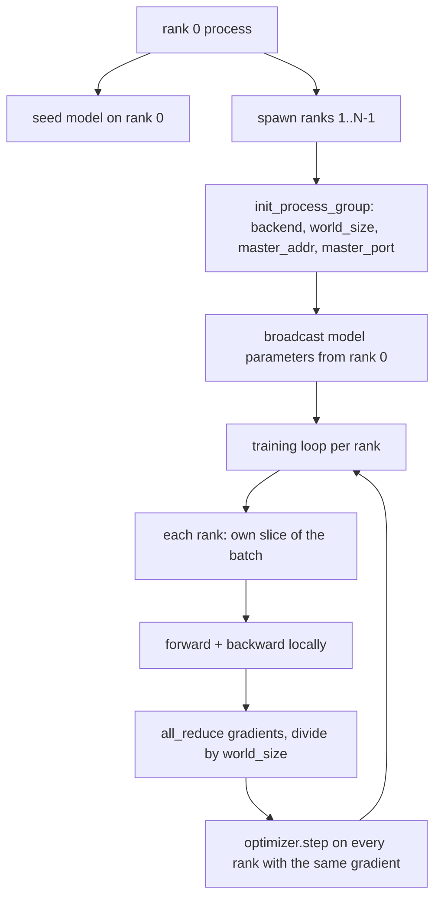
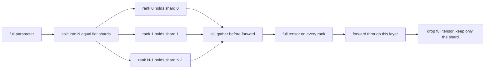

# 从零实现 Distributed Data Parallel 与 FSDP

> 多 rank 训练就是两个集合通信和一条规则。启动时广播参数，反向传播后平均梯度，永不让各 rank 对当前处于哪一步产生分歧。

**Type:** Build
**Languages:** Python
**Prerequisites:** Phase 19 lessons 42 to 45
**Time:** ~90 minutes

## 学习目标

- 用 `gloo` 后端在 N 个 rank 之间拉起进程组，无需特殊硬件。
- 实现一个最小 DDP 包装器：构造时广播参数，反向传播后 all-reduce 梯度。
- 证明逐 rank 梯度的 all-reduce 与单进程在拼接输入上的梯度一致。
- 勾勒 FSDP 参数分片：每个 rank 持有一个切片，前向传播时收集完整张量，之后丢弃。

## 问题

模型能装进一个设备。数据集不能。优化预算要求你每实际秒看到 N 倍的样本。第一根杠杆是数据并行：每个 rank 在 batch 的不同切片上运行同一模型，然后在优化器步前平均梯度。第二根杠杆是 FSDP：模型也装不进一个设备了，于是每个 rank 持有每个参数的一部分，在前向传播中逐层重建完整张量。

痛苦在于记账。如果参数在各 rank 间漂移，运行会静默损坏。如果你平均梯度却不平均损失，仪表盘就在说谎。如果集合通信后端无法就拓扑达成一致，运行会永远挂起。修复办法是亲手写一次集合通信，并且绝不信任你无法复现的包装器。

本课在 CPU 上运行。不假设有 CUDA。`gloo` 后端随每个 PyTorch 构建一起发布，接受 `torch.multiprocessing` worker；在多 GPU 节点上，同一份代码切换到 `nccl` 而结构不变。

## 概念



### 真正重要的两种集合通信

| 集合通信 | 作用 | 时机 |
|------------|--------------|------|
| `broadcast` | 把一个张量从一个 rank 复制到所有其他 rank | 参数初始化、调度器状态、任何一对多同步 |
| `all_reduce` | 跨所有 rank 对一个张量求和（或求平均、求最大），每个 rank 都得到结果 | 反向传播后的梯度平均 |
| `all_gather` | 每个 rank 贡献一个张量，每个 rank 得到拼接结果 | 收集 logits、FSDP 参数 unshard |

DDP 的约定是构造时 `broadcast`、反向传播后 `all_reduce`。FSDP 草图则在每一层前向传播之前加上 `all_gather`。

### 梯度平均与单进程梯度一致

在 N 个 rank 上以 B 个样本的 batch 训练的模型，必须产生与单进程在 N*B 的 batch 上训练相同的梯度。窍门是：把逐 rank 梯度求和再除以 N，得到平均损失梯度，这正是带 mean 归约的交叉熵在全 batch 上会产生的结果。本课代码以手工 all-reduce 梯度与参考单进程梯度之间的 `max-abs-diff < 1e-3` 断言这一点。

### FSDP 草图



内存收益是精确的：每 rank 的参数内存降到 1/N。代价是 gather，每次前向传播都要支付。生产级 FSDP 把 gather 与上一层的计算重叠，使实际耗时远小于朴素估算。本课对每个参数做往返，并断言重建结果与原始逐位相等。

### CPU 与 gloo 后端

CUDA 是生产目标，但同样的代码路径在 CPU 上也存在。`gloo` 是 CPU 的集合通信后端。它比 GPU 上的 `nccl` 慢几个数量级，但 API 面完全相同。本课的进程组以 `backend="gloo"` 初始化，rank 用 `torch.multiprocessing` 而非 `torchrun` 启动；两者最终都落到相同的 `torch.distributed` 调用。在多 GPU 节点上，唯独需要改的是 `backend="nccl"`、设备张量和用 `torchrun` 启动。

```figure
cg-allreduce-ring
```

## 构建它

`code/main.py` 是可运行的交付物。

### 第一步：拉起进程组

```python
os.environ["MASTER_ADDR"] = "127.0.0.1"
os.environ["MASTER_PORT"] = str(port)
dist.init_process_group(backend="gloo", rank=rank, world_size=world_size)
```

`MASTER_ADDR` 和 `MASTER_PORT` 是会合点：每个 rank 拨同一主机上的同一端口。本课用绑定后关闭的技巧挑一个空闲端口，避免多个运行共享机器时冲突。

### 第二步：构造时广播

`MinimalDDP.__init__` 遍历每个参数和缓冲区，调用 `dist.broadcast(tensor, src=0)`。Rank 0 的值成为规范初始化。没有这一步，每个 rank 用自己的种子初始化，各 rank 从第一步就开始分化。

### 第三步：反向传播后 all-reduce 梯度

```python
def all_reduce_grads_(module, world_size):
    for p in module.parameters():
        if p.grad is None:
            p.grad = torch.zeros_like(p.data)
        dist.all_reduce(p.grad.data, op=dist.ReduceOp.SUM)
        p.grad.data.div_(world_size)
```

每个 rank 最终得到相同的平均梯度。优化器步现在在每个 rank 上都是相同输入的函数，这就是参数在整个运行中保持同步的原因。

### 第四步：证明等价性

`manual_all_reduce_matches_single_process` 在 rank 0 上构建同一模型，把 all-reduce 后的梯度与单进程在拼接输入上计算的梯度作比较。最大绝对差约为 1e-8。

### 第五步：FSDP 往返

`fsdp_round_trip_sketch` 把每个参数展平、填充到 `world_size` 的倍数、切片、all-gather，再去填充。每个 rank 的重建都等于原始张量。这就是 unshard 步骤；其逆操作（前向之后重新分片）就是从收集到的张量上切一片。

运行它：

```bash
python3 code/main.py
```

默认 world size 是 2。两个 CPU 进程启动，通过 `gloo` 互相通信，零码退出。输出 `outputs/ddp-demo.json` 记录每个 rank 的参数和、all-reduce 之后的梯度范数、FSDP 往返结果，以及手工梯度与参考梯度的差值。

## 使用它

生产训练栈调用的也是这些原语。PyTorch 的 `DistributedDataParallel` 额外提供：在反向传播后触发的梯度钩子，让 all-reduce 与反向传播重叠；分桶 all-reduce，把多个小梯度合并为一次集合通信；以及第 46 课用过的 `no_sync` 上下文。

PyTorch 的 FSDP 额外提供：每层的扁平参数视图，使每个 rank 持有一个连续缓冲区；下一层 unshard 与当前层计算的重叠；以及分片可选的 CPU offload。

形状不变：启动时广播、反向传播后归约、参数装不下时分片。

## 交付它

`outputs/skill-distributed-fsdp-ddp.md` 带有一套新训练脚本的配方：CPU 用 `gloo`、GPU 用 `nccl` 拉起进程组，把模型包进构造时广播、反向传播后归约的 DDP 外壳，可选地用 FSDP 草图里的 all_gather 模式分片参数。

## 练习

1. 用 `--world-size 4` 运行，确认整个运行中参数离散度保持在 1e-3 以下。
2. 把手工平均换成 `dist.all_reduce(op=dist.ReduceOp.AVG)`，并计时比较差异。
3. 给 DDP 包装器添加反向传播后钩子，让 all-reduce 与反向传播的其余部分重叠；测量实际耗时的改善。
4. 实现 FSDP 的重新分片步骤：前向传播之后，再次用本地分片替换完整张量。确认每 rank 内存下降。
5. 在 CUDA 机器上把后端切换为 `nccl`。记下哪些环境变量变化、哪些保持不变。

## 关键术语

| 术语 | 常见说法 | 实际含义 |
|------|-----------------|------------------------|
| 后端 | 「gloo 或 nccl」 | 实现集合通信操作的库；gloo 用于 CPU，nccl 用于 GPU |
| world size | 「总 rank 数」 | 组内进程数量；组是集合通信操作的单位 |
| rank | 「worker id」 | 组内的进程标识，从零开始索引 |
| all-reduce | 「把梯度求和」 | 跨所有 rank 对一个张量求和，每个 rank 最终得到相同结果 |
| unshard | 「收集参数」 | 通过 all_gather 从各 rank 的切片重建完整张量 |

## 延伸阅读

- PyTorch `torch.distributed` 文档，说明本课依赖的集合通信语义。
- `gloo` 库的集合通信列表，形状与 CUDA 支撑的 `nccl` 原语相同。
- 第 19 阶段第 46 课，讲把 DDP all-reduce 包进 `no_sync` 的梯度累积模式。
- 第 19 阶段第 47 课，讲能挺过 DDP 与 FSDP 运行的 checkpoint 布局。
- PyTorch FSDP 文档，这里是此处草图的生产实现。
