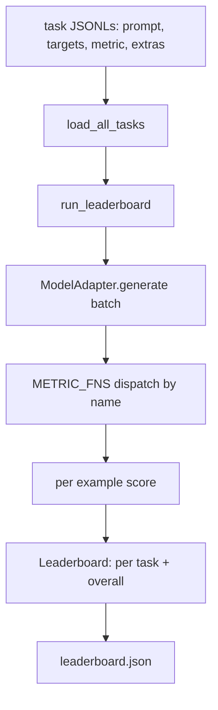
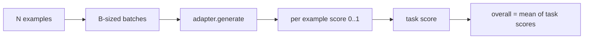

# 语言模型评估 harness

> 在一个你无法定义的任务上表现好的模型，是碰巧表现好的模型。harness 就是任务定义、指标、运行器和排行榜，浓缩成一个简短、可替换的形状。

**Type:** Build
**Languages:** Python
**Prerequisites:** Phase 19 lessons 42 to 45
**Time:** ~90 minutes

## 学习目标

- 把任务定义为一个 JSONL 文件，每个示例带 `prompt`、`targets`、`metric` 和可选的 `extras`。
- 实现五种指标：精确匹配、rouge-l F1、可执行检查、单选和子串包含。
- 构建运行器：按任务对示例分批，并分派给可替换的模型适配器。
- 输出排行榜 JSON，包含各任务得分、延迟，以及可复现的总平均分。

## 问题

每周都有新的语言模型发布。营销口径说它表现好。诚实的问题是：好在什么上？诚实的答案是：你自己写的排行榜，因为厂商的排行榜是他们调参对准的那一个。

仓库里没有 harness，你只能凭感觉比较两个模型。有了 harness，你在固定任务集、固定指标上按分数比较它们，输出是可以 diff 的 JSON。harness 是昨天运行与今天运行之间的契约。没有它，回归就会发布出去。

陷阱是让 harness 过拟合到单个模型。修复办法是把这个陷阱反过来：harness 小到十五分钟能读完，任务小到能随仓库发布，指标从零编写以便同事审计，适配器是唯一存放模型特定代码的地方。换适配器，排行榜会变；换任务，排行榜会变。其他东西都不应该动。

## 概念



### 任务规格

每个示例是一行 JSONL：

```json
{"id": "arith-00", "prompt": "compute: 2 + 2", "targets": ["4"], "metric": "exact_match"}
```

对需要评分辅助数据的指标，`extras` 携带旁路 payload：

```json
{
  "id": "code-00",
  "prompt": "python: write a function f that doubles its input",
  "targets": ["ok"],
  "metric": "code_exec",
  "extras": {"io_pairs": [[1, 2], [3, 6]]}
}
```

一个任务是 `outputs/tasks/` 下的一个 `.jsonl` 文件。文件名就是任务名。同一文件中的所有示例共用一种指标。

### 五个 fixture 任务

| 任务 | 指标 | 测试什么 |
|------|--------|---------------|
| arithmetic | exact_match | 在确定性答案上的 token 级正确性 |
| summary | rouge_l | 相对一行参考摘要的最长公共子序列 F1 |
| code-exec | code_exec | 可执行测试：预测的函数必须满足一组输入输出对 |
| multiple-choice | multiple_choice | 预测的首字母必须匹配允许的字母 |
| generation | substring_contains | 自由文本必须至少包含一个目标子串 |

### 指标契约

每个指标都是 `(prediction, targets, extras) -> float in [0.0, 1.0]` 的函数。harness 先对各示例分数求平均得到任务分数，再对各任务分数求平均得到总分。指标函数都很小：

- `exact_match`：转小写、压缩空白、比较相等。
- `substring_contains`：同样的归一化，子串测试。
- `multiple_choice`：首字符转大写。
- `rouge_l`：LCS 长度分别除以预测与参考的长度，再取精确率与召回率的 F1。
- `code_exec`：在受限命名空间中执行预测，对每个输入输出对调用 `f(x)`，统计匹配数。

code_exec 指标在一个剥离了 builtins 的命名空间中运行预测。本课测试断言 `import os` 会炸掉，因为 `os` 不在命名空间中；你无法从代码预测里触达文件系统。

### 模型适配器

```python
class ModelAdapter(Protocol):
    def generate(self, prompts: Sequence[str]) -> List[str]: ...
    @property
    def name(self) -> str: ...
```

适配器是接缝。本课提供 `ToyAdapter`，一个确定性的模式匹配器，对五个 fixture 任务中的每个 prompt 都返回正确答案。真实适配器调用模型并返回其输出。harness 不关心是哪一个。

### 运行器

`run_task` 每次批处理 `batch_size` 个 prompt，并分派给指标函数。`run_leaderboard` 遍历每个任务并求平均。`write_leaderboard` 输出带 schema 字符串的 JSON，使未来的格式变化不会静默弄坏仪表盘。



```figure
eval-harness-matrix
```

## 构建它

`code/main.py` 是可运行的交付物。

### 第一步：生成 fixture 任务

`seed_fixture_tasks(target_dir)` 写出五个 `.jsonl` 文件。`main.py` 首次运行时，若目录为空，就会生成它们。

### 第二步：加载任务

`load_all_tasks(task_dir)` 读取每个 `.jsonl`，返回任务名到 `Example` 记录列表的 dict。以 `#` 开头的注释行和空行会被跳过，方便贡献者标注文件。

### 第三步：实现指标

每个指标都是一个带单元测试的小函数。本课测试套件包含 13 个用例，覆盖归一化、部分重叠、代码执行和不安全代码拒绝。

### 第四步：编写运行器

`run_task` 遍历各 batch，产生带分数、正确数、总数和延迟的 `TaskResult`。`run_leaderboard` 遍历所有任务，产生带总平均分的 `Leaderboard`。

### 第五步：输出 JSON

`write_leaderboard` 序列化排行榜。`--include-per-example` 标志会转储逐示例记录，这样分数变动时你可以把预测与上一次运行做 diff。

运行它：

```bash
python3 code/main.py
```

脚本首次运行时生成 fixture，用 toy 适配器评分（它能做对每个 fixture），并写出 `outputs/leaderboard.json`。使用 toy 适配器时总分为 1.0；`test_main.py` 中的桩适配器测试表明，当适配器答不出来时，同一个 harness 给出 0.0。

## 使用它

要接入真实模型，写一个适配器。形状如下：

```python
class HttpAdapter:
    name = "vendor.v1"

    def __init__(self, endpoint, api_key):
        self.endpoint = endpoint
        self.api_key = api_key

    def generate(self, prompts):
        out = []
        for prompt in prompts:
            response = http_post(self.endpoint, prompt, self.api_key)
            out.append(response["text"])
        return out
```

在 `main()` 顶部把 `ToyAdapter` 换成 `HttpAdapter`。harness、任务、指标和排行榜都保持不变。

在真实项目中交付 harness 时，要落实三种模式：

- **固定任务文件。** leaderboard.json 要么携带经哈希固定的任务内容，要么把 JSONL 一起带上；否则任务文件一变分数就变，而你分不清是哪个变了。
- **diff 预测，而不只是分数。** `--include-per-example` 标志让你看到分数下降那天模型到底说了什么。
- **限制 batch 大小。** 真实适配器有速率限制。较小的 batch 让 harness 在各厂商之间保持兼容。

## 交付它

`outputs/skill-lm-eval-harness.md` 带有配方：JSONL 任务规格、五种指标、可替换适配器、批处理运行器、带 schema 字符串的排行榜 JSON。`outputs/tasks/` 中的任务文件是 fixture；把它们复制进真实项目作为起点。

## 练习

1. 添加第六个任务，配上你从零编写的自定义指标（类似 BLEU 的重叠、类似 BLEURT 的参考打分，任何有清晰契约的东西）。
2. 扩展 `code_exec` 以捕获 stdout，并接受一组期望的 stdout 作为 targets。
3. 添加排行榜 diff 命令：给定两个 `leaderboard.json` 文件，打印哪些任务变动了以及变动多少。
4. 为每个示例限制延迟。把适配器调用包进超时；在排行榜中单列 `timeouts` 一栏。
5. 用 sha256 在排行榜中固定任务内容，让未来的读者能验证他们评的是同样的任务。

## 关键术语

| 术语 | 常见说法 | 实际含义 |
|------|-----------------|------------------------|
| 任务规格 | 「评测格式」 | 每示例带 prompt、targets、metric 和可选 extras 的 JSONL 文件 |
| 指标 | 「怎么打分」 | 从 (prediction, targets, extras) 到 [0, 1] 浮点数的函数 |
| 适配器 | 「模型客户端」 | 带 generate(prompts) -> list[str] 方法的对象；唯一与模型相关的代码 |
| 排行榜 | 「记分牌」 | 带各任务分数、总数、延迟和总平均分的 JSON |
| 代码执行指标 | 「跑一下再检查」 | 在受限命名空间中执行预测，与输入输出对比较 |

## 延伸阅读

- 最初的 lm-evaluation-harness 作为生产参考，规模大得多但形状相同。
- HuggingFace 的 lighteval，是同一契约的另一种实现。
- 第 19 阶段第 46 课覆盖 harness 所评模型训练栈中使用的梯度累积模式。
- 第 19 阶段第 47 课覆盖你评分所针对的 checkpoint 格式；请在排行榜中固定 checkpoint 哈希。
- 第 19 阶段第 48 课覆盖产出被测模型的分布式训练栈。
