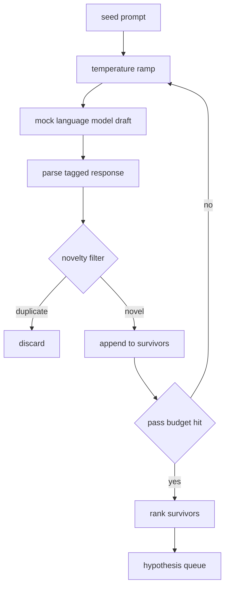

# 假设生成器

> 研究智能体把同一个问题问两遍就是在浪费 token。诀窍是迫使每一稿落在新的地方。

**Type:** Build
**Languages:** Python
**Prerequisites:** Phase 19 Track A lessons 20-29
**Time:** ~90 minutes

## 学习目标

- 由种子 prompt 驱动采样器，把输出转成带类型的假设记录。
- 每一轮都提升采样器温度，让下一稿离上一稿更远。
- 用小 embedding 模型和余弦距离阈值过滤近似重复。
- 用融合新颖性、具体性和可测试性的评分函数为幸存者排序。
- 让每一步保持确定性，使同一种子总是产生同一队列。

## 为什么先生成再过滤

只问一次模型的规划器得到一条假设。作为示例尚可。对研究循环来说，这个形状不对。循环想要一个有深度的排序队列，这样第一条假设失败时，运行器已经备好了下一条，而无需再支付一次完整采样。

两个想法结合产生这个队列。第一是温度爬升：每经过一次采样器就把温度调高一档，鼓励后面的稿子游荡得更远。第二是新颖性过滤：每完成一稿，生成器测量它与每个先前幸存者的 embedding 距离，拒绝落在簇内的任何东西。

本课提供一个模拟语言模型，对固定 prompt 返回脚本化的 token 序列。这个 mock 足以走通完整路径：输入种子 prompt，应用温度爬升，解析候选，运行新颖性过滤，输出排序队列。

## Hypothesis 的结构

```text
Hypothesis
  id             : int           (monotonic within a run)
  text           : str           (the claim)
  variables      : list[str]     (what changes between conditions)
  metric         : str           (what the runner will measure)
  baseline_ref   : str | None    (which paper or run the comparison cites)
  draft_pass     : int           (which sampler pass produced this)
  temperature    : float         (the sampler setting at draft time)
  novelty_score  : float         (distance from prior survivors, 0..1)
  rank_score     : float         (weighted sum used for ordering)
```

`variables` 和 `metric` 不是自由文本。解析器从带标签的响应中提取它们。第五十二课里的运行器在构建实验配置时直接读取这些字段。

`baseline_ref` 可选但推荐。第五十三课的评估器需要一个基线来对比。如果假设省略了它，评估器回退到同一指标上的上一次运行。

```figure
cg-novelty-ramp
```

## 架构



循环很直白。有意思的部分是每个盒子都有硬契约。

## 温度爬升

从 `t_min` 开始，到 `t_max` 结束，步长为 `(t_max - t_min) / (n_passes - 1)`。每一轮以当前温度调用采样器，从 `GeneratorConfig.schedule()` 产生 `n_passes` 个等间距的值。mock 模型通过在以 `(prompt, temp_bucket)` 为键的一小组脚本化响应之间切换来体现温度。桶是开区间，所以温度的微小变化就会选中不同的桶，产生不同的稿子。在生产中，采样器会是传入 `temperature=t` 的真实模型。

默认调度是从 `0.2` 到 `1.2` 的六轮。六轮足以填满队列，又不会为那些反正会被新颖性过滤拒绝的样本付费。低于 `0.2`，模型会把种子原样复读。高于 `1.2`，响应容易跑题，过不了解析器。

## 新颖性过滤

每稿解析后，生成器对文本做 embedding，并与每条已接受的假设比较。embedding 是一个小的哈希词袋，归一化为单位长度。两个单位向量之间的余弦距离是 `1 - dot(a, b)`。如果一稿与任何先前幸存者的最小距离高于 `novelty_threshold`，它就通过。默认值是 `0.25`。

哈希 embedding 并不花哨。它是确定性的，零依赖，足以抓住明显的情况：两稿共享了大部分名词。生产部署会换成小型句子模型。接口保持不变。

## 排序分数

```text
rank_score = w_novelty * novelty_score
           + w_specificity * specificity_score
           + w_testability * testability_score
```

三个子分数。`novelty_score` 是与先前幸存者的最小 embedding 距离。`specificity_score` 是假设中具体变量的数量除以目标数量。`testability_score` 在假设同时指定了指标和基线时为 1，只有指标时为 0.5，否则为 0。

默认权重是 `0.4`、`0.3`、`0.3`。权重放在生成器配置里，下游课程可以调整它们而无需 fork 代码。

## 模拟语言模型

```python
class MockLLM:
    def sample(self, prompt: str, temperature: float, seed: int) -> str:
        ...
```

给定 `(prompt, temperature, seed)` 三元组，采样器是确定性的。mock 维护以 `(prompt_signature, temperature_bucket)` 为键的脚本化响应表。如果表中没有该键的条目，采样器返回一个过不了解析器的兜底值。兜底路径由其中一个测试覆盖。

种子被混入响应，所以相同的 `(prompt, temperature)` 配不同种子会产生不同的稿子。测试中我们固定种子以保持结果可复现。真实部署中，种子会来自系统时钟或计数器。

## 输出队列

输出是按 `rank_score` 降序排列的 `Hypothesis` 记录列表。第五十二课的运行器弹出队头、运行实验，第五十三课的评估器写回判定。如果判定说假设错了，运行器就弹出下一条。

队列是有限的。队列为空时，编排器可以放宽种子 prompt 并再次运行生成器，或者停下并报告预算耗尽。

## 如何阅读代码

`code/main.py` 定义了 `Hypothesis`、`MockLLM`、`HypothesisGenerator` 和一个确定性演示。生成器只暴露一个 `run(seed_prompt)` 方法，返回排序后的队列；轮数从 `GeneratorConfig.n_passes` 读取，而不是作为参数传入。embedding 是哈希 token 袋。新颖性过滤是单个函数。排序分数是单个函数。什么都不依赖 `numpy`；embedding 数学是纯 stdlib，使本课保持可移植。

`code/tests/test_generator.py` 覆盖线性路径、重复拒绝路径、解析器失败路径、温度爬升边界和排序。

## 它在流程中的位置

第五十课产生队列。第五十一课取队头做文献检索，确认或反驳它。第五十二课取同一队头跑实际实验。第五十三课读取两者输出并写判定。四课组合成一个无人值守的研究循环；人类可以在任何边界介入。
