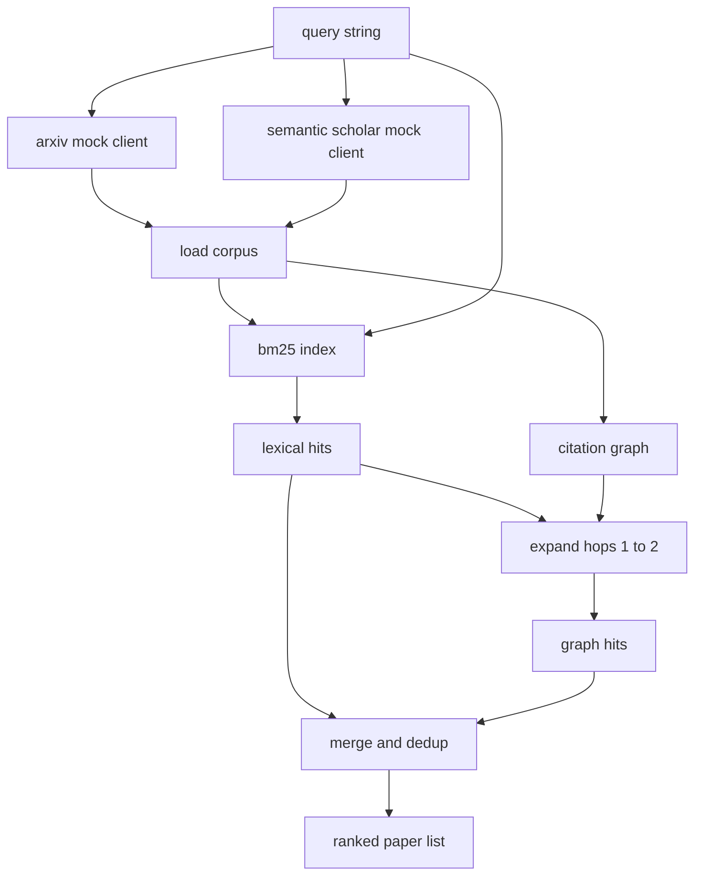

# 文献检索

> 提出一个假设很便宜。知道是否已有人证明它，才是昂贵的部分。构建检索层，让它在 runner 启动沙箱之前回答这个问题。

**Type:** Build
**Languages:** Python
**Prerequisites:** Phase 19 Track A lessons 20-29
**Time:** ~90 minutes

## 学习目标
- 用回路下游会读取的字段，为一条小型论文记录建模。
- 仅用标准库数据结构，在摘要之上构建 BM25 索引。
- 遍历引用图，找出词法检索遗漏的论文。
- 按稳定的 paper id，对两轮检索的命中去重。
- 把两个 mock 外部 API 封装在同一个客户端后面，这样真实端点接入时，上游调用点保持不变。

## 为什么需要两轮检索

基于摘要的关键词搜索会返回与查询共享词汇的论文。这覆盖了大部分表面。它漏掉两种情况。第一种是基础性论文使用了不同的词汇；例如查询 "sparse attention" 会漏掉标题为 "block selection in transformer routing" 的论文。第二种是相关论文是一篇后续工作，引用了某个已知锚点；先找到锚点再向前遍历，比暴力扫描整个摘要池更高效。

本课实现两轮检索。摘要上的 BM25 捕获词法命中。引用图遍历则从种子集合向前和向后扩展一跳或两跳。两者的并集按 paper id 去重，并用一个小型组合分数排序。

## Paper 的数据形状

```text
Paper
  id          : str           (stable identifier, "p001" for the mock corpus)
  title       : str
  abstract    : str
  year        : int
  authors     : list[str]
  references  : list[str]     (paper ids this paper cites)
  citations   : list[str]     (paper ids that cite this paper)
  source      : str           (which mock api supplied it, "arxiv" or "s2")
```

references 和 citations 字段构成有向引用图。两个 mock API 返回的字段有重叠但并非完全相同，因此语料加载器按 `id` 对它们取并集。

```figure
cg-citation-hops
```

## 架构



检索客户端持有两轮检索与合并逻辑。调用方交给它一个查询，拿回一个排序列表，其中每个条目都带有解释排名的逐论文分数字段（`bm25_score`、`graph_distance`、`recency_score`、`final_score`）。

## 从零实现 BM25

实现采用标准 Okapi BM25，默认参数为 `k1=1.5`、`b=0.75`。索引是两个字典：`term -> doc_frequency` 和 `term -> list of (doc_id, term_count)`。文档长度是摘要的 token 数。平均文档长度在构建索引时计算一次。对查询打分即对查询词求和 `idf * tf_norm`，其中 `tf_norm` 是标准的 BM25 长度归一化词频。

分词器先 `lower` 再按非字母数字切分。不做词干提取。生产系统会换用小型词干提取器。接口保持不变。

```math
\begin{aligned}
\text{idf}(t) &= \log\!\left(\frac{N - \text{df} + 0.5}{\text{df} + 0.5} + 1.0\right) \\
\text{tf\_norm}(t) &= \frac{f \cdot (k_1 + 1)}{f + k_1 \cdot \left(1 - b + b \cdot \text{dl} / \text{avgdl}\right)} \\
\text{score}(d, q) &= \sum_{t \in q} \text{idf}(t) \cdot \text{tf\_norm}(t)
\end{aligned}
```

## 引用图遍历

图由语料一次性构建。前向边从论文指向其参考文献。后向边从论文指向引用它的论文。遍历是从 BM25 头部命中出发的广度优先搜索，最多两跳。

两跳是刻意设的天花板。一跳太浅；Agent 常常需要直属的祖先或后代。三跳在连通图上会让结果规模爆炸，且容易跑题。本课把跳数上限暴露为配置旋钮，下游回路可以收紧它。

## 去重与排序

两轮检索返回重叠的集合。合并以 paper id 为键。每篇论文的最终分数是加权混合。

```text
final_score = w_bm25 * bm25_score_norm
            + w_graph * graph_score
            + w_recency * recency_score
```

`bm25_score_norm` 是 BM25 分数除以合并集合中的最大 BM25 分数（因此该字段落在 0 到 1 之间）。`graph_score` 对直接词法命中为 1，一跳为 `0.6`，两跳为 `0.3`，其他为 0。`recency_score` 是从语料最早年份为 0 到最晚年份为 1 的线性斜坡。

默认权重为 `0.5`、`0.3`、`0.2`。权重是配置项；冷门主题可能会调低时效性，而快速演进的主题则会调高。

## Mock 语料库

语料是一百篇论文，由 `build_corpus()` 生成。每篇论文都有一份手写的标题和摘要，主题属于五个之一：注意力稀疏性、检索增强、低秩适配器、数据集蒸馏和评估框架。引用与被引用关系被连成使每个主题形成一个连通子图，并带有少量跨主题边。

两个 mock API 客户端（`ArxivMockClient`、`SemanticScholarMockClient`）读取同一语料但暴露不同字段。Arxiv 返回标题、摘要、年份、作者。Semantic Scholar 额外提供 references 和 citations。检索客户端按 id 取并集；跨客户端字段冲突的处理留到后续课程。

## 第 52 和 53 课读取什么

第五十二课的 runner 读取 `paper.id`、`paper.title`，以及摘要的前三句，作为实验的上下文。第五十三课的 evaluator 读取 `paper.year` 和 `paper.references`，以便把某个基线归因到具体论文。

检索客户端返回一个 `RetrievalResult`，包含排序列表以及每次查询的指标：命中数、平均分、最高分、总实际耗时。runner 记录这些指标，以便下游的可观测性流程绘制质量随时间的变化。

## 如何阅读代码

`code/main.py` 定义了 `Paper`、`ArxivMockClient`、`SemanticScholarMockClient`、`BM25Index`、`CitationGraph`、`RetrievalClient`，以及一个确定性演示。mock 客户端与语料在同一文件里，以便课程保持可移植。BM25 实现是一个类，六十行。图遍历是一个方法。

`code/tests/test_retrieval.py` 覆盖词法路径、图路径、合并、去重以及空查询。

## 它在整个回路中的位置

第五十课产出一个假设。第五十一课检索文献，看该假设是否已有定论。若没有，第五十二课运行实验。第五十三课读取检索结果与实验指标，写出裁决。检索客户端是四个阶段中最便宜的一个，在编排器中最先运行。
