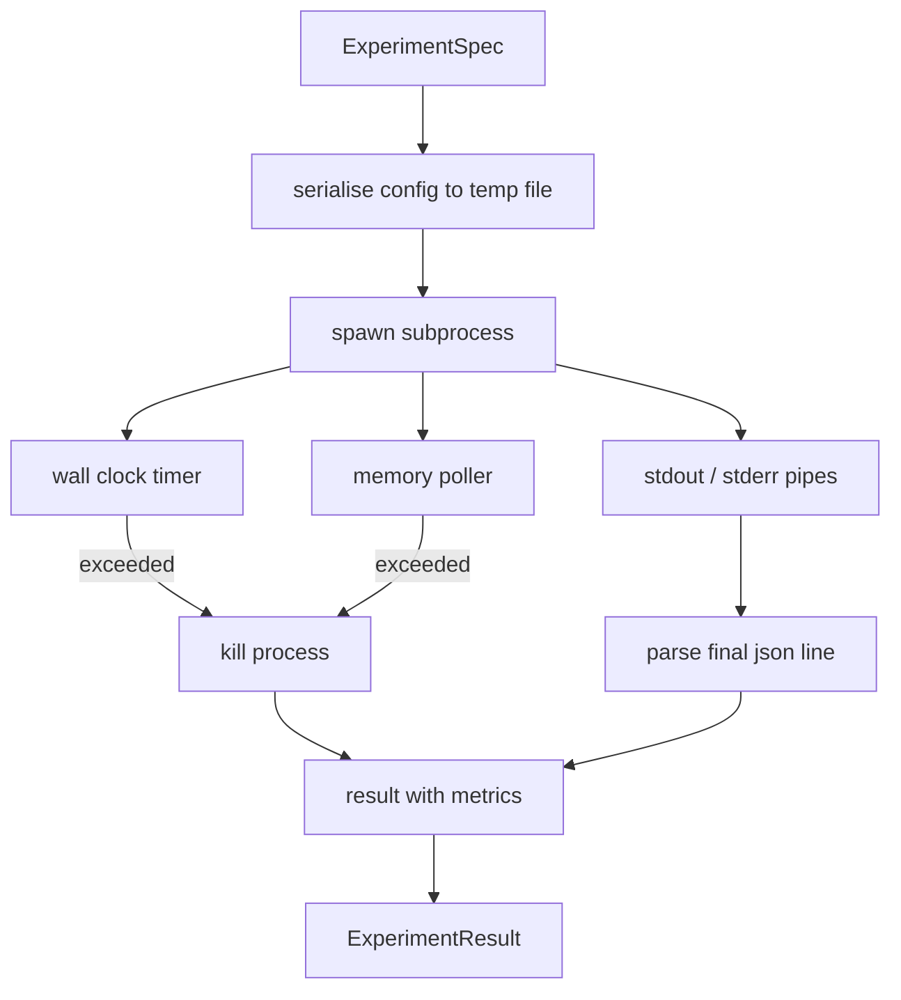

# 实验运行器

> 回路的诚实程度取决于它的测量。构建这个 runner：它接收 spec，在沙箱化的子进程中执行，并输出 evaluator 可以信任的 json 指标块。

**Type:** Build
**Languages:** Python
**Prerequisites:** Phase 19 Track A lessons 20-29
**Time:** ~90 minutes

## 学习目标
- 把实验编码为带类型的 spec，runner 可以将其序列化给子进程。
- 启动子进程时设置硬性实际耗时超时与软性内存上限，并把两者都作为终止条件暴露出来。
- 捕获 stdout、stderr 和结构化指标块，汇入同一条结果记录。
- 构建消融表，在固定基础 spec 上每次只扫一个配置旋钮。
- 在给定 seed 的情况下保持每个结果确定，使 evaluator 在多次运行中看到相同的数字。

## 为什么用子进程

研究回路会运行不受信任的代码。假设来自采样器，实验脚本也来自同一路径；把任一者当作进程内安全代码，就是在等着一次崩溃把编排器带走。子进程是语言自带的最简单隔离：独立进程、独立地址空间、父进程侧的信号句柄。

这里的 runner 不实现完整沙箱。没有 cgroup，没有 seccomp 过滤，没有命名空间重映射。它有的只是实际耗时超时、内存增长的轮询循环，以及在任一限制触发时终止进程的杀掉路径。这就是运行时契约，每个更复杂的沙箱都只是扩展它。本课把契约保持得足够小，可以一口气读完。

## ExperimentSpec 的数据形状

```text
ExperimentSpec
  spec_id        : str            (stable id, "exp_001")
  hypothesis_id  : int            (link back to the queue from lesson 50)
  script_path    : str            (path to the python script to run)
  config         : dict           (passed to the script as one json arg)
  seed           : int            (deterministic seed for the experiment)
  wall_timeout_s : float          (hard timeout, killed on exceed)
  memory_cap_mb  : int            (soft cap, polled; killed on exceed)
  metric_keys    : list[str]      (which fields the evaluator will read)
```

脚本位于磁盘上；runner 把 config 写入一个临时文件路径，脚本读取它。脚本应在 stdout 上打印一行 json，其键是 `metric_keys` 的超集。stdout 上的其他内容会被捕获，但会被指标解析器忽略。

```figure
cg-runner-limits
```

## 架构



runner 是一个类，一个主方法。poller 是一个小线程，每隔一个轮询间隔醒来一次，在可用时从 proc 文件系统读取子进程的 `psutil` 等价物，平台不暴露该能力时退化为空操作。

## 为什么用软内存上限

硬内存上限需要 `resource.setrlimit`，且只在 POSIX 上有效。本课提供了一个可移植方案：轮询平台上的常驻集大小（RSS），超过上限就杀掉子进程。上限是软的，因为轮询有非零间隔；进程可能在两次轮询之间冲高再回落。runner 记录观测到的最大 RSS，使 evaluator 能看到运行离限制有多近。

在没有进程探测支持的平台上，poller 记录一次警告并禁用自身。实际耗时超时仍然生效。本课的测试覆盖两条路径。

## 捕获 stdout 和 stderr

runner 在完成时排空两条管道并读取。stdout 逐行扫描；最后一行能解析为包含全部所需 `metric_keys` 的 json，被当作指标块。更早的 json 行作为 `intermediate_metrics` 保留在结果中；evaluator 可用它们绘制学习曲线。

stderr 被原样捕获进结果。runner 从不在非零退出码上抛异常；而是把退出码记录在结果里。任何非零退出都标记为 `"crash"`，即使脚本打印了指标，因此 evaluator 默认把部分运行视为失败。

## 消融表

```python
def ablate(base: ExperimentSpec, knob: str, values: list[Any]) -> list[ExperimentSpec]:
    ...
```

给定基础 spec 和旋钮名，助手函数为每个值返回一个 spec，并覆盖 `config[knob]`。每个 spec 得到派生出的 `spec_id`（`f"{base.spec_id}_{knob}_{value}"`）。runner 提供 `AblationRunner`，按顺序运行它们，并返回按旋钮值索引的 `AblationTable`。

为什么一次只扫一个旋钮。全因子扫描会指数爆炸，并产出 evaluator 无法解释的结果。一次一个旋钮产出一条干净的轴，evaluator 可以绘图。本课只支持把多旋钮扫描表达为重复的单旋钮消融，由调用方组合。

## 确定性

每个 spec 带有一个 seed。runner 通过 config 字典把 seed 转发给脚本（`config["__seed"] = spec.seed`）。`code/experiments/` 中的 mock 实验脚本遵守 seed，在多次运行中产出相同的指标。第五十三课的 evaluator 依赖这一点；没有确定性，一次「回退」可能只是不同的随机初始化。

## Mock 实验脚本

本课提供一个实验脚本：`code/experiments/sparsity_experiment.py`。它是一个真实脚本，读取配置、用 numpy 随机过程模拟一次小型训练，并打印 json 指标块。脚本遵守 `sleep_s` 旋钮以测试超时，以及 `allocate_mb` 旋钮以测试内存轮询器。

该模拟并不是真的在训练任何东西。它是一次模仿训练回路形状的数值计算：损失曲线、最终困惑度、实际耗时。本课的重点是 runner，而不是模拟。真实的实验脚本会导入模型。

## 结果的数据形状

```text
ExperimentResult
  spec_id              : str
  hypothesis_id        : int
  exit_code            : int
  terminal             : "ok" | "timeout" | "oom" | "crash"
  wall_time_s          : float
  peak_rss_mb          : float | None
  metrics              : dict
  intermediate_metrics : list[dict]
  stdout_tail          : str
  stderr_tail          : str
```

evaluator 先读取 `metrics` 和 `terminal`。如果 terminal 不是 `"ok"`，实验就算作失败运行，evaluator 的裁决是自动的。否则指标通过显著性检验。

## 如何阅读代码

`code/main.py` 定义了 `ExperimentSpec`、`ExperimentResult`、`ExperimentRunner`、`AblationRunner` 和一个确定性演示。子进程管理是一个类。内存轮询器是一个小线程。消融助手是一个函数。

`code/experiments/sparsity_experiment.py` 是测试中使用的 mock 实验。它从 argv 读取配置文件路径，并在完成时写出一行 json 指标。

`code/tests/test_runner.py` 覆盖成功路径、超时路径、崩溃路径、消融表，以及两次运行之间的确定性检查。

## 它在整个回路中的位置

第五十课生成假设。第五十一课过滤掉文献已经定论的内容。第五十二课为剩下的假设运行实验。第五十三课读取结果，运行显著性检验，并写出编排器按 hypothesis id 存储的裁决。
