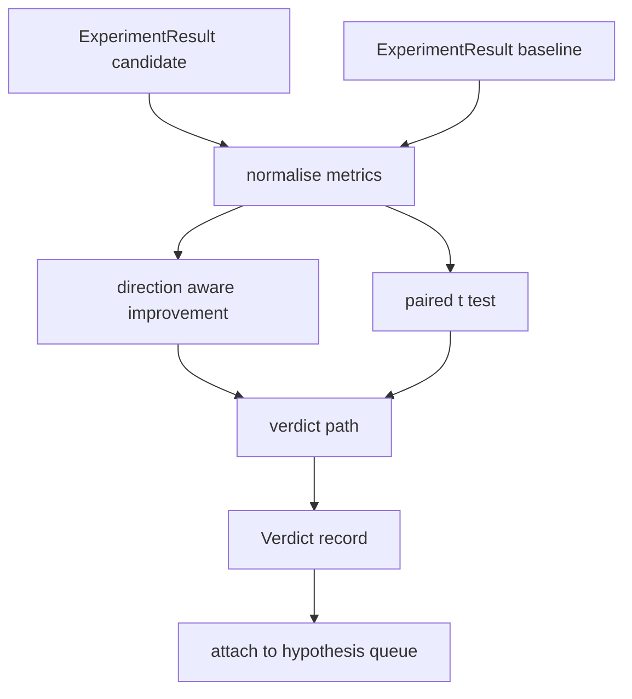

# 结果评估器

> runner 产出了数字。evaluator 决定这些数字是改进、回退还是噪声。构建把指标变成一句话结论的裁决路径。

**Type:** Build
**Languages:** Python
**Prerequisites:** Phase 19 Track A lessons 20-29
**Time:** ~90 minutes

## 学习目标
- 用方向感知的改进量和固定阈值，把候选运行与基线比较。
- 从零实现配对 t 检验，基于每个 seed 的指标，并读取得到的 p 值。
- 归一化对数尺度指标，使下游报告可以把它们与线性指标混合。
- 输出按假设的裁决，编排器可以附到第五十课的队列上。
- 保持每一步都是纯函数，因此相同输入始终产生相同裁决。

## 为什么用配对检验

runner 给出的单个数字无法说明变化是否真实。相同的配置用不同 seed 会得到不同的困惑度。变化可能只是噪声。正确的比较是配对的：相同 seed、相同数据，分别在候选配置和基线配置下各跑一次。每个 seed 贡献一个差值。这些差值的均值就是效应。这些差值的标准误就是噪声底线。

本课从零实现该检验。没有 `scipy.stats`。数学量足够小，一屏就能读完。

```text
diffs    = [a_i - b_i for i in seeds]
mean     = sum(diffs) / n
variance = sum((d - mean) ** 2 for d in diffs) / (n - 1)
t_stat   = mean / sqrt(variance / n)
df       = n - 1
p_value  = two_sided_p(t_stat, df)
```

双尾 p 值使用正则化不完全 beta 函数。本课提供一个使用 Lentz 连分数的小型实现。整个实现是六十行标准库数学。

## 方向感知的改进量

有些指标越高越好（准确率、吞吐量）。另一些越低越好（损失、困惑度、实际耗时）。evaluator 在每个指标上携带一个 `direction` 字段。

```text
if direction == "higher_is_better":
    improvement = (candidate - baseline) / abs(baseline)
elif direction == "lower_is_better":
    improvement = (baseline - candidate) / abs(baseline)
```

改进量是有符号的。在越高越好的指标上，负改进意味着候选更差。裁决路径同时读取符号与幅度。

一个平坦阈值（`improvement_threshold=0.02`，即 2%）决定变化是否大到值得判定。低于该阈值，无论 p 值如何裁决都是「噪声」；回路对用户无法测量的变化不感兴趣。

```figure
cg-paired-verdict
```

## 架构



evaluator 运行三项独立计算，并在裁决路径中合并它们。每项计算都是无共享状态的纯函数。

## 对数归一化

困惑度是损失的指数。损失下降 0.1 会造成困惑度的大幅下降。跨两种配置直接比较困惑度没问题，但在单个报告中与线性指标混合就需要归一化。

本课对 `scale` 字段为 `"log"` 的任何指标，在计算改进量前先取自然对数。随后阈值在对数空间中应用。困惑度从 32 降到 28，在越低越好的指标上是 `log(28) - log(32) = -0.133`，远高于 2% 阈值。

```text
if scale == "log":
    a = log(candidate)
    b = log(baseline)
else:
    a = candidate
    b = baseline
```

`scale="linear"`（默认）的指标跳过变换。同一代码路径处理两者。

## 按 seed 的配对检验

第五十二课的 runner 每次运行输出一个最终指标块。配对检验需要候选配置每个 seed 一个指标块，基线配置每个 seed 一个指标块。编排器在一组 seed 上以两种配置运行同一实验，并把两个 `ExperimentResult` 记录列表交给 evaluator。

evaluator 按 seed 配对（seed 位于 `result.metrics["seed"]`），并遍历所请求的指标。如果两个列表的 seed 不匹配，evaluator 抛出 `PairingError`。编排器应重跑。

## Verdict 的数据形状

```text
Verdict
  hypothesis_id          : int
  metric                 : str
  direction              : "higher_is_better" | "lower_is_better"
  scale                  : "linear" | "log"
  candidate_mean         : float
  baseline_mean          : float
  improvement            : float       (signed, fraction; see direction rules)
  p_value                : float | None  (None if n < 2)
  significance_threshold : float
  improvement_threshold  : float
  verdict                : "improved" | "regressed" | "noise" | "failed"
  rationale              : str
```

裁决路径是一张小决策表：

```text
1. If any candidate result has terminal != "ok": verdict = "failed"
2. else if |improvement| < improvement_threshold:  verdict = "noise"
3. else if p_value is None or p_value > significance: verdict = "noise"
4. else if improvement > 0:                          verdict = "improved"
5. else:                                             verdict = "regressed"
```

rationale 是一句人类可读的话，编排器可以按 hypothesis id 记录。

## 如何阅读代码

`code/main.py` 定义了 `MetricSpec`、`Verdict`、`Evaluator`、t 统计量与不完全 beta 助手函数，以及一个确定性演示。t 检验用纯标准库数学实现；numpy 仅用于读取指标列表并计算均值与方差。

`code/tests/test_evaluator.py` 覆盖改进路径、回退路径、噪声路径（小幅改进）、噪声路径（n 太小）、失败终止路径、对数归一化路径、对照已知参考值的 t 检验，以及配对错误。

## 它在整个回路中的位置

第五十课产出了假设队列。第五十一课过滤掉文献已定论的内容。第五十二课在候选与基线配置下跨 seed 运行实验。第五十三课读取这些运行并写出裁决。编排器把四者缝合起来：

```text
for hypothesis in queue:
    literature = retrieval.search(hypothesis.text)
    if literature_settles(hypothesis, literature):
        attach(hypothesis, verdict="settled")
        continue
    candidates = runner.run_all(specs_for(hypothesis))
    baselines  = runner.run_all(baseline_specs_for(hypothesis))
    metric_spec = MetricSpec("perplexity", direction=LOWER, scale=LOG)
    verdict = evaluator.evaluate(hypothesis.id, metric_spec, candidates, baselines)
    attach(hypothesis, verdict)
```

该编排器不在本课中；这四课无需任何胶水即可组合成它，只需要各自定义的数据类。
