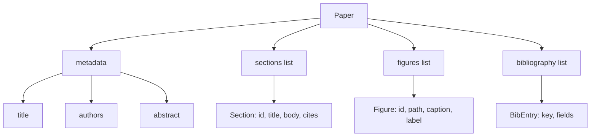
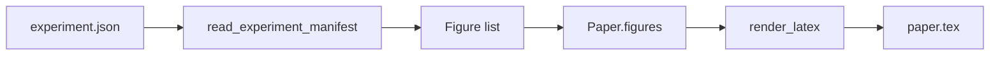
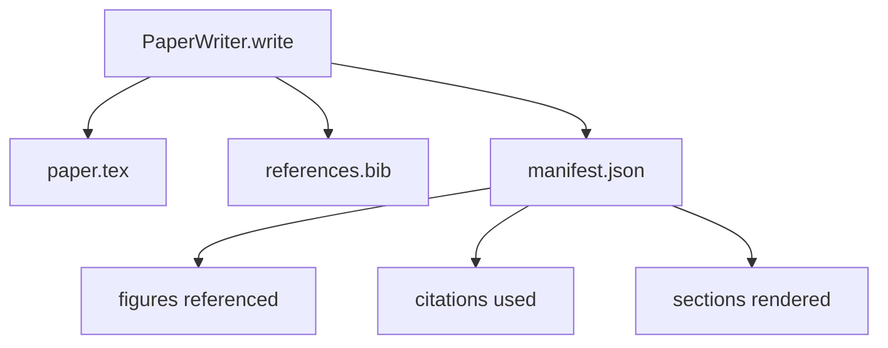

# 论文写作器

> LaTeX 骨架是研究者与排版者之间的契约。契约一旦破坏，文档就无法编译，而且失败是响亮的。先构建骨架，再填充它。

**Type:** Build
**Languages:** Python
**Prerequisites:** Phase 19 lessons 50-53
**Time:** ~90 minutes

## 学习目标

- 把研究论文当作一个有已知章节图的结构化产物，而不是自由格式文档。
- 在任何正文写出之前，生成一个声明摘要、章节、图槽位和文献键的 LaTeX 骨架。
- 通过确定性的槽位机制，把实验输出中的图（路径与标题）注入骨架。
- 接一个 mock 的正文生成器，从结构化大纲填充每个章节，使 harness 无需模型即可测试。
- 输出单个 `paper.tex`、一个 `references.bib`，以及一个列出所有引用图和所有引用键的清单。

```figure
ch-paper-skeleton
```

## 为什么先做骨架

从正文开始的草稿会积累结构性债务。引言长出三段本应属于相关工作。图在定义之前就被引用。参考文献最后出现同一篇论文的三个键。等作者发现时，重写成本已经高于写作成本。

骨架反转了这一点。结构作为数据在上游声明。章节是带名称和顺序的槽位。图是带 id 和标题的槽位。文献键在顶部连同它们指向的条目一起声明。正文一次一个槽位地生成进去。harness 可以在写出任何正文之前验证：每张图都有槽位、每个引用都有条目、每个章节都出现在目录中。

这与前面课程应用于计划、tool call 和 trace 的纪律相同。结构就是契约。

## Paper 的数据形状



每个字段都是纯 Python 数据。渲染器是从 `Paper` 到 LaTeX 字符串的纯函数。harness 可以在渲染前内省论文：统计章节、列出缺失的图文件、检查每个 `\cite{key}` 都有匹配的 `BibEntry`。

## 渲染契约

渲染器保证三条性质。第一，骨架中的每个图槽位发出一个 `\begin{figure}` 块，带形如 `fig:<id>` 的稳定 label。第二，每个章节发出一个 `\section{}`，带形如 `sec:<id>` 的稳定 label，使交叉引用可用。第三，参考文献发出一个 `\bibliography` 块，其 `references.bib` 恰好包含论文上声明的条目，不多不少。

违反其中任何一条都是渲染错误，而非警告。骨架就是契约；一次悄悄丢掉图的渲染就是破坏契约。

## 从实验注入图

本路线中更早的课程把实验输出生成为 JSON 清单。每个清单携带一组带路径和简短标题的产物。论文写作器读取该清单并生成 `Figure` 记录。



注入是确定性的。图 id 由实验名加一个单调计数器派生。标题来自清单。路径相对于论文输出目录归一化，因此即使实验输出位于磁盘别处，LaTeX 也能编译。

## Mock 正文生成器

本课不调用模型。`MockProseGenerator` 读取大纲形状并确定性地产出正文。大纲形状是每个章节一个短字符串。生成器把该字符串扩展成两段短文字，并织入章节标题。只有当大纲声明了它们时，生成的正文才会点名图和引用。

这足以测试写作器的每一种行为。真实实现会把生成器换成模型调用。其外围 harness 不变。这就是把正文生成器声明为可调用对象的价值：测试替换为确定性实现，生产替换为模型实现，管线其余部分完全相同。

## 清单输出

写作器向输出目录发出三个文件。



清单是下游 evaluator 或 critic 回路读取的对象。它不解析 LaTeX，而是读取清单。下一课 critic 回路以该清单为输入并产出反馈列表。因此清单是契约的一部分，而 LaTeX 不是。

## 校验关口

写作器在写任何文件之前运行四道关口。

1. 论文内每个图 id 唯一。
2. 每个章节的 `cites` 字段引用的文献键必须在论文上声明。
3. 摘要非空。
4. 标题非空。

任一关口失败都会以精确原因抛出 `PaperValidationError`。harness 把原因作为失败模式呈现。没有部分写入：三个文件要么全部写出，要么一个都不写。

## 如何阅读代码

`code/main.py` 定义了 `Paper`、`Section`、`Figure`、`BibEntry`、`PaperValidationError`、`MockProseGenerator`、`PaperWriter`，以及一个 `render_latex` 函数。`write` 方法接收输出目录并写出 `paper.tex`、`references.bib` 和 `manifest.json`。`read_experiment_manifest` 助手把实验清单列表转换为 `Figure` 记录。

`code/tests/test_paper_writer.py` 覆盖：无章节的骨架渲染、含两个章节和两张图的完整渲染、缺失引用关口、重复图 id 关口、清单内容，以及 LaTeX 字符串契约（每个章节发出 `\section{}`，每张图发出 `\begin{figure}`）。

## 进一步扩展

真实实现会想要两个扩展。第一，多格式渲染：相同的 `Paper` 形状可编译为 Markdown 用于博客文章，HTML 用于预览。渲染器成为 `Paper` 上的策略。第二，引用增强：写作器在给定本地 DOI 缓存的情况下，从引用键获取 BibTeX 条目。两者都有价值，且都能在不触碰骨架契约的前提下加入。

骨架是赌注。章节、图和引用声明为数据，正文生成进槽位，清单与 LaTeX 一并输出。其他所有改进都在其之上组合。
