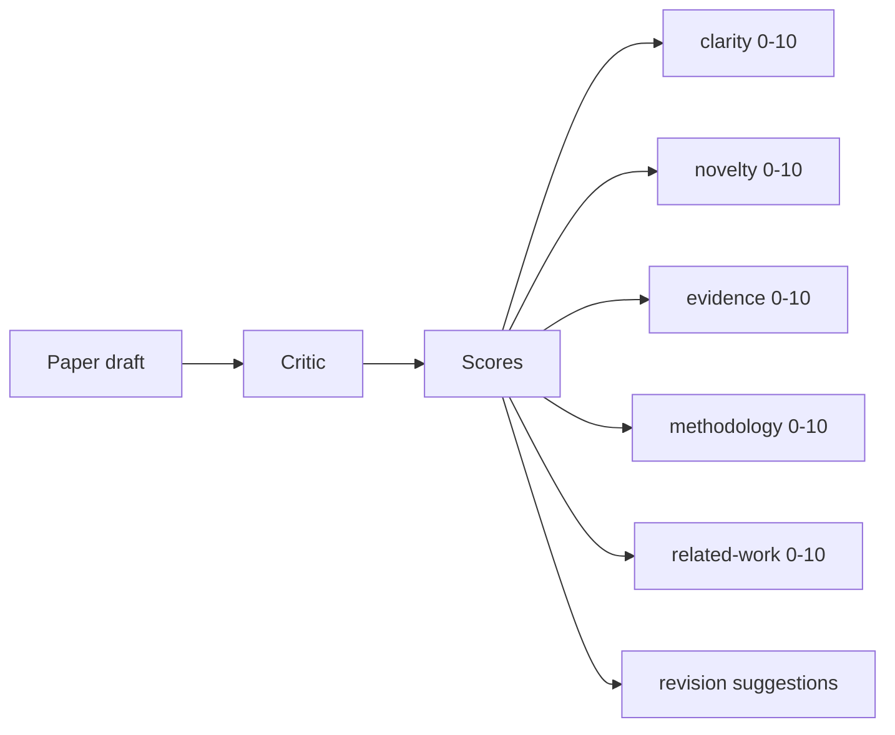
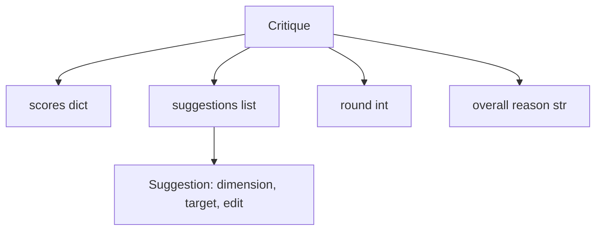
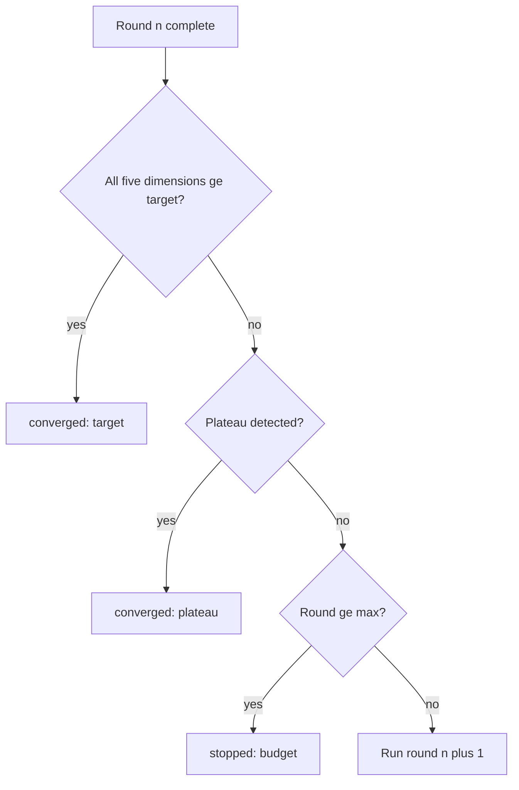
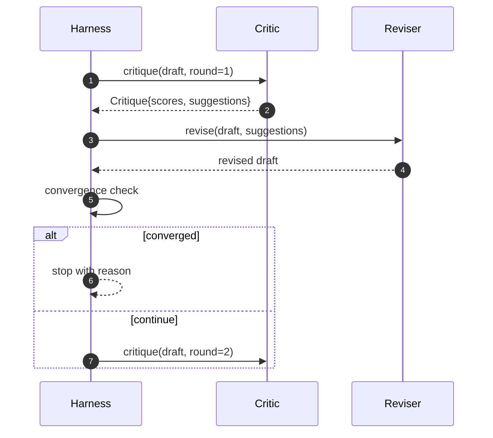

# Critic 回路

> 第一次就返回「看起来不错」的 critic 是坏的。总是返回「需要改进」的 critic 也是坏的。有意思的 critic 是能收敛的，而收敛需要工程化。

**Type:** Build
**Languages:** Python
**Prerequisites:** Phase 19 lessons 50-53
**Time:** ~90 minutes

## 学习目标

- 在五个固定维度上给论文草稿打分：清晰度、新颖性、证据、方法、相关工作。
- 把每一轮的批评作为结构化的修订 diff 应用，而不是自由形式的整篇重写。
- 通过比较跨轮分数检测收敛；在平台期、达标或预算耗尽时停止。
- 用最大迭代预算封顶轮数，使不收敛的 critic 不会永远运行。
- 输出每轮 trace，使仪表盘或下一阶段可以渲染分数轨迹。

```figure
ch-critic-converge
```

## 为什么是五个固定维度

自由形式的 critic 是一个返回一段建议的模型。下一轮的修订把这段文字当作环境上下文。重写是否回应了批评无法验证，因为批评从来没有结构。

五个维度给 harness 一个契约。



分数是一个向量。harness 跨轮观察每个维度。一次提升清晰度却拉低证据的修订，是证据上的回退，收敛检查能看到它。仅靠模型的 critic 无法提供这种保证。

## Critique 的数据形状



每条建议携带它改进的维度、它瞄准的章节，以及一个 reviser 可以应用的 `edit` 指令。reviser 也是一个可调用对象。本课提供一个确定性 reviser，把 edit 指令解释为向章节追加的操作。模型驱动的 reviser 会把同一字段解释为 prompt。契约不变。

## 收敛规则（按顺序）

critic 回路在三个条件之一触发时终止。



目标是严格情形：五个维度（清晰度、新颖性、证据、方法、相关工作）中的每一个都必须在回路返回成功之前达到 `>= target_score`（默认 `8.0`）。均值很高但有一个维度很弱是不够的。平台期检测把当前轮的均值与上一轮比较。如果改进连续两轮低于 `plateau_epsilon`（默认 `0.1`），回路以 `plateau` 退出。预算是对轮数的硬上限（默认 `5`），以 `budget` 退出。

顺序很重要。目标优先于平台期，平台期优先于预算。如果第三轮在恰好也会触发平台期的那次迭代达标，结果是 `target`，不是 `plateau`。

## 为什么平台期检测需要两轮

单轮平台期是噪声。真实的 critic 即使对固定草稿，每次迭代也会返回略有不同的分数，因为确定性打分仍取决于应用了哪些建议以及顺序。要求连续两轮平台期可以滤掉这种噪声。如果 harness 报告平台期，草稿是真正停止改进了。

## 本课的确定性 critic

本课不调用模型。随课提供的 critic 是一个可调用对象，基于三个信号给草稿打分：章节正文平均长度（清晰度）、图数量与引用数量（证据），以及论文元数据上的 `originality_tag` 字段（新颖性）。reviser 知道如何把每个分数往上推。

```text
clarity      grows when the average section body length increases
novelty      grows when originality_tag is set to "high"
evidence     grows when a section's figure_refs is non-empty
methodology  grows when a section titled "Method" exists with body
related-work grows when a section titled "Related Work" exists with body
```

reviser 把每条建议解释为有针对性的追加。第一轮之后，harness 能观察到分数上升。测试利用这一性质断言回路缩小差距。

## 完整回路契约



harness 拥有轮计数器、trace 和收敛检查。critic 拥有分数。reviser 拥有 diff。三者互不触碰对方的状态。

## Trace 输出

每轮发出一个 trace 事件，包含轮号、分数向量、建议数量和收敛裁决。完整 trace 与最终草稿一并返回。下游仪表盘可以渲染每轮分数图。下一课迭代调度器读取 trace，决定该分支是否值得保留。

## 保护免受坏 critic 影响的预算

一个只产出永远无法提升分数建议的 critic，会把回路锁在最大迭代上限。trace 使这一点可见：五轮、分数平、裁决 `budget`。用户会把它读作 critic 的 bug，而不是草稿的 bug。另一种做法，只呈现最终草稿，会隐藏诊断。trace 优先的设计会暴露它。

## 如何阅读代码

`code/main.py` 定义了 `Critique`、`Suggestion`、`Critic` 协议、`Reviser` 协议、`CriticLoop`，以及一个 `make_deterministic_critic_pair` 工厂，返回确定性 critic 及匹配的 reviser。附带一个最小的 `Paper` 形状，使课程可以独立成立。

`code/tests/test_critic_loop.py` 覆盖：第一轮之后的单调改进、在调优草稿上的目标收敛、两轮平坦后的平台期检测、无建议改进时的预算耗尽、reviser 的建议应用，以及 trace 形状。

## 进一步扩展

真实实现会想要两个扩展。第一，维度权重：研讨会论文给新颖性的权重高于方法；期刊则相反。收敛检查变成加权均值。第二，配对 critic：一个 critic 打分，第二个 critic 在 reviser 看到建议之前裁决它们。两者都有价值，且都在同一 `Critique` 形状上组合。

赌注是分数向量。一旦批评结构化，其他所有改进——收敛规则、仪表盘、配对 critic——都能在不改变回路的情况下接入。
