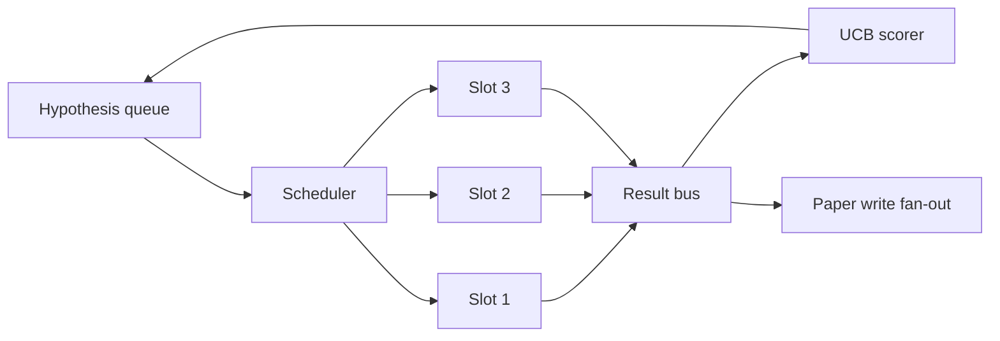
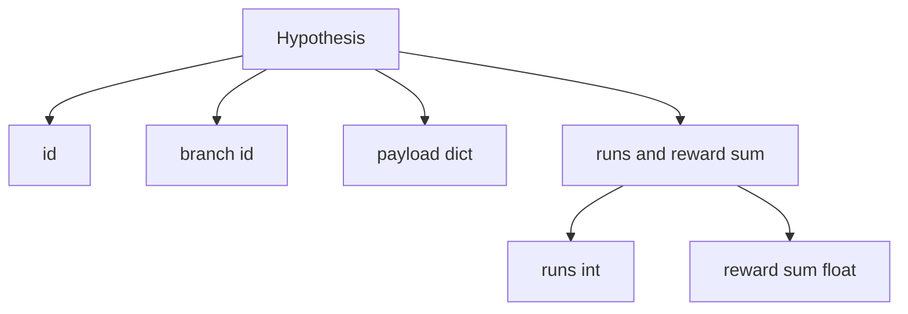
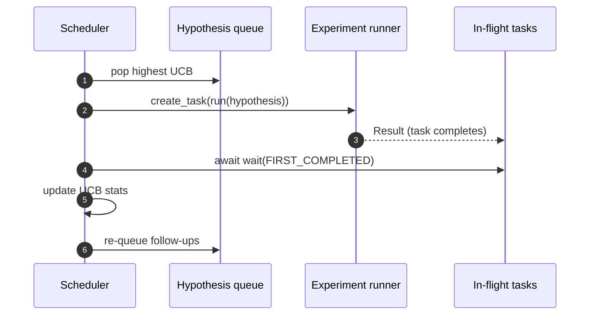

# 迭代调度器

> 没有调度器的研究回路是带妄想的队列。调度器是回路决定停止探索什么的地方，而这个决定就是全部。

**Type:** Build
**Languages:** Python
**Prerequisites:** Phase 19 lessons 50-53
**Time:** ~90 minutes

## 学习目标

- 把研究流程建模为假设队列，向并行实验槽位供给，结果再扇回。
- 用 asyncio 并发运行多个实验，使调度器能让所有槽位保持忙碌。
- 用 UCB 给每个假设分支打分，使调度器能在不放弃探索的前提下剪掉低产出分支。
- 把完成的结果扇出到论文写作阶段和重新入队阶段，使高产出分支滋生后续假设。
- 输出每次迭代的 trace，包含分支分数、槽位占用和剪枝决策。

```figure
ch-ucb-scheduler
```

## 为什么需要调度器而不是工作列表

平坦的工作列表按提交顺序运行任务。当每个任务相互独立时这没问题。研究不是独立的：实验三的发现会改变实验四和实验五的优先级。读取结果扇入并重排队列的调度器，每单位算力能完成更多有用的工作。

有意思的设计选择是打分规则。贪心打分器总是选当前领先者，从不探索。均匀打分器从不利用。UCB（置信上界）是中间路径：利用领先者，同时为尝试较少的分支保留容量。

## 系统形状



队列持有假设。槽位空闲时调度器挑选 UCB 最高的假设。每个槽位异步运行一个实验。完成的实验把结果扇入总线。总线更新来源分支的 UCB 统计，并在分支产出越过阈值时扇出到论文写作阶段。

## Hypothesis 的数据形状



`branch` 是 UCB 统计的键。多个假设可以共享一个分支（分支是研究方向；假设是其中的一次试验）。`runs` 是该分支已完成实验的数量，`reward_sum` 是累计奖励。UCB 同时读取两者。

## UCB 打分

本课使用的 UCB 公式是经典 UCB1。

```math
\text{ucb}(\text{branch}) = \text{mean\_reward}(\text{branch}) + c \sqrt{ \frac{\ln(\text{total\_runs})}{\text{runs}(\text{branch})} }
```

`total_runs` 是所有分支上完成实验的总数。`c` 是探索权重；本课默认 `sqrt(2)`。零运行的分支得到 `+inf`，因此未尝试的分支总是最先被调度。高平均奖励的分支保持高分，直到其他分支追上来；运行很多次但奖励不高的分支会被运行较少的替代者盖过。

剪枝关口与选择器分离。剪枝在分支平均奖励低于绝对下限（默认 `0.2`）且至少经过 `prune_after_runs` 次试验（默认 `3`）后，将该分支移出未来调度。这使队列保持有界。

## 用 asyncio 实现并行槽位

调度器用 `asyncio.create_task` 驱动实验。每个任务运行实验 runner（一个 `async def` 可调用对象）并返回 `Result`。主循环用 `asyncio.wait(..., return_when=asyncio.FIRST_COMPLETED)` 等待在途任务集合，并在每次完成时触发打分更新。



三个槽位并发运行。主循环从不阻塞在单个实验上。调度器在槽位一空就启动新任务，直到队列为空且没有在途任务。

## 扇出：论文触发

当分支平均奖励越过 `paper_threshold`（默认 `0.7`）且该分支尚未产出论文时，调度器把 `paper.trigger` 事件扇出到一个输出列表。下游第五十四课的论文写作器会拾取它。本课中触发器被捕获为列表，使测试可以断言。

## 扇出：后续假设

高产出结果落地时，调度器可以调用用户提供的 `expander`，在同一分支上产出一个或多个后续假设。expander 是从 `Result` 到 `list[Hypothesis]` 的纯函数。本课提供一个确定性 expander，为任何奖励超过论文阈值的结果产出两个后续假设。

## 预算

两个预算保护调度器不失控。

```text
max_experiments    : total count of experiments run across all branches
max_seconds        : wall-clock cap (asyncio time)
```

任一触发时，调度器停止调度新任务，等待在途任务，并返回最终 trace。trace 包含一个 `stop_reason`。

## Trace 与最终报告

每个调度决策（选取、派发、结果、剪枝、扇出）发出一个事件。最终报告汇总每个分支的统计、总运行数、总实际耗时，以及触发的论文触发器。下一课端到端演示读取该报告来驱动论文写作器。

## 如何阅读代码

`code/main.py` 定义了 `Hypothesis`、`Result`、`BranchStats`、`IterationScheduler`，以及一个 `make_deterministic_runner` 工厂，返回奖励可预测的 asyncio 实验 runner。runner 睡眠固定的 `delay_ms`（默认 `5ms`），使并发可观察。

`code/tests/test_scheduler.py` 覆盖：UCB 优先选未尝试分支、并行槽位占用、越过阈值时的论文触发、低产出试验后的分支剪枝、扇出后续假设，以及预算退出（实验数与实际耗时两种）。

## 进一步扩展

真实实现会想要三个扩展。第一，跨会话持久化 UCB 统计：当前统计在内存中；真实调度器会检查点保存它们，使重启保留已花费的探索预算。第二，多目标打分：每个结果发出向量而不是标量奖励，UCB 变成 Pareto 式选择器。第三，上下文老虎机（contextual bandits）：选择器以假设特征（长度、复杂度）为条件，使相似假设共享探索。

调度器是研究超越工作列表的地方。一旦 UCB 接通且槽位并行运行，其他所有改进都在其上组合。
