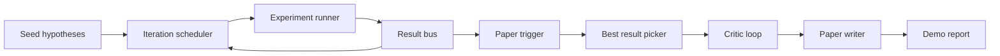
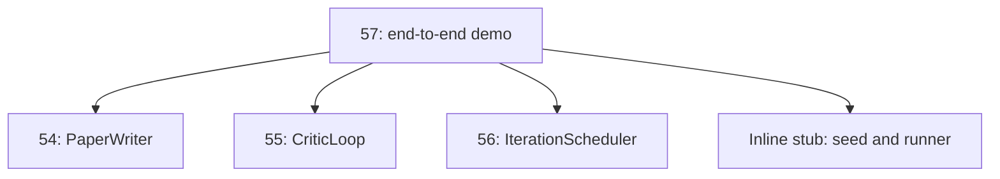
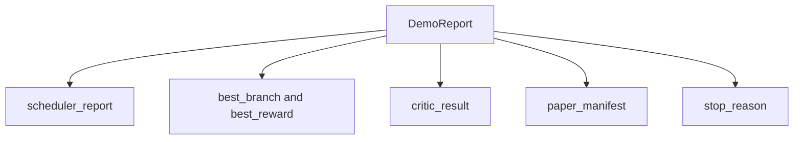

# 端到端研究演示

> 演示（demo）是此前写下的每一份契约（contract）都必须组合起来的地方。只要其中任何一份出现泄漏，演示就是抓住它的那一课。

**Type:** Build
**Languages:** Python
**Prerequisites:** Phase 19 lessons 50-53
**Time:** ~90 minutes

## 学习目标

- 端到端接通自动研究循环：假设种子、实验运行器、调度器、评论循环、论文撰写器。
- 通过纯 Python 导入组合 Track D 前四节课的原语（primitive），而不是依赖框架。
- 让循环自行终止地跑完，并输出一份列出每个阶段输出的演示报告。
- 保持演示的确定性，使测试套件可以断言最终形态。
- 当任一阶段的契约被破坏时，暴露清晰的失败模式，使下一阶段不会带着损坏的输入运行。

```figure
ch-research-pipeline
```

## 这里组合了什么



五个阶段。种子是三个假设组成的列表。调度器以三个并行槽在它们之间运行六个实验。总线报告一个或多个论文触发。挑选器选出唯一的最佳结果。评论循环对基于该结果构建的草稿进行迭代。论文撰写器输出最终的 LaTeX、BibTeX 和清单（manifest）。

## 为什么是导入而不是复制

前面每一课都提供一个 `main.py`，其中包含公开的 dataclass 和函数。演示通过调整 `sys.path` 指向每节课的父目录来导入它们。这不是框架式接线，而是前面课程的测试文件已经在用的同一套导入。



内联桩（inline stub）代替第五十到第五十三课：一个小型种子假设生成器和一个同步奖励函数。用户只需调整两个导入，就能把内联桩换成那些课程中的真实原语。

## 确定性保证

演示从构造上就是确定性的。实验运行器使用带种子的 numpy。评论循环的修订器按固定顺序遍历固定维度。论文撰写器的文本生成器是第五十四课里的 mock 版本。调度器的 UCB 挑选器按迭代顺序而非随机选择打破平局。

给定相同的种子，演示输出相同的报告。测试通过运行演示两次并比较清单来断言这一性质。

## 演示报告的形状



每个字段都逐字来自上游阶段。演示不做任何输出变换，只是把它们组合起来。这就是演示本身所代表的测试。

## 失败模式处理

每个阶段要么成功，要么抛出有类型的错误（typed error）。

```text
Scheduler ........ returns SchedulerReport with stop_reason
                   in {queue_empty, max_experiments, deadline}
Best-result pick . raises NoTriggerError if no paper trigger fired
Critic loop ...... returns LoopResult with status converged or stopped
Paper writer ..... raises PaperValidationError on contract break
```

任一阶段的失败都会以有类型异常短路整个演示。测试固定这一契约：`test_no_triggers_raises_typed_error` 和 `test_best_picker_raises_when_no_triggers` 断言：当没有分支触发时，挑选器抛出 `NoTriggerError` / `BestResultError`，且撰写器从未被调用。

## 最佳结果挑选器

调度器按分支发出论文触发。挑选器选择在所有触发中平均奖励最高的分支。平局按分支 id 的字母顺序打破，以保证演示的确定性。挑选器是一个小型纯函数；测试把它固定在一份固定的调度器报告上。

## 接入评论循环

第五十五课的评论循环作用于 `MiniPaper`。演示从选中的分支构建 `MiniPaper`：用分支 id 填充摘要，初始化两个小节（Introduction 和 Results），并根据分支的平均奖励设置 `originality_tag`（`>= 0.8` 为 high，`>= 0.6` 为 medium，否则为 low）。

修订器随后迭代草稿直至收敛。输出送入论文撰写器。

## 接入论文撰写器

第五十四课的论文撰写器作用于带插图和参考文献的完整 `Paper` 形状。演示通过 `mini_to_full_paper` 升级收敛后的 `MiniPaper`，该函数为选中的分支附加一张插图，并构建一份小型合成参考文献，取评论循环建议的 cite key 并集。演示添加的每个 cite 也会加入参考文献列表，因此校验通过。

## 如何阅读代码

`code/main.py` 定义了 `BestResultError`、`NoTriggerError`、`DemoReport`、`pick_best_branch`、`build_mini_paper`、`mini_to_full_paper` 和 `run_demo`。顶部导入一次性调整 `sys.path`，并从各自的课程中取出 `PaperWriter`、`CriticLoop` 和 `IterationScheduler`。

`code/tests/test_e2e.py` 覆盖以下情形：演示端到端运行并输出包含全部五个字段的报告；两次运行之间的确定性；没有分支越过阈值时的 `NoTriggerError`；撰写器契约被破坏时的 `PaperValidationError`；论文清单包含所选分支的插图；调度器停止原因是预期值之一。

## 更进一步

演示通过后，还有三个值得接上的扩展。第一，持久化状态：每个阶段的结果写入一个小型 JSON 存储，使重启后无需重跑廉价阶段即可恢复。第二，仪表盘：调度器和评论循环的跟踪事件渲染成单条时间线。第三，真实模型调用：把 mock 文本生成器和确定性的评论循环换成模型驱动的版本；接线方式不变。

演示的职责是证明组合本身就是架构。五节课，四个导入，一份报告。下次你增加一个阶段，接线只会增长一行。
