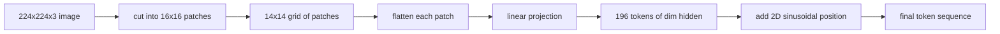

# 视觉编码器 Patch 嵌入

> 读取像素的视觉模型需要一套面向像素的分词器。Patch embedding 就是那套分词器。把图像切成方格网格，展平每个方格，用一个线性层投影，再叠加二维位置信号，让 Transformer 知道每个方格在原始图像中的位置。

**Type:** Build
**Languages:** Python
**Prerequisites:** Phase 19 lessons 30-37 (Track B foundations)
**Time:** ~90 minutes

## 学习目标

- 把图像 token 化为固定长度的 patch embedding 序列。
- 实现基于 `Conv2d` 的 patch 投影，使其数学与 unfold-then-linear 一致。
- 构建确定性的二维正弦位置嵌入，使 token 顺序编码空间位置。
- 在合成 fixture 上验证 patch 数量、embedding 形状以及 `Conv2d`/unfold 等价性。

## 问题

Transformer 吃进的是一组向量序列。图像是 3 通道网格。把每个像素都当作 token 读取会爆炸序列长度：224x224 RGB 图像是 150,528 个 token，12 层 Transformer 在注意力上负担不起。把图像当作一个巨大的扁平向量读取又会丢弃局部性，注意力层无法从中恢复。编码器前端的工作就是把像素网格压缩成几百个 token，每个 token 概括一个方形区域。

Patch embedding 用一个线性投影解决这个问题。224x224 图像切成 16x16 patch，得到 14x14 的 196 个 patch 网格。每个 patch 从 `(3, 16, 16) = 768` 个像素值展平成一个向量，然后线性层把它映射到模型的隐藏维度。Transformer 看到 196 个维度为 `hidden`（通常为 768）的 token，外加一个 CLS token。这就是网络其余部分可以消化的序列。

## 概念



### 为什么用 patch 而不是像素

注意力是序列长度的二次函数。196 token 的序列每个头每层需要 `196 * 196 = 38,416` 个注意力分数；150,528 token 的序列则需要 `150,528 * 150,528 = 22.6 billion` 个。Patch 让注意力计算减少 590,000 倍，而且一个 16x16 区域携带的信号足以支撑高层视觉任务。代价是丢失单个 patch 内部的细粒度空间细节，所以当下游多模态栈需要精细定位时，常常再跑一个高分辨率分支。

### 为什么一个线性投影就够

每个 patch 被当作独立向量。投影学习一组基：边缘检测器、颜色滤波器、简单纹理。单个线性层很小（ViT-Base 为 `768 * 768 = 589,824` 个参数）且训练快。更深的卷积 stem 确实存在（「hybrid」ViT），但扁平的线性投影是标准做法，大多数现代开放权重编码器都用这个确切的形状。

### `Conv2d` 技巧

无 padding 的 `Conv2d(in_channels=3, out_channels=hidden, kernel_size=patch_size, stride=patch_size)` 与 unfold-then-linear 产生相同的数值结果，因为每个输出位置都会把 patch 像素与一个滤波器做点积。卷积就是 patch 投影，大多数生产代码库这样实现，因为它在 GPU 上更快，还少一次 reshape。

### 位置嵌入

投影输出的 token 不携带顺序。二维正弦嵌入为每个 token 提供固定信号，编码它的 `(row, col)` 位置。嵌入维度的一半用多个频率的 sin/cos 编码行位置，另一半编码列位置。该编码是确定性的，因此可以在不重新训练的情况下更换分辨率，并且能干净地插值到模型训练时从未见过的网格。

| 组件 | 形状 | 参数 |
|-----------|-------|------------|
| Patch 投影（`Conv2d`） | `(hidden, 3, patch, patch)` | `3 * P * P * hidden + hidden` |
| 位置嵌入（固定） | `(num_patches, hidden)` | 0（计算得到，非学习） |
| CLS token（可学习） | `(1, hidden)` | `hidden` |

对于 224 分辨率的 ViT-Base/16：投影有 590,592 个参数，CLS token 有 768 个，正弦位置编码为零。下一课（59）会在这个前端之上堆叠 12 层 Transformer。

### 等价性作为健全性检查

Patch 步骤有两种写法：`Conv2d` 投影和显式的 unfold-then-linear。对于相同权重，它们必须产生相同输出。如果不一致，unfold 数学就是错的，编码器其余部分就建在沙子上。本课的测试会检验这种等价性。

```figure
ch-patch-tokenizer
```

## 构建它

`code/main.py` 实现了：

- `PatchEmbed`，包装 `Conv2d` 做 patch 投影的 `nn.Module`。
- `sinusoidal_2d(grid_h, grid_w, dim)`，构建二维位置表的无状态函数。
- `VisionFrontEnd`，把 patch embedding、CLS 前置和位置相加组合成一次前向。
- `synthesize_image(seed)` 辅助函数，从 `numpy.random` 构建确定性的 224x224x3 fixture。
- 一个 demo，把一张 fixture 图像跑过前端，打印输出形状、CLS token 范数和一行位置嵌入。

运行：

```bash
python3 code/main.py
```

输出：224x224 fixture 被 token 化为形状 `(1, 197, 768)` 的序列。第一个 token 是 CLS，接下来 196 个是 patch token。位置嵌入的范数在同一行内均匀，这是正弦编码的特征。

## 使用它

同一个 patch 前端出现在每个现代视觉-语言模型中：CLIP ViT-L/14、SigLIP、DINOv2、Qwen-VL 系列和 InternVL 栈都从 `Conv2d` patch 投影加位置信号开始。各家族的差异在下游（CLS 池化 vs 无 CLS 池化、register token、14 与 16 的 patch 尺寸、通过插值位置实现动态分辨率）。本课的前端是所有这些模型站立的基础。

## 测试

`code/test_main.py` 覆盖：

- patch 数量等于 `(image_size / patch_size) ** 2`
- 输出形状等于 `(batch, num_patches + 1, hidden)`
- `Conv2d` 投影在小型 fixture 上等于手动 unfold-then-linear
- 正弦位置表在多次调用间确定
- CLS token 在 batch 维度广播且无泄漏

运行：

```bash
python3 -m unittest code/test_main.py
```

## 练习

1. 把正弦位置换成可学习的 `nn.Parameter`，在小型合成分类任务上比较第一轮 epoch 的损失。固定分辨率下可学习位置更好；训练后改变分辨率时正弦更好。

2. 把 `Conv2d` 换成显式的 `nn.Unfold` 加 `nn.Linear`，并断言输出在浮点容差内一致。同样的数学，两种写法。

3. 支持非方形 patch 尺寸（例如宽高比输入用 32x16），并验证位置表能处理非方形网格。

4. 在 batch 大小 1、8、64 下 profile patch 步骤。Patch 投影很少是瓶颈；下游注意力层才是主导。

5. 把前端当作冻结的特征提取器，在 4 类合成形状数据集（圆形、方形、三角形、星形）上训练。CLS token 输出应当可以线性分离。

## 关键术语

| 术语 | 含义 |
|------|---------------|
| Patch | 图像的方形子区域，通常为 14x14 或 16x16 |
| Patch embedding | 将一个展平 patch 线性投影到隐藏维度 |
| 序列长度 | patch 分词后的 token 数，通常还要加 CLS |
| 正弦位置 | 编码二维网格坐标的固定 sin/cos 信号 |
| CLS token | 前置到序列中、作为池化头的可学习向量 |

## 延伸阅读

- An Image is Worth 16x16 Words（ViT，2021），原始的 patch-embed 框架。
- Attention Is All You Need（2017），此处改编为二维的正弦位置公式。
- DINOv2 论文，register token 可作为练习 6 加入。
