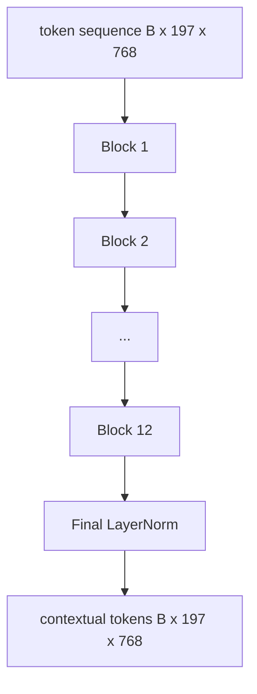
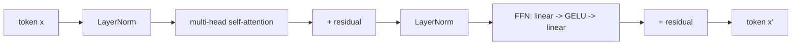

# 视觉 Transformer 编码器

> Patch 本身不会「看」。一个 12 层、12 个注意力头的 pre-LN Transformer 把 patch token 序列变成上下文 token 序列，CLS token 在最终隐藏状态中汇聚整图特征。这一课是每个现代视觉-语言模型的引擎室。

**Type:** Build
**Languages:** Python
**Prerequisites:** Phase 19 lessons 30-37 (Track B foundations)
**Time:** ~90 minutes

## 学习目标

- 实现带多头自注意力和前馈子层的 pre-LN Transformer 块。
- 堆叠 12 个块、12 个头，组成 ViT-Base 编码器。
- 把第 58 课的 patch 前端接入编码器并跑一次前向。
- 验证 CLS token 聚合了来自每个 patch 的信息。

## 问题

Patch embedding 产生 197 个 token 的序列，每个 token 都是不了解任何其他 patch 的向量。一张猫的图片需要每个 patch 知道哪些 patch 包含胡须、哪些是背景、哪些是眼睛。Transformer 就是逐个注意力层构建这种认知的机制。没有它，patch 前端只是一个聪明但无理解的分词器。

标准配方是 12 块深、12 头宽，pre-LayerNorm 放置、GELU 激活、4x 前馈扩展。该配方是 CLIP ViT-L、SigLIP、DINOv2、Qwen-VL 系列、InternVL 以及 2025-2026 年所有其他开放权重视觉编码器的骨干。配方足够稳定，你可以读那些论文中的任何一篇，并假定就是这种块形状，除非它们明确说明不同。

## 概念





### Pre-LN 与 post-LN

原始 Transformer 把 LayerNorm 放在残差之后。Pre-LN（在每个子层之前做 LayerNorm）是每个现代视觉-语言模型使用的版本，因为它不需要学习率 warm-up 技巧就能稳定训练。差别只是前向中的一行，但在 12 层以上的深度，梯度流是天壤之别。

### 多头自注意力

每个头把 token 向量投影成自己的 `(query, key, value)` 三元组，维度为 `head_dim = hidden / num_heads`。当 `hidden = 768`、`heads = 12` 时，每个头 `dim = 64`。12 个头并行做注意力，然后输出拼接回 768 维，再经过输出投影。多头的意义在于，一个头可以学习「关注猫眼」，另一个学习「关注背景渐变」，互不干扰。

### 为什么前馈层扩展 4 倍

FFN 走 `hidden -> 4 * hidden -> hidden`，中间是 GELU。因子 4 是经验值，自 2017 年以来在语言和视觉 Transformer 中都成立。更小（2x）会欠拟合；更大（8x）在固定数据预算下会过拟合。MLP 是模型存储大部分所学事实的地方，更宽的中间层就是它们所在的位置。

| 组件 | ViT-Base 规模下的参数 |
|-----------|------------------------------|
| 每块 qkv 投影 | `3 * 768 * 768 = 1.77M` |
| 每块输出投影 | `768 * 768 = 590K` |
| 每块 FFN（4x 扩展） | `2 * 768 * 4 * 768 = 4.72M` |
| 每块 LayerNorm | `4 * 768 = 3K` |
| 每块总计 | 约 7.1M |
| 12 个块 | 约 85M |
| 加上前端 | 总计约 86M |

ViT-Base 是一个 86M 参数的编码器。按 2026 年的标准算小（SigLIP-So400M 是 400M，Qwen-VL 的 ViT 是 675M），但除宽度和深度外，架构完全相同。

### 因果掩码还是不用？

视觉 Transformer 是纯编码器且双向：token `i` 可以关注任意 token `j`。没有掩码。第 61 课解码器侧的交叉注意力会使用因果掩码，但在视觉编码器内部，注意力是全连接的。

### CLS token 学到了什么

CLS token 初始化为可学习参数，自身没有 patch 内容，通过每个块的注意力累积信息。到最后一层，CLS 行就是整幅图像的向量摘要；下游头把这个单一向量投影成类别 logit、对比 embedding 或文本解码器的交叉注意力 key。

```figure
ch-cls-funnel
```

## 构建它

`code/main.py` 实现：

- `MultiHeadSelfAttention`，带 `qkv` 和输出投影、缩放点积注意力数学以及形状断言。
- `FeedForward`，4x 扩展的 GELU MLP。
- `Block`，组合注意力和前馈子层及残差的 pre-LN 块。
- `ViT`，12 个块的堆叠，末尾一个 LayerNorm。
- `VisionEncoder`，把第 58 课的 `VisionFrontEnd` 接到 `ViT` 堆叠，并提供返回上下文序列和池化 CLS 向量的 `forward()`。
- 一个 demo，把合成的 224x224 fixture 图像跑过完整编码器，打印输入形状、输出形状、参数数量以及每隔一层的 CLS 范数。

运行：

```bash
python3 code/main.py
```

输出：fixture 被编码为 `(1, 197, 768)` 张量。随着各层组合，CLS 范数向上漂移，然后在最终 LayerNorm 处稳定。参数总量报告为约 86M。

## 使用它

这里定义的编码器，除宽度和深度外，就是 2025-2026 年每个开放权重 VLM 内部搭载的同一个块堆叠。差异在于：

- **宽度与深度。** ViT-Large 是 `hidden=1024, depth=24, heads=16`；SigLIP So400M 是 `hidden=1152, depth=27, heads=16`。同样的块。
- **池化头。** CLS 池化（本课）vs 平均池化（SigLIP）vs 注意力池化（后来的 VLM）。
- **位置处理。** 固定正弦（第 58 课）vs 可学习 1D vs ALiBi vs 2D RoPE。块内数学不变。
- **Register token。** DINOv2 前置 4 个额外的可学习 token。一行代码。

这个块堆叠是基底。接下来的课程（60-63）都站在它之上。

## 测试

`code/test_main.py` 覆盖：

- 单个块保持形状，且对输入 batch 大小不变
- 注意力分数沿 key 轴求和为 1（softmax 健全性）
- 残差路径已接好（零输入仍通过 CLS token 产生非零输出）
- 4 层堆叠前向产生正确形状
- 梯度从 CLS 输出流向 patch 投影

运行：

```bash
python3 -m unittest code/test_main.py
```

## 练习

1. 加入 register token（在 CLS 之后前置 4 个可学习向量）并重跑。通过最后一层 softmax 分布的熵比较注意力图的平滑程度。

2. 把 pre-LN 换成 post-LN，在合成形状分类器上训练一个 epoch。观察哪一个无需 LR warm-up 就能稳定训练。

3. 把因果掩码实现为 `attn_mask` 参数，使同一个块可以作为解码器块复用。掩码形状为 `(seq, seq)`，下三角。

4. 用 `torch.profiler` 在 batch 大小 1、8、64 下 profile 一次前向。主导墙钟时间的是 MLP 层，不是注意力。

5. 把某一个注意力头的 q-k-v 投影换成低秩 LoRA adapter，冻结其余部分，验证梯度只在你预期的位置流动。

## 关键术语

| 术语 | 含义 |
|------|---------------|
| Pre-LN | 在每个子层之前而不是之后应用 LayerNorm |
| 自注意力 | 每个 token 关注同一序列中的其他所有 token |
| 多头 | 隐藏维度被拆分为 `H` 个独立的注意力头 |
| FFN 扩展 | 前馈层先加宽到 `4 * hidden` 再收窄 |
| CLS 池化 | 用第一个 token 的最终隐藏状态作为图像摘要 |

## 延伸阅读

- An Image is Worth 16x16 Words（ViT，2021），编码器配方。
- DINOv2（2023），register token 与自监督预训练目标。
- SigLIP（2023），平均池化变体与第 62 课使用的 sigmoid 对比损失。
